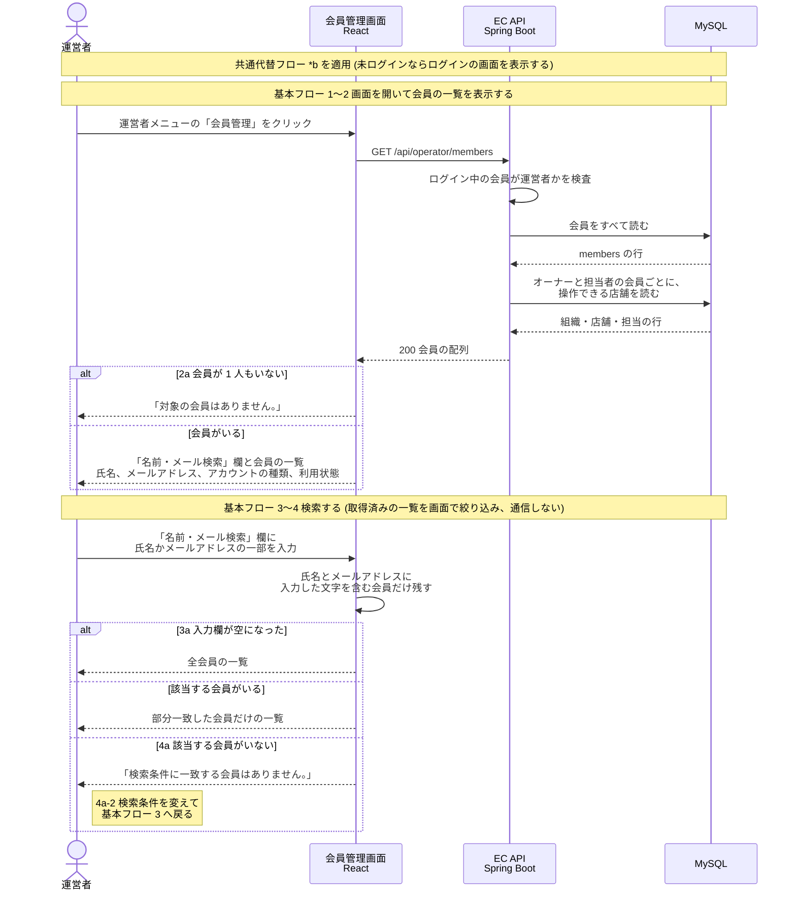
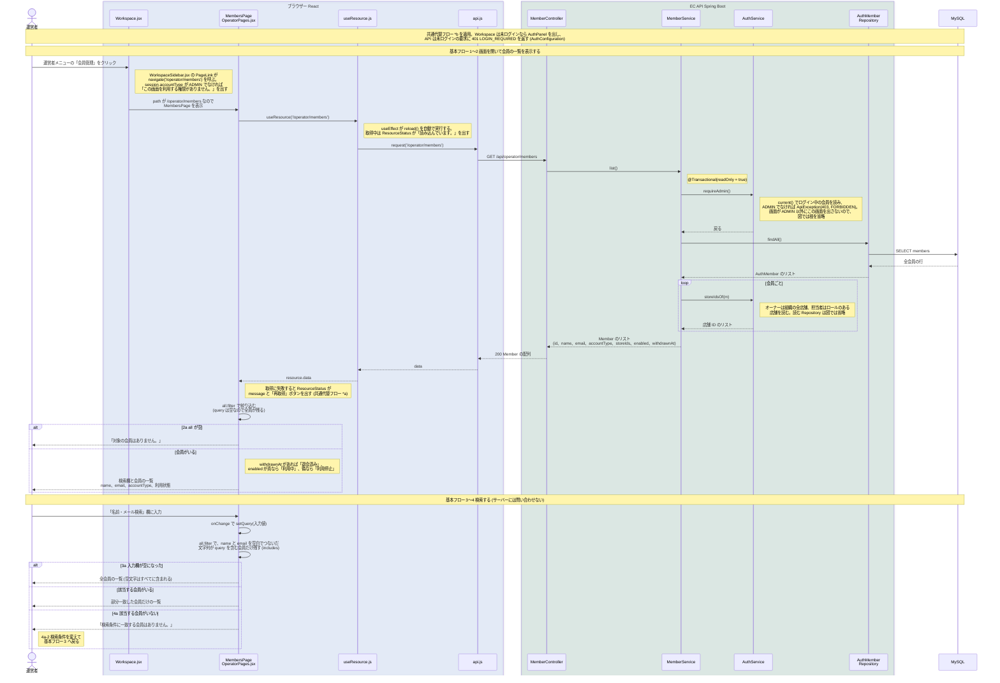

# EC-A01 会員を検索・確認する

- ユースケース記述: [EC-A01_会員を検索・確認する](<../../アーカイブ/ユースケース/kusakari-ec/EC-A01_会員を検索・確認する.md>)
- 対象のコード: kusakari-ec の main（19a2be3、2026-11-20 時点）

## 概要図

## 詳細図

## ユースケース記述との差

- 2a: 一覧は `members.findAll()` で運営者自身も含む全会員を返します。運営者がログインしている間は一覧が空にならないため、2a の「対象の会員はありません。」は通常の操作では出ません。
- 基本フロー 4: 絞り込みは JavaScript の `includes` です。大文字と小文字を区別し、入力の前後の空白も取り除きません。記述にはこの決まりが書かれていません。
- 基本フロー 2: サーバーは会員ごとに `AuthService.storeIdsOf()` を呼び、操作できる店舗の ID（`storeIds`）を応答に入れます。会員管理画面はこの値を使いません。記述にない処理です。

## 参照したコード

- [frontend/src/workspace/Workspace.jsx](https://github.com/abeouga/kusakari-ec/blob/19a2be307ee71a2cd87e538236c3c8c42929c5b3/frontend/src/workspace/Workspace.jsx): `operatorMenu`、`Workspace`（未ログインと ADMIN の確認、path と画面の対応）
- [frontend/src/workspace/WorkspaceSidebar.jsx](https://github.com/abeouga/kusakari-ec/blob/19a2be307ee71a2cd87e538236c3c8c42929c5b3/frontend/src/workspace/WorkspaceSidebar.jsx): `WorkspaceSidebar`、`MenuLink`
- [frontend/src/workspace/Common.jsx](https://github.com/abeouga/kusakari-ec/blob/19a2be307ee71a2cd87e538236c3c8c42929c5b3/frontend/src/workspace/Common.jsx): `PageLink`
- [frontend/src/workspace/navigation.js](https://github.com/abeouga/kusakari-ec/blob/19a2be307ee71a2cd87e538236c3c8c42929c5b3/frontend/src/workspace/navigation.js): `navigate`、`usePath`
- [frontend/src/workspace/OperatorPages.jsx](https://github.com/abeouga/kusakari-ec/blob/19a2be307ee71a2cd87e538236c3c8c42929c5b3/frontend/src/workspace/OperatorPages.jsx): `MembersPage`（`query`、`all.filter`、空の一覧の文言）
- [frontend/src/workspace/useResource.js](https://github.com/abeouga/kusakari-ec/blob/19a2be307ee71a2cd87e538236c3c8c42929c5b3/frontend/src/workspace/useResource.js): `useResource`、`reload`
- [frontend/src/workspace/ResourceView.jsx](https://github.com/abeouga/kusakari-ec/blob/19a2be307ee71a2cd87e538236c3c8c42929c5b3/frontend/src/workspace/ResourceView.jsx): `ResourceStatus`
- [frontend/src/api.js](https://github.com/abeouga/kusakari-ec/blob/19a2be307ee71a2cd87e538236c3c8c42929c5b3/frontend/src/api.js): `request`、`send`、`readResponse`
- [backend/src/main/java/jp/kusakari/ec/member/controller/MemberController.java](https://github.com/abeouga/kusakari-ec/blob/19a2be307ee71a2cd87e538236c3c8c42929c5b3/backend/src/main/java/jp/kusakari/ec/member/controller/MemberController.java): `list`
- [backend/src/main/java/jp/kusakari/ec/member/service/MemberService.java](https://github.com/abeouga/kusakari-ec/blob/19a2be307ee71a2cd87e538236c3c8c42929c5b3/backend/src/main/java/jp/kusakari/ec/member/service/MemberService.java): `list`、`Member`
- [backend/src/main/java/jp/kusakari/ec/auth/AuthService.java](https://github.com/abeouga/kusakari-ec/blob/19a2be307ee71a2cd87e538236c3c8c42929c5b3/backend/src/main/java/jp/kusakari/ec/auth/AuthService.java): `requireAdmin`、`current`、`storeIdsOf`
- [backend/src/main/java/jp/kusakari/ec/auth/AuthMemberRepository.java](https://github.com/abeouga/kusakari-ec/blob/19a2be307ee71a2cd87e538236c3c8c42929c5b3/backend/src/main/java/jp/kusakari/ec/auth/AuthMemberRepository.java): `findAll`（JpaRepository）
- [backend/src/main/java/jp/kusakari/ec/auth/AuthConfiguration.java](https://github.com/abeouga/kusakari-ec/blob/19a2be307ee71a2cd87e538236c3c8c42929c5b3/backend/src/main/java/jp/kusakari/ec/auth/AuthConfiguration.java): `authenticationEntryPoint`（401 LOGIN_REQUIRED）
