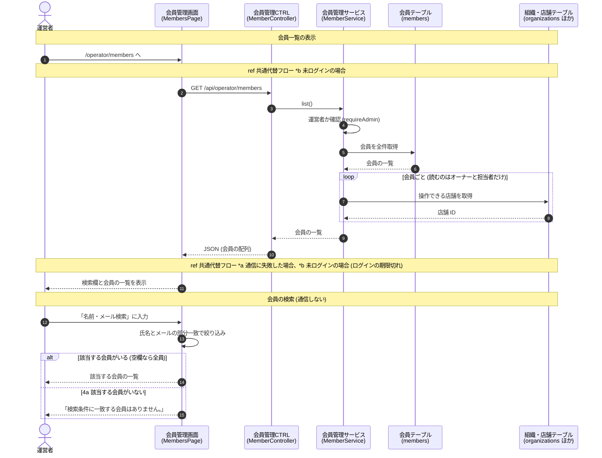
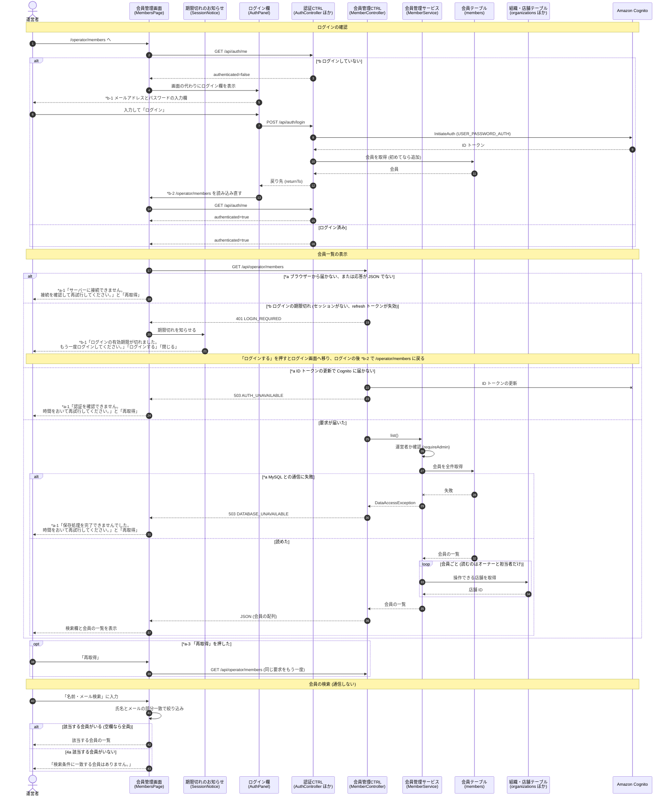

# EC-A01 会員を検索・確認する

- ユースケース記述: [EC-A01_会員を検索・確認する](<../../アーカイブ/ユースケース/kusakari-ec/EC-A01_会員を検索・確認する.md>)
- 共通代替フロー: [00_全ユースケース共通の代替フロー](<00_全ユースケース共通の代替フロー.md>)
- 対象のコード: kusakari-ec の main（6bad7e3、2026-11-24 時点）

## シーケンス図

`ref` の行は、そこで共通代替フローが起こりうることを示します。中身は 00 の図か、下の「共通代替フローを直接書いた図」を見てください。

## 共通代替フローを直接書いた図

上の図の `ref` の行に、この画面で起こる共通代替フロー（\*a、\*b）を書き込んだ図です。会員の検索は通信しないので、共通代替フローは起こりません。

## ユースケース記述との差

- 2a（会員が 1 人もいない）は図に書いていません。一覧は `members.findAll()` で、ログイン中の運営者本人も含む全会員を返します。運営者がログインしている間は一覧が空にならないので、2a は起こりません。コードには `all.length === 0` のときの「対象の会員はありません。」の表示が残っています。
- 3a（入力欄が空になった）は、分岐ではなく基本フロー 4 の中に書いています。空の入力に別の処理はなく、`includes('')` がすべての会員で真になるので、同じ絞り込みで全員が残ります。
- 基本フロー 4: 絞り込みは JavaScript の `includes` です。大文字と小文字を区別し、入力の前後の空白も取り除きません。記述にはこの決まりが書かれていません。
- 基本フロー 2: サーバーは会員ごとに `AuthService.storeIdsOf()` を呼び、操作できる店舗の ID（`storeIds`）を応答に入れます。会員管理画面はこの値を使いません。記述にない処理です。
- 運営者でない会員がこの画面を開くと、`Workspace.jsx` が「この画面を利用する権限がありません。」を出し、一覧を取りに行きません。API も `requireAdmin()` で 403 を返します。事前条件が運営者のログインなので、図には書いていません。

## 参照したコード

- [frontend/src/workspace/Workspace.jsx](https://github.com/abeouga/kusakari-ec/blob/6bad7e37c4135034fbe97e30309772fbe872e675/frontend/src/workspace/Workspace.jsx): `Workspace`（未ログインのときの `AuthPanel`、運営者の確認、path と画面の対応）
- [frontend/src/workspace/OperatorPages.jsx](https://github.com/abeouga/kusakari-ec/blob/6bad7e37c4135034fbe97e30309772fbe872e675/frontend/src/workspace/OperatorPages.jsx): `MembersPage`（`query`、`all.filter`、一覧が空のときの文言）
- [frontend/src/workspace/useResource.js](https://github.com/abeouga/kusakari-ec/blob/6bad7e37c4135034fbe97e30309772fbe872e675/frontend/src/workspace/useResource.js): `useResource`、`reload`
- [frontend/src/workspace/ResourceView.jsx](https://github.com/abeouga/kusakari-ec/blob/6bad7e37c4135034fbe97e30309772fbe872e675/frontend/src/workspace/ResourceView.jsx): `ResourceStatus`（エラーの文と「再取得」）
- [frontend/src/api.js](https://github.com/abeouga/kusakari-ec/blob/6bad7e37c4135034fbe97e30309772fbe872e675/frontend/src/api.js): `networkErrorMessage`、`sessionExpiredMessage`、`readResponse`、`send`
- [frontend/src/auth.js](https://github.com/abeouga/kusakari-ec/blob/6bad7e37c4135034fbe97e30309772fbe872e675/frontend/src/auth.js): `readSession`、`passwordLogin`、`wasSignedIn`
- [frontend/src/components/AuthPanel.jsx](https://github.com/abeouga/kusakari-ec/blob/6bad7e37c4135034fbe97e30309772fbe872e675/frontend/src/components/AuthPanel.jsx): ログイン欄
- [frontend/src/components/SessionNotice.jsx](https://github.com/abeouga/kusakari-ec/blob/6bad7e37c4135034fbe97e30309772fbe872e675/frontend/src/components/SessionNotice.jsx): 期限切れのお知らせ
- [backend/src/main/java/jp/kusakari/ec/member/controller/MemberController.java](https://github.com/abeouga/kusakari-ec/blob/6bad7e37c4135034fbe97e30309772fbe872e675/backend/src/main/java/jp/kusakari/ec/member/controller/MemberController.java): `list`
- [backend/src/main/java/jp/kusakari/ec/member/service/MemberService.java](https://github.com/abeouga/kusakari-ec/blob/6bad7e37c4135034fbe97e30309772fbe872e675/backend/src/main/java/jp/kusakari/ec/member/service/MemberService.java): `list`、`Member`
- [backend/src/main/java/jp/kusakari/ec/auth/AuthService.java](https://github.com/abeouga/kusakari-ec/blob/6bad7e37c4135034fbe97e30309772fbe872e675/backend/src/main/java/jp/kusakari/ec/auth/AuthService.java): `requireAdmin`、`storeIdsOf`、`session`
- [backend/src/main/java/jp/kusakari/ec/auth/AuthController.java](https://github.com/abeouga/kusakari-ec/blob/6bad7e37c4135034fbe97e30309772fbe872e675/backend/src/main/java/jp/kusakari/ec/auth/AuthController.java): `GET /api/auth/me`
- [backend/src/main/java/jp/kusakari/ec/auth/PasswordLoginController.java](https://github.com/abeouga/kusakari-ec/blob/6bad7e37c4135034fbe97e30309772fbe872e675/backend/src/main/java/jp/kusakari/ec/auth/PasswordLoginController.java): `POST /api/auth/login`
- [backend/src/main/java/jp/kusakari/ec/auth/SessionValidityFilter.java](https://github.com/abeouga/kusakari-ec/blob/6bad7e37c4135034fbe97e30309772fbe872e675/backend/src/main/java/jp/kusakari/ec/auth/SessionValidityFilter.java): ID トークンの更新、401 `LOGIN_REQUIRED`
- [backend/src/main/java/jp/kusakari/ec/auth/CognitoPasswordLogin.java](https://github.com/abeouga/kusakari-ec/blob/6bad7e37c4135034fbe97e30309772fbe872e675/backend/src/main/java/jp/kusakari/ec/auth/CognitoPasswordLogin.java): 503 `AUTH_UNAVAILABLE`
- [backend/src/main/java/jp/kusakari/ec/common/web/ApiErrors.java](https://github.com/abeouga/kusakari-ec/blob/6bad7e37c4135034fbe97e30309772fbe872e675/backend/src/main/java/jp/kusakari/ec/common/web/ApiErrors.java): `database`（503 `DATABASE_UNAVAILABLE`）
