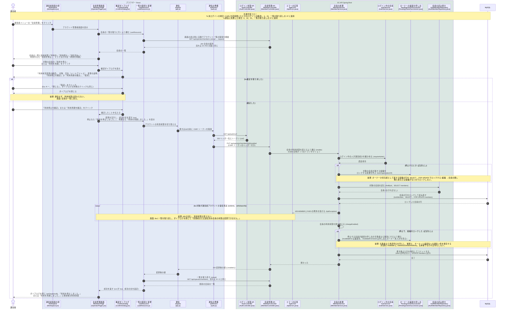
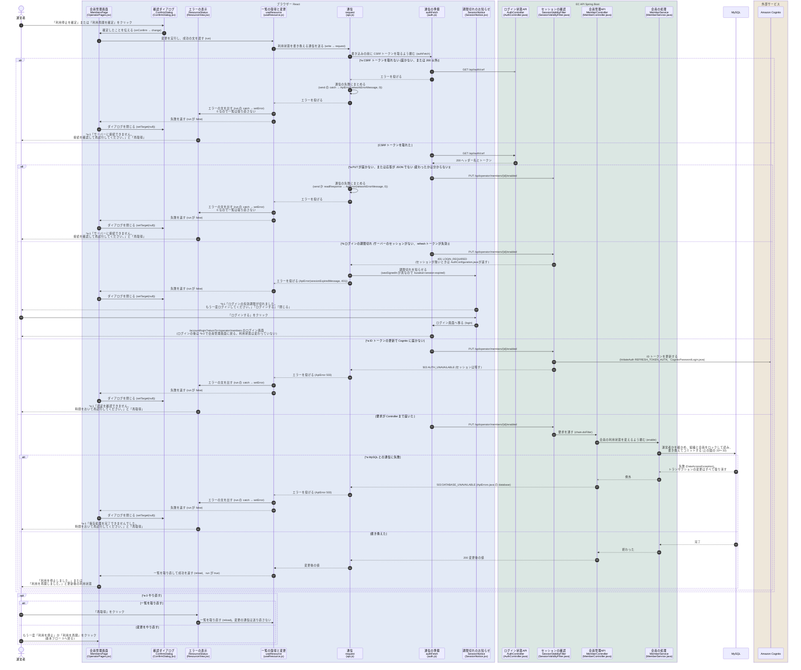

# EC-A02 アカウントの利用状況を変更する

- ユースケース記述: [EC-A02_アカウントの利用状況を変更する](<../../アーカイブ/ユースケース/kusakari-ec/EC-A02_アカウントの利用状況を変更する.md>)
- 共通代替フロー: [00_全ユースケース共通の代替フロー](<00_全ユースケース共通の代替フロー.md>)
- 対象のコード: kusakari-ec の main（6bad7e3、2026-11-24 時点）

## シーケンス図

参加者は、上から「画面や役割の名前」「コンポーネント・クラスの名前」「ファイル名（かっこ付き）」の順に書いています。
共通代替フローの中身は、00 の図か、下の「共通代替フローを直接書いた図」を見てください。
エラーは最重要の 6a（対象が運営者か退会済み）だけを描き、ほかの代替フローは図の下に並べています。6a のときの画面の後処理（`readResponse` が `ApiError` を投げる → 409 なので `reload` で一覧を取り直す → `run` が false → `setTarget(null)` でダイアログを閉じる → エラーの文を出す）は、Note に文で書いています。

図に描いていない代替フロー：（記述なし）の分岐（会員がいない）

## 共通代替フローを直接書いた図

上の図の確定の通信（CSRF トークンの取得と `PUT /api/operator/members/{id}/enabled`）に、この画面で起こる共通代替フロー（\*a、\*b）を書き込んだ図です。画面を開いて一覧を取る通信の \*a・\*b は、[EC-A01](<EC-A01_会員を検索・確認する.md>) の「共通代替フローを直接書いた図」と同じなので省いています。

## ユースケース記述との差

- 関連情報「対象者への通知は送らない」: 停止する会員が、オーナーの譲渡の承認待ちの当事者（譲渡先か、申し出たオーナー本人）なら、同じトランザクションで申し出を無効にします。`organization_member_events` に記録し、オーナーと譲渡先の両方へ「オーナーの譲渡の申し出が無効になりました」の通知を保存します（`PendingOwnerSuccession`、`OwnerSuccessionNotices`）。このときは停止した本人あてにも通知が残ります。記述にない処理です。
- 基本フロー 6: 停止するときは、会員の行より先に、会員が属する組織の行をロックします（「組織 → 会員」の順）。記述にない処理です。
- 対象の会員が見つからないときは 404 `MEMBER_NOT_FOUND`「会員が見つかりません。」を返し、画面は一覧を取り直します。記述にない分岐です。
- 6a: 画面は、運営者と退会済みの会員にもボタンを出し、確認ダイアログも開きます（ボタンを無効にしない）。止めるのは確定の後のサーバーの 409 です。
- 5a: 記述は「取消」ボタンだけです。コードでは Esc キー、ダイアログの「閉じる」ボタン、ダイアログの外側のクリックでも、`onCancel` を呼んで同じように閉じます（`Dialog.jsx`、`ConfirmDialog.jsx`）。通信中（`busy`）は閉じません。
- 確定の後は、成功しても失敗しても `setTarget(null)` でダイアログを閉じます。共通代替フローで失敗したときも、ダイアログは閉じて一覧の上にエラーの文が出ます。\*a-3 の「再取得」は一覧を取り直すだけで、変更の通信は送り直しません。やり直すには、もう一度ボタンから確定します。
- CSRF トークンを取れないとき、`authFetch` は「操作の確認情報を取得できません。画面を再読み込みしてください。」のエラーを投げますが、`api.js` の `send()` がすべての例外を「サーバーに接続できません。…」に置き換えるので、この文は画面に出ません。
- 関連情報「利用停止中のアカウントはログインできない」: ログイン中の会員を停止すると、その会員の次の要求で `SessionValidityFilter` が `AuthService.current()` の 403 `ACCOUNT_DISABLED`「このアカウントは利用できません。」を返し、セッションを無効にします。ログイン中のセッションも止まることは記述にありません。
- 運営者でない会員がこの画面を開くと、`Workspace.jsx` が「この画面を利用する権限がありません。」を出します。API も `requireAdmin()` で 403 `FORBIDDEN` を返します。事前条件が運営者のログインなので、図には書いていません。

## 参照したコード

- [frontend/src/workspace/Workspace.jsx](https://github.com/abeouga/kusakari-ec/blob/6bad7e37c4135034fbe97e30309772fbe872e675/frontend/src/workspace/Workspace.jsx): `operatorMenu`、`Workspace`（未ログインと ADMIN の確認、path と画面の対応）
- [frontend/src/workspace/WorkspaceSidebar.jsx](https://github.com/abeouga/kusakari-ec/blob/6bad7e37c4135034fbe97e30309772fbe872e675/frontend/src/workspace/WorkspaceSidebar.jsx): `MenuLink`
- [frontend/src/workspace/Common.jsx](https://github.com/abeouga/kusakari-ec/blob/6bad7e37c4135034fbe97e30309772fbe872e675/frontend/src/workspace/Common.jsx): `PageLink`
- [frontend/src/workspace/OperatorPages.jsx](https://github.com/abeouga/kusakari-ec/blob/6bad7e37c4135034fbe97e30309772fbe872e675/frontend/src/workspace/OperatorPages.jsx): `MembersPage`（`setTarget`、`change`、ダイアログの文言）
- [frontend/src/components/ConfirmDialog.jsx](https://github.com/abeouga/kusakari-ec/blob/6bad7e37c4135034fbe97e30309772fbe872e675/frontend/src/components/ConfirmDialog.jsx): `ConfirmDialog`（`onConfirm`、`onCancel`、`busy`）
- [frontend/src/components/Dialog.jsx](https://github.com/abeouga/kusakari-ec/blob/6bad7e37c4135034fbe97e30309772fbe872e675/frontend/src/components/Dialog.jsx): `Dialog`（Esc キー、外側のクリック、「閉じる」）
- [frontend/src/workspace/useResource.js](https://github.com/abeouga/kusakari-ec/blob/6bad7e37c4135034fbe97e30309772fbe872e675/frontend/src/workspace/useResource.js): `useResource`、`reload`、`run`、`write`
- [frontend/src/workspace/ResourceView.jsx](https://github.com/abeouga/kusakari-ec/blob/6bad7e37c4135034fbe97e30309772fbe872e675/frontend/src/workspace/ResourceView.jsx): `ResourceStatus`（エラーの文と「再取得」）
- [frontend/src/api.js](https://github.com/abeouga/kusakari-ec/blob/6bad7e37c4135034fbe97e30309772fbe872e675/frontend/src/api.js): `request`、`send`、`readResponse`、`ApiError`、`networkErrorMessage`、`sessionExpiredMessage`
- [frontend/src/auth.js](https://github.com/abeouga/kusakari-ec/blob/6bad7e37c4135034fbe97e30309772fbe872e675/frontend/src/auth.js): `authFetch`（`GET /api/auth/csrf`）、`wasSignedIn`、`login`
- [frontend/src/components/SessionNotice.jsx](https://github.com/abeouga/kusakari-ec/blob/6bad7e37c4135034fbe97e30309772fbe872e675/frontend/src/components/SessionNotice.jsx): 期限切れのお知らせ
- [backend/src/main/java/jp/kusakari/ec/auth/AuthController.java](https://github.com/abeouga/kusakari-ec/blob/6bad7e37c4135034fbe97e30309772fbe872e675/backend/src/main/java/jp/kusakari/ec/auth/AuthController.java): `csrf`
- [backend/src/main/java/jp/kusakari/ec/member/controller/MemberController.java](https://github.com/abeouga/kusakari-ec/blob/6bad7e37c4135034fbe97e30309772fbe872e675/backend/src/main/java/jp/kusakari/ec/member/controller/MemberController.java): `list`、`enabled`、`EnabledRequest`
- [backend/src/main/java/jp/kusakari/ec/member/service/MemberService.java](https://github.com/abeouga/kusakari-ec/blob/6bad7e37c4135034fbe97e30309772fbe872e675/backend/src/main/java/jp/kusakari/ec/member/service/MemberService.java): `list`、`enable`、`lockMember`
- [backend/src/main/java/jp/kusakari/ec/store/service/PendingOwnerSuccession.java](https://github.com/abeouga/kusakari-ec/blob/6bad7e37c4135034fbe97e30309772fbe872e675/backend/src/main/java/jp/kusakari/ec/store/service/PendingOwnerSuccession.java): `lockOrganizationOf`、`lock`、`invalidateFor`、`invalidateForOwner`、`invalidate`
- [backend/src/main/java/jp/kusakari/ec/store/service/OwnerSuccessionNotices.java](https://github.com/abeouga/kusakari-ec/blob/6bad7e37c4135034fbe97e30309772fbe872e675/backend/src/main/java/jp/kusakari/ec/store/service/OwnerSuccessionNotices.java): `invalidated`
- [backend/src/main/java/jp/kusakari/ec/auth/AuthService.java](https://github.com/abeouga/kusakari-ec/blob/6bad7e37c4135034fbe97e30309772fbe872e675/backend/src/main/java/jp/kusakari/ec/auth/AuthService.java): `requireAdmin`、`current`（`ACCOUNT_DISABLED`）
- [backend/src/main/java/jp/kusakari/ec/auth/AuthMember.java](https://github.com/abeouga/kusakari-ec/blob/6bad7e37c4135034fbe97e30309772fbe872e675/backend/src/main/java/jp/kusakari/ec/auth/AuthMember.java): `changeEnabled`、`isAdmin`
- [backend/src/main/java/jp/kusakari/ec/auth/AuthMemberRepository.java](https://github.com/abeouga/kusakari-ec/blob/6bad7e37c4135034fbe97e30309772fbe872e675/backend/src/main/java/jp/kusakari/ec/auth/AuthMemberRepository.java): `findById`（JpaRepository）
- [backend/src/main/java/jp/kusakari/ec/auth/SessionValidityFilter.java](https://github.com/abeouga/kusakari-ec/blob/6bad7e37c4135034fbe97e30309772fbe872e675/backend/src/main/java/jp/kusakari/ec/auth/SessionValidityFilter.java): `doFilterInternal`（ID トークンの更新、401、停止した会員のセッションの無効化）
- [backend/src/main/java/jp/kusakari/ec/auth/CognitoPasswordLogin.java](https://github.com/abeouga/kusakari-ec/blob/6bad7e37c4135034fbe97e30309772fbe872e675/backend/src/main/java/jp/kusakari/ec/auth/CognitoPasswordLogin.java): ID トークンの更新、503 `AUTH_UNAVAILABLE`
- [backend/src/main/java/jp/kusakari/ec/auth/AuthConfiguration.java](https://github.com/abeouga/kusakari-ec/blob/6bad7e37c4135034fbe97e30309772fbe872e675/backend/src/main/java/jp/kusakari/ec/auth/AuthConfiguration.java): `authenticationEntryPoint`（401 `LOGIN_REQUIRED`）
- [backend/src/main/java/jp/kusakari/ec/common/web/ApiErrors.java](https://github.com/abeouga/kusakari-ec/blob/6bad7e37c4135034fbe97e30309772fbe872e675/backend/src/main/java/jp/kusakari/ec/common/web/ApiErrors.java): `business`、`database`
