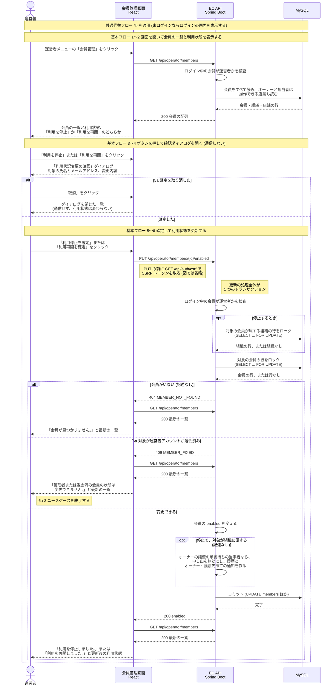
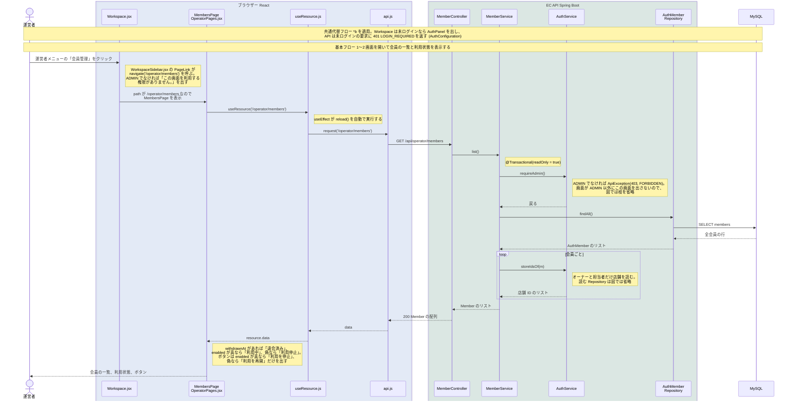
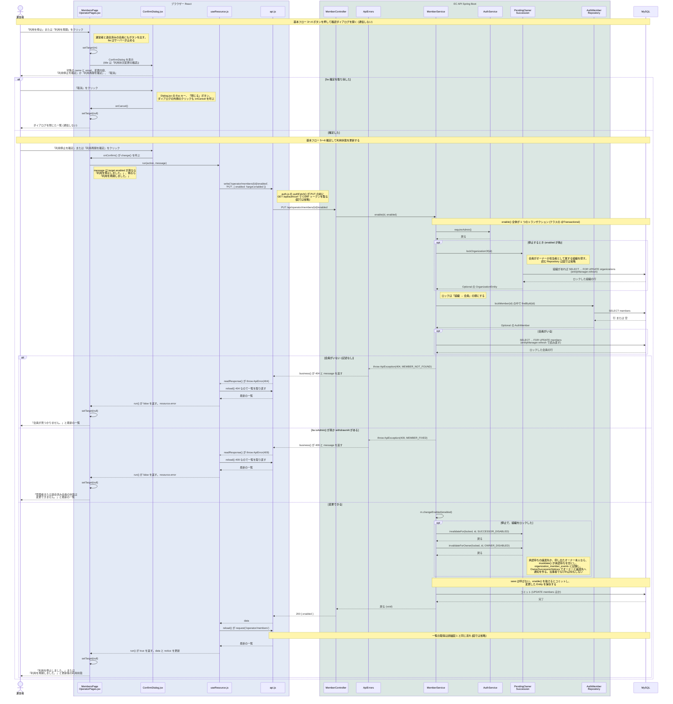

# EC-A02 アカウントの利用状況を変更する

- ユースケース記述: [EC-A02_アカウントの利用状況を変更する](<../../アーカイブ/ユースケース/kusakari-ec/EC-A02_アカウントの利用状況を変更する.md>)
- 対象のコード: kusakari-ec の main（19a2be3、2026-11-20 時点）

## 概要図

## 詳細図 1 基本フロー 1〜2

## 詳細図 2 基本フロー 3〜6

## ユースケース記述との差

- 関連情報「対象者への通知は送らない」: 停止する会員が、オーナーの譲渡の承認待ちの当事者（譲渡先か、申し出たオーナー本人）なら、同じトランザクションで申し出を無効にします。`organization_member_events` に記録し、オーナーと譲渡先の両方へ「オーナーの譲渡の申し出が無効になりました」の通知を保存します（`PendingOwnerSuccession`、`OwnerSuccessionNotices`）。このときは停止した本人あてにも通知が残ります。記述にない処理です。
- 基本フロー 6: 停止するときは、会員の行より先に、会員が属する組織の行をロックします（「組織 → 会員」の順）。記述にない処理です。
- 対象の会員が見つからないときは 404 `MEMBER_NOT_FOUND`「会員が見つかりません。」を返し、画面は一覧を取り直します。記述にない分岐です。
- 5a: 記述は「取消」ボタンだけです。コードでは Esc キー、ダイアログの「閉じる」ボタン、ダイアログの外側のクリックでも、`onCancel` を呼んで同じように閉じます（`Dialog.jsx`、`ConfirmDialog.jsx`）。
- 関連情報「利用停止中のアカウントはログインできない」: ログイン中の会員を停止すると、その会員の次の要求で `SessionValidityFilter` が `AuthService.current()` の 403 `ACCOUNT_DISABLED` を返し、セッションを無効にします。ログイン中のセッションも止まることは記述にありません。

## 参照したコード

- [frontend/src/workspace/Workspace.jsx](https://github.com/abeouga/kusakari-ec/blob/19a2be307ee71a2cd87e538236c3c8c42929c5b3/frontend/src/workspace/Workspace.jsx): `operatorMenu`、`Workspace`（未ログインと ADMIN の確認、path と画面の対応）
- [frontend/src/workspace/WorkspaceSidebar.jsx](https://github.com/abeouga/kusakari-ec/blob/19a2be307ee71a2cd87e538236c3c8c42929c5b3/frontend/src/workspace/WorkspaceSidebar.jsx): `MenuLink`
- [frontend/src/workspace/Common.jsx](https://github.com/abeouga/kusakari-ec/blob/19a2be307ee71a2cd87e538236c3c8c42929c5b3/frontend/src/workspace/Common.jsx): `PageLink`
- [frontend/src/workspace/OperatorPages.jsx](https://github.com/abeouga/kusakari-ec/blob/19a2be307ee71a2cd87e538236c3c8c42929c5b3/frontend/src/workspace/OperatorPages.jsx): `MembersPage`（`setTarget`、`change`、ダイアログの文言）
- [frontend/src/components/ConfirmDialog.jsx](https://github.com/abeouga/kusakari-ec/blob/19a2be307ee71a2cd87e538236c3c8c42929c5b3/frontend/src/components/ConfirmDialog.jsx): `ConfirmDialog`（`onConfirm`、`onCancel`）
- [frontend/src/components/Dialog.jsx](https://github.com/abeouga/kusakari-ec/blob/19a2be307ee71a2cd87e538236c3c8c42929c5b3/frontend/src/components/Dialog.jsx): `Dialog`（`onCancel`、外側のクリック、「閉じる」）
- [frontend/src/workspace/useResource.js](https://github.com/abeouga/kusakari-ec/blob/19a2be307ee71a2cd87e538236c3c8c42929c5b3/frontend/src/workspace/useResource.js): `useResource`、`reload`、`run`、`write`
- [frontend/src/api.js](https://github.com/abeouga/kusakari-ec/blob/19a2be307ee71a2cd87e538236c3c8c42929c5b3/frontend/src/api.js): `request`、`send`、`readResponse`、`ApiError`
- [frontend/src/auth.js](https://github.com/abeouga/kusakari-ec/blob/19a2be307ee71a2cd87e538236c3c8c42929c5b3/frontend/src/auth.js): `authFetch`（`GET /api/auth/csrf`）
- [backend/src/main/java/jp/kusakari/ec/member/controller/MemberController.java](https://github.com/abeouga/kusakari-ec/blob/19a2be307ee71a2cd87e538236c3c8c42929c5b3/backend/src/main/java/jp/kusakari/ec/member/controller/MemberController.java): `list`、`enabled`、`EnabledRequest`
- [backend/src/main/java/jp/kusakari/ec/member/service/MemberService.java](https://github.com/abeouga/kusakari-ec/blob/19a2be307ee71a2cd87e538236c3c8c42929c5b3/backend/src/main/java/jp/kusakari/ec/member/service/MemberService.java): `list`、`enable`、`lockMember`
- [backend/src/main/java/jp/kusakari/ec/store/service/PendingOwnerSuccession.java](https://github.com/abeouga/kusakari-ec/blob/19a2be307ee71a2cd87e538236c3c8c42929c5b3/backend/src/main/java/jp/kusakari/ec/store/service/PendingOwnerSuccession.java): `lockOrganizationOf`、`lock`、`invalidateFor`、`invalidateForOwner`、`invalidate`
- [backend/src/main/java/jp/kusakari/ec/store/service/OwnerSuccessionNotices.java](https://github.com/abeouga/kusakari-ec/blob/19a2be307ee71a2cd87e538236c3c8c42929c5b3/backend/src/main/java/jp/kusakari/ec/store/service/OwnerSuccessionNotices.java): `invalidated`
- [backend/src/main/java/jp/kusakari/ec/auth/AuthService.java](https://github.com/abeouga/kusakari-ec/blob/19a2be307ee71a2cd87e538236c3c8c42929c5b3/backend/src/main/java/jp/kusakari/ec/auth/AuthService.java): `requireAdmin`、`current`、`storeIdsOf`
- [backend/src/main/java/jp/kusakari/ec/auth/AuthMember.java](https://github.com/abeouga/kusakari-ec/blob/19a2be307ee71a2cd87e538236c3c8c42929c5b3/backend/src/main/java/jp/kusakari/ec/auth/AuthMember.java): `changeEnabled`、`isAdmin`、`withdraw`
- [backend/src/main/java/jp/kusakari/ec/auth/AuthMemberRepository.java](https://github.com/abeouga/kusakari-ec/blob/19a2be307ee71a2cd87e538236c3c8c42929c5b3/backend/src/main/java/jp/kusakari/ec/auth/AuthMemberRepository.java): `findAll`、`findById`（JpaRepository）
- [backend/src/main/java/jp/kusakari/ec/auth/SessionValidityFilter.java](https://github.com/abeouga/kusakari-ec/blob/19a2be307ee71a2cd87e538236c3c8c42929c5b3/backend/src/main/java/jp/kusakari/ec/auth/SessionValidityFilter.java): `doFilterInternal`
- [backend/src/main/java/jp/kusakari/ec/common/web/ApiErrors.java](https://github.com/abeouga/kusakari-ec/blob/19a2be307ee71a2cd87e538236c3c8c42929c5b3/backend/src/main/java/jp/kusakari/ec/common/web/ApiErrors.java): `business`
