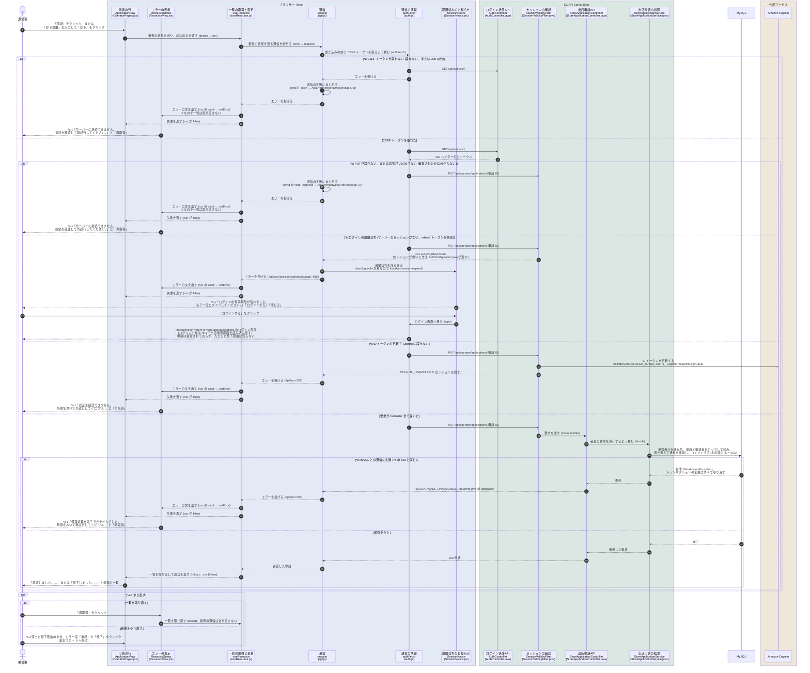

# EC-A03 出店申請を審査する

- ユースケース記述: [EC-A03_出店申請を審査する](<../../アーカイブ/ユースケース/kusakari-ec/EC-A03_出店申請を審査する.md>)
- 共通代替フロー: [00_全ユースケース共通の代替フロー](<00_全ユースケース共通の代替フロー.md>)
- 対象のコード: kusakari-ec の main（6bad7e3、2026-11-24 時点）

## シーケンス図

参加者は、上から「画面や役割の名前」「コンポーネント・クラスの名前」「ファイル名（かっこ付き）」の順に書いています。
共通代替フローの中身は、00 の図か、下の「共通代替フローを直接書いた図」を見てください。

```mermaid
sequenceDiagram
    autonumber
    actor User as 運営者
    box rgba(47,111,219,0.10) ブラウザー React
        participant Work as 運営者画面の枠<br/>Workspace<br/>(Workspace.jsx)
        participant Page as 出店審査画面<br/>ReviewPage<br/>(OperatorPages.jsx)
        participant Row as 申請の行<br/>ApplicationRow<br/>(OperatorPages.jsx)
        participant Hook as 一覧の取得と変更<br/>useResource<br/>(useResource.js)
        participant Http as 通信<br/>request<br/>(api.js)
        participant AuthJs as 通信の準備<br/>authFetch<br/>(auth.js)
    end
    box rgba(27,127,92,0.12) EC API Spring Boot
        participant AuthCtrl as ログイン状態API<br/>AuthController<br/>(AuthController.java)
        participant Ctrl as 出店申請API<br/>StoreApplicationController<br/>(StoreApplicationController.java)
        participant Errs as エラーの応答<br/>ApiErrors<br/>(ApiErrors.java)
        participant Svc as 出店申請の処理<br/>StoreApplicationService<br/>(StoreApplicationService.java)
        participant Auth as ログイン中の会員<br/>AuthService<br/>(AuthService.java)
        participant AppRepo as 出店申請の読み書き<br/>StoreApplicationRepository<br/>(StoreApplicationRepository.java)
        participant MemRepo as 会員の読み書き<br/>AuthMemberRepository<br/>(AuthMemberRepository.java)
        participant OrgRepo as 組織の読み書き<br/>OrganizationRepository<br/>(OrganizationRepository.java)
        participant Notices as サイト内通知<br/>NotificationService<br/>(NotificationService.java)
    end
    participant Db as MySQL

    Note over User,Db: 共通代替フロー<br/>*b 未ログインの場合: 2 (URL を直接開いたときのログインの確認)、5、43、45、一覧の取り直しの 56・63・74・83・107 に適用<br/>*a 通信に失敗した場合: 5、43、45、一覧の取り直しの 56・63・74・83・107 に適用

    User->>Work: 運営者メニューの「出店審査」をクリック
    Work->>Page: URL を /operator/applications に変え、<br/>ReviewPage を表示
    Page->>Hook: 出店申請の一覧を取りに行くよう頼む (useResource)
    Hook->>Http: 画面を開いたときに自動で<br/>一覧の通信を始める (reload → request)
    Http->>Ctrl: GET /api/operator/applications
    Ctrl->>Svc: 運営者向けの申請の一覧を作るよう頼む<br/>(all → list(true))。全体が読むだけのトランザクション
    Svc->>Auth: ログイン中の人が運営者かを確かめる (requireAdmin)
    Auth-->>Svc: 運営者である
    Svc->>AppRepo: 全申請を新しい順に読むよう頼む (findAllByOrderByCreatedAtDesc)
    AppRepo->>Db: SELECT organization_applications
    Db-->>AppRepo: 全申請の行 (申請者ごとの「前回の申請」の行も含む)
    AppRepo-->>Svc: 申請のリスト
    Svc-->>Ctrl: 申請のリスト (view。提出書類のデータは入れず、ファイル名だけ)
    Ctrl-->>Http: 200 申請の配列
    Http-->>Hook: 申請の一覧
    Hook-->>Page: 申請の一覧
    Page->>Page: 「表示する申請」は最初「審査中」なので、審査中の申請だけ残し、<br/>申請日の古い順に並べる (scope、filter、reviewOrder)
    alt 3a 審査中の申請がない
        Page-->>User: 3a-1「審査待ちの出店申請はありません。」
    else 審査中の申請がある
        loop 申請ごと
            Page->>Row: 申請の行を表示 (ApplicationRow)
            Row-->>User: 会社名、「申請者：名前 / 申請日：日付」、メール / 所在地 / 電話番号、<br/>状態 (applicationLabels で「審査中」)、「提出書類を確認」、<br/>「却下理由」欄、「承認」「却下」
        end
    end
    opt 3b 審査済みの申請も確認する
        User->>Page: 3b-1「表示する申請」で「すべて」を選ぶ
        Page->>Page: 選んだ値を覚え (setScope('ALL'))、審査中を古い順に先に、<br/>審査済みを新しい順に後に並べる (reviewOrder)。通信しない
        Page-->>User: 3b-2 審査済みの行は状態 (「承認」「却下」「取り下げ済み」) と却下理由を出し、<br/>「却下理由」欄と「承認」「却下」を出さない<br/>(申請が 1 件もなければ「出店申請はありません。」)
    end

    User->>Row: 審査する申請の「提出書類を確認」をクリック
    Row->>Ctrl: GET /api/account/store-applications/{申請 ID}/document<br/>(a 要素のリンク。api.js を通らず、ブラウザーが Cookie を付けて送る)
    Ctrl->>Svc: 提出書類を読むよう頼む (file → document)<br/>全体が読むだけのトランザクション
    Svc->>AppRepo: 申請を読むよう頼む (findById)
    AppRepo->>Db: SELECT organization_applications
    Db-->>AppRepo: 申請の行 (提出書類のデータを含む)
    AppRepo-->>Svc: 申請
    Svc->>Auth: ログイン中の会員を読む (current)
    Auth-->>Svc: 運営者 (isAdmin が真なので、申請者本人でなくても読める)
    Svc-->>Ctrl: 提出書類 (ファイル名、種類、データ)
    Ctrl-->>Row: 200 提出書類 (Content-Disposition は attachment、<br/>X-Content-Type-Options は nosniff、Cache-Control は no-store)
    Row-->>User: ブラウザーが提出書類のファイルを端末に保存する

    User->>Row: 「承認」をクリック、または<br/>「却下理由」を入力して「却下」をクリック
    Row->>Row: 承認か却下かを受け取る (decide)
    alt 6a 却下で、却下理由が空 (reason.trim() が空)
        Row-->>User: 6a-1「却下する場合は却下理由を入力してください。」<br/>(setMissing(true)。通信せず、状態は変わらない)
        User->>Row: 6a-2 却下理由を入力し直す (基本フロー 6 へ戻る)
    else 送る
        Row->>Hook: 審査の結果を送り、成功の文を渡す (run)<br/>承認なら「承認しました。申請者に審査結果を通知しました。」、<br/>却下なら「却下しました。申請者に却下理由を通知しました。」
        Hook->>Http: 審査の結果を送る通信を始める<br/>(write → request、本文は { approved, reason })
        Http->>AuthJs: 書き込みの前に CSRF トークンを取るよう頼む (authFetch)
        AuthJs->>AuthCtrl: GET /api/auth/csrf
        AuthCtrl-->>AuthJs: 200 ヘッダー名とトークン (csrf)
        AuthJs->>Ctrl: PUT /api/operator/applications/{申請 ID}<br/>(CSRF トークンのヘッダー付き)
        Ctrl->>Svc: 審査の結果を保存するよう頼む (decide)<br/>decide 全体が 1 つのトランザクション
        Svc->>Auth: ログイン中の人が運営者かを確かめる (requireAdmin)
        Auth-->>Svc: 運営者である
        Svc->>AppRepo: 申請をロックして読むよう頼む (lock)
        AppRepo->>Db: SELECT ... FOR UPDATE organization_applications
        Db-->>AppRepo: 申請の行 (なければなし)
        AppRepo-->>Svc: 申請 (なければなし)
        alt 申請がない (記述なし)
            Svc--xErrs: 404 APPLICATION_NOT_FOUND の例外を投げる (missing → ApiException)
            Errs-->>Http: 404「申請が見つかりません。」(business)
            Http--xHook: エラーを投げる (readResponse → ApiError)
            Hook->>Http: 404 なので一覧を取り直す (reload)<br/>流れは 5〜15 と同じ
            Http-->>Hook: 最新の申請の一覧
            Hook-->>Row: 失敗を返す (run が false、エラーの文を設定)
            Page-->>User: 「申請が見つかりません。」と最新の一覧
        else 7a 申請が審査中ではない (status が SUBMITTED でない)
            Svc--xErrs: 409 APPLICATION_CHANGED の例外を投げる (ApiException)
            Errs-->>Http: 409「この申請は審査済みです。」(business)
            Http--xHook: エラーを投げる (readResponse → ApiError)
            Hook->>Http: 409 なので一覧を取り直す (reload)<br/>流れは 5〜15 と同じ
            Http-->>Hook: 最新の申請の一覧
            Hook-->>Row: 失敗を返す (run が false、エラーの文を設定)
            Page-->>User: 7a-1「この申請は審査済みです。」と最新の一覧<br/>(7a-2 基本フロー 2 へ戻る。「審査中」の一覧からは消える)
        else 審査中
            Svc->>MemRepo: 申請者の会員をロックして読むよう頼む (lockMember)
            MemRepo->>Db: SELECT ... FOR UPDATE members
            Db-->>MemRepo: 申請者の行
            MemRepo-->>Svc: 申請者
            alt 7c 承認で、申請者が利用停止中か退会済み (isEnabled が偽)、<br/>または出店申請用アカウント (SHOP_OWNER_APPLICANT) でない
                Svc--xErrs: 409 MEMBER_CHANGED の例外を投げる (ApiException)
                Errs-->>Http: 409「申請者の利用状態が変わりました。」(business)
                Http--xHook: エラーを投げる (readResponse → ApiError)
                Hook->>Http: 409 なので一覧を取り直す (reload)<br/>流れは 5〜15 と同じ
                Http-->>Hook: 最新の申請の一覧
                Hook-->>Row: 失敗を返す (run が false、エラーの文を設定)
                Page-->>User: 7c-1「申請者の利用状態が変わりました。」と最新の一覧<br/>(申請は審査中のまま。7c-2 基本フロー 6 へ戻る)
            else 7b 承認で、アカウントの切り替えか組織の作成で DB がエラーを返す
                Svc->>Db: 申請者をオーナーにして組織を作る (becomeOwner → flush、<br/>saveAndFlush。UPDATE members、INSERT organizations)
                Db--xSvc: エラー。トランザクションの変更はすべて取り消す<br/>(申請・アカウント・組織は処理前のまま)
                Svc--xErrs: 例外 (DataIntegrityViolationException か DataAccessException)
                Errs-->>Http: 409「データが競合しました。最新の内容を確認してください。」(conflict)、<br/>または 503「保存処理を完了できませんでした。時間をおいて再試行してください。」(database)
                Http--xHook: エラーを投げる (readResponse → ApiError)
                opt 409 のとき
                    Hook->>Http: 一覧を取り直す (reload)。流れは 5〜15 と同じ
                    Http-->>Hook: 最新の申請の一覧
                end
                Hook-->>Row: 失敗を返す (run が false、エラーの文を設定)
                Page-->>User: 7b-1 エラーの文 (7b-2 基本フロー 3 へ戻る)
            else 承認できる、または却下
                alt 承認
                    Svc->>Svc: 申請者を出店者 (オーナー) のアカウントに切り替える (becomeOwner)
                    Svc->>MemRepo: 切り替えを先に DB に送るよう頼む (flush)
                    MemRepo->>Db: UPDATE members (account_type を SHOP_OWNER に)
                    Db-->>MemRepo: 完了
                    MemRepo-->>Svc: 終わった
                    Svc->>OrgRepo: 申請の会社名で組織を作るよう頼む<br/>(saveAndFlush、OrganizationEntity。オーナーは申請者)
                    OrgRepo->>Db: INSERT organizations
                    Db-->>OrgRepo: 組織の行
                    OrgRepo-->>Svc: 組織
                    Svc->>Svc: 申請を承認にして組織を結びつけ、却下理由を空にする (approve)
                else 却下
                    Svc->>Svc: 申請を却下にして、前後の空白を除いた却下理由を入れる (reject)<br/>(却下理由が空白だけなら 400 REASON_REQUIRED。画面の 6a が先に止める)
                end
                Svc->>Notices: 申請者にサイト内通知を送るよう頼む (send)<br/>題名は「出店申請が承認されました」か「出店申請が却下されました」、<br/>本文は「会社名 / 却下理由欄の文字」
                Notices->>Db: 通知を保存する (NotificationRepository.save、notifications)
                Db-->>Notices: 完了
                Notices-->>Svc: 終わった
                Svc->>Db: 書き換えた申請を保存してコミットする<br/>(save は呼ばない。UPDATE organization_applications ほか)
                Db-->>Svc: 完了
                Svc-->>Ctrl: 審査した申請 (view)
                Ctrl-->>Http: 200 申請
                Http-->>Hook: 審査した申請
                Hook->>Http: 一覧を取り直す (reload)。流れは 5〜15 と同じ
                Http-->>Hook: 最新の申請の一覧
                Hook-->>Row: 成功を返す (run が true、成功の文を設定)
                Page-->>User: 「承認しました。申請者に審査結果を通知しました。」または<br/>「却下しました。申請者に却下理由を通知しました。」と最新の一覧<br/>(審査した申請は「審査中」の一覧から消える)
            end
        end
    end
```

## 共通代替フローを直接書いた図

上の図の審査の通信（CSRF トークンの取得と `PUT /api/operator/applications/{申請 ID}`）に、この画面で起こる共通代替フロー（\*a、\*b）を書き込んだ図です。画面を開いて申請の一覧を取る通信と、審査の後の一覧の取り直しの \*a・\*b は、[EC-A05](<EC-A05_店舗情報を確認する.md>) の「共通代替フローを直接書いた図」と同じ流れ（URL を直接開いたときのログインの確認、`ResourceStatus` のエラーの文と「再取得」）なので省いています。「提出書類を確認」のリンクは `api.js` を通らないので、共通代替フローの形になりません（下の「ユースケース記述との差」に書きます）。

## ユースケース記述との差

- 基本フロー 8: 通知の本文は、承認でも却下でも「会社名 / 却下理由欄の文字」です。承認でも「却下理由」欄に文字があればそのまま本文に入り、空なら「会社名 / 」になります。記述は「却下の場合は却下理由も通知に含める」だけです。また、通知には入力どおりの文字を入れ、申請の却下理由（`rejection_reason`）には前後の空白を除いた値を保存します。承認では申請の却下理由を空にします（`approve`）。
- 6a: 画面の検査（`reason.trim()` が空）のほかに、サーバーにも `reason.isBlank()` の検査（400 `REASON_REQUIRED`「却下理由が必要です。」）があります。画面が先に止めるので、画面の操作では届きません。却下理由の長さはサーバーが 500 文字までに制限します（`Decision` の `@Size`、400 `INVALID_INPUT`）。画面の欄も 500 文字までなので、届きません。
- 7c: コードは、利用停止中・退会済み（`isEnabled()` が偽）のほか、申請者の種別が `SHOP_OWNER_APPLICANT` でなくなった場合も 409 `MEMBER_CHANGED` にします。また、却下では申請者の状態を確かめないため、利用停止中・退会済みの申請者の申請も却下でき、通知も保存します。
- 7b: コードに失敗を見分ける専用の処理はありません。DB の例外を `ApiErrors` が 409 `DATA_CHANGED`「データが競合しました。最新の内容を確認してください。」か、503 `DATABASE_UNAVAILABLE`「保存処理を完了できませんでした。時間をおいて再試行してください。」にします。記述の「エラーメッセージ」はこのどちらかです。409 のときは一覧を取り直し、503 のときは取り直しません。503 は共通代替フロー \*a の MySQL の失敗と同じ応答です。
- 審査の PUT は、申請が見つからないときに 404 `APPLICATION_NOT_FOUND`「申請が見つかりません。」を返し、画面は一覧を取り直します。記述にない分岐です。
- 3b: 「すべて」を選んで申請が 1 件もないときは「出店申請はありません。」を表示します。記述にない表示です。一覧には、申請者が再申請したときに残る「前回の申請」の行も入ります。
- 基本フロー 4〜5: 「提出書類を確認」は `api.js` を通らない a 要素のリンクです。応答はブラウザーがそのまま受け取るので、ダウンロードに失敗しても（ログインが切れた 401、申請が見つからない 404 `APPLICATION_NOT_FOUND`、通信の失敗など）、出店審査画面にはメッセージを出さず、共通代替フロー \*a・\*b の表示にもなりません。記述にはダウンロードの失敗が書かれていません。
- 共通代替フロー \*a: 審査の通信に失敗しても、`ApplicationRow` の「却下理由」欄の入力は残ります（\*a-2 のとおり）。\*a-3 の「再取得」は一覧を取り直すだけで、審査の通信は送り直しません。やり直すには、もう一度「承認」か「却下」を押します。
- CSRF トークンを取れないとき、`authFetch` は「操作の確認情報を取得できません。画面を再読み込みしてください。」のエラーを投げますが、`api.js` の `send()` がすべての例外を「サーバーに接続できません。…」に置き換えるので、この文は画面に出ません。
- 運営者でない会員がこの画面を開くと、`Workspace.jsx` が「この画面を利用する権限がありません。」を出し、一覧を取りに行きません。API も `requireAdmin()` で 403 `FORBIDDEN` を返します。事前条件が運営者のログインなので、図には書いていません。

## 確かめられなかったこと

- 7b の失敗を起こす具体的な条件（どの制約やどの障害で起きるか）は、コードから特定できませんでした。動かしても確かめていません。
- 「提出書類を確認」の GET が 401 や 404 などで失敗したときに、ブラウザーが何を表示するか（応答の JSON をそのまま表示するかなど）は確かめていません。

## 参照したコード

- [frontend/src/workspace/Workspace.jsx](https://github.com/abeouga/kusakari-ec/blob/6bad7e37c4135034fbe97e30309772fbe872e675/frontend/src/workspace/Workspace.jsx): `operatorMenu`、`Workspace`（未ログインと運営者の確認、path と画面の対応）
- [frontend/src/workspace/WorkspaceSidebar.jsx](https://github.com/abeouga/kusakari-ec/blob/6bad7e37c4135034fbe97e30309772fbe872e675/frontend/src/workspace/WorkspaceSidebar.jsx): `MenuLink`
- [frontend/src/workspace/Common.jsx](https://github.com/abeouga/kusakari-ec/blob/6bad7e37c4135034fbe97e30309772fbe872e675/frontend/src/workspace/Common.jsx): `PageLink`
- [frontend/src/workspace/OperatorPages.jsx](https://github.com/abeouga/kusakari-ec/blob/6bad7e37c4135034fbe97e30309772fbe872e675/frontend/src/workspace/OperatorPages.jsx): `ReviewPage`（`scope`、空の一覧の文言）、`reviewOrder`、`applicationLabels`、`ApplicationRow`（`decide`、`missing`）
- [frontend/src/workspace/useResource.js](https://github.com/abeouga/kusakari-ec/blob/6bad7e37c4135034fbe97e30309772fbe872e675/frontend/src/workspace/useResource.js): `useResource`、`reload`、`run`、`write`
- [frontend/src/workspace/ResourceView.jsx](https://github.com/abeouga/kusakari-ec/blob/6bad7e37c4135034fbe97e30309772fbe872e675/frontend/src/workspace/ResourceView.jsx): `ResourceStatus`（エラーの文と「再取得」）
- [frontend/src/api.js](https://github.com/abeouga/kusakari-ec/blob/6bad7e37c4135034fbe97e30309772fbe872e675/frontend/src/api.js): `request`、`send`、`readResponse`、`ApiError`、`networkErrorMessage`、`sessionExpiredMessage`
- [frontend/src/auth.js](https://github.com/abeouga/kusakari-ec/blob/6bad7e37c4135034fbe97e30309772fbe872e675/frontend/src/auth.js): `authFetch`（`GET /api/auth/csrf`）、`wasSignedIn`、`login`
- [frontend/src/components/SessionNotice.jsx](https://github.com/abeouga/kusakari-ec/blob/6bad7e37c4135034fbe97e30309772fbe872e675/frontend/src/components/SessionNotice.jsx): 期限切れのお知らせ
- [backend/src/main/java/jp/kusakari/ec/auth/AuthController.java](https://github.com/abeouga/kusakari-ec/blob/6bad7e37c4135034fbe97e30309772fbe872e675/backend/src/main/java/jp/kusakari/ec/auth/AuthController.java): `csrf`
- [backend/src/main/java/jp/kusakari/ec/store/controller/StoreApplicationController.java](https://github.com/abeouga/kusakari-ec/blob/6bad7e37c4135034fbe97e30309772fbe872e675/backend/src/main/java/jp/kusakari/ec/store/controller/StoreApplicationController.java): `all`、`decide`、`Decision`、`file`
- [backend/src/main/java/jp/kusakari/ec/store/service/StoreApplicationService.java](https://github.com/abeouga/kusakari-ec/blob/6bad7e37c4135034fbe97e30309772fbe872e675/backend/src/main/java/jp/kusakari/ec/store/service/StoreApplicationService.java): `list`、`decide`、`document`、`view`、`missing`
- [backend/src/main/java/jp/kusakari/ec/store/persistence/entity/StoreApplicationEntity.java](https://github.com/abeouga/kusakari-ec/blob/6bad7e37c4135034fbe97e30309772fbe872e675/backend/src/main/java/jp/kusakari/ec/store/persistence/entity/StoreApplicationEntity.java): `approve`、`reject`
- [backend/src/main/java/jp/kusakari/ec/store/persistence/repository/StoreApplicationRepository.java](https://github.com/abeouga/kusakari-ec/blob/6bad7e37c4135034fbe97e30309772fbe872e675/backend/src/main/java/jp/kusakari/ec/store/persistence/repository/StoreApplicationRepository.java): `findAllByOrderByCreatedAtDesc`、`lock`、`findById`（JpaRepository）
- [backend/src/main/java/jp/kusakari/ec/auth/AuthMemberRepository.java](https://github.com/abeouga/kusakari-ec/blob/6bad7e37c4135034fbe97e30309772fbe872e675/backend/src/main/java/jp/kusakari/ec/auth/AuthMemberRepository.java): `lockMember`、`flush`（JpaRepository）
- [backend/src/main/java/jp/kusakari/ec/auth/AuthMember.java](https://github.com/abeouga/kusakari-ec/blob/6bad7e37c4135034fbe97e30309772fbe872e675/backend/src/main/java/jp/kusakari/ec/auth/AuthMember.java): `becomeOwner`、`isEnabled`、`isAdmin`
- [backend/src/main/java/jp/kusakari/ec/auth/AuthService.java](https://github.com/abeouga/kusakari-ec/blob/6bad7e37c4135034fbe97e30309772fbe872e675/backend/src/main/java/jp/kusakari/ec/auth/AuthService.java): `requireAdmin`、`current`
- [backend/src/main/java/jp/kusakari/ec/store/persistence/repository/OrganizationRepository.java](https://github.com/abeouga/kusakari-ec/blob/6bad7e37c4135034fbe97e30309772fbe872e675/backend/src/main/java/jp/kusakari/ec/store/persistence/repository/OrganizationRepository.java): `saveAndFlush`（JpaRepository）
- [backend/src/main/java/jp/kusakari/ec/store/persistence/entity/OrganizationEntity.java](https://github.com/abeouga/kusakari-ec/blob/6bad7e37c4135034fbe97e30309772fbe872e675/backend/src/main/java/jp/kusakari/ec/store/persistence/entity/OrganizationEntity.java): コンストラクター（会社名とオーナー）
- [backend/src/main/java/jp/kusakari/ec/notification/service/NotificationService.java](https://github.com/abeouga/kusakari-ec/blob/6bad7e37c4135034fbe97e30309772fbe872e675/backend/src/main/java/jp/kusakari/ec/notification/service/NotificationService.java): `send`
- [backend/src/main/java/jp/kusakari/ec/auth/SessionValidityFilter.java](https://github.com/abeouga/kusakari-ec/blob/6bad7e37c4135034fbe97e30309772fbe872e675/backend/src/main/java/jp/kusakari/ec/auth/SessionValidityFilter.java): `doFilterInternal`（ID トークンの更新、401 `LOGIN_REQUIRED`）
- [backend/src/main/java/jp/kusakari/ec/auth/CognitoPasswordLogin.java](https://github.com/abeouga/kusakari-ec/blob/6bad7e37c4135034fbe97e30309772fbe872e675/backend/src/main/java/jp/kusakari/ec/auth/CognitoPasswordLogin.java): `refresh`、503 `AUTH_UNAVAILABLE`
- [backend/src/main/java/jp/kusakari/ec/auth/AuthConfiguration.java](https://github.com/abeouga/kusakari-ec/blob/6bad7e37c4135034fbe97e30309772fbe872e675/backend/src/main/java/jp/kusakari/ec/auth/AuthConfiguration.java): `authenticationEntryPoint`（401 `LOGIN_REQUIRED`）
- [backend/src/main/java/jp/kusakari/ec/common/web/ApiErrors.java](https://github.com/abeouga/kusakari-ec/blob/6bad7e37c4135034fbe97e30309772fbe872e675/backend/src/main/java/jp/kusakari/ec/common/web/ApiErrors.java): `business`、`invalid`、`conflict`、`database`
