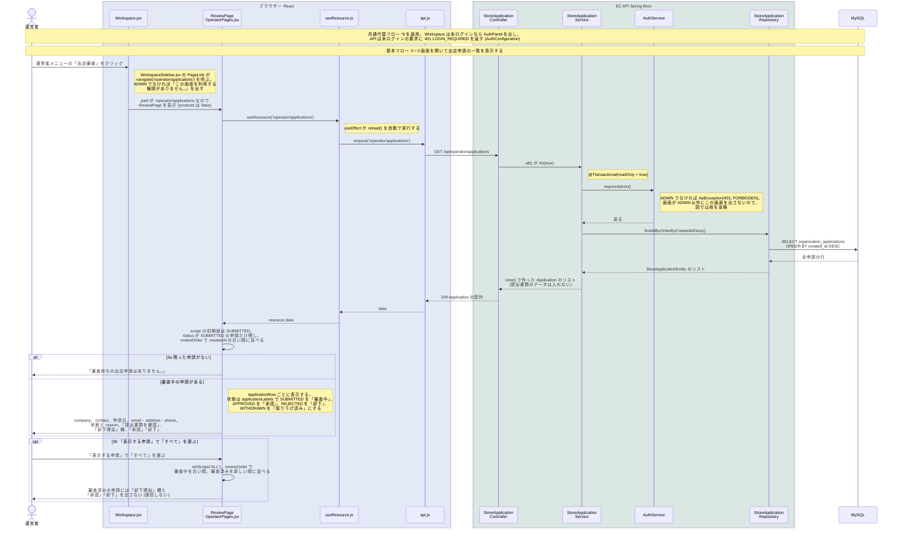
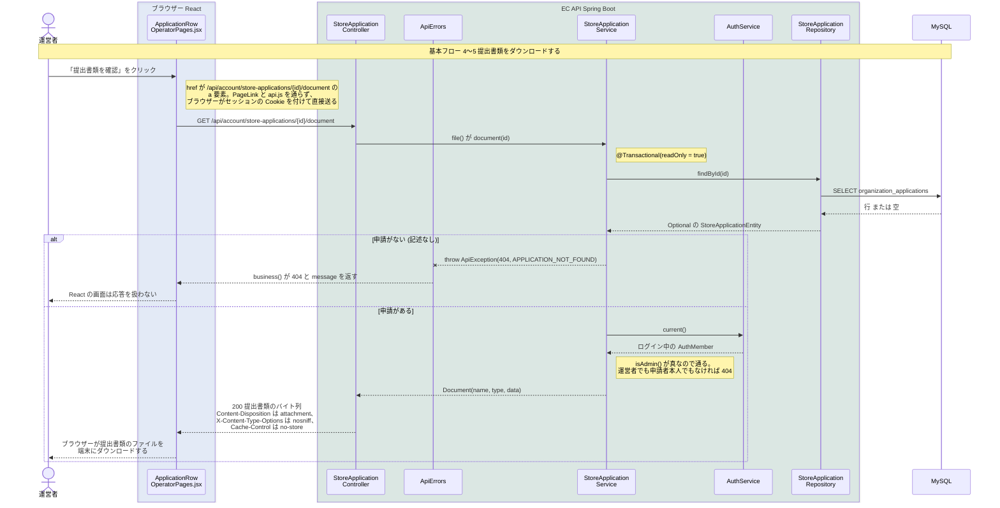
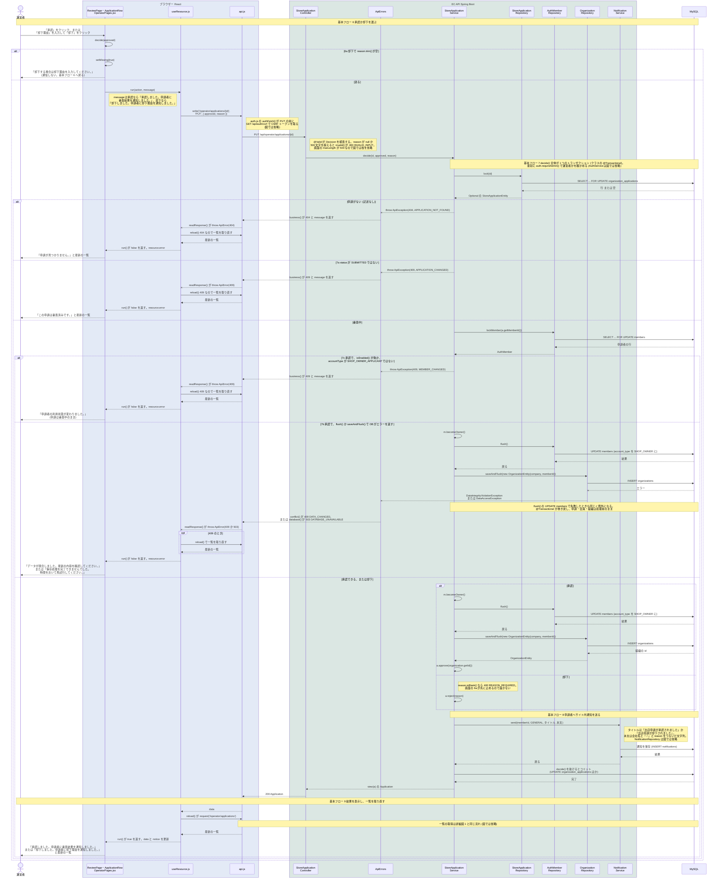

# EC-A03 出店申請を審査する

- ユースケース記述: [EC-A03_出店申請を審査する](<../../アーカイブ/ユースケース/kusakari-ec/EC-A03_出店申請を審査する.md>)
- 対象のコード: kusakari-ec の main（19a2be3、2026-11-20 時点）

## 概要図

```mermaid
sequenceDiagram
    actor User as 運営者
    participant Page as 出店審査画面<br/>React
    participant Api as EC API<br/>Spring Boot
    participant Db as MySQL

    Note over User,Db: 共通代替フロー *b を適用 (未ログインならログインの画面を表示する)

    Note over User,Db: 基本フロー 1〜3 画面を開いて出店申請の一覧を表示する
    User->>Page: 運営者メニューの「出店審査」をクリック
    Page->>Api: GET /api/operator/applications
    Api->>Api: ログイン中の会員が運営者かを検査
    Api->>Db: 出店申請をすべて新しい順に読む
    Db-->>Api: organization_applications の行
    Api-->>Page: 200 申請の配列
    Page->>Page: 「表示する申請」は「審査中」なので、<br/>審査中の申請だけを申請日の古い順に並べる
    alt 3a 審査中の申請がない
        Page-->>User: 「審査待ちの出店申請はありません。」
    else 審査中の申請がある
        Page-->>User: 申請ごとに会社名、申請者、申請日、連絡先、<br/>出店審査状態、「提出書類を確認」、<br/>「却下理由」欄、「承認」「却下」
    end
    opt 3b 審査済みの申請も確認する
        User->>Page: 「表示する申請」で「すべて」を選ぶ
        Page-->>User: 審査中を古い順に、審査済みを新しい順に表示<br/>(審査済みには却下理由欄とボタンを出さない。通信しない)
    end

    Note over User,Db: 基本フロー 4〜5 提出書類をダウンロードする
    User->>Page: 「提出書類を確認」をクリック
    Page->>Api: GET /api/account/store-applications/{id}/document<br/>(a 要素のリンク。ブラウザーが直接送る)
    Api->>Db: 申請を読む
    Db-->>Api: 申請の行 (提出書類のデータを含む)、または行なし
    alt 申請がない (記述なし)
        Api-->>Page: 404 APPLICATION_NOT_FOUND
        Page-->>User: React の画面は応答を扱わない
    else 申請がある
        Api->>Api: ログイン中の会員が運営者か申請者本人かを検査
        Api-->>Page: 200 提出書類 (Content-Disposition は attachment)
        Page-->>User: ブラウザーが提出書類のファイルを<br/>端末にダウンロードする
    end

    Note over User,Db: 基本フロー 6〜9 承認か却下を選び、結果を保存して知らせる
    User->>Page: 「承認」をクリック、または<br/>「却下理由」を入力して「却下」をクリック
    alt 6a 却下で、却下理由が空
        Page-->>User: 「却下する場合は却下理由を入力してください。」<br/>(通信しない。基本フロー 6 へ戻る)
    else 送る
        Page->>Api: PUT /api/operator/applications/{id}<br/>(approved と reason)
        Note right of Page: PUT の前に GET /api/auth/csrf で<br/>CSRF トークンを取る (図では省略)
        Note right of Api: 審査の処理全体が<br/>1 つのトランザクション
        Api->>Api: 入力と、運営者かを検査
        Api->>Db: 申請の行をロック (SELECT ... FOR UPDATE)
        Db-->>Api: 申請の行、または行なし
        alt 申請がない (記述なし)
            Api-->>Page: 404 APPLICATION_NOT_FOUND
            Page->>Api: GET /api/operator/applications
            Api-->>Page: 200 最新の一覧
            Page-->>User: 「申請が見つかりません。」と最新の一覧
        else 7a 申請が審査中ではない
            Api-->>Page: 409 APPLICATION_CHANGED
            Page->>Api: GET /api/operator/applications
            Api-->>Page: 200 最新の一覧
            Page-->>User: 「この申請は審査済みです。」と最新の一覧<br/>(7a-2 基本フロー 2 へ戻る)
        else 審査中
            Api->>Db: 申請者の会員の行をロック (SELECT ... FOR UPDATE)
            Db-->>Api: 会員の行
            alt 7c 承認で、申請者が利用停止中か退会済み、<br/>または出店申請用アカウントではない
                Api-->>Page: 409 MEMBER_CHANGED
                Page->>Api: GET /api/operator/applications
                Api-->>Page: 200 最新の一覧
                Page-->>User: 「申請者の利用状態が変わりました。」<br/>(申請は審査中のまま。基本フロー 6 へ戻る)
            else 7b 承認で、アカウントの切り替えか組織の作成で DB がエラーを返す
                Api->>Db: UPDATE members (出店者のオーナーへ)、<br/>INSERT organizations
                Db--xApi: エラー
                Note right of Api: トランザクションを巻き戻し、<br/>申請・会員・組織は処理前のまま
                Api-->>Page: 409 DATA_CHANGED<br/>または 503 DATABASE_UNAVAILABLE
                opt 409 のとき
                    Page->>Api: GET /api/operator/applications
                    Api-->>Page: 200 最新の一覧
                end
                Page-->>User: エラーメッセージ (7b-2 基本フロー 3 へ戻る)
            else 承認できる、または却下
                alt 承認
                    Api->>Db: UPDATE members (出店者のオーナーへ)、<br/>INSERT organizations (申請の会社名で)
                    Db-->>Api: 組織の id
                    Api->>Api: 申請を APPROVED にする
                else 却下
                    Api->>Api: 申請を REJECTED にし、却下理由を入れる
                end
                Api->>Api: 申請者あてのサイト内通知を作る
                Api->>Db: コミット (UPDATE organization_applications、<br/>INSERT notifications)
                Db-->>Api: 完了
                Api-->>Page: 200 申請
                Page->>Api: GET /api/operator/applications
                Api-->>Page: 200 最新の一覧
                Page-->>User: 「承認しました。申請者に審査結果を通知しました。」<br/>または「却下しました。申請者に却下理由を通知しました。」<br/>と最新の一覧
            end
        end
    end
```

## 詳細図 1 基本フロー 1〜3

## 詳細図 2 基本フロー 4〜5

## 詳細図 3 基本フロー 6〜9

## ユースケース記述との差

- 基本フロー 8: 通知の本文は、承認でも却下でも「会社名 / 却下理由欄の文字」です。承認でも「却下理由」欄に文字があればそのまま本文に入り、空なら「会社名 / 」になります。記述は「却下の場合は却下理由も通知に含める」だけです。また、通知には入力どおりの `reason` を入れ、申請の `rejection_reason` には前後の空白を除いた値を保存します。
- 6a: 画面の検査（`reason.trim()` が空）のほかに、サーバーにも `reason.isBlank()` の検査（400 `REASON_REQUIRED`「却下理由が必要です。」）があります。画面が先に止めるので、画面の操作では届きません。
- 7c: コードは、利用停止中・退会済み（`isEnabled()` が偽）のほか、申請者の種別が `SHOP_OWNER_APPLICANT` でなくなった場合も 409 `MEMBER_CHANGED` にします。また、却下では申請者の状態を確かめないため、利用停止中・退会済みの申請者の申請も却下でき、通知も保存します。
- 7b: コードに失敗を見分ける専用の処理はありません。DB の例外を `ApiErrors` が 409 `DATA_CHANGED`「データが競合しました。最新の内容を確認してください。」か、503 `DATABASE_UNAVAILABLE`「保存処理を完了できませんでした。時間をおいて再試行してください。」にします。記述の「エラーメッセージ」はこのどちらかです。409 のときは一覧を取り直し、503 のときは取り直しません。
- 審査の PUT と提出書類の GET は、申請が見つからないときに 404 `APPLICATION_NOT_FOUND`「申請が見つかりません。」を返します。記述にない分岐です。
- 3b: 「すべて」を選んで申請が 1 件もないときは「出店申請はありません。」を表示します。記述にない表示です。
- 基本フロー 4〜5: 「提出書類を確認」は api.js を通らない a 要素のリンクです。ダウンロードに失敗しても、出店審査画面にはメッセージを出しません。記述にはダウンロードの失敗が書かれていません。

## 確かめられなかったこと

- 7b の失敗を起こす具体的な条件（どの制約やどの障害で起きるか）は、コードから特定できませんでした。動かしても確かめていません。
- 提出書類の GET が 404 などで失敗したときに、ブラウザーが何を表示するかは確かめていません。

## 参照したコード

- [frontend/src/workspace/Workspace.jsx](https://github.com/abeouga/kusakari-ec/blob/19a2be307ee71a2cd87e538236c3c8c42929c5b3/frontend/src/workspace/Workspace.jsx): `operatorMenu`、`Workspace`（未ログインと ADMIN の確認、path と画面の対応）
- [frontend/src/workspace/WorkspaceSidebar.jsx](https://github.com/abeouga/kusakari-ec/blob/19a2be307ee71a2cd87e538236c3c8c42929c5b3/frontend/src/workspace/WorkspaceSidebar.jsx): `MenuLink`
- [frontend/src/workspace/Common.jsx](https://github.com/abeouga/kusakari-ec/blob/19a2be307ee71a2cd87e538236c3c8c42929c5b3/frontend/src/workspace/Common.jsx): `PageLink`
- [frontend/src/workspace/OperatorPages.jsx](https://github.com/abeouga/kusakari-ec/blob/19a2be307ee71a2cd87e538236c3c8c42929c5b3/frontend/src/workspace/OperatorPages.jsx): `ReviewPage`、`reviewOrder`、`applicationLabels`、`ApplicationRow`、`decide`
- [frontend/src/workspace/useResource.js](https://github.com/abeouga/kusakari-ec/blob/19a2be307ee71a2cd87e538236c3c8c42929c5b3/frontend/src/workspace/useResource.js): `useResource`、`reload`、`run`、`write`
- [frontend/src/workspace/ResourceView.jsx](https://github.com/abeouga/kusakari-ec/blob/19a2be307ee71a2cd87e538236c3c8c42929c5b3/frontend/src/workspace/ResourceView.jsx): `ResourceStatus`
- [frontend/src/api.js](https://github.com/abeouga/kusakari-ec/blob/19a2be307ee71a2cd87e538236c3c8c42929c5b3/frontend/src/api.js): `request`、`send`、`readResponse`、`ApiError`
- [frontend/src/auth.js](https://github.com/abeouga/kusakari-ec/blob/19a2be307ee71a2cd87e538236c3c8c42929c5b3/frontend/src/auth.js): `authFetch`（`GET /api/auth/csrf`）
- [backend/src/main/java/jp/kusakari/ec/store/controller/StoreApplicationController.java](https://github.com/abeouga/kusakari-ec/blob/19a2be307ee71a2cd87e538236c3c8c42929c5b3/backend/src/main/java/jp/kusakari/ec/store/controller/StoreApplicationController.java): `all`、`decide`、`Decision`、`file`
- [backend/src/main/java/jp/kusakari/ec/store/service/StoreApplicationService.java](https://github.com/abeouga/kusakari-ec/blob/19a2be307ee71a2cd87e538236c3c8c42929c5b3/backend/src/main/java/jp/kusakari/ec/store/service/StoreApplicationService.java): `list`、`decide`、`document`、`view`、`missing`
- [backend/src/main/java/jp/kusakari/ec/store/persistence/entity/StoreApplicationEntity.java](https://github.com/abeouga/kusakari-ec/blob/19a2be307ee71a2cd87e538236c3c8c42929c5b3/backend/src/main/java/jp/kusakari/ec/store/persistence/entity/StoreApplicationEntity.java): `approve`、`reject`
- [backend/src/main/java/jp/kusakari/ec/store/persistence/repository/StoreApplicationRepository.java](https://github.com/abeouga/kusakari-ec/blob/19a2be307ee71a2cd87e538236c3c8c42929c5b3/backend/src/main/java/jp/kusakari/ec/store/persistence/repository/StoreApplicationRepository.java): `findAllByOrderByCreatedAtDesc`、`lock`
- [backend/src/main/java/jp/kusakari/ec/auth/AuthMemberRepository.java](https://github.com/abeouga/kusakari-ec/blob/19a2be307ee71a2cd87e538236c3c8c42929c5b3/backend/src/main/java/jp/kusakari/ec/auth/AuthMemberRepository.java): `lockMember`
- [backend/src/main/java/jp/kusakari/ec/auth/AuthMember.java](https://github.com/abeouga/kusakari-ec/blob/19a2be307ee71a2cd87e538236c3c8c42929c5b3/backend/src/main/java/jp/kusakari/ec/auth/AuthMember.java): `becomeOwner`、`isEnabled`、`withdraw`
- [backend/src/main/java/jp/kusakari/ec/auth/AuthService.java](https://github.com/abeouga/kusakari-ec/blob/19a2be307ee71a2cd87e538236c3c8c42929c5b3/backend/src/main/java/jp/kusakari/ec/auth/AuthService.java): `requireAdmin`、`current`
- [backend/src/main/java/jp/kusakari/ec/store/persistence/repository/OrganizationRepository.java](https://github.com/abeouga/kusakari-ec/blob/19a2be307ee71a2cd87e538236c3c8c42929c5b3/backend/src/main/java/jp/kusakari/ec/store/persistence/repository/OrganizationRepository.java): `saveAndFlush`（JpaRepository）
- [backend/src/main/java/jp/kusakari/ec/store/persistence/entity/OrganizationEntity.java](https://github.com/abeouga/kusakari-ec/blob/19a2be307ee71a2cd87e538236c3c8c42929c5b3/backend/src/main/java/jp/kusakari/ec/store/persistence/entity/OrganizationEntity.java): コンストラクター（会社名とオーナー）
- [backend/src/main/java/jp/kusakari/ec/notification/service/NotificationService.java](https://github.com/abeouga/kusakari-ec/blob/19a2be307ee71a2cd87e538236c3c8c42929c5b3/backend/src/main/java/jp/kusakari/ec/notification/service/NotificationService.java): `send`
- [backend/src/main/java/jp/kusakari/ec/common/web/ApiErrors.java](https://github.com/abeouga/kusakari-ec/blob/19a2be307ee71a2cd87e538236c3c8c42929c5b3/backend/src/main/java/jp/kusakari/ec/common/web/ApiErrors.java): `business`、`invalid`、`conflict`、`database`
- [backend/src/main/resources/db/migration/V1__schema.sql](https://github.com/abeouga/kusakari-ec/blob/19a2be307ee71a2cd87e538236c3c8c42929c5b3/backend/src/main/resources/db/migration/V1__schema.sql): `members`、`organizations`、`organization_applications`、`notifications`
