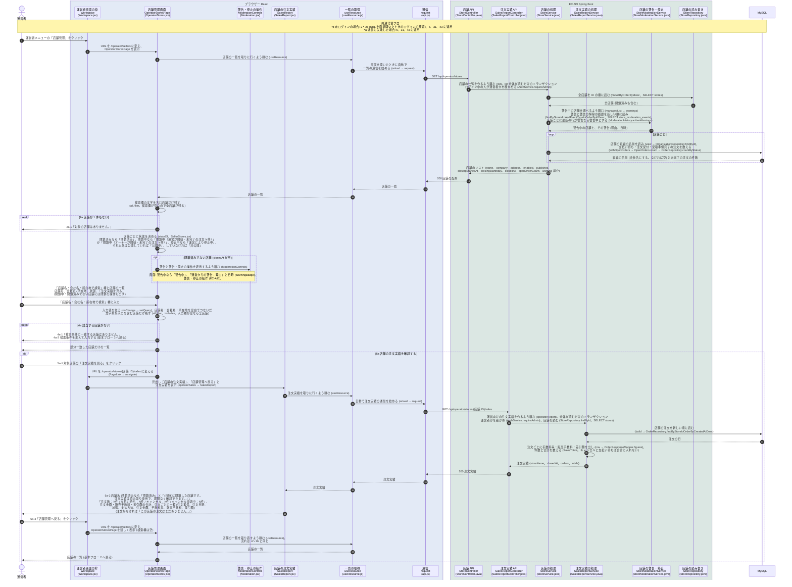
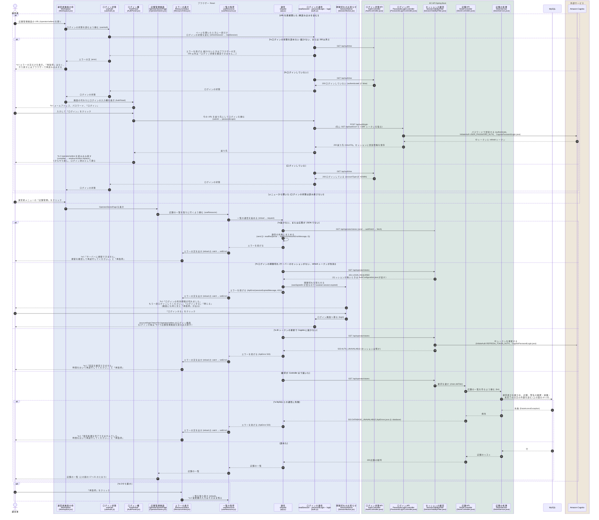

# EC-A05 店舗情報を確認する

- ユースケース記述: [EC-A05_店舗情報を確認する](<../../アーカイブ/ユースケース/kusakari-ec/EC-A05_店舗情報を確認する.md>)
- 共通代替フロー: [00_全ユースケース共通の代替フロー](<00_全ユースケース共通の代替フロー.md>)
- 対象のコード: kusakari-ec の main（6bad7e3、2026-11-24 時点）

## シーケンス図

参加者は、上から「画面や役割の名前」「コンポーネント・クラスの名前」「ファイル名（かっこ付き）」の順に書いています。
共通代替フローの中身は、00 の図か、下の「共通代替フローを直接書いた図」を見てください。
代替フローのうち、一覧の表示だけで終わるもの（2a・4a）は分かれる所だけを描き、閉鎖済みでない店舗だけに出す警告・停止の操作（opt）は、表示を頼む矢印と Note に寄せています。5a は、そこでしか起きない注文実績の通信（`GET /api/operator/stores/{店舗 ID}/sales`）があるので、矢印で描いています。

## 共通代替フローを直接書いた図

上の図の、画面を開いて店舗の一覧を取る通信（`GET /api/operator/stores`）に、この画面で起こる共通代替フロー（\*a、\*b）を書き込んだ図です。注文実績の画面の `GET /api/operator/stores/{店舗 ID}/sales` と、「店舗管理へ戻る」の後の一覧の取り直しも、同じ `useResource.js` と `ResourceStatus` を通るので、同じ流れになります（URL を直接開いたときのログインの確認も同じです）。その 2 つは省いています。

## ユースケース記述との差

- 基本フロー 2: API は閉鎖済みの店舗にも警告（`warning`）を返します。ところが画面は、`closedAt` がある店舗に `ModerationControls` を出しません。「警告中」のバッジ（`WarningBadge`）は `ModerationControls` の中にあるので、閉鎖済みの店舗は警告中でもバッジと理由が出ません。記述は「警告中の店舗には『警告中』のバッジと警告の理由を表示する」としています。
- 基本フロー 2: 一覧には、警告・停止の操作（EC-A11）と、閉鎖・閉鎖の取り消し・未完了の注文のまとめてキャンセルのボタンも出ます。記述は関連情報で触れているだけです。
- 基本フロー 4: 絞り込みは JavaScript の `includes` です。店舗名・会社名・所在地を空白でつないだ 1 つの文字列を探すので、大文字と小文字を区別し、入力の前後の空白も取り除きません。空白をはさんだ入力（「店舗名 会社名」など）が、2 つの項目にまたがって当たることもあります。記述にはこの決まりが書かれていません。
- 5a-2: 注文が 1 件もない店舗では、一覧の代わりに「この店舗の注文はまだありません。」を出します。「注文数」と金額の合計は、キャンセルと支払い待ちの注文を除いて数えます（`SalesReportService.build()`、`OrderResponseMapper.figures()` の `counted`）。手数料の決まりの説明の文も出ます。どれも記述にはありません。
- 5a-3: 「店舗管理へ戻る」で `OperatorStoresPage` を作り直すので、店舗の一覧を取り直し、検索欄は空に戻ります。記述は「基本フロー 2 へ戻る」だけです。
- 共通代替フロー \*a: MySQL との通信に失敗したときの文は、読むだけの通信でも「保存処理を完了できませんでした。時間をおいて再試行してください。」です（`ApiErrors.database()` の文が 1 つだけのため）。
- 注文実績の API は、店舗が見つからないときに 404 `STORE_NOT_FOUND`「店舗が見つかりません。」を返します。一覧のリンクから開くので、図には書いていません。
- 運営者でない会員がこの画面を開くと、`Workspace.jsx` が「この画面を利用する権限がありません。」を出し、一覧を取りに行きません。API も `requireAdmin()` で 403 `FORBIDDEN` を返します。事前条件が運営者のログインなので、図には書いていません。

## 参照したコード

- [frontend/src/workspace/Workspace.jsx](https://github.com/abeouga/kusakari-ec/blob/6bad7e37c4135034fbe97e30309772fbe872e675/frontend/src/workspace/Workspace.jsx): `operatorMenu`、`Workspace`（未ログインのときの `AuthPanel`、運営者の確認、`operatorSales`、path と画面の対応、「店舗管理へ戻る」）
- [frontend/src/workspace/WorkspaceSidebar.jsx](https://github.com/abeouga/kusakari-ec/blob/6bad7e37c4135034fbe97e30309772fbe872e675/frontend/src/workspace/WorkspaceSidebar.jsx): `MenuLink`
- [frontend/src/workspace/Common.jsx](https://github.com/abeouga/kusakari-ec/blob/6bad7e37c4135034fbe97e30309772fbe872e675/frontend/src/workspace/Common.jsx): `PageLink`
- [frontend/src/workspace/navigation.js](https://github.com/abeouga/kusakari-ec/blob/6bad7e37c4135034fbe97e30309772fbe872e675/frontend/src/workspace/navigation.js): `navigate`
- [frontend/src/workspace/OperatorStores.jsx](https://github.com/abeouga/kusakari-ec/blob/6bad7e37c4135034fbe97e30309772fbe872e675/frontend/src/workspace/OperatorStores.jsx): `OperatorStoresPage`（`query`、`all.filter`、空の一覧の文言、「注文実績を見る」、閉鎖済みでない店舗だけの `ModerationControls`）
- [frontend/src/workspace/SellerStores.jsx](https://github.com/abeouga/kusakari-ec/blob/6bad7e37c4135034fbe97e30309772fbe872e675/frontend/src/workspace/SellerStores.jsx): `stateOf`
- [frontend/src/workspace/Moderation.jsx](https://github.com/abeouga/kusakari-ec/blob/6bad7e37c4135034fbe97e30309772fbe872e675/frontend/src/workspace/Moderation.jsx): `ModerationControls`、`WarningBadge`
- [frontend/src/workspace/SalesReport.jsx](https://github.com/abeouga/kusakari-ec/blob/6bad7e37c4135034fbe97e30309772fbe872e675/frontend/src/workspace/SalesReport.jsx): `SalesReport`
- [frontend/src/workspace/useResource.js](https://github.com/abeouga/kusakari-ec/blob/6bad7e37c4135034fbe97e30309772fbe872e675/frontend/src/workspace/useResource.js): `useResource`、`reload`
- [frontend/src/workspace/ResourceView.jsx](https://github.com/abeouga/kusakari-ec/blob/6bad7e37c4135034fbe97e30309772fbe872e675/frontend/src/workspace/ResourceView.jsx): `ResourceStatus`（エラーの文と「再取得」）
- [frontend/src/api.js](https://github.com/abeouga/kusakari-ec/blob/6bad7e37c4135034fbe97e30309772fbe872e675/frontend/src/api.js): `request`、`send`、`readResponse`、`ApiError`、`networkErrorMessage`、`sessionExpiredMessage`
- [frontend/src/auth.js](https://github.com/abeouga/kusakari-ec/blob/6bad7e37c4135034fbe97e30309772fbe872e675/frontend/src/auth.js): `readSession`、`authFetch`、`passwordLogin`、`wasSignedIn`、`login`
- [frontend/src/useAuth.js](https://github.com/abeouga/kusakari-ec/blob/6bad7e37c4135034fbe97e30309772fbe872e675/frontend/src/useAuth.js): `useAuth`（`refreshSession`）
- [frontend/src/components/AuthPanel.jsx](https://github.com/abeouga/kusakari-ec/blob/6bad7e37c4135034fbe97e30309772fbe872e675/frontend/src/components/AuthPanel.jsx): `AuthPanel`（`submit`、`complete`、`returnTo`）
- [frontend/src/components/SessionNotice.jsx](https://github.com/abeouga/kusakari-ec/blob/6bad7e37c4135034fbe97e30309772fbe872e675/frontend/src/components/SessionNotice.jsx): 期限切れのお知らせ
- [backend/src/main/java/jp/kusakari/ec/store/controller/StoreController.java](https://github.com/abeouga/kusakari-ec/blob/6bad7e37c4135034fbe97e30309772fbe872e675/backend/src/main/java/jp/kusakari/ec/store/controller/StoreController.java): `list`
- [backend/src/main/java/jp/kusakari/ec/store/service/StoreService.java](https://github.com/abeouga/kusakari-ec/blob/6bad7e37c4135034fbe97e30309772fbe872e675/backend/src/main/java/jp/kusakari/ec/store/service/StoreService.java): `list`、`managedList`、`withOpenOrders`、`view`、`Profile`
- [backend/src/main/java/jp/kusakari/ec/store/service/StoreModerationService.java](https://github.com/abeouga/kusakari-ec/blob/6bad7e37c4135034fbe97e30309772fbe872e675/backend/src/main/java/jp/kusakari/ec/store/service/StoreModerationService.java): `warnings`
- [backend/src/main/java/jp/kusakari/ec/moderation/service/ModerationHistory.java](https://github.com/abeouga/kusakari-ec/blob/6bad7e37c4135034fbe97e30309772fbe872e675/backend/src/main/java/jp/kusakari/ec/moderation/service/ModerationHistory.java): `activeWarnings`、`WARNING_TYPES`
- [backend/src/main/java/jp/kusakari/ec/store/service/OpenOrders.java](https://github.com/abeouga/kusakari-ec/blob/6bad7e37c4135034fbe97e30309772fbe872e675/backend/src/main/java/jp/kusakari/ec/store/service/OpenOrders.java): `count`、`BLOCKING`
- [backend/src/main/java/jp/kusakari/ec/catalog/persistence/repository/StoreRepository.java](https://github.com/abeouga/kusakari-ec/blob/6bad7e37c4135034fbe97e30309772fbe872e675/backend/src/main/java/jp/kusakari/ec/catalog/persistence/repository/StoreRepository.java): `findAllByOrderByIdAsc`、`findById`（JpaRepository）
- [backend/src/main/java/jp/kusakari/ec/moderation/persistence/repository/StoreModerationEventRepository.java](https://github.com/abeouga/kusakari-ec/blob/6bad7e37c4135034fbe97e30309772fbe872e675/backend/src/main/java/jp/kusakari/ec/moderation/persistence/repository/StoreModerationEventRepository.java): `findByStoreIdInAndEventTypeInOrderByIdDesc`
- [backend/src/main/java/jp/kusakari/ec/store/persistence/repository/OrganizationRepository.java](https://github.com/abeouga/kusakari-ec/blob/6bad7e37c4135034fbe97e30309772fbe872e675/backend/src/main/java/jp/kusakari/ec/store/persistence/repository/OrganizationRepository.java): `findById`（JpaRepository）
- [backend/src/main/java/jp/kusakari/ec/commerce/persistence/repository/OrderRepository.java](https://github.com/abeouga/kusakari-ec/blob/6bad7e37c4135034fbe97e30309772fbe872e675/backend/src/main/java/jp/kusakari/ec/commerce/persistence/repository/OrderRepository.java): `countByStatus`、`findByStoreIdOrderByCreatedAtDesc`
- [backend/src/main/java/jp/kusakari/ec/commerce/controller/SalesReportController.java](https://github.com/abeouga/kusakari-ec/blob/6bad7e37c4135034fbe97e30309772fbe872e675/backend/src/main/java/jp/kusakari/ec/commerce/controller/SalesReportController.java): `operator`
- [backend/src/main/java/jp/kusakari/ec/commerce/service/SalesReportService.java](https://github.com/abeouga/kusakari-ec/blob/6bad7e37c4135034fbe97e30309772fbe872e675/backend/src/main/java/jp/kusakari/ec/commerce/service/SalesReportService.java): `operatorReport`、`build`、`row`
- [backend/src/main/java/jp/kusakari/ec/commerce/mapper/OrderResponseMapper.java](https://github.com/abeouga/kusakari-ec/blob/6bad7e37c4135034fbe97e30309772fbe872e675/backend/src/main/java/jp/kusakari/ec/commerce/mapper/OrderResponseMapper.java): `figures`
- [backend/src/main/java/jp/kusakari/ec/auth/AuthService.java](https://github.com/abeouga/kusakari-ec/blob/6bad7e37c4135034fbe97e30309772fbe872e675/backend/src/main/java/jp/kusakari/ec/auth/AuthService.java): `requireAdmin`
- [backend/src/main/java/jp/kusakari/ec/auth/AuthController.java](https://github.com/abeouga/kusakari-ec/blob/6bad7e37c4135034fbe97e30309772fbe872e675/backend/src/main/java/jp/kusakari/ec/auth/AuthController.java): `GET /api/auth/me`、`GET /api/auth/csrf`
- [backend/src/main/java/jp/kusakari/ec/auth/PasswordLoginController.java](https://github.com/abeouga/kusakari-ec/blob/6bad7e37c4135034fbe97e30309772fbe872e675/backend/src/main/java/jp/kusakari/ec/auth/PasswordLoginController.java): `POST /api/auth/login`
- [backend/src/main/java/jp/kusakari/ec/auth/CognitoPasswordLogin.java](https://github.com/abeouga/kusakari-ec/blob/6bad7e37c4135034fbe97e30309772fbe872e675/backend/src/main/java/jp/kusakari/ec/auth/CognitoPasswordLogin.java): `authenticate`、`refresh`、503 `AUTH_UNAVAILABLE`
- [backend/src/main/java/jp/kusakari/ec/auth/SessionValidityFilter.java](https://github.com/abeouga/kusakari-ec/blob/6bad7e37c4135034fbe97e30309772fbe872e675/backend/src/main/java/jp/kusakari/ec/auth/SessionValidityFilter.java): `doFilterInternal`、`renewIdToken`（ID トークンの更新、401 `LOGIN_REQUIRED`）
- [backend/src/main/java/jp/kusakari/ec/auth/AuthConfiguration.java](https://github.com/abeouga/kusakari-ec/blob/6bad7e37c4135034fbe97e30309772fbe872e675/backend/src/main/java/jp/kusakari/ec/auth/AuthConfiguration.java): `authenticationEntryPoint`（セッションが無いときの 401 `LOGIN_REQUIRED`）
- [backend/src/main/java/jp/kusakari/ec/common/web/ApiErrors.java](https://github.com/abeouga/kusakari-ec/blob/6bad7e37c4135034fbe97e30309772fbe872e675/backend/src/main/java/jp/kusakari/ec/common/web/ApiErrors.java): `database`（503 `DATABASE_UNAVAILABLE`）
