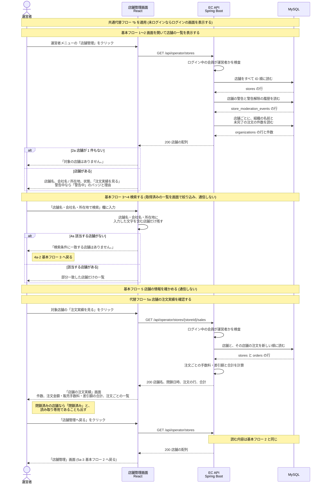
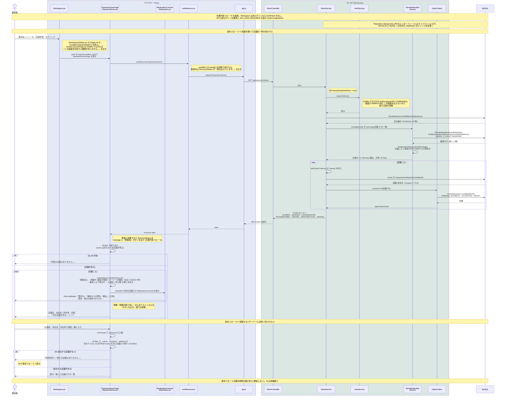
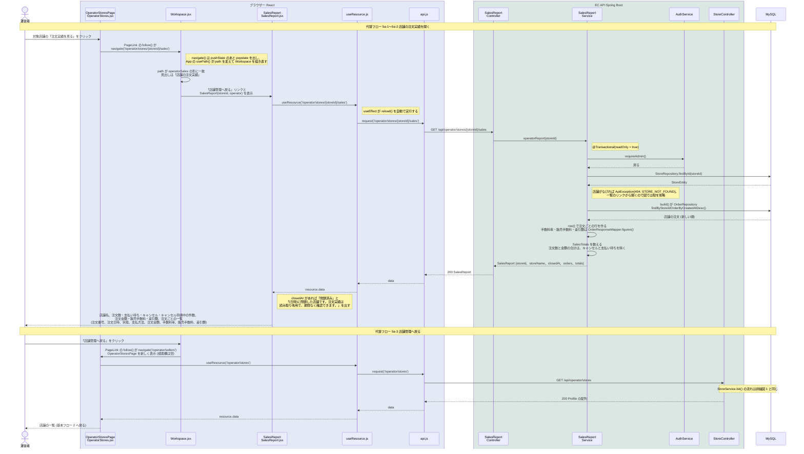

# EC-A05 店舗情報を確認する

- ユースケース記述: [EC-A05_店舗情報を確認する](<../../アーカイブ/ユースケース/kusakari-ec/EC-A05_店舗情報を確認する.md>)
- 対象のコード: kusakari-ec の main（19a2be3、2026-11-20 時点）

## 概要図

## 詳細図 1 基本フロー 1〜5

## 詳細図 2 代替フロー 5a 店舗の注文実績を確認する

## ユースケース記述との差

- 基本フロー 2: API は閉鎖済みの店舗にも `warning` を返します。ところが画面は、`closedAt` がある店舗に `ModerationControls` を出しません。`WarningBadge` は `ModerationControls` の中にあるので、閉鎖済みの店舗は警告中でも「警告中」のバッジと理由が出ません。記述は「警告中の店舗には『警告中』のバッジと警告の理由を表示する」としています。
- 基本フロー 4: 絞り込みは JavaScript の `includes` です。店舗名・会社名・所在地を空白でつないだ 1 つの文字列を探すので、大文字と小文字を区別し、入力の前後の空白も取り除きません。記述にはこの決まりが書かれていません。
- 5a-2: 注文が 1 件もない店舗では、一覧の代わりに「この店舗の注文はまだありません。」を出します。また「注文数」と金額の合計は、キャンセルと支払い待ちの注文を除いて数えます（`SalesReportService.build()`、`OrderResponseMapper.figures()` の `counted`）。どちらも記述にはありません。

## 参照したコード

- [frontend/src/workspace/Workspace.jsx](https://github.com/abeouga/kusakari-ec/blob/19a2be307ee71a2cd87e538236c3c8c42929c5b3/frontend/src/workspace/Workspace.jsx): `operatorMenu`、`operatorSales`、`Workspace`（未ログインと ADMIN の確認、path と画面の対応、「店舗管理へ戻る」）
- [frontend/src/workspace/WorkspaceSidebar.jsx](https://github.com/abeouga/kusakari-ec/blob/19a2be307ee71a2cd87e538236c3c8c42929c5b3/frontend/src/workspace/WorkspaceSidebar.jsx): `WorkspaceSidebar`、`MenuLink`
- [frontend/src/workspace/Common.jsx](https://github.com/abeouga/kusakari-ec/blob/19a2be307ee71a2cd87e538236c3c8c42929c5b3/frontend/src/workspace/Common.jsx): `PageLink`
- [frontend/src/workspace/navigation.js](https://github.com/abeouga/kusakari-ec/blob/19a2be307ee71a2cd87e538236c3c8c42929c5b3/frontend/src/workspace/navigation.js): `navigate`、`usePath`
- [frontend/src/workspace/OperatorStores.jsx](https://github.com/abeouga/kusakari-ec/blob/19a2be307ee71a2cd87e538236c3c8c42929c5b3/frontend/src/workspace/OperatorStores.jsx): `OperatorStoresPage`（`query`、`all.filter`、空の一覧の文言、「注文実績を見る」）
- [frontend/src/workspace/SellerStores.jsx](https://github.com/abeouga/kusakari-ec/blob/19a2be307ee71a2cd87e538236c3c8c42929c5b3/frontend/src/workspace/SellerStores.jsx): `stateOf`
- [frontend/src/workspace/Moderation.jsx](https://github.com/abeouga/kusakari-ec/blob/19a2be307ee71a2cd87e538236c3c8c42929c5b3/frontend/src/workspace/Moderation.jsx): `ModerationControls`、`WarningBadge`
- [frontend/src/workspace/SalesReport.jsx](https://github.com/abeouga/kusakari-ec/blob/19a2be307ee71a2cd87e538236c3c8c42929c5b3/frontend/src/workspace/SalesReport.jsx): `SalesReport`
- [frontend/src/workspace/useResource.js](https://github.com/abeouga/kusakari-ec/blob/19a2be307ee71a2cd87e538236c3c8c42929c5b3/frontend/src/workspace/useResource.js): `useResource`、`reload`
- [frontend/src/workspace/ResourceView.jsx](https://github.com/abeouga/kusakari-ec/blob/19a2be307ee71a2cd87e538236c3c8c42929c5b3/frontend/src/workspace/ResourceView.jsx): `ResourceStatus`
- [frontend/src/api.js](https://github.com/abeouga/kusakari-ec/blob/19a2be307ee71a2cd87e538236c3c8c42929c5b3/frontend/src/api.js): `request`、`send`、`readResponse`
- [backend/src/main/java/jp/kusakari/ec/store/controller/StoreController.java](https://github.com/abeouga/kusakari-ec/blob/19a2be307ee71a2cd87e538236c3c8c42929c5b3/backend/src/main/java/jp/kusakari/ec/store/controller/StoreController.java): `list`
- [backend/src/main/java/jp/kusakari/ec/store/service/StoreService.java](https://github.com/abeouga/kusakari-ec/blob/19a2be307ee71a2cd87e538236c3c8c42929c5b3/backend/src/main/java/jp/kusakari/ec/store/service/StoreService.java): `list`、`managedList`、`withOpenOrders`、`view`、`Profile`
- [backend/src/main/java/jp/kusakari/ec/store/service/StoreModerationService.java](https://github.com/abeouga/kusakari-ec/blob/19a2be307ee71a2cd87e538236c3c8c42929c5b3/backend/src/main/java/jp/kusakari/ec/store/service/StoreModerationService.java): `warnings`
- [backend/src/main/java/jp/kusakari/ec/moderation/service/ModerationHistory.java](https://github.com/abeouga/kusakari-ec/blob/19a2be307ee71a2cd87e538236c3c8c42929c5b3/backend/src/main/java/jp/kusakari/ec/moderation/service/ModerationHistory.java): `activeWarnings`、`WARNING_TYPES`
- [backend/src/main/java/jp/kusakari/ec/store/service/OpenOrders.java](https://github.com/abeouga/kusakari-ec/blob/19a2be307ee71a2cd87e538236c3c8c42929c5b3/backend/src/main/java/jp/kusakari/ec/store/service/OpenOrders.java): `count`、`BLOCKING`
- [backend/src/main/java/jp/kusakari/ec/catalog/persistence/repository/StoreRepository.java](https://github.com/abeouga/kusakari-ec/blob/19a2be307ee71a2cd87e538236c3c8c42929c5b3/backend/src/main/java/jp/kusakari/ec/catalog/persistence/repository/StoreRepository.java): `findAllByOrderByIdAsc`
- [backend/src/main/java/jp/kusakari/ec/moderation/persistence/repository/StoreModerationEventRepository.java](https://github.com/abeouga/kusakari-ec/blob/19a2be307ee71a2cd87e538236c3c8c42929c5b3/backend/src/main/java/jp/kusakari/ec/moderation/persistence/repository/StoreModerationEventRepository.java): `findByStoreIdInAndEventTypeInOrderByIdDesc`
- [backend/src/main/java/jp/kusakari/ec/commerce/persistence/repository/OrderRepository.java](https://github.com/abeouga/kusakari-ec/blob/19a2be307ee71a2cd87e538236c3c8c42929c5b3/backend/src/main/java/jp/kusakari/ec/commerce/persistence/repository/OrderRepository.java): `countByStatus`、`findByStoreIdOrderByCreatedAtDesc`
- [backend/src/main/java/jp/kusakari/ec/commerce/controller/SalesReportController.java](https://github.com/abeouga/kusakari-ec/blob/19a2be307ee71a2cd87e538236c3c8c42929c5b3/backend/src/main/java/jp/kusakari/ec/commerce/controller/SalesReportController.java): `operator`
- [backend/src/main/java/jp/kusakari/ec/commerce/service/SalesReportService.java](https://github.com/abeouga/kusakari-ec/blob/19a2be307ee71a2cd87e538236c3c8c42929c5b3/backend/src/main/java/jp/kusakari/ec/commerce/service/SalesReportService.java): `operatorReport`、`build`、`row`
- [backend/src/main/java/jp/kusakari/ec/commerce/mapper/OrderResponseMapper.java](https://github.com/abeouga/kusakari-ec/blob/19a2be307ee71a2cd87e538236c3c8c42929c5b3/backend/src/main/java/jp/kusakari/ec/commerce/mapper/OrderResponseMapper.java): `figures`
- [backend/src/main/java/jp/kusakari/ec/auth/AuthService.java](https://github.com/abeouga/kusakari-ec/blob/19a2be307ee71a2cd87e538236c3c8c42929c5b3/backend/src/main/java/jp/kusakari/ec/auth/AuthService.java): `requireAdmin`
- [backend/src/main/java/jp/kusakari/ec/auth/AuthConfiguration.java](https://github.com/abeouga/kusakari-ec/blob/19a2be307ee71a2cd87e538236c3c8c42929c5b3/backend/src/main/java/jp/kusakari/ec/auth/AuthConfiguration.java): `authenticationEntryPoint`（401 LOGIN_REQUIRED）
