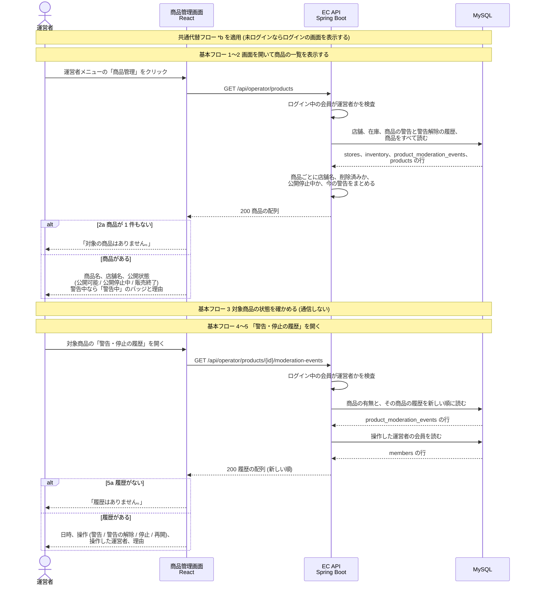
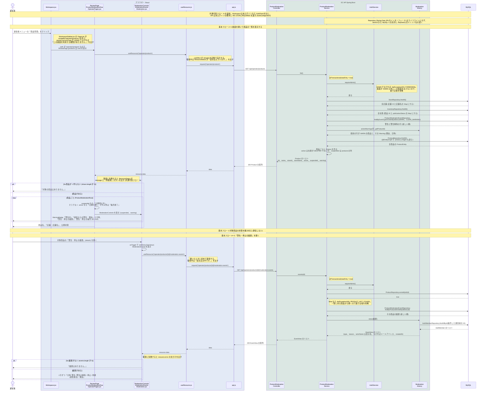

# EC-A06 商品情報を確認する

- ユースケース記述: [EC-A06_商品情報を確認する](<../../アーカイブ/ユースケース/kusakari-ec/EC-A06_商品情報を確認する.md>)
- 対象のコード: kusakari-ec の main（19a2be3、2026-11-20 時点）

## 概要図

## 詳細図

## ユースケース記述との差

- 基本フロー 5: 履歴の取得に失敗したとき、`ModerationEvents` はエラーの文だけを出し、「再取得」ボタンを出しません。「警告・停止の履歴」を閉じて開き直すと、`ModerationEvents` を作り直して取り直します。共通代替フロー *a の「再実行を可能にする」とは、再実行の方法が違います。
- 基本フロー 5: 「操作した運営者」は、会員の表示名です。表示名が空なら、メールアドレスを出します（`ModerationHistory.nameOf()`）。記述にはこの決まりが書かれていません。

## 確かめられなかったこと

- 商品の一覧の並び順です。`ProductModerationService.list()` は `ProductRepository.findAll()` の順のまま返し、ORDER BY も並べ替えもありません。実際に MySQL が返す順は、実行して確かめていません。

## 参照したコード

- [frontend/src/workspace/Workspace.jsx](https://github.com/abeouga/kusakari-ec/blob/19a2be307ee71a2cd87e538236c3c8c42929c5b3/frontend/src/workspace/Workspace.jsx): `operatorMenu`、`Workspace`（未ログインと ADMIN の確認、path と画面の対応）
- [frontend/src/workspace/WorkspaceSidebar.jsx](https://github.com/abeouga/kusakari-ec/blob/19a2be307ee71a2cd87e538236c3c8c42929c5b3/frontend/src/workspace/WorkspaceSidebar.jsx): `WorkspaceSidebar`、`MenuLink`
- [frontend/src/workspace/OperatorPages.jsx](https://github.com/abeouga/kusakari-ec/blob/19a2be307ee71a2cd87e538236c3c8c42929c5b3/frontend/src/workspace/OperatorPages.jsx): `ReviewPage`、`ProductModerationRow`
- [frontend/src/workspace/Moderation.jsx](https://github.com/abeouga/kusakari-ec/blob/19a2be307ee71a2cd87e538236c3c8c42929c5b3/frontend/src/workspace/Moderation.jsx): `ModerationControls`、`WarningBadge`、`ModerationEvents`、`eventLabels`
- [frontend/src/workspace/useResource.js](https://github.com/abeouga/kusakari-ec/blob/19a2be307ee71a2cd87e538236c3c8c42929c5b3/frontend/src/workspace/useResource.js): `useResource`、`reload`
- [frontend/src/workspace/ResourceView.jsx](https://github.com/abeouga/kusakari-ec/blob/19a2be307ee71a2cd87e538236c3c8c42929c5b3/frontend/src/workspace/ResourceView.jsx): `ResourceStatus`
- [frontend/src/api.js](https://github.com/abeouga/kusakari-ec/blob/19a2be307ee71a2cd87e538236c3c8c42929c5b3/frontend/src/api.js): `request`、`send`、`readResponse`
- [backend/src/main/java/jp/kusakari/ec/catalog/controller/ProductModerationController.java](https://github.com/abeouga/kusakari-ec/blob/19a2be307ee71a2cd87e538236c3c8c42929c5b3/backend/src/main/java/jp/kusakari/ec/catalog/controller/ProductModerationController.java): `list`、`events`
- [backend/src/main/java/jp/kusakari/ec/catalog/service/ProductModerationService.java](https://github.com/abeouga/kusakari-ec/blob/19a2be307ee71a2cd87e538236c3c8c42929c5b3/backend/src/main/java/jp/kusakari/ec/catalog/service/ProductModerationService.java): `list`、`events`、`Product`
- [backend/src/main/java/jp/kusakari/ec/moderation/service/ModerationHistory.java](https://github.com/abeouga/kusakari-ec/blob/19a2be307ee71a2cd87e538236c3c8c42929c5b3/backend/src/main/java/jp/kusakari/ec/moderation/service/ModerationHistory.java): `activeWarnings`、`views`、`nameOf`
- [backend/src/main/java/jp/kusakari/ec/moderation/dto/ModerationDtos.java](https://github.com/abeouga/kusakari-ec/blob/19a2be307ee71a2cd87e538236c3c8c42929c5b3/backend/src/main/java/jp/kusakari/ec/moderation/dto/ModerationDtos.java): `Warning`、`EventView`
- [backend/src/main/java/jp/kusakari/ec/catalog/persistence/repository/ProductRepository.java](https://github.com/abeouga/kusakari-ec/blob/19a2be307ee71a2cd87e538236c3c8c42929c5b3/backend/src/main/java/jp/kusakari/ec/catalog/persistence/repository/ProductRepository.java): `findAll`（`@EntityGraph`）、`existsById`
- [backend/src/main/java/jp/kusakari/ec/catalog/persistence/repository/InventoryRepository.java](https://github.com/abeouga/kusakari-ec/blob/19a2be307ee71a2cd87e538236c3c8c42929c5b3/backend/src/main/java/jp/kusakari/ec/catalog/persistence/repository/InventoryRepository.java): `findAll`（JpaRepository）
- [backend/src/main/java/jp/kusakari/ec/catalog/persistence/repository/StoreRepository.java](https://github.com/abeouga/kusakari-ec/blob/19a2be307ee71a2cd87e538236c3c8c42929c5b3/backend/src/main/java/jp/kusakari/ec/catalog/persistence/repository/StoreRepository.java): `findAll`（JpaRepository）
- [backend/src/main/java/jp/kusakari/ec/moderation/persistence/repository/ProductModerationEventRepository.java](https://github.com/abeouga/kusakari-ec/blob/19a2be307ee71a2cd87e538236c3c8c42929c5b3/backend/src/main/java/jp/kusakari/ec/moderation/persistence/repository/ProductModerationEventRepository.java): `findByEventTypeInOrderByIdDesc`、`findByProductIdOrderByIdDesc`
- [backend/src/main/java/jp/kusakari/ec/auth/AuthMemberRepository.java](https://github.com/abeouga/kusakari-ec/blob/19a2be307ee71a2cd87e538236c3c8c42929c5b3/backend/src/main/java/jp/kusakari/ec/auth/AuthMemberRepository.java): `findAllById`（JpaRepository）
- [backend/src/main/java/jp/kusakari/ec/auth/AuthService.java](https://github.com/abeouga/kusakari-ec/blob/19a2be307ee71a2cd87e538236c3c8c42929c5b3/backend/src/main/java/jp/kusakari/ec/auth/AuthService.java): `requireAdmin`
- [backend/src/main/java/jp/kusakari/ec/auth/AuthConfiguration.java](https://github.com/abeouga/kusakari-ec/blob/19a2be307ee71a2cd87e538236c3c8c42929c5b3/backend/src/main/java/jp/kusakari/ec/auth/AuthConfiguration.java): `authenticationEntryPoint`（401 LOGIN_REQUIRED）
