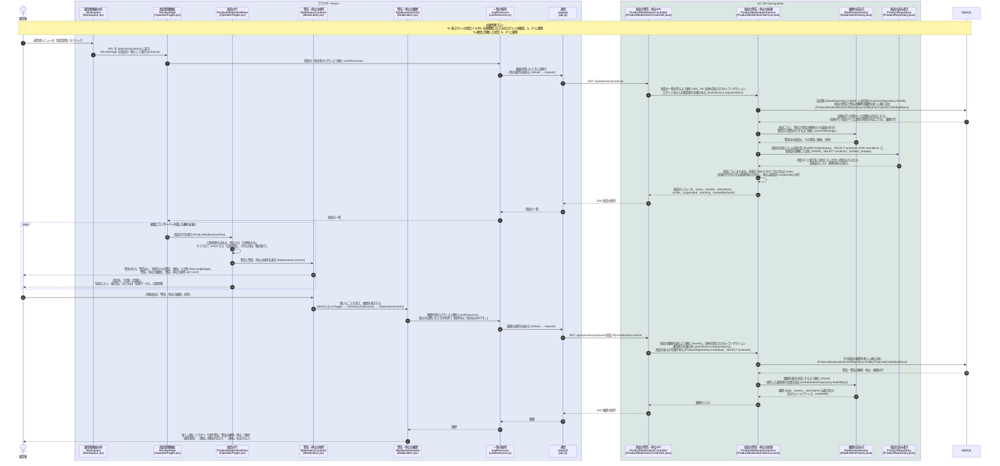
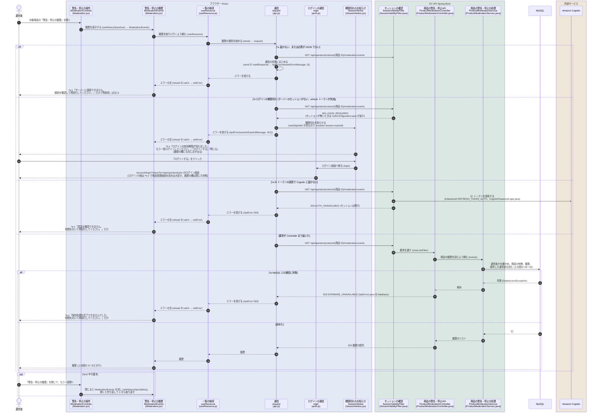

# EC-A06 商品情報を確認する

- ユースケース記述: [EC-A06_商品情報を確認する](<../../アーカイブ/ユースケース/kusakari-ec/EC-A06_商品情報を確認する.md>)
- 共通代替フロー: [00_全ユースケース共通の代替フロー](<00_全ユースケース共通の代替フロー.md>)
- 対象のコード: kusakari-ec の main（6bad7e3、2026-11-24 時点）

## シーケンス図

参加者は、上から「画面や役割の名前」「コンポーネント・クラスの名前」「ファイル名（かっこ付き）」の順に書いています。
共通代替フローの中身は、00 の図か、下の「共通代替フローを直接書いた図」を見てください。
エラーの分岐は描かず、一覧が空のときの表示（2a・5a）は図の下に並べています。

図に描いていない代替フロー：2a（商品がない）、5a（履歴がない）

## 共通代替フローを直接書いた図

上の図の「警告・停止の履歴」を開いたときの通信（`GET /api/operator/products/{商品 ID}/moderation-events`）に、この画面で起こる共通代替フロー（\*a、\*b）を書き込んだ図です。履歴の欄はエラーの文だけを出し、「再取得」を出さないので、一覧と違う形になります。画面を開いて商品の一覧を取る通信（`GET /api/operator/products`）の \*a・\*b は、[EC-A05](<EC-A05_店舗情報を確認する.md>) の「共通代替フローを直接書いた図」と同じ流れ（URL を直接開いたときのログインの確認、`ResourceStatus` のエラーの文と「再取得」）なので省いています。

## ユースケース記述との差

- 基本フロー 2: 一覧の行には、記述にない「追加した人：表示名」も出ます。商品を追加した会員の表示名で、追加した人がない商品（初期データ）は「初期データ」と出ます（`ProductRepository.findAllCreatorNames()`、`ProductModerationRow`）。
- 基本フロー 2: 一覧は、出店者が削除した商品（「販売終了」）も含む全商品です。在庫の行がない商品も「販売終了」になります。並べ替えはしておらず、`ProductRepository.findAll()` の順のままです。
- 基本フロー 2: 各行には、警告・停止の操作（EC-A10）のボタンも出ます。
- 2a: 削除済みの商品も一覧に入るので、「対象の商品はありません。」が出るのは、商品の行が 1 件もないときだけです。
- 基本フロー 5: 「操作した運営者」は会員の表示名です。表示名が空なら、メールアドレスを出します（`ModerationHistory.nameOf()`）。記述にはこの決まりが書かれていません。
- 共通代替フロー \*a: 履歴の取得に失敗したとき、`ModerationEvents` はエラーの文だけを出し、「再取得」ボタンを出しません。「警告・停止の履歴」を閉じて開き直すと、`ModerationEvents` を作り直して取り直します。\*a-3 の「再実行を可能にする」とは、やり直し方が違います。
- 共通代替フロー \*a: MySQL との通信に失敗したときの文は、読むだけの通信でも「保存処理を完了できませんでした。時間をおいて再試行してください。」です（`ApiErrors.database()` の文が 1 つだけのため）。
- 履歴の API は、商品がないときに 404 `PRODUCT_NOT_FOUND` を返します。一覧にある商品から開くので、図には書いていません。
- 運営者でない会員がこの画面を開くと、`Workspace.jsx` が「この画面を利用する権限がありません。」を出し、一覧を取りに行きません。API も `requireAdmin()` で 403 `FORBIDDEN` を返します。事前条件が運営者のログインなので、図には書いていません。

## 確かめられなかったこと

- 商品の一覧の並び順です。`ProductModerationService.list()` は `ProductRepository.findAll()` の順のまま返し、ORDER BY も並べ替えもありません。実際に MySQL が返す順は、実行して確かめていません。

## 参照したコード

- [frontend/src/workspace/Workspace.jsx](https://github.com/abeouga/kusakari-ec/blob/6bad7e37c4135034fbe97e30309772fbe872e675/frontend/src/workspace/Workspace.jsx): `operatorMenu`、`Workspace`（未ログインと運営者の確認、path と画面の対応）
- [frontend/src/workspace/WorkspaceSidebar.jsx](https://github.com/abeouga/kusakari-ec/blob/6bad7e37c4135034fbe97e30309772fbe872e675/frontend/src/workspace/WorkspaceSidebar.jsx): `MenuLink`
- [frontend/src/workspace/Common.jsx](https://github.com/abeouga/kusakari-ec/blob/6bad7e37c4135034fbe97e30309772fbe872e675/frontend/src/workspace/Common.jsx): `PageLink`
- [frontend/src/workspace/OperatorPages.jsx](https://github.com/abeouga/kusakari-ec/blob/6bad7e37c4135034fbe97e30309772fbe872e675/frontend/src/workspace/OperatorPages.jsx): `ReviewPage`（`products`、空の一覧の文言）、`ProductModerationRow`
- [frontend/src/workspace/Moderation.jsx](https://github.com/abeouga/kusakari-ec/blob/6bad7e37c4135034fbe97e30309772fbe872e675/frontend/src/workspace/Moderation.jsx): `ModerationControls`（`historyOpen`）、`WarningBadge`、`ModerationEvents`、`eventLabels`
- [frontend/src/workspace/useResource.js](https://github.com/abeouga/kusakari-ec/blob/6bad7e37c4135034fbe97e30309772fbe872e675/frontend/src/workspace/useResource.js): `useResource`、`reload`
- [frontend/src/workspace/ResourceView.jsx](https://github.com/abeouga/kusakari-ec/blob/6bad7e37c4135034fbe97e30309772fbe872e675/frontend/src/workspace/ResourceView.jsx): `ResourceStatus`
- [frontend/src/api.js](https://github.com/abeouga/kusakari-ec/blob/6bad7e37c4135034fbe97e30309772fbe872e675/frontend/src/api.js): `request`、`send`、`readResponse`、`ApiError`、`networkErrorMessage`、`sessionExpiredMessage`
- [frontend/src/auth.js](https://github.com/abeouga/kusakari-ec/blob/6bad7e37c4135034fbe97e30309772fbe872e675/frontend/src/auth.js): `authFetch`、`wasSignedIn`、`login`
- [frontend/src/components/SessionNotice.jsx](https://github.com/abeouga/kusakari-ec/blob/6bad7e37c4135034fbe97e30309772fbe872e675/frontend/src/components/SessionNotice.jsx): 期限切れのお知らせ
- [backend/src/main/java/jp/kusakari/ec/catalog/controller/ProductModerationController.java](https://github.com/abeouga/kusakari-ec/blob/6bad7e37c4135034fbe97e30309772fbe872e675/backend/src/main/java/jp/kusakari/ec/catalog/controller/ProductModerationController.java): `list`、`events`
- [backend/src/main/java/jp/kusakari/ec/catalog/service/ProductModerationService.java](https://github.com/abeouga/kusakari-ec/blob/6bad7e37c4135034fbe97e30309772fbe872e675/backend/src/main/java/jp/kusakari/ec/catalog/service/ProductModerationService.java): `list`、`events`、`Product`
- [backend/src/main/java/jp/kusakari/ec/moderation/service/ModerationHistory.java](https://github.com/abeouga/kusakari-ec/blob/6bad7e37c4135034fbe97e30309772fbe872e675/backend/src/main/java/jp/kusakari/ec/moderation/service/ModerationHistory.java): `activeWarnings`、`views`、`nameOf`
- [backend/src/main/java/jp/kusakari/ec/moderation/dto/ModerationDtos.java](https://github.com/abeouga/kusakari-ec/blob/6bad7e37c4135034fbe97e30309772fbe872e675/backend/src/main/java/jp/kusakari/ec/moderation/dto/ModerationDtos.java): `Warning`、`EventView`
- [backend/src/main/java/jp/kusakari/ec/catalog/persistence/repository/ProductRepository.java](https://github.com/abeouga/kusakari-ec/blob/6bad7e37c4135034fbe97e30309772fbe872e675/backend/src/main/java/jp/kusakari/ec/catalog/persistence/repository/ProductRepository.java): `findAll`（`@EntityGraph`）、`findAllCreatorNames`、`existsById`
- [backend/src/main/java/jp/kusakari/ec/catalog/persistence/repository/InventoryRepository.java](https://github.com/abeouga/kusakari-ec/blob/6bad7e37c4135034fbe97e30309772fbe872e675/backend/src/main/java/jp/kusakari/ec/catalog/persistence/repository/InventoryRepository.java): `findAll`（JpaRepository）
- [backend/src/main/java/jp/kusakari/ec/catalog/persistence/repository/StoreRepository.java](https://github.com/abeouga/kusakari-ec/blob/6bad7e37c4135034fbe97e30309772fbe872e675/backend/src/main/java/jp/kusakari/ec/catalog/persistence/repository/StoreRepository.java): `findAll`（JpaRepository）
- [backend/src/main/java/jp/kusakari/ec/moderation/persistence/repository/ProductModerationEventRepository.java](https://github.com/abeouga/kusakari-ec/blob/6bad7e37c4135034fbe97e30309772fbe872e675/backend/src/main/java/jp/kusakari/ec/moderation/persistence/repository/ProductModerationEventRepository.java): `findByEventTypeInOrderByIdDesc`、`findByProductIdOrderByIdDesc`
- [backend/src/main/java/jp/kusakari/ec/auth/AuthMemberRepository.java](https://github.com/abeouga/kusakari-ec/blob/6bad7e37c4135034fbe97e30309772fbe872e675/backend/src/main/java/jp/kusakari/ec/auth/AuthMemberRepository.java): `findAllById`（JpaRepository）
- [backend/src/main/java/jp/kusakari/ec/auth/AuthService.java](https://github.com/abeouga/kusakari-ec/blob/6bad7e37c4135034fbe97e30309772fbe872e675/backend/src/main/java/jp/kusakari/ec/auth/AuthService.java): `requireAdmin`
- [backend/src/main/java/jp/kusakari/ec/auth/SessionValidityFilter.java](https://github.com/abeouga/kusakari-ec/blob/6bad7e37c4135034fbe97e30309772fbe872e675/backend/src/main/java/jp/kusakari/ec/auth/SessionValidityFilter.java): `doFilterInternal`（ID トークンの更新、401 `LOGIN_REQUIRED`）
- [backend/src/main/java/jp/kusakari/ec/auth/CognitoPasswordLogin.java](https://github.com/abeouga/kusakari-ec/blob/6bad7e37c4135034fbe97e30309772fbe872e675/backend/src/main/java/jp/kusakari/ec/auth/CognitoPasswordLogin.java): `refresh`、503 `AUTH_UNAVAILABLE`
- [backend/src/main/java/jp/kusakari/ec/auth/AuthConfiguration.java](https://github.com/abeouga/kusakari-ec/blob/6bad7e37c4135034fbe97e30309772fbe872e675/backend/src/main/java/jp/kusakari/ec/auth/AuthConfiguration.java): `authenticationEntryPoint`（401 `LOGIN_REQUIRED`）
- [backend/src/main/java/jp/kusakari/ec/common/web/ApiErrors.java](https://github.com/abeouga/kusakari-ec/blob/6bad7e37c4135034fbe97e30309772fbe872e675/backend/src/main/java/jp/kusakari/ec/common/web/ApiErrors.java): `database`（503 `DATABASE_UNAVAILABLE`）
