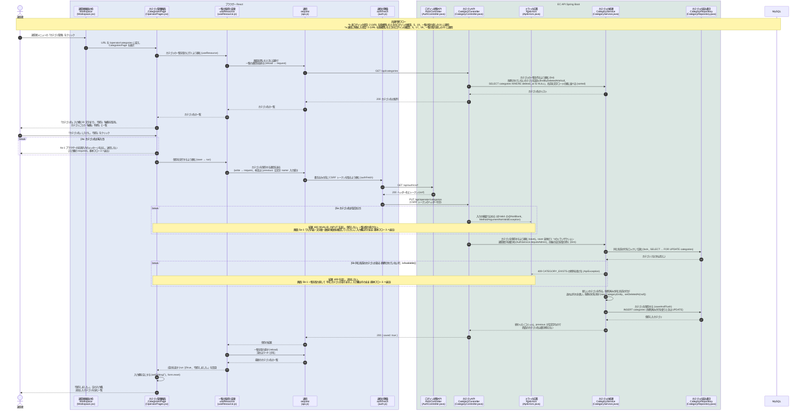
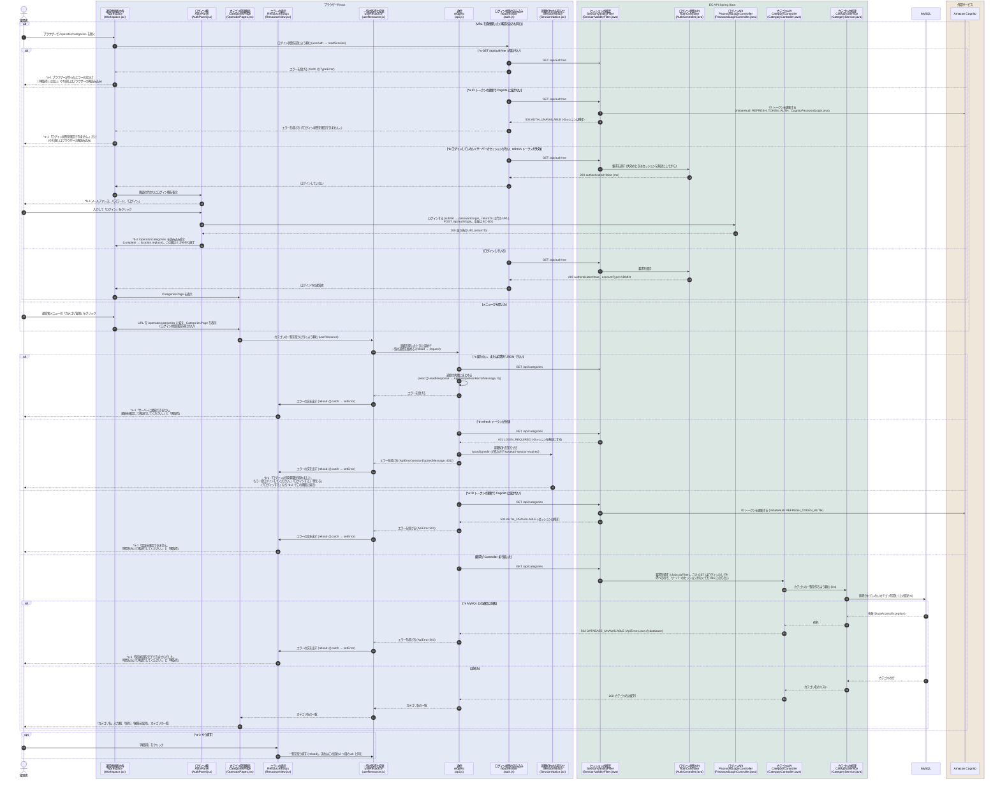
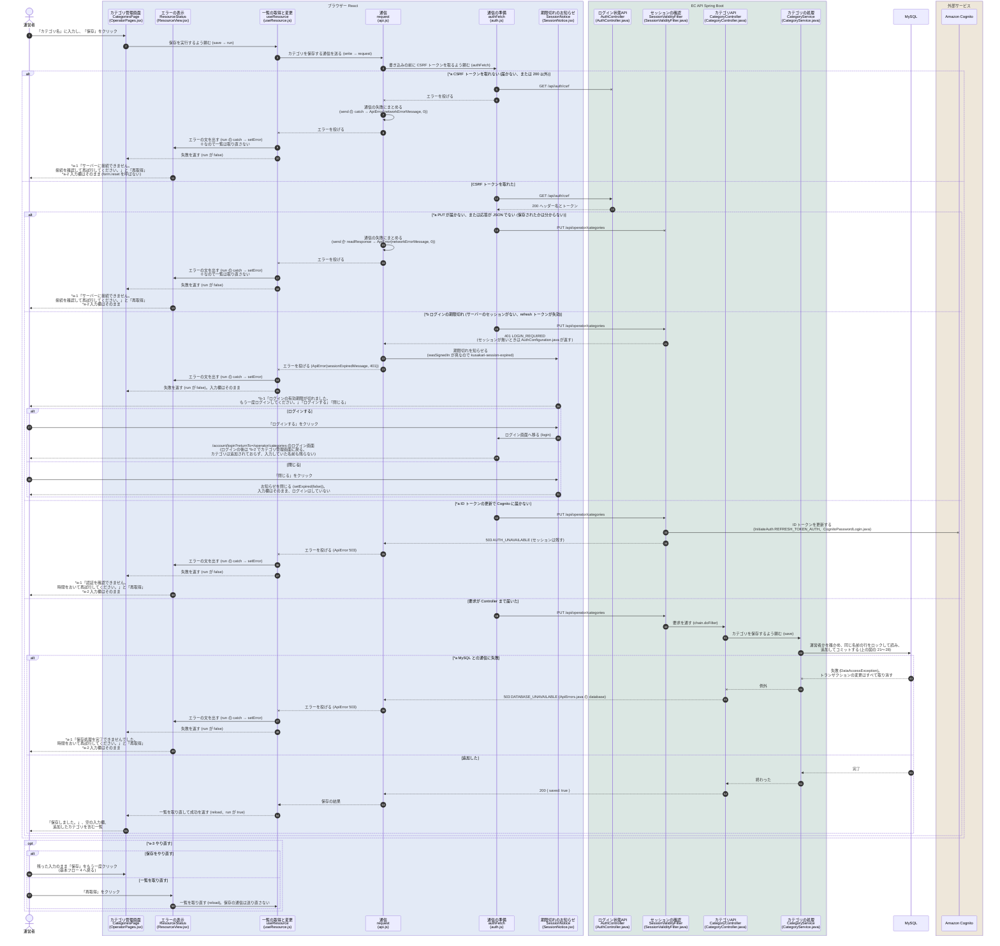

# EC-A07 商品カテゴリを追加する

- ユースケース記述: [EC-A07_商品カテゴリを追加する](<../../アーカイブ/ユースケース/kusakari-ec/EC-A07_商品カテゴリを追加する.md>)
- 共通代替フロー: [00_全ユースケース共通の代替フロー](<00_全ユースケース共通の代替フロー.md>)
- 対象のコード: kusakari-ec の main（6bad7e3、2026-11-24 時点）

## シーケンス図

参加者は、上から「画面や役割の名前」「コンポーネント・クラスの名前」「ファイル名（かっこ付き）」の順に書いています。
共通代替フローの中身は、00 の図か、下の「共通代替フローを直接書いた図」を見てください。
代替フローのうち、エラーで終わるもの（4a・5a・5b）は分かれる所だけを描き、結果と画面は Note に文で書いています。エラーのときの画面の後処理（`readResponse` が `ApiError` を投げる → 409 なら `reload` で一覧を取り直す → `run` が false → エラーの文を出す）は、どれも同じです。

## 共通代替フローを直接書いた図

上の図の通信に、この画面で起こる共通代替フロー（\*a、\*b）を書き込んだ図です。画面を開くときと「保存」をクリックしたときの 2 つに分けています。EC-A08・EC-A09 の画面を開くときの図は、この 1 つ目の図と同じです。

### 画面を開くとき

ログイン状態の確認（`GET /api/auth/me`）は、URL を直接開いたとき（再読み込みを含む）だけ行います。メニューのクリックでは読み直しません。

### 「保存」をクリックしたとき

## ユースケース記述との差

- 関連情報は「共通代替フロー \*b を適用する」だけですが、一覧の取得と保存の通信には \*a も起こります。図には両方を書いています。
- 一覧の取得（`GET /api/categories`）は、ログインしていなくても呼べる API です（`AuthConfiguration.java` の `permitAll`）。そのため、サーバーのセッションがないときもこの GET は 200 で一覧を返し、\*b にはなりません。\*b になるのは、セッションが残っていて refresh トークンが失効しているとき（`SessionValidityFilter` の 401）だけです。保存の `PUT /api/operator/categories` は、どちらのときも 401 `LOGIN_REQUIRED` になります。
- 基本フロー 2 の「名前順」は、`CategoryService.list()` が `String` を `sorted()` で並べた順です。文字コードの順なので、読みの五十音順にはなりません。
- 5a の空白だけの入力は、`CategoryController.Input` の `@NotBlank` で止まり、`ApiErrors.invalid()` の「入力内容・文字数・数値の範囲を確認してください。」になります。記述どおりです。`CategoryService.save()` にある「カテゴリ名を入力してください。」（400 `INVALID_CATEGORY`）は、この経路では届きません。
- `@NotBlank` の検査と `trim()` は、どちらも `String.trim()` と同じ決まりで空白を判定します。`String.trim()` は全角の空白（U+3000）を取り除かないため、コードから読むと、全角の空白だけのカテゴリ名は 5a にならずに保存されます。前後の全角の空白も取り除かれません。関連情報の「前後の空白を取り除いて保存する」は半角の空白などだけに当てはまります。
- 30 文字を超える入力は、入力欄の `maxLength` で打てません。API を直接呼んだときだけ `@Size(max = 30)` で 400 `INVALID_INPUT` になります。記述の関連情報どおりです。
- 記述にない処理として、削除済みの同じ名前の行（`deleted_at` が入った行）があると、新しい行を作らずにその行の `deleted_at` を空に戻します（EC-A09 で、削除済みの商品だけが使っていたカテゴリは行を残すため）。
- 5b のあと、画面は一覧を取り直します（`useResource` の `run` は 404 と 409 のときに `reload` します）。記述にない処理です。
- 保存の通信が失敗したとき（\*a、\*b）は、`save()` が `form.reset()` を呼ばないので、入力欄はそのまま残ります（\*a-2）。「再取得」は一覧を取り直すだけで、保存の通信は送り直しません。
- 運営者でない会員がこの画面を開くと、`Workspace.jsx` が「この画面を利用する権限がありません。」を出し、一覧を取りに行きません。API も `requireAdmin()` で 403 `FORBIDDEN` を返します。事前条件が運営者のログインなので、図には書いていません。

## 確かめられなかったこと

- 2 人の運営者が同じ名前を同時に追加したときの動きは、動かして確かめていません。まだ無い行への `lock`（`SELECT ... FOR UPDATE`）で待つのか、主キーの重複で `DataIntegrityViolationException` になり `ApiErrors.conflict()` の 409 `DATA_CHANGED` になるのかは、コードだけでは決められません。
- `categories` の表は照合順序を指定していません（`V1__schema.sql`）。MySQL 8 の既定の照合順序なら大文字と小文字を区別しないので、「Herb」があるときに「herb」を追加すると 5b の 409 になると読めますが、動かして確かめていません。

## 参照したコード

- [frontend/src/workspace/Workspace.jsx](https://github.com/abeouga/kusakari-ec/blob/6bad7e37c4135034fbe97e30309772fbe872e675/frontend/src/workspace/Workspace.jsx): `operatorMenu`、`Workspace`（未ログインのときの `AuthPanel`、ADMIN の確認、`CategoriesPage` の表示）
- [frontend/src/workspace/WorkspaceSidebar.jsx](https://github.com/abeouga/kusakari-ec/blob/6bad7e37c4135034fbe97e30309772fbe872e675/frontend/src/workspace/WorkspaceSidebar.jsx): `MenuLink`
- [frontend/src/workspace/Common.jsx](https://github.com/abeouga/kusakari-ec/blob/6bad7e37c4135034fbe97e30309772fbe872e675/frontend/src/workspace/Common.jsx): `PageLink`
- [frontend/src/workspace/OperatorPages.jsx](https://github.com/abeouga/kusakari-ec/blob/6bad7e37c4135034fbe97e30309772fbe872e675/frontend/src/workspace/OperatorPages.jsx): `CategoriesPage`（`save`、`editing`）
- [frontend/src/workspace/ResourceView.jsx](https://github.com/abeouga/kusakari-ec/blob/6bad7e37c4135034fbe97e30309772fbe872e675/frontend/src/workspace/ResourceView.jsx): `Input`（`required`、`maxLength`）、`values`、`ResourceStatus`（エラーの文と「再取得」）
- [frontend/src/workspace/useResource.js](https://github.com/abeouga/kusakari-ec/blob/6bad7e37c4135034fbe97e30309772fbe872e675/frontend/src/workspace/useResource.js): `useResource`、`reload`、`run`、`write`
- [frontend/src/api.js](https://github.com/abeouga/kusakari-ec/blob/6bad7e37c4135034fbe97e30309772fbe872e675/frontend/src/api.js): `request`、`send`、`readResponse`、`ApiError`、`networkErrorMessage`、`sessionExpiredMessage`
- [frontend/src/auth.js](https://github.com/abeouga/kusakari-ec/blob/6bad7e37c4135034fbe97e30309772fbe872e675/frontend/src/auth.js): `readSession`、`authFetch`（`GET /api/auth/csrf`）、`wasSignedIn`、`passwordLogin`、`login`
- [frontend/src/useAuth.js](https://github.com/abeouga/kusakari-ec/blob/6bad7e37c4135034fbe97e30309772fbe872e675/frontend/src/useAuth.js): `useAuth`
- [frontend/src/components/AuthPanel.jsx](https://github.com/abeouga/kusakari-ec/blob/6bad7e37c4135034fbe97e30309772fbe872e675/frontend/src/components/AuthPanel.jsx): `AuthPanel`（`submit`、`complete`、`returnTo`）
- [frontend/src/components/SessionNotice.jsx](https://github.com/abeouga/kusakari-ec/blob/6bad7e37c4135034fbe97e30309772fbe872e675/frontend/src/components/SessionNotice.jsx): 期限切れのお知らせ
- [backend/src/main/java/jp/kusakari/ec/catalog/controller/CategoryController.java](https://github.com/abeouga/kusakari-ec/blob/6bad7e37c4135034fbe97e30309772fbe872e675/backend/src/main/java/jp/kusakari/ec/catalog/controller/CategoryController.java): `Input`、`list`、`save`
- [backend/src/main/java/jp/kusakari/ec/catalog/service/CategoryService.java](https://github.com/abeouga/kusakari-ec/blob/6bad7e37c4135034fbe97e30309772fbe872e675/backend/src/main/java/jp/kusakari/ec/catalog/service/CategoryService.java): `list`、`save`
- [backend/src/main/java/jp/kusakari/ec/catalog/persistence/repository/CategoryRepository.java](https://github.com/abeouga/kusakari-ec/blob/6bad7e37c4135034fbe97e30309772fbe872e675/backend/src/main/java/jp/kusakari/ec/catalog/persistence/repository/CategoryRepository.java): `findByDeletedAtIsNull`、`lock`
- [backend/src/main/java/jp/kusakari/ec/catalog/persistence/entity/CategoryEntity.java](https://github.com/abeouga/kusakari-ec/blob/6bad7e37c4135034fbe97e30309772fbe872e675/backend/src/main/java/jp/kusakari/ec/catalog/persistence/entity/CategoryEntity.java): `isAvailable`、`deletedAt`
- [backend/src/main/java/jp/kusakari/ec/auth/AuthService.java](https://github.com/abeouga/kusakari-ec/blob/6bad7e37c4135034fbe97e30309772fbe872e675/backend/src/main/java/jp/kusakari/ec/auth/AuthService.java): `requireAdmin`、`current`
- [backend/src/main/java/jp/kusakari/ec/auth/AuthController.java](https://github.com/abeouga/kusakari-ec/blob/6bad7e37c4135034fbe97e30309772fbe872e675/backend/src/main/java/jp/kusakari/ec/auth/AuthController.java): `me`、`csrf`
- [backend/src/main/java/jp/kusakari/ec/auth/PasswordLoginController.java](https://github.com/abeouga/kusakari-ec/blob/6bad7e37c4135034fbe97e30309772fbe872e675/backend/src/main/java/jp/kusakari/ec/auth/PasswordLoginController.java): `POST /api/auth/login`
- [backend/src/main/java/jp/kusakari/ec/auth/SessionValidityFilter.java](https://github.com/abeouga/kusakari-ec/blob/6bad7e37c4135034fbe97e30309772fbe872e675/backend/src/main/java/jp/kusakari/ec/auth/SessionValidityFilter.java): `doFilterInternal`（ID トークンの更新、401、503）
- [backend/src/main/java/jp/kusakari/ec/auth/CognitoPasswordLogin.java](https://github.com/abeouga/kusakari-ec/blob/6bad7e37c4135034fbe97e30309772fbe872e675/backend/src/main/java/jp/kusakari/ec/auth/CognitoPasswordLogin.java): ID トークンの更新、503 `AUTH_UNAVAILABLE`
- [backend/src/main/java/jp/kusakari/ec/auth/AuthConfiguration.java](https://github.com/abeouga/kusakari-ec/blob/6bad7e37c4135034fbe97e30309772fbe872e675/backend/src/main/java/jp/kusakari/ec/auth/AuthConfiguration.java): `authorizeHttpRequests`（`/api/categories` の `permitAll`）、`authenticationEntryPoint`（401 `LOGIN_REQUIRED`）
- [backend/src/main/java/jp/kusakari/ec/common/web/ApiErrors.java](https://github.com/abeouga/kusakari-ec/blob/6bad7e37c4135034fbe97e30309772fbe872e675/backend/src/main/java/jp/kusakari/ec/common/web/ApiErrors.java): `business`、`invalid`、`conflict`、`database`
- [backend/src/main/resources/db/migration/V1__schema.sql](https://github.com/abeouga/kusakari-ec/blob/6bad7e37c4135034fbe97e30309772fbe872e675/backend/src/main/resources/db/migration/V1__schema.sql): `categories`
