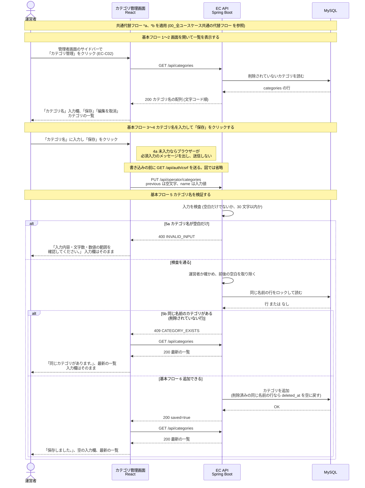
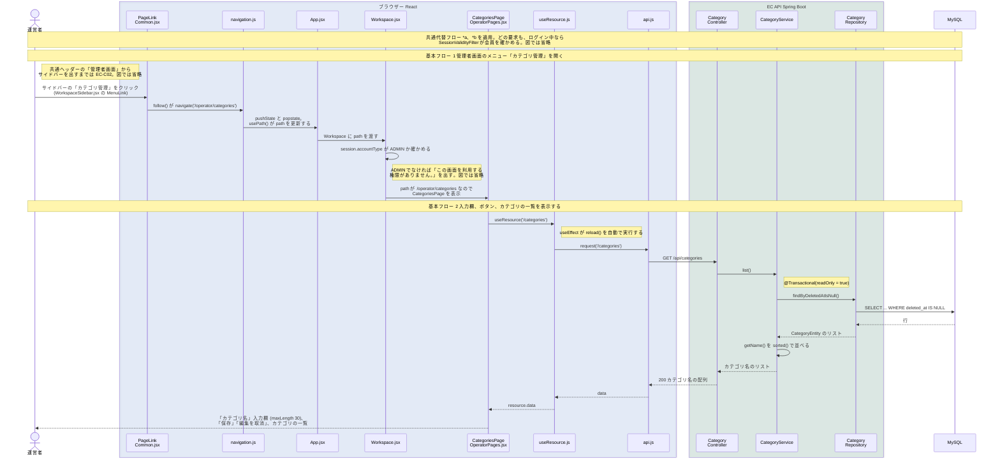
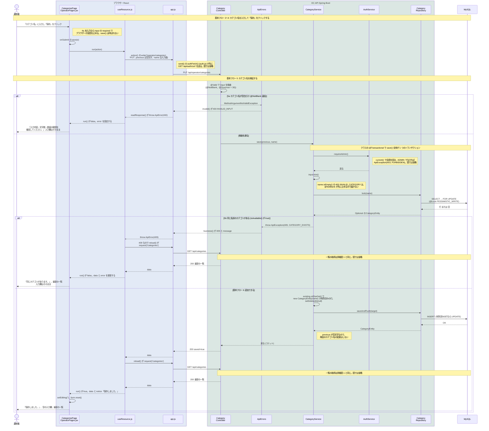

# EC-A07 商品カテゴリを追加する

- ユースケース記述: [EC-A07_商品カテゴリを追加する](<../../アーカイブ/ユースケース/kusakari-ec/EC-A07_商品カテゴリを追加する.md>)
- 対象のコード: kusakari-ec の main（19a2be3、2026-11-20 時点）

## 概要図

## 詳細図 1 基本フロー 1〜2

## 詳細図 2 基本フロー 3〜6

## ユースケース記述との差

- 基本フロー 2 の「名前順」は、`CategoryService.list()` が `String` を `sorted()` で並べた順です。文字コードの順なので、読みの五十音順にはなりません。
- 5a の空白だけの入力は、`CategoryController.Input` の `@NotBlank` で止まり、`ApiErrors.invalid()` の「入力内容・文字数・数値の範囲を確認してください。」になります。記述どおりです。`CategoryService.save()` にある「カテゴリ名を入力してください。」（400 `INVALID_CATEGORY`）は、この経路では届きません。
- `@NotBlank` の検査と `input.trim()` は、どちらも `String.trim()` で空白を判定します。`String.trim()` は全角の空白（U+3000）を取り除かないため、コードから読むと、全角の空白だけのカテゴリ名は 5a にならずに保存されます。前後の全角の空白も取り除かれません。関連情報の「前後の空白を取り除いて保存する」は半角の空白だけに当てはまります。
- 記述にない処理として、削除済みの同じ名前の行（`deleted_at` が入った行）があると、新しい行を作らずにその行の `deleted_at` を空に戻します（EC-A09 で、削除済みの商品だけが使っていたカテゴリは行を残すため）。
- 記述にない処理として、保存の前に `GET /api/auth/csrf` で CSRF トークンを取ります。運営者でない会員の要求は `AuthService.requireAdmin()` が 403 `FORBIDDEN` にします。画面は `Workspace.jsx` が運営者以外にこの画面を出しません。

## 確かめられなかったこと

- 2 人の運営者が同じ名前を同時に追加したときの動きは、動かして確かめていません。まだ無い行への `lock(name)`（`SELECT ... FOR UPDATE`）で待つのか、主キーの重複で `DataIntegrityViolationException` になり `ApiErrors.conflict()` の 409 `DATA_CHANGED` になるのかは、コードだけでは決められません。

## 参照したコード

- [frontend/src/workspace/WorkspaceSidebar.jsx](https://github.com/abeouga/kusakari-ec/blob/19a2be307ee71a2cd87e538236c3c8c42929c5b3/frontend/src/workspace/WorkspaceSidebar.jsx): `MenuLink`
- [frontend/src/workspace/Common.jsx](https://github.com/abeouga/kusakari-ec/blob/19a2be307ee71a2cd87e538236c3c8c42929c5b3/frontend/src/workspace/Common.jsx): `PageLink` の `follow()`
- [frontend/src/workspace/navigation.js](https://github.com/abeouga/kusakari-ec/blob/19a2be307ee71a2cd87e538236c3c8c42929c5b3/frontend/src/workspace/navigation.js): `navigate()`、`usePath()`
- [frontend/src/App.jsx](https://github.com/abeouga/kusakari-ec/blob/19a2be307ee71a2cd87e538236c3c8c42929c5b3/frontend/src/App.jsx): `App`（`Workspace` に `path` を渡す）
- [frontend/src/workspace/Workspace.jsx](https://github.com/abeouga/kusakari-ec/blob/19a2be307ee71a2cd87e538236c3c8c42929c5b3/frontend/src/workspace/Workspace.jsx): `operatorMenu`、`Workspace`（ADMIN の確認、`CategoriesPage` の表示）
- [frontend/src/workspace/OperatorPages.jsx](https://github.com/abeouga/kusakari-ec/blob/19a2be307ee71a2cd87e538236c3c8c42929c5b3/frontend/src/workspace/OperatorPages.jsx): `CategoriesPage` の `save()`
- [frontend/src/workspace/ResourceView.jsx](https://github.com/abeouga/kusakari-ec/blob/19a2be307ee71a2cd87e538236c3c8c42929c5b3/frontend/src/workspace/ResourceView.jsx): `Input`（`required`、`maxLength`）、`values()`、`ResourceStatus`
- [frontend/src/workspace/useResource.js](https://github.com/abeouga/kusakari-ec/blob/19a2be307ee71a2cd87e538236c3c8c42929c5b3/frontend/src/workspace/useResource.js): `useResource` の `reload()`、`run()`、`write()`
- [frontend/src/api.js](https://github.com/abeouga/kusakari-ec/blob/19a2be307ee71a2cd87e538236c3c8c42929c5b3/frontend/src/api.js): `request()`、`send()`、`readResponse()`
- [frontend/src/auth.js](https://github.com/abeouga/kusakari-ec/blob/19a2be307ee71a2cd87e538236c3c8c42929c5b3/frontend/src/auth.js): `authFetch()`
- [backend/src/main/java/jp/kusakari/ec/catalog/controller/CategoryController.java](https://github.com/abeouga/kusakari-ec/blob/19a2be307ee71a2cd87e538236c3c8c42929c5b3/backend/src/main/java/jp/kusakari/ec/catalog/controller/CategoryController.java): `Input`、`list()`、`save()`
- [backend/src/main/java/jp/kusakari/ec/catalog/service/CategoryService.java](https://github.com/abeouga/kusakari-ec/blob/19a2be307ee71a2cd87e538236c3c8c42929c5b3/backend/src/main/java/jp/kusakari/ec/catalog/service/CategoryService.java): `list()`、`save()`
- [backend/src/main/java/jp/kusakari/ec/catalog/persistence/repository/CategoryRepository.java](https://github.com/abeouga/kusakari-ec/blob/19a2be307ee71a2cd87e538236c3c8c42929c5b3/backend/src/main/java/jp/kusakari/ec/catalog/persistence/repository/CategoryRepository.java): `findByDeletedAtIsNull()`、`lock()`
- [backend/src/main/java/jp/kusakari/ec/catalog/persistence/entity/CategoryEntity.java](https://github.com/abeouga/kusakari-ec/blob/19a2be307ee71a2cd87e538236c3c8c42929c5b3/backend/src/main/java/jp/kusakari/ec/catalog/persistence/entity/CategoryEntity.java): `isAvailable()`、`deletedAt`
- [backend/src/main/java/jp/kusakari/ec/auth/AuthService.java](https://github.com/abeouga/kusakari-ec/blob/19a2be307ee71a2cd87e538236c3c8c42929c5b3/backend/src/main/java/jp/kusakari/ec/auth/AuthService.java): `requireAdmin()`、`current()`
- [backend/src/main/java/jp/kusakari/ec/common/web/ApiErrors.java](https://github.com/abeouga/kusakari-ec/blob/19a2be307ee71a2cd87e538236c3c8c42929c5b3/backend/src/main/java/jp/kusakari/ec/common/web/ApiErrors.java): `business()`、`invalid()`、`conflict()`
- [backend/src/main/resources/db/migration/V1__schema.sql](https://github.com/abeouga/kusakari-ec/blob/19a2be307ee71a2cd87e538236c3c8c42929c5b3/backend/src/main/resources/db/migration/V1__schema.sql): `categories`
