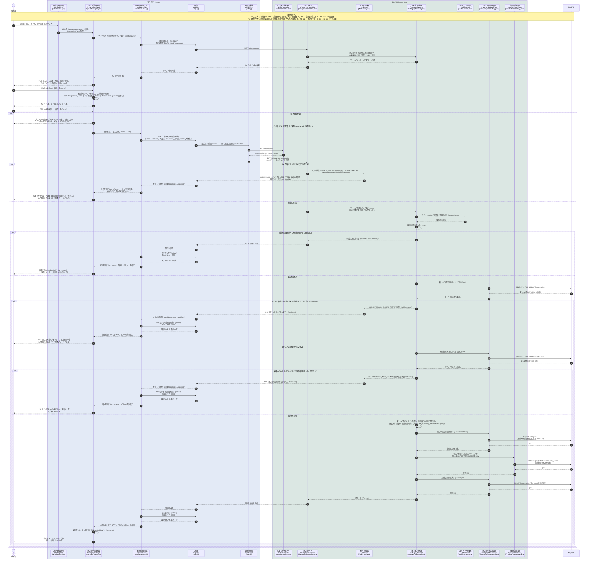
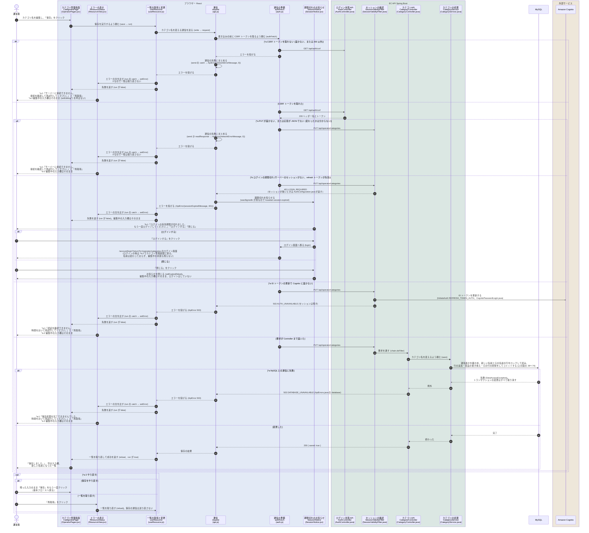

# EC-A08 商品カテゴリを編集する

- ユースケース記述: [EC-A08_商品カテゴリを編集する](<../../アーカイブ/ユースケース/kusakari-ec/EC-A08_商品カテゴリを編集する.md>)
- 共通代替フロー: [00_全ユースケース共通の代替フロー](<00_全ユースケース共通の代替フロー.md>)
- 対象のコード: kusakari-ec の main（6bad7e3、2026-11-24 時点）

## シーケンス図

参加者は、上から「画面や役割の名前」「コンポーネント・クラスの名前」「ファイル名（かっこ付き）」の順に書いています。
共通代替フローの中身は、00 の図か、下の「共通代替フローを直接書いた図」を見てください。

## 共通代替フローを直接書いた図

上の図の「保存」の通信（CSRF トークンの取得と `PUT /api/operator/categories`）に、この画面で起こる共通代替フロー（\*a、\*b）を書き込んだ図です。画面を開いて一覧を取る通信の \*a・\*b は、[EC-A07](<EC-A07_商品カテゴリを追加する.md>) の「共通代替フローを直接書いた図」の「画面を開くとき」と同じなので省いています。

## ユースケース記述との差

- 関連情報は「共通代替フロー \*b を適用する」だけですが、一覧の取得と保存の通信には \*a も起こります。図には両方を書いています。
- 一覧の取得（`GET /api/categories`）はログインしていなくても呼べる API なので、サーバーのセッションがないときも 200 で一覧を返します。\*b になるのは refresh トークンが失効しているときだけです（EC-A07 と同じ）。
- 7a の「空白のみの場合は『カテゴリ名を入力してください。』」は、コードと違います。空白だけの入力は `CategoryController.Input` の `@NotBlank` で止まり、`ApiErrors.invalid()` の「入力内容・文字数・数値の範囲を確認してください。」（400 `INVALID_INPUT`）を表示します。`CategoryService.save()` の「カテゴリ名を入力してください。」には届きません。
- 7a のうち空欄は、入力欄の `required` でブラウザーが止め、通信しません。30 文字を超える入力は、入力欄の `maxLength` で打てません。API を直接呼んだときだけ `@Size(max = 30)` で 400 `INVALID_INPUT` になります。
- `@NotBlank` の検査と `trim()` は、どちらも `String.trim()` と同じ決まりで空白を判定します。コードから読むと、全角の空白（U+3000）だけの名前は 7a にならずに保存され、前後の全角の空白も取り除かれません。
- 記述にない処理として、次の 3 つがあります。
  - 前後の空白を取り除いた名前が元の名前と同じなら、何も変えずに 200 を返し、「保存しました。」を表示します。
  - 編集中にほかの運営者がそのカテゴリを削除していると、404 `CATEGORY_NOT_FOUND`「カテゴリが見つかりません。」を表示し、一覧を取り直します。入力欄は編集中のまま残ります。
  - 新しい名前が削除済みのカテゴリ（`deleted_at` が入った行）と同じなら、その行を元に戻して使います。
- カテゴリ名は `categories` の主キーなので、名前の変更は「新しい名前の行を追加 → `products.category_name` を書き換え → 元の行を削除」の 3 つの SQL で行います。書き換えは削除済みの商品も含め、元の名前を持つすべての商品が対象です。関連情報の「そのカテゴリの商品にも新しいカテゴリ名が表示される」はこの書き換えによるものです。
- 基本フロー 8 には、保存のあとに入力欄を空にして編集をやめること（`setEditing('')`、`form.reset()`）が書かれていません。
- 画面には「編集を取消」ボタンがあり、押すと編集をやめて入力欄を空にします（`setEditing('')`、通信しない）。この操作は代替フローにありません。
- 運営者でない会員がこの画面を開くと、`Workspace.jsx` が「この画面を利用する権限がありません。」を出します。API も `requireAdmin()` で 403 `FORBIDDEN` を返します。事前条件が運営者のログインなので、図には書いていません。

## 確かめられなかったこと

- 2 人の運営者が同時に編集したときの動きは、動かして確かめていません。`save()` は新しい名前、元の名前の順に `lock()` で行をロックします。2 つの編集が互いの名前を入れ替えるような場合に、待ちやデッドロックになるか、`ApiErrors.conflict()` の 409 `DATA_CHANGED` になるかは、コードだけでは決められません。
- `categories` の表は照合順序を指定していません（`V1__schema.sql`）。MySQL 8 の既定の照合順序なら大文字と小文字を区別しないので、「herb」を「Herb」に変えるような、大文字と小文字だけの変更は、新しい名前の `lock()` が元の行を見つけて 409「同じカテゴリがあります。」になると読めます。動かして確かめていません。

## 参照したコード

- [frontend/src/workspace/Workspace.jsx](https://github.com/abeouga/kusakari-ec/blob/6bad7e37c4135034fbe97e30309772fbe872e675/frontend/src/workspace/Workspace.jsx): `operatorMenu`、`Workspace`（ADMIN の確認、`CategoriesPage` の表示）
- [frontend/src/workspace/WorkspaceSidebar.jsx](https://github.com/abeouga/kusakari-ec/blob/6bad7e37c4135034fbe97e30309772fbe872e675/frontend/src/workspace/WorkspaceSidebar.jsx): `MenuLink`
- [frontend/src/workspace/Common.jsx](https://github.com/abeouga/kusakari-ec/blob/6bad7e37c4135034fbe97e30309772fbe872e675/frontend/src/workspace/Common.jsx): `PageLink`
- [frontend/src/workspace/OperatorPages.jsx](https://github.com/abeouga/kusakari-ec/blob/6bad7e37c4135034fbe97e30309772fbe872e675/frontend/src/workspace/OperatorPages.jsx): `CategoriesPage`（`save`、`editing`、「編集」「編集を取消」の `onClick`）
- [frontend/src/workspace/ResourceView.jsx](https://github.com/abeouga/kusakari-ec/blob/6bad7e37c4135034fbe97e30309772fbe872e675/frontend/src/workspace/ResourceView.jsx): `Input`（`required`、`maxLength`、`defaultValue`）、`values`、`ResourceStatus`
- [frontend/src/workspace/useResource.js](https://github.com/abeouga/kusakari-ec/blob/6bad7e37c4135034fbe97e30309772fbe872e675/frontend/src/workspace/useResource.js): `useResource`、`reload`、`run`、`write`
- [frontend/src/api.js](https://github.com/abeouga/kusakari-ec/blob/6bad7e37c4135034fbe97e30309772fbe872e675/frontend/src/api.js): `request`、`send`、`readResponse`、`ApiError`、`networkErrorMessage`、`sessionExpiredMessage`
- [frontend/src/auth.js](https://github.com/abeouga/kusakari-ec/blob/6bad7e37c4135034fbe97e30309772fbe872e675/frontend/src/auth.js): `authFetch`（`GET /api/auth/csrf`）、`wasSignedIn`、`login`
- [frontend/src/components/SessionNotice.jsx](https://github.com/abeouga/kusakari-ec/blob/6bad7e37c4135034fbe97e30309772fbe872e675/frontend/src/components/SessionNotice.jsx): 期限切れのお知らせ
- [backend/src/main/java/jp/kusakari/ec/catalog/controller/CategoryController.java](https://github.com/abeouga/kusakari-ec/blob/6bad7e37c4135034fbe97e30309772fbe872e675/backend/src/main/java/jp/kusakari/ec/catalog/controller/CategoryController.java): `Input`、`list`、`save`
- [backend/src/main/java/jp/kusakari/ec/catalog/service/CategoryService.java](https://github.com/abeouga/kusakari-ec/blob/6bad7e37c4135034fbe97e30309772fbe872e675/backend/src/main/java/jp/kusakari/ec/catalog/service/CategoryService.java): `list`、`save`、`notFound`
- [backend/src/main/java/jp/kusakari/ec/catalog/persistence/repository/CategoryRepository.java](https://github.com/abeouga/kusakari-ec/blob/6bad7e37c4135034fbe97e30309772fbe872e675/backend/src/main/java/jp/kusakari/ec/catalog/persistence/repository/CategoryRepository.java): `findByDeletedAtIsNull`、`lock`
- [backend/src/main/java/jp/kusakari/ec/catalog/persistence/repository/ProductRepository.java](https://github.com/abeouga/kusakari-ec/blob/6bad7e37c4135034fbe97e30309772fbe872e675/backend/src/main/java/jp/kusakari/ec/catalog/persistence/repository/ProductRepository.java): `renameCategory`
- [backend/src/main/java/jp/kusakari/ec/catalog/persistence/entity/CategoryEntity.java](https://github.com/abeouga/kusakari-ec/blob/6bad7e37c4135034fbe97e30309772fbe872e675/backend/src/main/java/jp/kusakari/ec/catalog/persistence/entity/CategoryEntity.java): `isAvailable`、`deletedAt`
- [backend/src/main/java/jp/kusakari/ec/auth/AuthService.java](https://github.com/abeouga/kusakari-ec/blob/6bad7e37c4135034fbe97e30309772fbe872e675/backend/src/main/java/jp/kusakari/ec/auth/AuthService.java): `requireAdmin`、`current`
- [backend/src/main/java/jp/kusakari/ec/auth/AuthController.java](https://github.com/abeouga/kusakari-ec/blob/6bad7e37c4135034fbe97e30309772fbe872e675/backend/src/main/java/jp/kusakari/ec/auth/AuthController.java): `csrf`
- [backend/src/main/java/jp/kusakari/ec/auth/SessionValidityFilter.java](https://github.com/abeouga/kusakari-ec/blob/6bad7e37c4135034fbe97e30309772fbe872e675/backend/src/main/java/jp/kusakari/ec/auth/SessionValidityFilter.java): `doFilterInternal`（ID トークンの更新、401、503）
- [backend/src/main/java/jp/kusakari/ec/auth/CognitoPasswordLogin.java](https://github.com/abeouga/kusakari-ec/blob/6bad7e37c4135034fbe97e30309772fbe872e675/backend/src/main/java/jp/kusakari/ec/auth/CognitoPasswordLogin.java): ID トークンの更新、503 `AUTH_UNAVAILABLE`
- [backend/src/main/java/jp/kusakari/ec/auth/AuthConfiguration.java](https://github.com/abeouga/kusakari-ec/blob/6bad7e37c4135034fbe97e30309772fbe872e675/backend/src/main/java/jp/kusakari/ec/auth/AuthConfiguration.java): `authorizeHttpRequests`（`/api/categories` の `permitAll`）、`authenticationEntryPoint`（401 `LOGIN_REQUIRED`）
- [backend/src/main/java/jp/kusakari/ec/common/web/ApiErrors.java](https://github.com/abeouga/kusakari-ec/blob/6bad7e37c4135034fbe97e30309772fbe872e675/backend/src/main/java/jp/kusakari/ec/common/web/ApiErrors.java): `business`、`invalid`、`conflict`、`database`
- [backend/src/main/resources/db/migration/V1__schema.sql](https://github.com/abeouga/kusakari-ec/blob/6bad7e37c4135034fbe97e30309772fbe872e675/backend/src/main/resources/db/migration/V1__schema.sql): `categories`、`products` の `fk_products_category`
