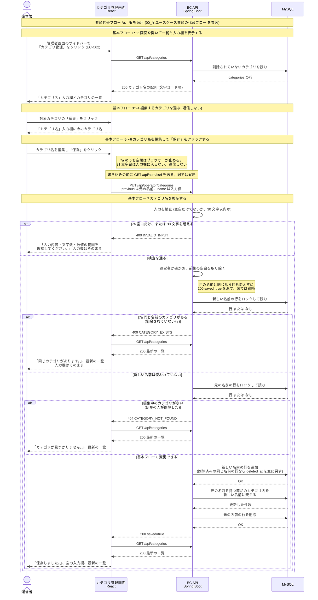
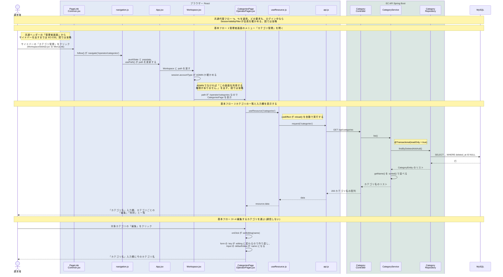
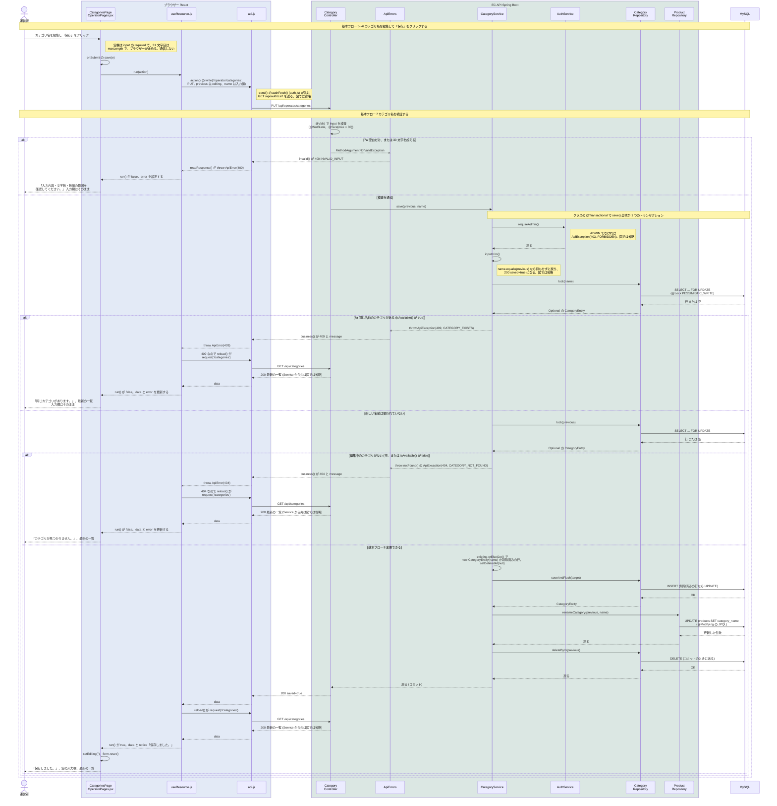

# EC-A08 商品カテゴリを編集する

- ユースケース記述: [EC-A08_商品カテゴリを編集する](<../../アーカイブ/ユースケース/kusakari-ec/EC-A08_商品カテゴリを編集する.md>)
- 対象のコード: kusakari-ec の main（19a2be3、2026-11-20 時点）

## 概要図

## 詳細図 1 基本フロー 1〜4

## 詳細図 2 基本フロー 5〜8

## ユースケース記述との差

- 7a の「空白のみの場合は『カテゴリ名を入力してください。』」は、コードと違います。空白だけの入力は `CategoryController.Input` の `@NotBlank` で止まり、`ApiErrors.invalid()` の「入力内容・文字数・数値の範囲を確認してください。」（400 `INVALID_INPUT`）を表示します。`CategoryService.save()` の「カテゴリ名を入力してください。」には届きません。
- 7a のうち空欄は、入力欄の `required` でブラウザーが止め、通信しません。30 文字を超える入力は、入力欄の `maxLength` で打てません。API を直接呼んだときだけ `@Size(max = 30)` で 400 `INVALID_INPUT` になります。
- `@NotBlank` の検査と `input.trim()` は、どちらも `String.trim()` で空白を判定します。コードから読むと、全角の空白（U+3000）だけの名前は 7a にならずに保存され、前後の全角の空白も取り除かれません。
- 記述にない処理として、次の 3 つがあります。
  - 前後の空白を取り除いた名前が元の名前と同じなら、何も変えずに 200 を返し、「保存しました。」を表示します。
  - 編集中にほかの運営者がそのカテゴリを削除していると、404 `CATEGORY_NOT_FOUND`「カテゴリが見つかりません。」を表示し、一覧を取り直します。
  - 新しい名前が削除済みのカテゴリ（`deleted_at` が入った行）と同じなら、その行を元に戻して使います。
- カテゴリ名は `categories` の主キーなので、名前の変更は「新しい名前の行を追加 → `products.category_name` を書き換え → 元の行を削除」の 3 つの SQL で行います。書き換えは削除済みの商品も含め、元の名前を持つすべての商品が対象です。関連情報の「そのカテゴリの商品にも新しいカテゴリ名が表示される」はこの書き換えによるものです。
- 基本フロー 8 には、保存のあとに入力欄を空にして編集をやめること（`setEditing('')`、`form.reset()`）が書かれていません。
- 画面には「編集を取消」ボタンがあり、押すと編集をやめて入力欄を空にします（`setEditing('')`、通信しない）。この操作は代替フローにありません。
- 記述にない処理として、保存の前に `GET /api/auth/csrf` で CSRF トークンを取ります。運営者でない会員の要求は `AuthService.requireAdmin()` が 403 `FORBIDDEN` にします。

## 確かめられなかったこと

- 2 人の運営者が同時に編集したときの動きは、動かして確かめていません。`save()` は新しい名前、元の名前の順に `lock()` で行をロックします。2 つの編集が互いの名前を入れ替えるような場合に、待ちやデッドロックになるか、`ApiErrors.conflict()` の 409 `DATA_CHANGED` になるかは、コードだけでは決められません。

## 参照したコード

- [frontend/src/workspace/WorkspaceSidebar.jsx](https://github.com/abeouga/kusakari-ec/blob/19a2be307ee71a2cd87e538236c3c8c42929c5b3/frontend/src/workspace/WorkspaceSidebar.jsx): `MenuLink`
- [frontend/src/workspace/Common.jsx](https://github.com/abeouga/kusakari-ec/blob/19a2be307ee71a2cd87e538236c3c8c42929c5b3/frontend/src/workspace/Common.jsx): `PageLink` の `follow()`
- [frontend/src/workspace/navigation.js](https://github.com/abeouga/kusakari-ec/blob/19a2be307ee71a2cd87e538236c3c8c42929c5b3/frontend/src/workspace/navigation.js): `navigate()`、`usePath()`
- [frontend/src/App.jsx](https://github.com/abeouga/kusakari-ec/blob/19a2be307ee71a2cd87e538236c3c8c42929c5b3/frontend/src/App.jsx): `App`（`Workspace` に `path` を渡す）
- [frontend/src/workspace/Workspace.jsx](https://github.com/abeouga/kusakari-ec/blob/19a2be307ee71a2cd87e538236c3c8c42929c5b3/frontend/src/workspace/Workspace.jsx): `operatorMenu`、`Workspace`（ADMIN の確認、`CategoriesPage` の表示）
- [frontend/src/workspace/OperatorPages.jsx](https://github.com/abeouga/kusakari-ec/blob/19a2be307ee71a2cd87e538236c3c8c42929c5b3/frontend/src/workspace/OperatorPages.jsx): `CategoriesPage` の `save()`、`editing`、「編集」「編集を取消」の `onClick`
- [frontend/src/workspace/ResourceView.jsx](https://github.com/abeouga/kusakari-ec/blob/19a2be307ee71a2cd87e538236c3c8c42929c5b3/frontend/src/workspace/ResourceView.jsx): `Input`（`required`、`maxLength`、`defaultValue`）、`values()`、`ResourceStatus`
- [frontend/src/workspace/useResource.js](https://github.com/abeouga/kusakari-ec/blob/19a2be307ee71a2cd87e538236c3c8c42929c5b3/frontend/src/workspace/useResource.js): `useResource` の `reload()`、`run()`、`write()`
- [frontend/src/api.js](https://github.com/abeouga/kusakari-ec/blob/19a2be307ee71a2cd87e538236c3c8c42929c5b3/frontend/src/api.js): `request()`、`send()`、`readResponse()`
- [frontend/src/auth.js](https://github.com/abeouga/kusakari-ec/blob/19a2be307ee71a2cd87e538236c3c8c42929c5b3/frontend/src/auth.js): `authFetch()`
- [backend/src/main/java/jp/kusakari/ec/catalog/controller/CategoryController.java](https://github.com/abeouga/kusakari-ec/blob/19a2be307ee71a2cd87e538236c3c8c42929c5b3/backend/src/main/java/jp/kusakari/ec/catalog/controller/CategoryController.java): `Input`、`list()`、`save()`
- [backend/src/main/java/jp/kusakari/ec/catalog/service/CategoryService.java](https://github.com/abeouga/kusakari-ec/blob/19a2be307ee71a2cd87e538236c3c8c42929c5b3/backend/src/main/java/jp/kusakari/ec/catalog/service/CategoryService.java): `list()`、`save()`、`notFound()`
- [backend/src/main/java/jp/kusakari/ec/catalog/persistence/repository/CategoryRepository.java](https://github.com/abeouga/kusakari-ec/blob/19a2be307ee71a2cd87e538236c3c8c42929c5b3/backend/src/main/java/jp/kusakari/ec/catalog/persistence/repository/CategoryRepository.java): `findByDeletedAtIsNull()`、`lock()`
- [backend/src/main/java/jp/kusakari/ec/catalog/persistence/repository/ProductRepository.java](https://github.com/abeouga/kusakari-ec/blob/19a2be307ee71a2cd87e538236c3c8c42929c5b3/backend/src/main/java/jp/kusakari/ec/catalog/persistence/repository/ProductRepository.java): `renameCategory()`
- [backend/src/main/java/jp/kusakari/ec/catalog/persistence/entity/CategoryEntity.java](https://github.com/abeouga/kusakari-ec/blob/19a2be307ee71a2cd87e538236c3c8c42929c5b3/backend/src/main/java/jp/kusakari/ec/catalog/persistence/entity/CategoryEntity.java): `isAvailable()`、`deletedAt`
- [backend/src/main/java/jp/kusakari/ec/auth/AuthService.java](https://github.com/abeouga/kusakari-ec/blob/19a2be307ee71a2cd87e538236c3c8c42929c5b3/backend/src/main/java/jp/kusakari/ec/auth/AuthService.java): `requireAdmin()`、`current()`
- [backend/src/main/java/jp/kusakari/ec/common/web/ApiErrors.java](https://github.com/abeouga/kusakari-ec/blob/19a2be307ee71a2cd87e538236c3c8c42929c5b3/backend/src/main/java/jp/kusakari/ec/common/web/ApiErrors.java): `business()`、`invalid()`、`conflict()`
- [backend/src/main/resources/db/migration/V1__schema.sql](https://github.com/abeouga/kusakari-ec/blob/19a2be307ee71a2cd87e538236c3c8c42929c5b3/backend/src/main/resources/db/migration/V1__schema.sql): `categories`、`products` の `fk_products_category`
