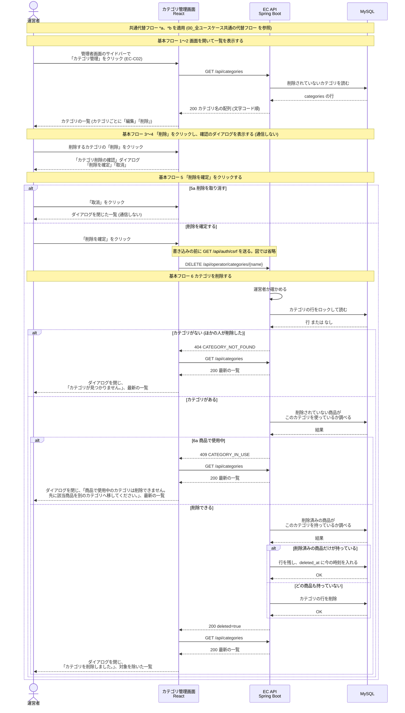
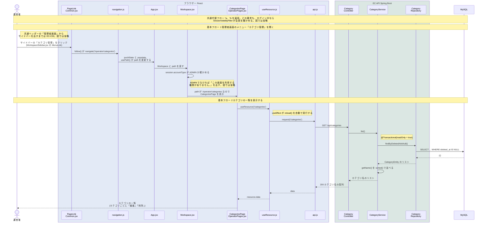
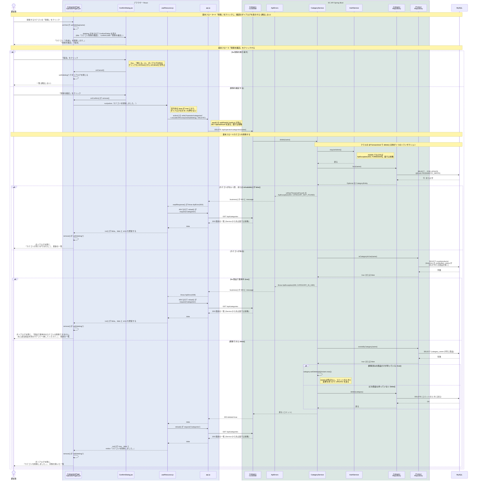

# EC-A09 商品カテゴリを削除する

- ユースケース記述: [EC-A09_商品カテゴリを削除する](<../../アーカイブ/ユースケース/kusakari-ec/EC-A09_商品カテゴリを削除する.md>)
- 対象のコード: kusakari-ec の main（19a2be3、2026-11-20 時点）

## 概要図

## 詳細図 1 基本フロー 1〜2

## 詳細図 2 基本フロー 3〜6

## ユースケース記述との差

- 5a の取り消しは「取消」ボタンのほかに、Esc キー、ダイアログの「閉じる」（×）ボタン、ダイアログの外のクリックでもできます（`Dialog.jsx` の `onClose`）。どれも通信しません。
- 6a の「商品が紐づいている」は、`ProductRepository.isCategoryInUse()` で判定します。在庫の行（`inventory`）の `publication_status` が `DELETED` でない商品が 1 つでもあれば使用中です。販売中（`PUBLISHED`）だけでなく非表示（`HIDDEN`）の商品も含みます。ダイアログの文「販売中・非表示の商品が登録されているカテゴリは削除できません。」と合っています。
- 6a のあと、画面は一覧を取り直し、ダイアログを閉じて、エラーの文と「再取得」ボタンを一覧の上に出します。記述の「一覧を再表示する」はこの取り直しです。
- 記述にない処理として、次の 2 つがあります。
  - 削除済みの商品だけがこのカテゴリを持っているときは、行を消さずに `deleted_at` に今の時刻を入れます。`products.category_name` は `categories(name)` への外部キー（`fk_products_category`）なので、参照が残る行は消せないためです。この行は一覧と商品登録の選択肢に出ません。同じ名前を EC-A07 で追加すると、この行が元に戻ります。
  - ダイアログを開いている間にほかの運営者がそのカテゴリを削除していると、404 `CATEGORY_NOT_FOUND`「カテゴリが見つかりません。」を表示し、一覧を取り直します。
- 記述にない処理として、削除の前に `GET /api/auth/csrf` で CSRF トークンを取ります。運営者でない会員の要求は `AuthService.requireAdmin()` が 403 `FORBIDDEN` にします。

## 確かめられなかったこと

- カテゴリ名に `/` や `%` などがあるときの削除は、動かして確かめていません。画面は名前を `encodeURIComponent()` でパスに入れるので、`/` は `%2F`、`%` は `%25` になります。Spring Security の既定の `StrictHttpFirewall` は、パスの中のこれらを拒否します。EC-A07 では名前を本文で送るので、こうした名前のカテゴリは追加できても、削除できない可能性があります。このときの応答と画面の表示も確かめていません。

## 参照したコード

- [frontend/src/workspace/WorkspaceSidebar.jsx](https://github.com/abeouga/kusakari-ec/blob/19a2be307ee71a2cd87e538236c3c8c42929c5b3/frontend/src/workspace/WorkspaceSidebar.jsx): `MenuLink`
- [frontend/src/workspace/Common.jsx](https://github.com/abeouga/kusakari-ec/blob/19a2be307ee71a2cd87e538236c3c8c42929c5b3/frontend/src/workspace/Common.jsx): `PageLink` の `follow()`
- [frontend/src/workspace/navigation.js](https://github.com/abeouga/kusakari-ec/blob/19a2be307ee71a2cd87e538236c3c8c42929c5b3/frontend/src/workspace/navigation.js): `navigate()`、`usePath()`
- [frontend/src/App.jsx](https://github.com/abeouga/kusakari-ec/blob/19a2be307ee71a2cd87e538236c3c8c42929c5b3/frontend/src/App.jsx): `App`（`Workspace` に `path` を渡す）
- [frontend/src/workspace/Workspace.jsx](https://github.com/abeouga/kusakari-ec/blob/19a2be307ee71a2cd87e538236c3c8c42929c5b3/frontend/src/workspace/Workspace.jsx): `operatorMenu`、`Workspace`（ADMIN の確認、`CategoriesPage` の表示）
- [frontend/src/workspace/OperatorPages.jsx](https://github.com/abeouga/kusakari-ec/blob/19a2be307ee71a2cd87e538236c3c8c42929c5b3/frontend/src/workspace/OperatorPages.jsx): `CategoriesPage` の `remove()`、`deleting`、`ConfirmDialog` に渡す値
- [frontend/src/components/ConfirmDialog.jsx](https://github.com/abeouga/kusakari-ec/blob/19a2be307ee71a2cd87e538236c3c8c42929c5b3/frontend/src/components/ConfirmDialog.jsx): `ConfirmDialog`（「取消」、`onConfirm`、`onCancel`）
- [frontend/src/components/Dialog.jsx](https://github.com/abeouga/kusakari-ec/blob/19a2be307ee71a2cd87e538236c3c8c42929c5b3/frontend/src/components/Dialog.jsx): `Dialog` の `onCancel`、`onClick`、「閉じる」ボタン
- [frontend/src/workspace/useResource.js](https://github.com/abeouga/kusakari-ec/blob/19a2be307ee71a2cd87e538236c3c8c42929c5b3/frontend/src/workspace/useResource.js): `useResource` の `reload()`、`run()`、`write()`
- [frontend/src/workspace/ResourceView.jsx](https://github.com/abeouga/kusakari-ec/blob/19a2be307ee71a2cd87e538236c3c8c42929c5b3/frontend/src/workspace/ResourceView.jsx): `ResourceStatus`
- [frontend/src/api.js](https://github.com/abeouga/kusakari-ec/blob/19a2be307ee71a2cd87e538236c3c8c42929c5b3/frontend/src/api.js): `request()`、`send()`、`readResponse()`
- [frontend/src/auth.js](https://github.com/abeouga/kusakari-ec/blob/19a2be307ee71a2cd87e538236c3c8c42929c5b3/frontend/src/auth.js): `authFetch()`
- [backend/src/main/java/jp/kusakari/ec/catalog/controller/CategoryController.java](https://github.com/abeouga/kusakari-ec/blob/19a2be307ee71a2cd87e538236c3c8c42929c5b3/backend/src/main/java/jp/kusakari/ec/catalog/controller/CategoryController.java): `list()`、`delete()`
- [backend/src/main/java/jp/kusakari/ec/catalog/service/CategoryService.java](https://github.com/abeouga/kusakari-ec/blob/19a2be307ee71a2cd87e538236c3c8c42929c5b3/backend/src/main/java/jp/kusakari/ec/catalog/service/CategoryService.java): `list()`、`delete()`、`notFound()`
- [backend/src/main/java/jp/kusakari/ec/catalog/persistence/repository/CategoryRepository.java](https://github.com/abeouga/kusakari-ec/blob/19a2be307ee71a2cd87e538236c3c8c42929c5b3/backend/src/main/java/jp/kusakari/ec/catalog/persistence/repository/CategoryRepository.java): `findByDeletedAtIsNull()`、`lock()`
- [backend/src/main/java/jp/kusakari/ec/catalog/persistence/repository/ProductRepository.java](https://github.com/abeouga/kusakari-ec/blob/19a2be307ee71a2cd87e538236c3c8c42929c5b3/backend/src/main/java/jp/kusakari/ec/catalog/persistence/repository/ProductRepository.java): `isCategoryInUse()`、`existsByCategory()`
- [backend/src/main/java/jp/kusakari/ec/catalog/persistence/entity/CategoryEntity.java](https://github.com/abeouga/kusakari-ec/blob/19a2be307ee71a2cd87e538236c3c8c42929c5b3/backend/src/main/java/jp/kusakari/ec/catalog/persistence/entity/CategoryEntity.java): `isAvailable()`、`deletedAt`
- [backend/src/main/java/jp/kusakari/ec/auth/AuthService.java](https://github.com/abeouga/kusakari-ec/blob/19a2be307ee71a2cd87e538236c3c8c42929c5b3/backend/src/main/java/jp/kusakari/ec/auth/AuthService.java): `requireAdmin()`
- [backend/src/main/java/jp/kusakari/ec/common/web/ApiErrors.java](https://github.com/abeouga/kusakari-ec/blob/19a2be307ee71a2cd87e538236c3c8c42929c5b3/backend/src/main/java/jp/kusakari/ec/common/web/ApiErrors.java): `business()`
- [backend/src/main/resources/db/migration/V1__schema.sql](https://github.com/abeouga/kusakari-ec/blob/19a2be307ee71a2cd87e538236c3c8c42929c5b3/backend/src/main/resources/db/migration/V1__schema.sql): `categories`、`products` の `fk_products_category`、`inventory` の `publication_status`
