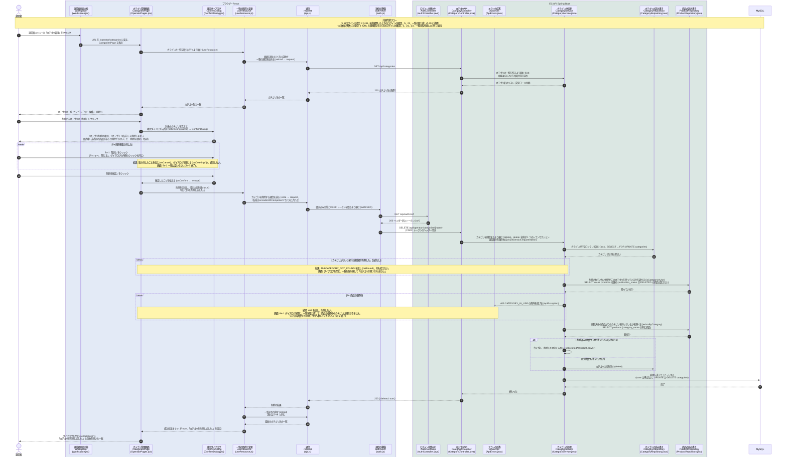
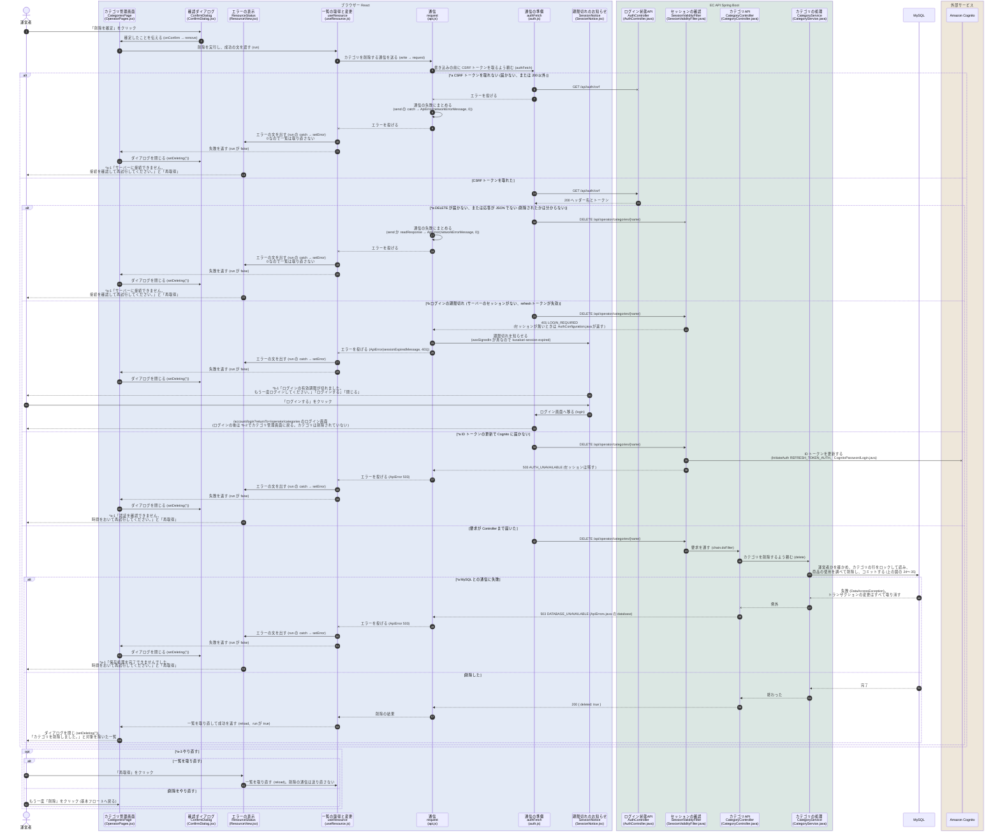

# EC-A09 商品カテゴリを削除する

- ユースケース記述: [EC-A09_商品カテゴリを削除する](<../../アーカイブ/ユースケース/kusakari-ec/EC-A09_商品カテゴリを削除する.md>)
- 共通代替フロー: [00_全ユースケース共通の代替フロー](<00_全ユースケース共通の代替フロー.md>)
- 対象のコード: kusakari-ec の main（6bad7e3、2026-11-24 時点）

## シーケンス図

参加者は、上から「画面や役割の名前」「コンポーネント・クラスの名前」「ファイル名（かっこ付き）」の順に書いています。
共通代替フローの中身は、00 の図か、下の「共通代替フローを直接書いた図」を見てください。
代替フローのうち、画面の中だけで終わるもの（5a）、エラーで終わるもの（6a）と記述にない分岐（カテゴリがない）は、分かれる所だけを描き、結果と画面は Note に文で書いています。エラーのときの画面の後処理（`readResponse` が `ApiError` を投げる → 404・409 なら `reload` で一覧を取り直す → `run` が false → ダイアログを閉じてエラーの文を出す）は、どれも同じです。

## 共通代替フローを直接書いた図

上の図の削除の通信（CSRF トークンの取得と `DELETE /api/operator/categories/{name}`）に、この画面で起こる共通代替フロー（\*a、\*b）を書き込んだ図です。画面を開いて一覧を取る通信の \*a・\*b は、[EC-A07](<EC-A07_商品カテゴリを追加する.md>) の「共通代替フローを直接書いた図」の「画面を開くとき」と同じなので省いています。

## ユースケース記述との差

- 関連情報は「共通代替フロー \*b を適用する」だけですが、一覧の取得と削除の通信には \*a も起こります。図には両方を書いています。
- 一覧の取得（`GET /api/categories`）はログインしていなくても呼べる API なので、サーバーのセッションがないときも 200 で一覧を返します。\*b になるのは refresh トークンが失効しているときだけです（EC-A07 と同じ）。
- 5a の取り消しは「取消」ボタンのほかに、Esc キー、ダイアログの「閉じる」（×）ボタン、ダイアログの外のクリックでもできます（`Dialog.jsx` の `onClose` から `onCancel`）。どれも通信しません。通信中（`busy`）は閉じません。
- 6a の「商品が紐づいている」は、`ProductRepository.isCategoryInUse()` で判定します。在庫の行（`inventory`）の `publication_status` が `DELETED` の商品は数えないので、販売中（`PUBLISHED`）と非表示（`HIDDEN`）の商品が 1 つでもあれば使用中です。ダイアログの文「販売中・非表示の商品が登録されているカテゴリは削除できません。」と合っています。関連情報の「出店者が削除した商品は、カテゴリの削除を妨げない」もこの判定によるものです。
- 6a のあと、画面は一覧を取り直し、ダイアログを閉じて、エラーの文と「再取得」ボタンを一覧の上に出します。記述の「一覧を再表示する」はこの取り直しです。
- `remove()` は結果にかかわらず `setDeleting('')` でダイアログを閉じます。共通代替フローで失敗したときも、ダイアログは閉じて一覧の上にエラーの文が出ます。\*a-3 の「再取得」は一覧を取り直すだけで、削除の通信は送り直しません。やり直すには、もう一度「削除」から確定します。
- 記述にない処理として、次の 2 つがあります。
  - 削除済みの商品だけがこのカテゴリを持っているときは、行を消さずに `deleted_at` に今の時刻を入れます。`products.category_name` は `categories(name)` への外部キー（`fk_products_category`）なので、参照が残る行は消せないためです。この行は一覧と商品登録の選択肢に出ません。同じ名前を EC-A07 で追加すると、この行が元に戻ります。
  - ダイアログを開いている間にほかの運営者がそのカテゴリを削除していると、404 `CATEGORY_NOT_FOUND`「カテゴリが見つかりません。」を表示し、一覧を取り直します。
- 運営者でない会員がこの画面を開くと、`Workspace.jsx` が「この画面を利用する権限がありません。」を出します。API も `requireAdmin()` で 403 `FORBIDDEN` を返します。事前条件が運営者のログインなので、図には書いていません。

## 確かめられなかったこと

- カテゴリ名に `/` や `%` などがあるときの削除は、動かして確かめていません。画面は名前を `encodeURIComponent()` でパスに入れるので、`/` は `%2F`、`%` は `%25` になります。Spring Security の既定の `StrictHttpFirewall` は、パスの中のこれらを拒否します。EC-A07 では名前を本文で送るので、こうした名前のカテゴリは追加できても、削除できない可能性があります。このときの応答と画面の表示も確かめていません。
- `save` を呼ばずにコミットのときに UPDATE や DELETE を送る時点は、JPA の動きから読んだもので、実行して確かめていません。

## 参照したコード

- [frontend/src/workspace/Workspace.jsx](https://github.com/abeouga/kusakari-ec/blob/6bad7e37c4135034fbe97e30309772fbe872e675/frontend/src/workspace/Workspace.jsx): `operatorMenu`、`Workspace`（ADMIN の確認、`CategoriesPage` の表示）
- [frontend/src/workspace/WorkspaceSidebar.jsx](https://github.com/abeouga/kusakari-ec/blob/6bad7e37c4135034fbe97e30309772fbe872e675/frontend/src/workspace/WorkspaceSidebar.jsx): `MenuLink`
- [frontend/src/workspace/Common.jsx](https://github.com/abeouga/kusakari-ec/blob/6bad7e37c4135034fbe97e30309772fbe872e675/frontend/src/workspace/Common.jsx): `PageLink`
- [frontend/src/workspace/OperatorPages.jsx](https://github.com/abeouga/kusakari-ec/blob/6bad7e37c4135034fbe97e30309772fbe872e675/frontend/src/workspace/OperatorPages.jsx): `CategoriesPage`（`remove`、`deleting`、`ConfirmDialog` に渡す文言）
- [frontend/src/components/ConfirmDialog.jsx](https://github.com/abeouga/kusakari-ec/blob/6bad7e37c4135034fbe97e30309772fbe872e675/frontend/src/components/ConfirmDialog.jsx): `ConfirmDialog`（「取消」、`onConfirm`、`onCancel`、`busy`）
- [frontend/src/components/Dialog.jsx](https://github.com/abeouga/kusakari-ec/blob/6bad7e37c4135034fbe97e30309772fbe872e675/frontend/src/components/Dialog.jsx): `Dialog`（Esc キー、外側のクリック、「閉じる」）
- [frontend/src/workspace/useResource.js](https://github.com/abeouga/kusakari-ec/blob/6bad7e37c4135034fbe97e30309772fbe872e675/frontend/src/workspace/useResource.js): `useResource`、`reload`、`run`、`write`
- [frontend/src/workspace/ResourceView.jsx](https://github.com/abeouga/kusakari-ec/blob/6bad7e37c4135034fbe97e30309772fbe872e675/frontend/src/workspace/ResourceView.jsx): `ResourceStatus`
- [frontend/src/api.js](https://github.com/abeouga/kusakari-ec/blob/6bad7e37c4135034fbe97e30309772fbe872e675/frontend/src/api.js): `request`、`send`、`readResponse`、`ApiError`、`networkErrorMessage`、`sessionExpiredMessage`
- [frontend/src/auth.js](https://github.com/abeouga/kusakari-ec/blob/6bad7e37c4135034fbe97e30309772fbe872e675/frontend/src/auth.js): `authFetch`（`GET /api/auth/csrf`）、`wasSignedIn`、`login`
- [frontend/src/components/SessionNotice.jsx](https://github.com/abeouga/kusakari-ec/blob/6bad7e37c4135034fbe97e30309772fbe872e675/frontend/src/components/SessionNotice.jsx): 期限切れのお知らせ
- [backend/src/main/java/jp/kusakari/ec/catalog/controller/CategoryController.java](https://github.com/abeouga/kusakari-ec/blob/6bad7e37c4135034fbe97e30309772fbe872e675/backend/src/main/java/jp/kusakari/ec/catalog/controller/CategoryController.java): `list`、`delete`
- [backend/src/main/java/jp/kusakari/ec/catalog/service/CategoryService.java](https://github.com/abeouga/kusakari-ec/blob/6bad7e37c4135034fbe97e30309772fbe872e675/backend/src/main/java/jp/kusakari/ec/catalog/service/CategoryService.java): `list`、`delete`、`notFound`
- [backend/src/main/java/jp/kusakari/ec/catalog/persistence/repository/CategoryRepository.java](https://github.com/abeouga/kusakari-ec/blob/6bad7e37c4135034fbe97e30309772fbe872e675/backend/src/main/java/jp/kusakari/ec/catalog/persistence/repository/CategoryRepository.java): `findByDeletedAtIsNull`、`lock`
- [backend/src/main/java/jp/kusakari/ec/catalog/persistence/repository/ProductRepository.java](https://github.com/abeouga/kusakari-ec/blob/6bad7e37c4135034fbe97e30309772fbe872e675/backend/src/main/java/jp/kusakari/ec/catalog/persistence/repository/ProductRepository.java): `isCategoryInUse`、`existsByCategory`
- [backend/src/main/java/jp/kusakari/ec/catalog/persistence/entity/CategoryEntity.java](https://github.com/abeouga/kusakari-ec/blob/6bad7e37c4135034fbe97e30309772fbe872e675/backend/src/main/java/jp/kusakari/ec/catalog/persistence/entity/CategoryEntity.java): `isAvailable`、`deletedAt`
- [backend/src/main/java/jp/kusakari/ec/auth/AuthService.java](https://github.com/abeouga/kusakari-ec/blob/6bad7e37c4135034fbe97e30309772fbe872e675/backend/src/main/java/jp/kusakari/ec/auth/AuthService.java): `requireAdmin`
- [backend/src/main/java/jp/kusakari/ec/auth/AuthController.java](https://github.com/abeouga/kusakari-ec/blob/6bad7e37c4135034fbe97e30309772fbe872e675/backend/src/main/java/jp/kusakari/ec/auth/AuthController.java): `csrf`
- [backend/src/main/java/jp/kusakari/ec/auth/SessionValidityFilter.java](https://github.com/abeouga/kusakari-ec/blob/6bad7e37c4135034fbe97e30309772fbe872e675/backend/src/main/java/jp/kusakari/ec/auth/SessionValidityFilter.java): `doFilterInternal`（ID トークンの更新、401、503）
- [backend/src/main/java/jp/kusakari/ec/auth/CognitoPasswordLogin.java](https://github.com/abeouga/kusakari-ec/blob/6bad7e37c4135034fbe97e30309772fbe872e675/backend/src/main/java/jp/kusakari/ec/auth/CognitoPasswordLogin.java): ID トークンの更新、503 `AUTH_UNAVAILABLE`
- [backend/src/main/java/jp/kusakari/ec/auth/AuthConfiguration.java](https://github.com/abeouga/kusakari-ec/blob/6bad7e37c4135034fbe97e30309772fbe872e675/backend/src/main/java/jp/kusakari/ec/auth/AuthConfiguration.java): `authorizeHttpRequests`（`/api/categories` の `permitAll`）、`authenticationEntryPoint`（401 `LOGIN_REQUIRED`）
- [backend/src/main/java/jp/kusakari/ec/common/web/ApiErrors.java](https://github.com/abeouga/kusakari-ec/blob/6bad7e37c4135034fbe97e30309772fbe872e675/backend/src/main/java/jp/kusakari/ec/common/web/ApiErrors.java): `business`、`database`
- [backend/src/main/resources/db/migration/V1__schema.sql](https://github.com/abeouga/kusakari-ec/blob/6bad7e37c4135034fbe97e30309772fbe872e675/backend/src/main/resources/db/migration/V1__schema.sql): `categories`、`products` の `fk_products_category`、`inventory` の `publication_status`
