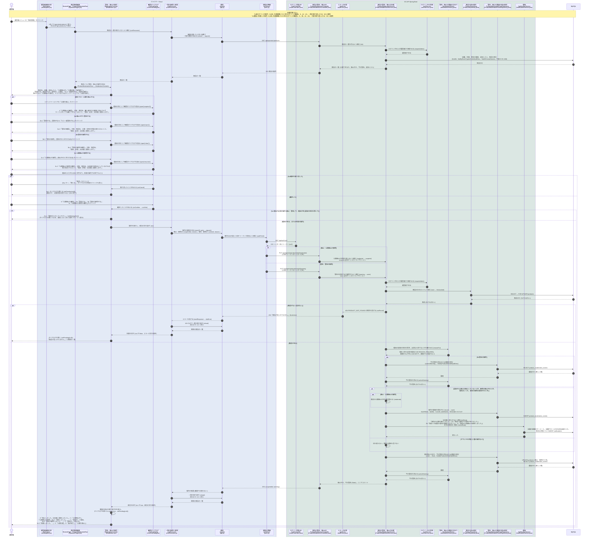
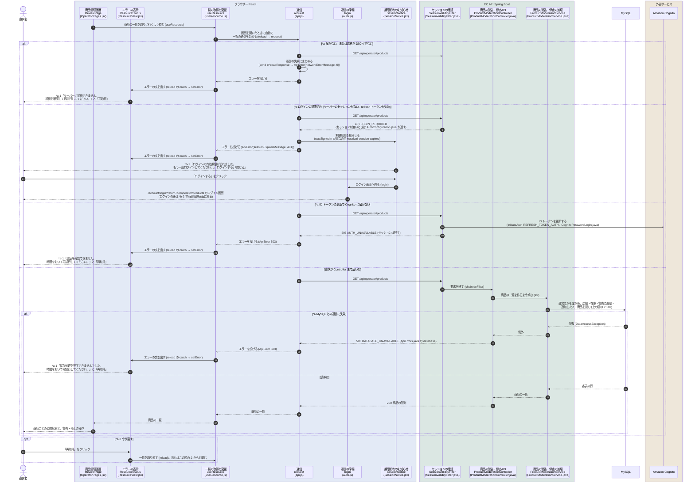

# EC-A10 商品の公開を停止・再開する

- ユースケース記述: [EC-A10_商品の公開を停止・再開する](<../../アーカイブ/ユースケース/kusakari-ec/EC-A10_商品の公開を停止・再開する.md>)
- 共通代替フロー: [00_全ユースケース共通の代替フロー](<00_全ユースケース共通の代替フロー.md>)
- 対象のコード: kusakari-ec の main（6bad7e3、2026-11-24 時点）

## シーケンス図

参加者は、上から「画面や役割の名前」「コンポーネント・クラスの名前」「ファイル名（かっこ付き）」の順に書いています。
共通代替フローの中身は、00 の図か、下の「共通代替フローを直接書いた図」を見てください。
基本フロー（公開の停止）と代替フロー 3a〜3c（警告、警告の解除、公開停止の解除）は、同じ部品と同じ流れを通るので、1 枚の図の中で操作ごとに分けて書いています。

## 共通代替フローを直接書いた図

上の図の通信に、この画面で起こる共通代替フロー（\*a、\*b）を書き込んだ図です。画面を開いて一覧を取るときと、確認ダイアログで確定したときの 2 つに分けています。URL を直接開いたときのログイン状態の確認（`GET /api/auth/me`）は、[EC-A07](<EC-A07_商品カテゴリを追加する.md>) の「共通代替フローを直接書いた図」の「画面を開くとき」の 1 つ目の alt と同じなので省いています（表示する画面が `ReviewPage` になるだけです）。

### 画面を開いて一覧を取るとき

### 確認ダイアログで確定したとき

```mermaid
sequenceDiagram
    autonumber
    actor User as 運営者
    box rgba(47,111,219,0.10) ブラウザー React
        participant Mod as 警告・停止の操作<br/>ModerationControls<br/>(Moderation.jsx)
        participant Dlg as 確認ダイアログ<br/>ConfirmDialog<br/>(ConfirmDialog.jsx)
        participant Status as エラーの表示<br/>ResourceStatus<br/>(ResourceView.jsx)
        participant Hook as 一覧の取得と変更<br/>useResource<br/>(useResource.js)
        participant Http as 通信<br/>request<br/>(api.js)
        participant AuthJs as 通信の準備<br/>authFetch<br/>(auth.js)
        participant Notice as 期限切れのお知らせ<br/>SessionNotice<br/>(SessionNotice.jsx)
    end
    box rgba(27,127,92,0.12) EC API Spring Boot
        participant AuthCtrl as ログイン状態API<br/>AuthController<br/>(AuthController.java)
        participant Filter as セッションの確認<br/>SessionValidityFilter<br/>(SessionValidityFilter.java)
        participant Ctrl as 商品の警告・停止API<br/>ProductModerationController<br/>(ProductModerationController.java)
        participant Svc as 商品の警告・停止の処理<br/>ProductModerationService<br/>(ProductModerationService.java)
    end
    participant Db as MySQL
    box rgba(180,120,20,0.12) 外部サービス
        participant Cog as Amazon Cognito
    end

    User->>Dlg: 「公開停止を確定」などをクリック
    Dlg->>Mod: 確定したことを伝える (onConfirm → confirm)
    Mod->>Hook: 操作を実行し、成功の文を渡す (run)
    Hook->>Http: 操作の通信を送る (send の write → request)
    Http->>AuthJs: 書き込みの前に CSRF トークンを取るよう頼む (authFetch)
    alt *a CSRF トークンを取れない (届かない、または 200 以外)
        AuthJs-xAuthCtrl: GET /api/auth/csrf
        AuthJs--xHttp: エラーを投げる
        Http->>Http: 通信の失敗にまとめる<br/>(send の catch → ApiError(networkErrorMessage, 0))
        Http--xHook: エラーを投げる
        Hook->>Status: エラーの文を出す (run の catch → setError)<br/>0 なので一覧は取り直さない
        Hook-->>Mod: 失敗を返す (run が false)
        Mod->>Dlg: ダイアログを閉じる (setPending(null))。入力した理由は残らない
        Status-->>User: *a-1「サーバーに接続できません。<br/>接続を確認して再試行してください。」と「再取得」
    else CSRF トークンを取れた
        AuthJs->>AuthCtrl: GET /api/auth/csrf
        AuthCtrl-->>AuthJs: 200 ヘッダー名とトークン
        alt *a PUT が届かない、または応答が JSON でない (変わったかは分からない)
            AuthJs-xFilter: PUT /api/operator/products/{id}/moderation か .../warning
            Http->>Http: 通信の失敗にまとめる<br/>(send か readResponse → ApiError(networkErrorMessage, 0))
            Http--xHook: エラーを投げる
            Hook->>Status: エラーの文を出す (run の catch → setError)<br/>0 なので一覧は取り直さない
            Hook-->>Mod: 失敗を返す (run が false)
            Mod->>Dlg: ダイアログを閉じる (setPending(null))
            Status-->>User: *a-1「サーバーに接続できません。<br/>接続を確認して再試行してください。」と「再取得」
        else *b ログインの期限切れ (サーバーのセッションがない、refresh トークンが失効)
            AuthJs->>Filter: PUT /api/operator/products/{id}/moderation か .../warning
            Filter-->>Http: 401 LOGIN_REQUIRED<br/>(セッションが無いときは AuthConfiguration.java が返す)
            Http->>Notice: 期限切れを知らせる<br/>(wasSignedIn が真なので kusakari-session-expired)
            Http--xHook: エラーを投げる (ApiError(sessionExpiredMessage, 401))
            Hook->>Status: エラーの文を出す (run の catch → setError)
            Hook-->>Mod: 失敗を返す (run が false)
            Mod->>Dlg: ダイアログを閉じる (setPending(null))
            Notice-->>User: *b-1「ログインの有効期限が切れました。<br/>もう一度ログインしてください。」「ログインする」「閉じる」
            User->>Notice: 「ログインする」をクリック
            Notice->>AuthJs: ログイン画面へ移る (login)
            AuthJs-->>User: /account/login?returnTo=/operator/products のログイン画面<br/>(ログインの後は *b-2 で商品管理画面に戻る。公開状態は変わっていない)
        else *a ID トークンの更新で Cognito に届かない
            AuthJs->>Filter: PUT /api/operator/products/{id}/moderation か .../warning
            Filter-xCog: ID トークンを更新する<br/>(InitiateAuth REFRESH_TOKEN_AUTH、CognitoPasswordLogin.java)
            Filter-->>Http: 503 AUTH_UNAVAILABLE (セッションは残す)
            Http--xHook: エラーを投げる (ApiError 503)
            Hook->>Status: エラーの文を出す (run の catch → setError)
            Hook-->>Mod: 失敗を返す (run が false)
            Mod->>Dlg: ダイアログを閉じる (setPending(null))
            Status-->>User: *a-1「認証を確認できません。<br/>時間をおいて再試行してください。」と「再取得」
        else 要求が Controller まで届いた
            AuthJs->>Filter: PUT /api/operator/products/{id}/moderation か .../warning
            Filter->>Ctrl: 要求を通す (chain.doFilter)
            Ctrl->>Svc: 公開停止の状態を変えるか、警告を記録・解除するよう頼む (suspend、warn)
            Svc->>Db: 運営者かを確かめ、商品をロックして読み、履歴と通知を保存して<br/>コミットする (上の図の 45〜79)
            alt *a MySQL との通信に失敗
                Db--xSvc: 失敗 (DataAccessException)。<br/>トランザクションの変更 (公開停止の印、履歴、通知) はすべて取り消す
                Svc--xCtrl: 例外
                Ctrl-->>Http: 503 DATABASE_UNAVAILABLE (ApiErrors.java の database)
                Http--xHook: エラーを投げる (ApiError 503)
                Hook->>Status: エラーの文を出す (run の catch → setError)
                Hook-->>Mod: 失敗を返す (run が false)
                Mod->>Dlg: ダイアログを閉じる (setPending(null))
                Status-->>User: *a-1「保存処理を完了できませんでした。<br/>時間をおいて再試行してください。」と「再取得」
            else 記録した
                Db-->>Svc: 完了
                Svc-->>Ctrl: 停止中か、今の警告
                Ctrl-->>Http: 200 { suspended, warning }
                Http-->>Hook: 操作の結果
                Hook-->>Mod: 一覧を取り直して成功を返す (reload、run が true)
                Mod->>Dlg: ダイアログを閉じる (setVersion、setPending(null))
                Status-->>User: 「停止しました。出店者に通知しました。」などと、更新後の公開状態
            end
        end
    end
    opt *a-3 やり直す
        alt 一覧を取り直す
            User->>Status: 「再取得」をクリック
            Status->>Hook: 一覧を取り直す (reload)。操作の通信は送り直さない
        else 操作をやり直す
            User->>Mod: もう一度「公開を停止」などをクリックし、<br/>理由を入力し直す (基本フロー 3 へ戻る)
        end
    end
```

## ユースケース記述との差

- 関連情報は「共通代替フロー \*b を適用する」だけですが、一覧の取得と操作の通信には \*a も起こります。図には両方を書いています。
- 共通代替フロー \*a・\*b で失敗したとき、`confirm()` は結果にかかわらず `setPending(null)` でダイアログを閉じます。エラーは画面上部の `ResourceStatus` に出ます。もう一度ボタンを押すと `open()` が理由を空にするので、入力した理由は残りません。\*a-2 の「入力内容を保持したまま、再実行を可能にする」と違います。「再取得」は一覧を取り直すだけで、操作の通信は送り直しません。
- 関連情報「すでに公開停止中の商品の停止、公開停止していない商品の解除、警告していない商品の警告の解除は、何もせず、履歴も通知も残さない」: サーバーは何もせずに 200 を返します。画面は 200 を成功として扱うので、このときも「停止しました。出店者に通知しました。」などを出します。通知を送っていないのに「通知しました」と出ます。2 人の運営者が同じ商品を続けて操作したときなどに起きます。
- 3c-4・3c-5: 解除のあとの表示は、出店者が商品を削除していれば（在庫の `publicationStatus` が `DELETED`）「公開可能」ではなく「販売終了」です。記述は「公開可能」に更新するとだけ書いています。
- 5a: 理由の検査は画面（`reason.trim()`）とサーバー（`ModerationHistory.reasonFor()` の 400 `REASON_REQUIRED`）の両方にあります。画面の検査が先に止めるので、画面からサーバーの検査には届きません。記述は画面の検査だけを書いています。理由の 500 文字の上限も、入力欄の `maxLength` とサーバーの `@Size(max = 500)` の両方にあります。
- 記述にない処理として、次の 3 つがあります。
  - 操作の応答（`State` の `suspended` と `warning`）を画面は使わず、`reload()` で一覧を取り直して表示します。
  - 操作の間に商品が消えていると、404 `PRODUCT_NOT_FOUND`「商品が見つかりません。」を表示し、一覧を取り直します。
  - 成功すると `setVersion` で、開いている「警告・停止の履歴」（`ModerationEvents` の `GET /api/operator/products/{id}/moderation-events`）を取り直します。履歴を開く操作はこのユースケースの流れにないので、図には書いていません。
- 商品の一覧の取得（`GET /api/operator/products`）はログインが必要な API なので、サーバーのセッションがないときも refresh トークンが失効したときも 401 `LOGIN_REQUIRED` になり、\*b のお知らせが出ます（カテゴリ管理画面の `GET /api/categories` とは違います）。
- 運営者でない会員がこの画面を開くと、`Workspace.jsx` が「この画面を利用する権限がありません。」を出します。API も `requireAdmin()` で 403 `FORBIDDEN` を返します。事前条件が運営者のログインなので、図には書いていません。

## 確かめられなかったこと

- MySQL に送る SQL は、`@Lock(PESSIMISTIC_WRITE)` やメソッド名から読んだものです。SELECT ... FOR UPDATE になることや、UPDATE と INSERT を送る時点（`state()` の `flush()` かコミットか）は、実行して確かめていません。
- 一覧の取得の中身（`list()` が読む表）は、EC-A06 の図で扱うため、ここでは 1 本の矢印にまとめています。

## 参照したコード

- [frontend/src/workspace/Workspace.jsx](https://github.com/abeouga/kusakari-ec/blob/6bad7e37c4135034fbe97e30309772fbe872e675/frontend/src/workspace/Workspace.jsx): `operatorMenu`、`Workspace`（`/operator/products` と `ReviewPage` の対応、ADMIN の確認）
- [frontend/src/workspace/WorkspaceSidebar.jsx](https://github.com/abeouga/kusakari-ec/blob/6bad7e37c4135034fbe97e30309772fbe872e675/frontend/src/workspace/WorkspaceSidebar.jsx): `MenuLink`
- [frontend/src/workspace/Common.jsx](https://github.com/abeouga/kusakari-ec/blob/6bad7e37c4135034fbe97e30309772fbe872e675/frontend/src/workspace/Common.jsx): `PageLink`
- [frontend/src/workspace/OperatorPages.jsx](https://github.com/abeouga/kusakari-ec/blob/6bad7e37c4135034fbe97e30309772fbe872e675/frontend/src/workspace/OperatorPages.jsx): `ReviewPage`、`ProductModerationRow`（公開状態の表示、「追加した人」）
- [frontend/src/workspace/Moderation.jsx](https://github.com/abeouga/kusakari-ec/blob/6bad7e37c4135034fbe97e30309772fbe872e675/frontend/src/workspace/Moderation.jsx): `targets`、`ModerationControls`（`open`、`confirm`、`send`、`done`、`titles`）、`WarningBadge`、`ModerationEvents`
- [frontend/src/components/ConfirmDialog.jsx](https://github.com/abeouga/kusakari-ec/blob/6bad7e37c4135034fbe97e30309772fbe872e675/frontend/src/components/ConfirmDialog.jsx): `ConfirmDialog`（`onConfirm`、`onCancel`、`busy`）
- [frontend/src/components/Dialog.jsx](https://github.com/abeouga/kusakari-ec/blob/6bad7e37c4135034fbe97e30309772fbe872e675/frontend/src/components/Dialog.jsx): `Dialog`（Esc キー、外側のクリック、「閉じる」）
- [frontend/src/workspace/useResource.js](https://github.com/abeouga/kusakari-ec/blob/6bad7e37c4135034fbe97e30309772fbe872e675/frontend/src/workspace/useResource.js): `useResource`、`reload`、`run`、`write`
- [frontend/src/workspace/ResourceView.jsx](https://github.com/abeouga/kusakari-ec/blob/6bad7e37c4135034fbe97e30309772fbe872e675/frontend/src/workspace/ResourceView.jsx): `ResourceStatus`
- [frontend/src/api.js](https://github.com/abeouga/kusakari-ec/blob/6bad7e37c4135034fbe97e30309772fbe872e675/frontend/src/api.js): `request`、`send`、`readResponse`、`ApiError`、`networkErrorMessage`、`sessionExpiredMessage`
- [frontend/src/auth.js](https://github.com/abeouga/kusakari-ec/blob/6bad7e37c4135034fbe97e30309772fbe872e675/frontend/src/auth.js): `authFetch`（`GET /api/auth/csrf`）、`wasSignedIn`、`login`
- [frontend/src/components/SessionNotice.jsx](https://github.com/abeouga/kusakari-ec/blob/6bad7e37c4135034fbe97e30309772fbe872e675/frontend/src/components/SessionNotice.jsx): 期限切れのお知らせ
- [backend/src/main/java/jp/kusakari/ec/catalog/controller/ProductModerationController.java](https://github.com/abeouga/kusakari-ec/blob/6bad7e37c4135034fbe97e30309772fbe872e675/backend/src/main/java/jp/kusakari/ec/catalog/controller/ProductModerationController.java): `Input`、`list`、`moderate`、`warning`
- [backend/src/main/java/jp/kusakari/ec/catalog/service/ProductModerationService.java](https://github.com/abeouga/kusakari-ec/blob/6bad7e37c4135034fbe97e30309772fbe872e675/backend/src/main/java/jp/kusakari/ec/catalog/service/ProductModerationService.java): `list`、`suspend`、`warn`、`record`、`currentWarning`、`state`、`lock`、`notFound`
- [backend/src/main/java/jp/kusakari/ec/moderation/service/ModerationHistory.java](https://github.com/abeouga/kusakari-ec/blob/6bad7e37c4135034fbe97e30309772fbe872e675/backend/src/main/java/jp/kusakari/ec/moderation/service/ModerationHistory.java): `reasonFor`、`activeWarning`、`noticeBody`
- [backend/src/main/java/jp/kusakari/ec/moderation/persistence/entity/ModerationAction.java](https://github.com/abeouga/kusakari-ec/blob/6bad7e37c4135034fbe97e30309772fbe872e675/backend/src/main/java/jp/kusakari/ec/moderation/persistence/entity/ModerationAction.java): `requiresReason`
- [backend/src/main/java/jp/kusakari/ec/moderation/dto/ModerationDtos.java](https://github.com/abeouga/kusakari-ec/blob/6bad7e37c4135034fbe97e30309772fbe872e675/backend/src/main/java/jp/kusakari/ec/moderation/dto/ModerationDtos.java): `State`、`WarningRequest`、`Warning`
- [backend/src/main/java/jp/kusakari/ec/catalog/persistence/repository/ProductRepository.java](https://github.com/abeouga/kusakari-ec/blob/6bad7e37c4135034fbe97e30309772fbe872e675/backend/src/main/java/jp/kusakari/ec/catalog/persistence/repository/ProductRepository.java): `findLocked`、`findAllCreatorNames`
- [backend/src/main/java/jp/kusakari/ec/catalog/persistence/entity/ProductEntity.java](https://github.com/abeouga/kusakari-ec/blob/6bad7e37c4135034fbe97e30309772fbe872e675/backend/src/main/java/jp/kusakari/ec/catalog/persistence/entity/ProductEntity.java): `moderate`、`isSuspended`
- [backend/src/main/java/jp/kusakari/ec/moderation/persistence/repository/ProductModerationEventRepository.java](https://github.com/abeouga/kusakari-ec/blob/6bad7e37c4135034fbe97e30309772fbe872e675/backend/src/main/java/jp/kusakari/ec/moderation/persistence/repository/ProductModerationEventRepository.java): `findByProductIdOrderByIdDesc`、`findByEventTypeInOrderByIdDesc`、`save`（JpaRepository）
- [backend/src/main/java/jp/kusakari/ec/notification/service/NotificationService.java](https://github.com/abeouga/kusakari-ec/blob/6bad7e37c4135034fbe97e30309772fbe872e675/backend/src/main/java/jp/kusakari/ec/notification/service/NotificationService.java): `toStore`
- [backend/src/main/java/jp/kusakari/ec/auth/AuthService.java](https://github.com/abeouga/kusakari-ec/blob/6bad7e37c4135034fbe97e30309772fbe872e675/backend/src/main/java/jp/kusakari/ec/auth/AuthService.java): `requireAdmin`
- [backend/src/main/java/jp/kusakari/ec/auth/AuthController.java](https://github.com/abeouga/kusakari-ec/blob/6bad7e37c4135034fbe97e30309772fbe872e675/backend/src/main/java/jp/kusakari/ec/auth/AuthController.java): `csrf`
- [backend/src/main/java/jp/kusakari/ec/auth/SessionValidityFilter.java](https://github.com/abeouga/kusakari-ec/blob/6bad7e37c4135034fbe97e30309772fbe872e675/backend/src/main/java/jp/kusakari/ec/auth/SessionValidityFilter.java): `doFilterInternal`（ID トークンの更新、401、503）
- [backend/src/main/java/jp/kusakari/ec/auth/CognitoPasswordLogin.java](https://github.com/abeouga/kusakari-ec/blob/6bad7e37c4135034fbe97e30309772fbe872e675/backend/src/main/java/jp/kusakari/ec/auth/CognitoPasswordLogin.java): ID トークンの更新、503 `AUTH_UNAVAILABLE`
- [backend/src/main/java/jp/kusakari/ec/auth/AuthConfiguration.java](https://github.com/abeouga/kusakari-ec/blob/6bad7e37c4135034fbe97e30309772fbe872e675/backend/src/main/java/jp/kusakari/ec/auth/AuthConfiguration.java): `authenticationEntryPoint`（401 `LOGIN_REQUIRED`）
- [backend/src/main/java/jp/kusakari/ec/common/web/ApiErrors.java](https://github.com/abeouga/kusakari-ec/blob/6bad7e37c4135034fbe97e30309772fbe872e675/backend/src/main/java/jp/kusakari/ec/common/web/ApiErrors.java): `business`、`invalid`、`database`
