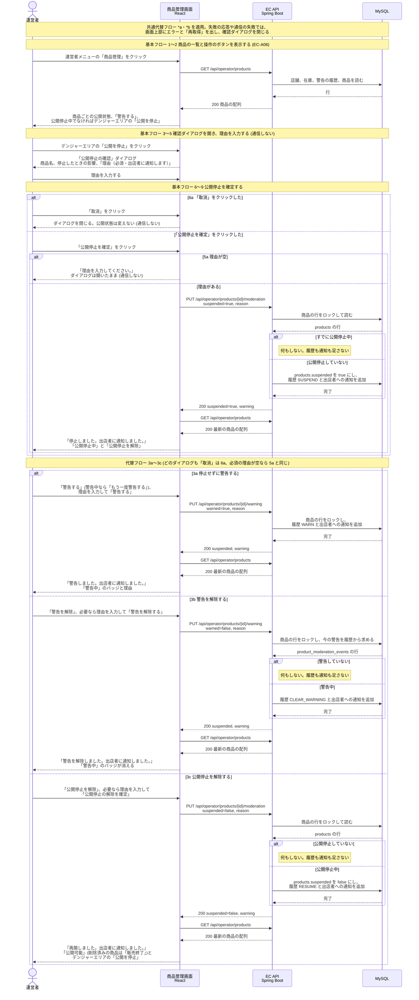
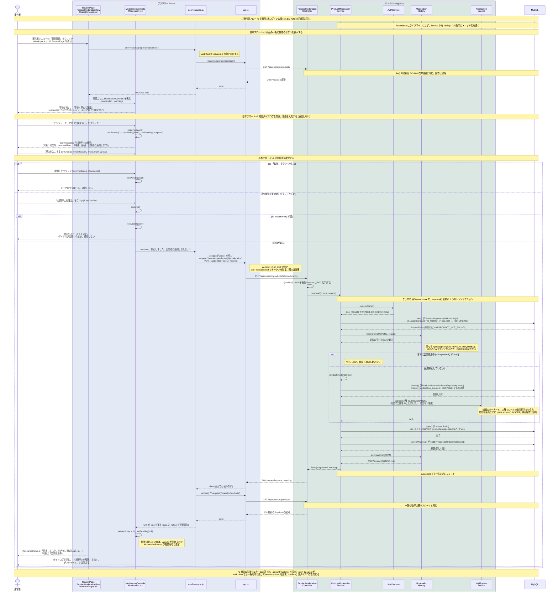
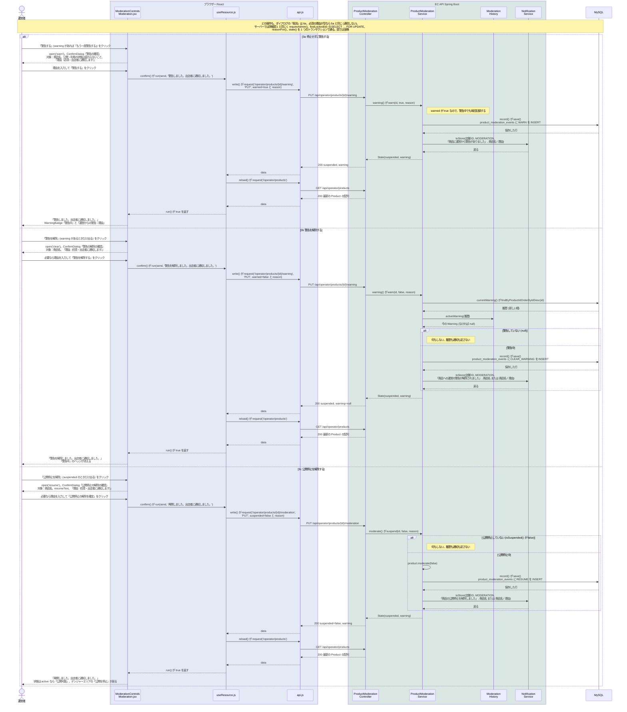

# EC-A10 商品の公開を停止・再開する

- ユースケース記述: [EC-A10_商品の公開を停止・再開する](<../../アーカイブ/ユースケース/kusakari-ec/EC-A10_商品の公開を停止・再開する.md>)
- 対象のコード: kusakari-ec の main（19a2be3、2026-11-20 時点）

## 概要図

## 詳細図 1 基本フロー 1〜9

## 詳細図 2 代替フロー 3a〜3c

## ユースケース記述との差

- 共通代替フロー *a: 通信に失敗したときやエラーの応答のとき、`confirm()` は結果にかかわらず `setPending(null)` でダイアログを閉じます。エラーは画面上部の `ResourceStatus` に出ます。もう一度ボタンを押すと `open()` が理由を空にするので、入力した理由は残りません。*a-2 の「入力内容を保持したまま、再実行を可能にする」と違います。
- 関連情報「すでに公開停止中の商品の停止、公開停止していない商品の解除、警告していない商品の警告の解除は、何もせず」: サーバーは何もせずに 200 を返します。画面は 200 を成功として扱うので、このときも「停止しました。出店者に通知しました。」などを出します。通知を送っていないのに「通知しました」と出ます。2 人の運営者が同じ商品を続けて操作したときなどに起きます。
- 3c-4・3c-5: 解除のあとの表示は、出店者が商品を削除していれば（在庫の `publicationStatus` が `DELETED`）「公開可能」ではなく「販売終了」です。記述は「公開可能」に更新するとだけ書いています。
- 5a: 理由の検査は画面（`reason.trim()`）とサーバー（`ModerationHistory.reasonFor()` の 400 `REASON_REQUIRED`）の両方にあります。画面の検査が先に止めるので、画面からサーバーの検査には届きません。記述は画面の検査だけを書いています。
- 基本フロー 7: 操作の応答（`State` の `suspended` と `warning`）を画面は使わず、`reload()` で一覧を取り直して表示します。記述にない処理です。

## 確かめられなかったこと

- MySQL に送る SQL は、`@Lock(PESSIMISTIC_WRITE)` やメソッド名から読んだものです。SELECT … FOR UPDATE になることや、UPDATE と INSERT を送る時点は、実行して確かめていません。

## 参照したコード

- [frontend/src/workspace/Workspace.jsx](https://github.com/abeouga/kusakari-ec/blob/19a2be307ee71a2cd87e538236c3c8c42929c5b3/frontend/src/workspace/Workspace.jsx): `operatorMenu`、`Workspace`（`/operator/products` と `ReviewPage` の対応）
- [frontend/src/workspace/OperatorPages.jsx](https://github.com/abeouga/kusakari-ec/blob/19a2be307ee71a2cd87e538236c3c8c42929c5b3/frontend/src/workspace/OperatorPages.jsx): `ReviewPage`、`ProductModerationRow`
- [frontend/src/workspace/Moderation.jsx](https://github.com/abeouga/kusakari-ec/blob/19a2be307ee71a2cd87e538236c3c8c42929c5b3/frontend/src/workspace/Moderation.jsx): `targets`、`ModerationControls`（`open`、`confirm`、`send`、`done`、`titles`）、`WarningBadge`、`ModerationEvents`
- [frontend/src/components/ConfirmDialog.jsx](https://github.com/abeouga/kusakari-ec/blob/19a2be307ee71a2cd87e538236c3c8c42929c5b3/frontend/src/components/ConfirmDialog.jsx): `ConfirmDialog`（`onConfirm`、`onCancel`）
- [frontend/src/workspace/useResource.js](https://github.com/abeouga/kusakari-ec/blob/19a2be307ee71a2cd87e538236c3c8c42929c5b3/frontend/src/workspace/useResource.js): `useResource`、`reload`、`run`、`write`
- [frontend/src/workspace/ResourceView.jsx](https://github.com/abeouga/kusakari-ec/blob/19a2be307ee71a2cd87e538236c3c8c42929c5b3/frontend/src/workspace/ResourceView.jsx): `ResourceStatus`
- [frontend/src/api.js](https://github.com/abeouga/kusakari-ec/blob/19a2be307ee71a2cd87e538236c3c8c42929c5b3/frontend/src/api.js): `request`、`send`、`readResponse`、`ApiError`
- [frontend/src/auth.js](https://github.com/abeouga/kusakari-ec/blob/19a2be307ee71a2cd87e538236c3c8c42929c5b3/frontend/src/auth.js): `authFetch`（`/api/auth/csrf`）
- [backend/src/main/java/jp/kusakari/ec/catalog/controller/ProductModerationController.java](https://github.com/abeouga/kusakari-ec/blob/19a2be307ee71a2cd87e538236c3c8c42929c5b3/backend/src/main/java/jp/kusakari/ec/catalog/controller/ProductModerationController.java): `Input`、`list`、`moderate`、`warning`
- [backend/src/main/java/jp/kusakari/ec/catalog/service/ProductModerationService.java](https://github.com/abeouga/kusakari-ec/blob/19a2be307ee71a2cd87e538236c3c8c42929c5b3/backend/src/main/java/jp/kusakari/ec/catalog/service/ProductModerationService.java): `suspend`、`warn`、`record`、`currentWarning`、`state`、`lock`、`notFound`
- [backend/src/main/java/jp/kusakari/ec/moderation/service/ModerationHistory.java](https://github.com/abeouga/kusakari-ec/blob/19a2be307ee71a2cd87e538236c3c8c42929c5b3/backend/src/main/java/jp/kusakari/ec/moderation/service/ModerationHistory.java): `reasonFor`、`activeWarning`、`noticeBody`
- [backend/src/main/java/jp/kusakari/ec/moderation/persistence/entity/ModerationAction.java](https://github.com/abeouga/kusakari-ec/blob/19a2be307ee71a2cd87e538236c3c8c42929c5b3/backend/src/main/java/jp/kusakari/ec/moderation/persistence/entity/ModerationAction.java): `requiresReason`
- [backend/src/main/java/jp/kusakari/ec/moderation/dto/ModerationDtos.java](https://github.com/abeouga/kusakari-ec/blob/19a2be307ee71a2cd87e538236c3c8c42929c5b3/backend/src/main/java/jp/kusakari/ec/moderation/dto/ModerationDtos.java): `State`、`WarningRequest`、`Warning`
- [backend/src/main/java/jp/kusakari/ec/catalog/persistence/repository/ProductRepository.java](https://github.com/abeouga/kusakari-ec/blob/19a2be307ee71a2cd87e538236c3c8c42929c5b3/backend/src/main/java/jp/kusakari/ec/catalog/persistence/repository/ProductRepository.java): `findLocked`
- [backend/src/main/java/jp/kusakari/ec/catalog/persistence/entity/ProductEntity.java](https://github.com/abeouga/kusakari-ec/blob/19a2be307ee71a2cd87e538236c3c8c42929c5b3/backend/src/main/java/jp/kusakari/ec/catalog/persistence/entity/ProductEntity.java): `moderate`、`suspended`
- [backend/src/main/java/jp/kusakari/ec/moderation/persistence/repository/ProductModerationEventRepository.java](https://github.com/abeouga/kusakari-ec/blob/19a2be307ee71a2cd87e538236c3c8c42929c5b3/backend/src/main/java/jp/kusakari/ec/moderation/persistence/repository/ProductModerationEventRepository.java): `findByProductIdOrderByIdDesc`、`save`（JpaRepository）
- [backend/src/main/java/jp/kusakari/ec/notification/service/NotificationService.java](https://github.com/abeouga/kusakari-ec/blob/19a2be307ee71a2cd87e538236c3c8c42929c5b3/backend/src/main/java/jp/kusakari/ec/notification/service/NotificationService.java): `toStore`
- [backend/src/main/java/jp/kusakari/ec/auth/AuthService.java](https://github.com/abeouga/kusakari-ec/blob/19a2be307ee71a2cd87e538236c3c8c42929c5b3/backend/src/main/java/jp/kusakari/ec/auth/AuthService.java): `requireAdmin`
- [backend/src/main/java/jp/kusakari/ec/common/web/ApiErrors.java](https://github.com/abeouga/kusakari-ec/blob/19a2be307ee71a2cd87e538236c3c8c42929c5b3/backend/src/main/java/jp/kusakari/ec/common/web/ApiErrors.java): `business`、`invalid`
