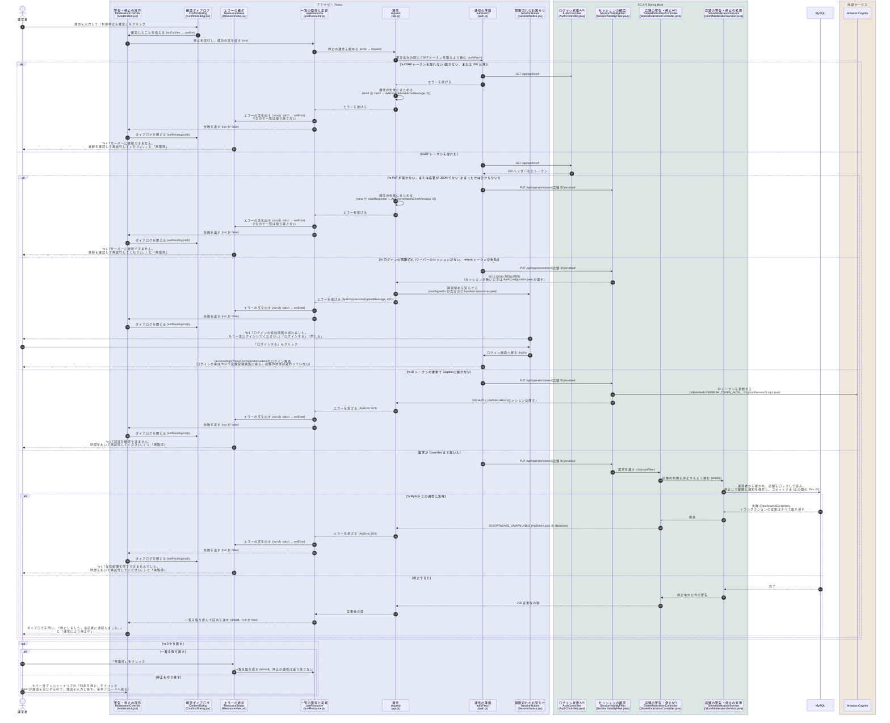

# EC-A11 店舗の利用を停止・再開する

```mermaid
sequenceDiagram
    autonumber
    actor User as 運営者
    box rgba(47,111,219,0.10) ブラウザー React
        participant Work as 運営者画面の枠<br/>Workspace<br/>(Workspace.jsx)
        participant Page as 店舗管理画面<br/>OperatorStoresPage<br/>(OperatorStores.jsx)
        participant Mod as 警告・停止の操作<br/>ModerationControls<br/>(Moderation.jsx)
        participant Dlg as 確認ダイアログ<br/>ConfirmDialog<br/>(ConfirmDialog.jsx)
        participant Ev as 警告・停止の履歴<br/>ModerationEvents<br/>(Moderation.jsx)
        participant Hook as 一覧の取得と変更<br/>useResource<br/>(useResource.js)
        participant Http as 通信<br/>request<br/>(api.js)
        participant AuthJs as 通信の準備<br/>authFetch<br/>(auth.js)
    end
    box rgba(27,127,92,0.12) EC API Spring Boot
        participant AuthCtrl as ログイン状態API<br/>AuthController<br/>(AuthController.java)
        participant SCtrl as 店舗API<br/>StoreController<br/>(StoreController.java)
        participant Ctrl as 店舗の警告・停止API<br/>StoreModerationController<br/>(StoreModerationController.java)
        participant Svc as 店舗の警告・停止の処理<br/>StoreModerationService<br/>(StoreModerationService.java)
        participant Hist as 履歴の読み方<br/>ModerationHistory<br/>(ModerationHistory.java)
        participant Notices as 出店者への通知<br/>NotificationService<br/>(NotificationService.java)
        participant Repo as 店舗の読み書き<br/>StoreRepository<br/>(StoreRepository.java)
    end
    participant Db as MySQL

    Note over User,Db: 共通代替フロー<br/>*b 未ログインの場合: 2 (URL を直接開いたときのログインの確認)、5、24、45、一覧の取り直しの 38 に適用<br/>*a 通信に失敗した場合: 5、22、24、45、一覧の取り直しの 38 に適用

    User->>Work: 運営者メニューの「店舗管理」をクリック
    Work->>Page: URL を /operator/sellers に変え、<br/>OperatorStoresPage を表示
    Page->>Hook: 店舗の一覧を取りに行くよう頼む (useResource)
    Hook->>Http: 画面を開いたときに自動で<br/>一覧の通信を始める (reload → request)
    Http->>SCtrl: GET /api/operator/stores
    SCtrl-->>Http: 200 店舗の配列<br/>(作り方は EC-A05 の図と同じ流れ)
    Http-->>Hook: 店舗の一覧
    Hook-->>Page: 店舗の一覧
    Page->>Mod: 閉鎖済みでない店舗ごとに、警告と停止の操作を表示<br/>(ModerationControls。停止中かは enabled の逆)
    Mod-->>User: 「警告する」(警告中なら「もう一度警告する」と「警告を解除」、<br/>「警告中」と「運営からの警告：理由」)、「警告・停止の履歴」、<br/>停止中なら「利用を再開」、停止中でなければデンジャーエリアの「利用を停止」

    alt 基本フロー 利用を停止する
        User->>Mod: 対象店舗のデンジャーエリアの「利用を停止」をクリック
        Mod->>Dlg: 理由を空にして確認ダイアログを表示<br/>(open('suspend') → ConfirmDialog)
        Dlg-->>User: 「利用停止の確認」、「対象：店舗名」、「この店舗の利用を停止します。<br/>商品は購入者向けの画面に表示されなくなり、出店者は商品・在庫・注文を<br/>操作できなくなります。確定済みの注文はキャンセルされません。」、<br/>「理由（必須・出店者に通知します）」欄、「利用停止を確定」、「取消」
    else 3a 停止せずに警告する
        User->>Mod: 3a-1「警告する」(警告中なら「もう一度警告する」) をクリック
        Note over User,Dlg: 結果: 理由を空にして確認ダイアログを表示 (open('warn'))。<br/>画面: 3a-2「警告の確認」、「出店者に理由を通知します。公開・利用の状態は変わりません。」、「理由（必須・出店者に通知します）」欄、「警告する」、「取消」
    else 3b 警告を解除する
        User->>Mod: 3b-1「警告を解除」(警告中だけに出る) をクリック
        Note over User,Dlg: 結果: 理由を空にして確認ダイアログを表示 (open('clear'))。<br/>画面: 3b-2「警告の解除の確認」、「警告を解除し、出店者に通知します。」、「理由（任意・出店者に通知します）」欄、「警告を解除する」、「取消」
    else 3c 利用を再開する
        User->>Mod: 3c-1「利用を再開」(停止中だけに出る) をクリック
        Note over User,Dlg: 結果: 理由を空にして確認ダイアログを表示 (open('resume'))。<br/>画面: 3c-2「利用再開の確認」、「利用停止を解除し、再び利用できるようにします。」、「理由（任意・出店者に通知します）」欄、「利用再開を確定」、「取消」
    end
    User->>Dlg: 理由を入力し (onChange → setReason。500 文字まで。3b・3c は任意)、<br/>「利用停止を確定」をクリック<br/>(3a-3「警告する」、3b-3「警告を解除する」、3c-3「利用再開を確定」)
    Dlg->>Mod: 確定したことを伝える (onConfirm → confirm)
    Mod->>Hook: 操作を実行し、成功の文を渡す (run)<br/>「停止しました。出店者に通知しました。」<br/>(3a「警告しました。…」、3b「警告を解除しました。…」、3c「再開しました。…」)
    Hook->>Http: 操作の通信を始める (write → request)<br/>本文は停止 { enabled: false, reason }、3c { enabled: true, reason }、<br/>3a { warned: true, reason }、3b { warned: false, reason }
    Http->>AuthJs: 書き込みの前に CSRF トークンを取るよう頼む (authFetch)
    AuthJs->>AuthCtrl: GET /api/auth/csrf
    AuthCtrl-->>AuthJs: 200 ヘッダー名とトークン (csrf)
    AuthJs->>Ctrl: PUT /api/operator/stores/{店舗 ID}/enabled (停止・3c)<br/>PUT /api/operator/stores/{店舗 ID}/warning (3a・3b)<br/>(CSRF トークンのヘッダー付き)
    Ctrl->>Svc: 停止・再開は (enabled → enable)、警告・解除は (warning → warn) 頼む<br/>全体が 1 つのトランザクション。運営者かを確かめる (AuthService.requireAdmin)
    Svc->>Repo: 店舗をロックして読む (lock、SELECT ... FOR UPDATE stores)
    Repo-->>Svc: 店舗
    Svc->>Hist: 理由の前後の空白を除くよう頼む (reasonFor)<br/>(必須の理由が空なら 400 REASON_REQUIRED。画面の 5a が先に止める)
    opt 3b 警告の解除
        Svc->>Db: 今の警告を求めるため、店舗の履歴を読む (currentWarning)
        Note over Svc,Db: 結果: 履歴を新しい順に読み (findByStoreIdOrderByIdDesc)、<br/>今の警告を求める (ModerationHistory.activeWarning)。
    end
    alt 記録する (停止は停止していないとき、再開は停止中のとき、<br/>警告はいつも (警告中でも毎回)、警告の解除は警告中のとき)
        Svc->>Db: 停止・再開は店舗の停止の印を変え (changeSuspended)、<br/>履歴に SUSPEND・WARN・CLEAR_WARNING・RESUME のどれかを足す<br/>(record → StoreModerationEventRepository.save、store_moderation_events)
        Svc->>Notices: 店舗の出店者に知らせるよう頼む (toStore)<br/>題名「店舗の利用が停止されました」(3a「店舗に運営から警告がありました」、<br/>3b「店舗への運営の警告が解除されました」、3c「店舗の利用停止が解除されました」)、<br/>本文「店舗名 / 理由」(noticeBody)。組織のオーナーと、店舗でロールのある<br/>担当者のうち、利用中の会員ごとに通知を保存する (notifications)
    else すでにその状態
        Svc->>Svc: 何もしない。履歴も通知も足さない
    end
    Svc->>Db: 変更を送ってから、店舗の履歴を新しい順に読む<br/>(state → flush、findByStoreIdOrderByIdDesc)
    Db-->>Svc: 履歴
    Svc-->>Ctrl: 今の警告を求め (ModerationHistory.activeWarning)、<br/>停止中かと今の警告 (State) を返す。ここでコミット
    Ctrl-->>Http: 200 { suspended, warning }
    Http-->>Hook: 変更後の値 (画面では使わない)
    Hook->>Http: 一覧を取り直す (reload)。流れは 5〜7 と同じ
    Http-->>Hook: 最新の店舗の一覧
    Hook-->>Mod: 成功を返す (run が true、成功の文を設定)
    Mod-->>User: 履歴の欄を作り直す印を進め、ダイアログを閉じ (setVersion、setPending(null))、<br/>「停止しました。出店者に通知しました。」、状態は「運営により停止中」<br/>(stateOf。閉鎖中の店舗は閉鎖中のまま)、デンジャーエリアの代わりに「利用を再開」<br/>(3a-5「警告中」と「運営からの警告：理由」と日時、3b-5「警告中」のバッジが消える、<br/>3c-5 更新後の状態とデンジャーエリアの「利用を停止」)

    alt 3d 履歴を確認する
        User->>Mod: 3d-1 対象店舗の「警告・停止の履歴」を開く
        Mod->>Ev: 開いたことを覚え、履歴を表示する<br/>(details の onToggle → setHistoryOpen(true) → ModerationEvents)
        Ev->>Hook: 履歴を取りに行くよう頼む (useResource)。<br/>取るのは開いたときが初めて (取得中は「読み込み中です。」)
        Hook->>Ctrl: GET /api/operator/stores/{店舗 ID}/moderation-events<br/>(reload → request)
        Ctrl->>Svc: 店舗の履歴を読むよう頼む (events)。全体が読むだけのトランザクション<br/>運営者かを確かめ (AuthService.requireAdmin)、店舗があるかを確かめ<br/>(StoreRepository.existsById)、履歴を新しい順に読む<br/>(StoreModerationEventRepository.findByStoreIdOrderByIdDesc)、<br/>操作した運営者の会員を読んで表示の形にする (ModerationHistory.views、AuthMemberRepository.findAllById)
        Svc-->>Ctrl: 履歴のリスト (type、reason、actorName は表示名か、<br/>空ならメールアドレス、createdAt)
        Ctrl-->>Hook: 200 履歴の配列
        Hook-->>Ev: 履歴
        Ev-->>User: 3d-2 新しい順に 1 行ずつ「日時 警告／警告の解除／停止／再開<br/>（運営者名）：理由」(理由が空なら「：理由」を出さない。<br/>履歴がなければ「履歴はありません。」)
    end
```

- ユースケース記述: [EC-A11_店舗の利用を停止・再開する](<../../アーカイブ/ユースケース/kusakari-ec/EC-A11_店舗の利用を停止・再開する.md>)
- 共通代替フロー: [00_全ユースケース共通の代替フロー](<00_全ユースケース共通の代替フロー.md>)
- 対象のコード: kusakari-ec の main（6bad7e3、2026-11-24 時点）

## シーケンス図

参加者は、上から「画面や役割の名前」「コンポーネント・クラスの名前」「ファイル名（かっこ付き）」の順に書いています。
共通代替フローの中身は、00 の図か、下の「共通代替フローを直接書いた図」を見てください。
代替フローのうち、確認ダイアログを開くだけの 3a〜3c は、分かれる所だけを描き、結果と画面は Note に文で書いています。3b で今の警告を読む処理（opt）も、頼む矢印と Note に寄せています。3d は、そこでしか起きない履歴の通信があるので矢印で描いています。エラーの分岐は描かず、ほかの代替フローは図の下に並べています。
基本フロー 3 で運営者が選ぶ操作ごとに、利用の停止（基本フロー）と 3a〜3c を `alt` で分けています。3d（履歴の確認）は、確定の後の流れを通らないので、図の最後に別の `alt` で書いています。

図に描いていない代替フロー：5a（理由が未入力）、6a（「取消」をクリックした）、7a（店舗が閉鎖済みになっていた）

## 共通代替フローを直接書いた図

上の図の「利用停止を確定」の通信（CSRF トークンの取得と `PUT /api/operator/stores/{店舗 ID}/enabled`）に、この画面で起こる共通代替フロー（\*a、\*b）を書き込んだ図です。3a〜3c の「警告する」「警告を解除する」「利用再開を確定」も、同じ `ModerationControls` の `confirm()` と `useResource.js` の `run()` を通るので、パスと文が違うだけで同じ流れです。画面を開いて店舗の一覧を取る通信の \*a・\*b は [EC-A05](<EC-A05_店舗情報を確認する.md>) の図と、3d の履歴の通信の \*a・\*b は [EC-A06](<EC-A06_商品情報を確認する.md>) の図（エラーの文だけを出し、「再取得」がない）と同じなので省いています。

## ユースケース記述との差

- 基本フロー 2: 「警告する」ボタンは、利用停止中の店舗にも出ます。記述は「利用停止中でない店舗には、『警告する』ボタンと…」としています。閉鎖済みの店舗には、警告・停止の操作も「警告・停止の履歴」も出ません（記述の関連情報のとおり）。
- 基本フロー 7・9: 閉鎖中の店舗も利用停止できます（記述の関連情報のとおり）。ところが画面の状態は `stateOf()` が閉鎖中を先に見るので、閉鎖中の店舗を利用停止しても「閉鎖中（…）」のままで、「運営により停止中」になりません。ボタンは「利用を再開」に変わります。
- 共通代替フロー \*a: 通信に失敗したときやエラーの応答のとき、`confirm()` は結果にかかわらず `setPending(null)` でダイアログを閉じます。エラーは画面上部の `ResourceStatus` に出ます。もう一度ボタンを押すと `open()` が理由を空にするので、入力した理由は残りません。\*a-2 の「入力内容を保持したまま、再実行を可能にする」と違います。7a でもダイアログは閉じます。\*a-3 の「再取得」は一覧を取り直すだけで、停止の通信は送り直しません。
- 関連情報「すでに利用停止中の店舗の停止、利用停止していない店舗の再開、警告していない店舗の警告の解除は、何もせず」: サーバーは何もせずに 200 を返します。画面は 200 を成功として扱うので、このときも「停止しました。出店者に通知しました。」などを出します。通知を送っていないのに「通知しました」と出ます。
- 7a: 閉鎖済みの検査は `StoreModerationService.lock()` にあり、利用停止だけでなく、警告・警告の解除・利用再開でも同じ 409 `STORE_CLOSED` になります。記述は基本フロー 7 の代替フローとしてだけ書いています。
- 3d: 閉鎖済みの店舗には `ModerationControls` を出さないので、「警告・停止の履歴」も開けません。API の `GET /api/operator/stores/{店舗 ID}/moderation-events` は閉鎖済みの店舗でも履歴を返します。記述は閉鎖済みの店舗の履歴について書いていません。
- 3d: 履歴の取得に失敗したときは、履歴の欄にエラーの文だけを出し、「再取得」を出しません。閉じて開き直すと取り直します（[EC-A06](<EC-A06_商品情報を確認する.md>) と同じ）。
- 関連情報「通知は、組織のオーナーと、その店舗でロールを割り振られた担当者に届く」: `NotificationService.toStore()` は、そのうち利用停止されていない会員（`AuthMember.isEnabled()`）にだけ送ります。
- 5a: 理由の検査は画面（`reason.trim()`）とサーバー（`ModerationHistory.reasonFor()` の 400 `REASON_REQUIRED`「理由を入力してください。」）の両方にあります。画面の検査が先に止めるので、画面からサーバーの検査には届きません。理由の 500 文字の制限もサーバー（`@Size`、400 `INVALID_INPUT`）と画面の欄の両方にあります。
- 操作の API は、店舗がないときに 404 `STORE_NOT_FOUND`「店舗が見つかりません。」を返します（画面は一覧を取り直します）。一覧にある店舗から操作するので、図には書いていません。
- 運営者でない会員がこの画面を開くと、`Workspace.jsx` が「この画面を利用する権限がありません。」を出します。API も `requireAdmin()` で 403 `FORBIDDEN` を返します。事前条件が運営者のログインなので、図には書いていません。

## 確かめられなかったこと

- MySQL に送る SQL は、`@Lock(PESSIMISTIC_WRITE)` やメソッド名から読んだものです。SELECT … FOR UPDATE になることや、UPDATE と INSERT を送る時点は、実行して確かめていません。

## 参照したコード

- [frontend/src/workspace/Workspace.jsx](https://github.com/abeouga/kusakari-ec/blob/6bad7e37c4135034fbe97e30309772fbe872e675/frontend/src/workspace/Workspace.jsx): `operatorMenu`、`Workspace`（`/operator/sellers` と `OperatorStoresPage` の対応）
- [frontend/src/workspace/WorkspaceSidebar.jsx](https://github.com/abeouga/kusakari-ec/blob/6bad7e37c4135034fbe97e30309772fbe872e675/frontend/src/workspace/WorkspaceSidebar.jsx): `MenuLink`
- [frontend/src/workspace/Common.jsx](https://github.com/abeouga/kusakari-ec/blob/6bad7e37c4135034fbe97e30309772fbe872e675/frontend/src/workspace/Common.jsx): `PageLink`
- [frontend/src/workspace/OperatorStores.jsx](https://github.com/abeouga/kusakari-ec/blob/6bad7e37c4135034fbe97e30309772fbe872e675/frontend/src/workspace/OperatorStores.jsx): `OperatorStoresPage`（`closedAt` がない店舗だけに `ModerationControls` を出す）
- [frontend/src/workspace/SellerStores.jsx](https://github.com/abeouga/kusakari-ec/blob/6bad7e37c4135034fbe97e30309772fbe872e675/frontend/src/workspace/SellerStores.jsx): `stateOf`
- [frontend/src/workspace/Moderation.jsx](https://github.com/abeouga/kusakari-ec/blob/6bad7e37c4135034fbe97e30309772fbe872e675/frontend/src/workspace/Moderation.jsx): `targets`、`ModerationControls`（`open`、`confirm`、`send`、`done`、`titles`）、`WarningBadge`、`ModerationEvents`、`eventLabels`
- [frontend/src/components/ConfirmDialog.jsx](https://github.com/abeouga/kusakari-ec/blob/6bad7e37c4135034fbe97e30309772fbe872e675/frontend/src/components/ConfirmDialog.jsx): `ConfirmDialog`（`onConfirm`、`onCancel`、`busy`）
- [frontend/src/components/Dialog.jsx](https://github.com/abeouga/kusakari-ec/blob/6bad7e37c4135034fbe97e30309772fbe872e675/frontend/src/components/Dialog.jsx): `Dialog`（Esc キー、外側のクリック、「閉じる」）
- [frontend/src/workspace/useResource.js](https://github.com/abeouga/kusakari-ec/blob/6bad7e37c4135034fbe97e30309772fbe872e675/frontend/src/workspace/useResource.js): `useResource`、`reload`、`run`、`write`
- [frontend/src/workspace/ResourceView.jsx](https://github.com/abeouga/kusakari-ec/blob/6bad7e37c4135034fbe97e30309772fbe872e675/frontend/src/workspace/ResourceView.jsx): `ResourceStatus`（エラーの文と「再取得」）
- [frontend/src/api.js](https://github.com/abeouga/kusakari-ec/blob/6bad7e37c4135034fbe97e30309772fbe872e675/frontend/src/api.js): `request`、`send`、`readResponse`、`ApiError`、`networkErrorMessage`、`sessionExpiredMessage`
- [frontend/src/auth.js](https://github.com/abeouga/kusakari-ec/blob/6bad7e37c4135034fbe97e30309772fbe872e675/frontend/src/auth.js): `authFetch`（`GET /api/auth/csrf`）、`wasSignedIn`、`login`
- [frontend/src/components/SessionNotice.jsx](https://github.com/abeouga/kusakari-ec/blob/6bad7e37c4135034fbe97e30309772fbe872e675/frontend/src/components/SessionNotice.jsx): 期限切れのお知らせ
- [backend/src/main/java/jp/kusakari/ec/auth/AuthController.java](https://github.com/abeouga/kusakari-ec/blob/6bad7e37c4135034fbe97e30309772fbe872e675/backend/src/main/java/jp/kusakari/ec/auth/AuthController.java): `csrf`
- [backend/src/main/java/jp/kusakari/ec/store/controller/StoreController.java](https://github.com/abeouga/kusakari-ec/blob/6bad7e37c4135034fbe97e30309772fbe872e675/backend/src/main/java/jp/kusakari/ec/store/controller/StoreController.java): `list`
- [backend/src/main/java/jp/kusakari/ec/store/controller/StoreModerationController.java](https://github.com/abeouga/kusakari-ec/blob/6bad7e37c4135034fbe97e30309772fbe872e675/backend/src/main/java/jp/kusakari/ec/store/controller/StoreModerationController.java): `EnabledRequest`、`enabled`、`warning`、`events`
- [backend/src/main/java/jp/kusakari/ec/store/service/StoreModerationService.java](https://github.com/abeouga/kusakari-ec/blob/6bad7e37c4135034fbe97e30309772fbe872e675/backend/src/main/java/jp/kusakari/ec/store/service/StoreModerationService.java): `enable`、`warn`、`events`、`record`、`currentWarning`、`state`、`lock`
- [backend/src/main/java/jp/kusakari/ec/moderation/service/ModerationHistory.java](https://github.com/abeouga/kusakari-ec/blob/6bad7e37c4135034fbe97e30309772fbe872e675/backend/src/main/java/jp/kusakari/ec/moderation/service/ModerationHistory.java): `reasonFor`、`activeWarning`、`views`、`noticeBody`、`nameOf`
- [backend/src/main/java/jp/kusakari/ec/moderation/dto/ModerationDtos.java](https://github.com/abeouga/kusakari-ec/blob/6bad7e37c4135034fbe97e30309772fbe872e675/backend/src/main/java/jp/kusakari/ec/moderation/dto/ModerationDtos.java): `State`、`WarningRequest`、`EventView`
- [backend/src/main/java/jp/kusakari/ec/catalog/persistence/repository/StoreRepository.java](https://github.com/abeouga/kusakari-ec/blob/6bad7e37c4135034fbe97e30309772fbe872e675/backend/src/main/java/jp/kusakari/ec/catalog/persistence/repository/StoreRepository.java): `lock`、`existsById`（JpaRepository）
- [backend/src/main/java/jp/kusakari/ec/catalog/persistence/entity/StoreEntity.java](https://github.com/abeouga/kusakari-ec/blob/6bad7e37c4135034fbe97e30309772fbe872e675/backend/src/main/java/jp/kusakari/ec/catalog/persistence/entity/StoreEntity.java): `changeSuspended`、`suspended`、`closedAt`
- [backend/src/main/java/jp/kusakari/ec/moderation/persistence/repository/StoreModerationEventRepository.java](https://github.com/abeouga/kusakari-ec/blob/6bad7e37c4135034fbe97e30309772fbe872e675/backend/src/main/java/jp/kusakari/ec/moderation/persistence/repository/StoreModerationEventRepository.java): `findByStoreIdOrderByIdDesc`、`save`（JpaRepository）
- [backend/src/main/java/jp/kusakari/ec/auth/AuthMemberRepository.java](https://github.com/abeouga/kusakari-ec/blob/6bad7e37c4135034fbe97e30309772fbe872e675/backend/src/main/java/jp/kusakari/ec/auth/AuthMemberRepository.java): `findAllById`（JpaRepository）
- [backend/src/main/java/jp/kusakari/ec/notification/service/NotificationService.java](https://github.com/abeouga/kusakari-ec/blob/6bad7e37c4135034fbe97e30309772fbe872e675/backend/src/main/java/jp/kusakari/ec/notification/service/NotificationService.java): `toStore`
- [backend/src/main/java/jp/kusakari/ec/auth/AuthService.java](https://github.com/abeouga/kusakari-ec/blob/6bad7e37c4135034fbe97e30309772fbe872e675/backend/src/main/java/jp/kusakari/ec/auth/AuthService.java): `requireAdmin`
- [backend/src/main/java/jp/kusakari/ec/auth/SessionValidityFilter.java](https://github.com/abeouga/kusakari-ec/blob/6bad7e37c4135034fbe97e30309772fbe872e675/backend/src/main/java/jp/kusakari/ec/auth/SessionValidityFilter.java): `doFilterInternal`（ID トークンの更新、401 `LOGIN_REQUIRED`）
- [backend/src/main/java/jp/kusakari/ec/auth/CognitoPasswordLogin.java](https://github.com/abeouga/kusakari-ec/blob/6bad7e37c4135034fbe97e30309772fbe872e675/backend/src/main/java/jp/kusakari/ec/auth/CognitoPasswordLogin.java): `refresh`、503 `AUTH_UNAVAILABLE`
- [backend/src/main/java/jp/kusakari/ec/auth/AuthConfiguration.java](https://github.com/abeouga/kusakari-ec/blob/6bad7e37c4135034fbe97e30309772fbe872e675/backend/src/main/java/jp/kusakari/ec/auth/AuthConfiguration.java): `authenticationEntryPoint`（401 `LOGIN_REQUIRED`）
- [backend/src/main/java/jp/kusakari/ec/common/web/ApiErrors.java](https://github.com/abeouga/kusakari-ec/blob/6bad7e37c4135034fbe97e30309772fbe872e675/backend/src/main/java/jp/kusakari/ec/common/web/ApiErrors.java): `business`、`invalid`、`database`
