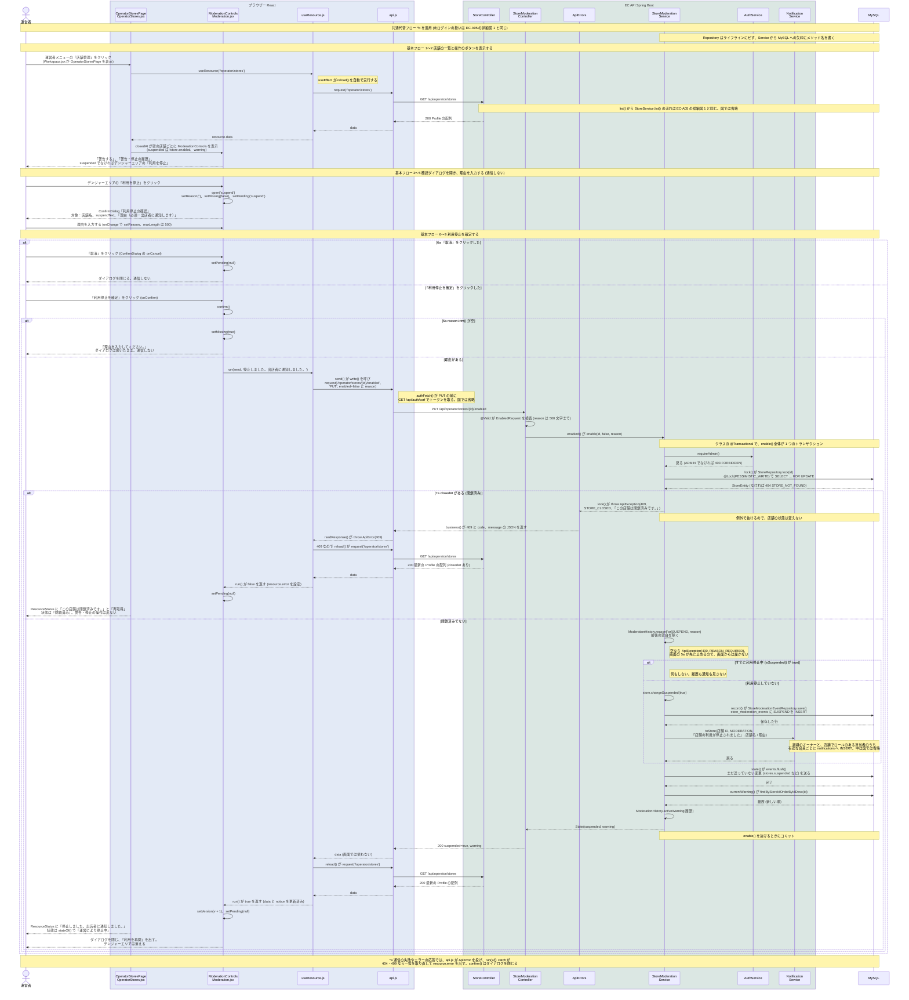
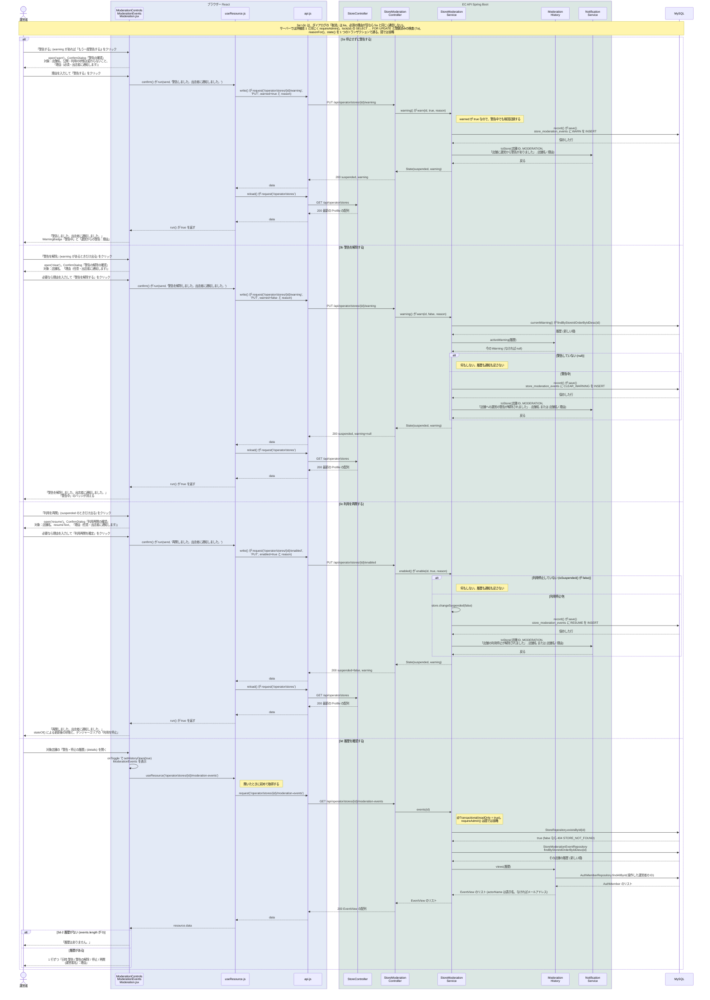

# EC-A11 店舗の利用を停止・再開する

- ユースケース記述: [EC-A11_店舗の利用を停止・再開する](<../../アーカイブ/ユースケース/kusakari-ec/EC-A11_店舗の利用を停止・再開する.md>)
- 対象のコード: kusakari-ec の main（19a2be3、2026-11-20 時点）

## 概要図

```mermaid
sequenceDiagram
    actor User as 運営者
    participant Page as 店舗管理画面<br/>React
    participant Api as EC API<br/>Spring Boot
    participant Db as MySQL

    Note over User,Db: 共通代替フロー *a・*b を適用。失敗の応答や通信の失敗では、<br/>画面上部にエラーと「再取得」を出し、確認ダイアログを閉じる

    Note over User,Db: 基本フロー 1〜2 店舗の一覧と操作のボタンを表示する (EC-A05)
    User->>Page: 運営者メニューの「店舗管理」をクリック
    Page->>Api: GET /api/operator/stores
    Api->>Db: 店舗、警告の履歴、組織、未完了の注文の件数を読む
    Db-->>Api: 行
    Api-->>Page: 200 店舗の配列
    Page-->>User: 閉鎖済みでない店舗に「警告する」、<br/>利用停止中でなければデンジャーエリアの「利用を停止」

    Note over User,Db: 基本フロー 3〜5 確認ダイアログを開き、理由を入力する (通信しない)
    User->>Page: デンジャーエリアの「利用を停止」をクリック
    Page-->>User: 「利用停止の確認」ダイアログ<br/>店舗名、停止したときの影響、「理由（必須・出店者に通知します）」
    User->>Page: 理由を入力する

    Note over User,Db: 基本フロー 6〜9 利用停止を確定する
    alt 6a 「取消」をクリックした
        User->>Page: 「取消」をクリック
        Page-->>User: ダイアログを閉じる。店舗の状態は変えない (通信しない)
    else 「利用停止を確定」をクリックした
        User->>Page: 「利用停止を確定」をクリック
        alt 5a 理由が空
            Page-->>User: 「理由を入力してください。」<br/>ダイアログは開いたまま (通信しない)
        else 理由がある
            Page->>Api: PUT /api/operator/stores/{id}/enabled<br/>enabled=false, reason
            Api->>Db: 店舗の行をロックして読む
            Db-->>Api: stores の行
            alt 7a 店舗が閉鎖済みになっていた
                Api-->>Page: 409 STORE_CLOSED
                Page->>Api: GET /api/operator/stores
                Api-->>Page: 200 最新の店舗の配列
                Page-->>User: 「この店舗は閉鎖済みです。」<br/>ダイアログを閉じ、状態は「閉鎖済み」
            else 閉鎖済みでない
                alt すでに利用停止中
                    Note right of Api: 何もしない。履歴も通知も足さない
                else 利用停止していない
                    Api->>Db: stores.suspended を true にし、<br/>履歴 SUSPEND と出店者への通知を追加
                    Db-->>Api: 完了
                end
                Api-->>Page: 200 suspended=true, warning
                Page->>Api: GET /api/operator/stores
                Api-->>Page: 200 最新の店舗の配列
                Page-->>User: 「停止しました。出店者に通知しました。」<br/>「運営により停止中」と「利用を再開」
            end
        end
    end

    Note over User,Db: 代替フロー 3a〜3d (どのダイアログも「取消」は 6a、必須の理由が空なら 5a、<br/>3a〜3c で店舗が閉鎖済みになっていたら 7a と同じ)
    alt 3a 停止せずに警告する
        User->>Page: 「警告する」(警告中なら「もう一度警告する」)、<br/>理由を入力して「警告する」
        Page->>Api: PUT /api/operator/stores/{id}/warning<br/>warned=true, reason
        Api->>Db: 店舗の行をロックし、<br/>履歴 WARN と出店者への通知を追加
        Db-->>Api: 完了
        Api-->>Page: 200 suspended, warning
        Page->>Api: GET /api/operator/stores
        Api-->>Page: 200 最新の店舗の配列
        Page-->>User: 「警告しました。出店者に通知しました。」<br/>「警告中」のバッジと理由
    else 3b 警告を解除する
        User->>Page: 「警告を解除」、必要なら理由を入力して「警告を解除する」
        Page->>Api: PUT /api/operator/stores/{id}/warning<br/>warned=false, reason
        Api->>Db: 店舗の行をロックし、今の警告を履歴から求める
        Db-->>Api: store_moderation_events の行
        alt 警告していない
            Note right of Api: 何もしない。履歴も通知も足さない
        else 警告中
            Api->>Db: 履歴 CLEAR_WARNING と出店者への通知を追加
            Db-->>Api: 完了
        end
        Api-->>Page: 200 suspended, warning
        Page->>Api: GET /api/operator/stores
        Api-->>Page: 200 最新の店舗の配列
        Page-->>User: 「警告を解除しました。出店者に通知しました。」<br/>「警告中」のバッジが消える
    else 3c 利用を再開する
        User->>Page: 「利用を再開」、必要なら理由を入力して「利用再開を確定」
        Page->>Api: PUT /api/operator/stores/{id}/enabled<br/>enabled=true, reason
        Api->>Db: 店舗の行をロックして読む
        Db-->>Api: stores の行
        alt 利用停止していない
            Note right of Api: 何もしない。履歴も通知も足さない
        else 利用停止中
            Api->>Db: stores.suspended を false にし、<br/>履歴 RESUME と出店者への通知を追加
            Db-->>Api: 完了
        end
        Api-->>Page: 200 suspended=false, warning
        Page->>Api: GET /api/operator/stores
        Api-->>Page: 200 最新の店舗の配列
        Page-->>User: 「再開しました。出店者に通知しました。」<br/>更新後の状態とデンジャーエリアの「利用を停止」
    else 3d 履歴を確認する
        User->>Page: 対象店舗の「警告・停止の履歴」を開く
        Page->>Api: GET /api/operator/stores/{id}/moderation-events
        Api->>Db: 店舗の有無と、その店舗の履歴を新しい順に読み、<br/>操作した運営者の会員を読む
        Db-->>Api: store_moderation_events と members の行
        Api-->>Page: 200 履歴の配列 (新しい順)
        alt 3d-2 履歴がない
            Page-->>User: 「履歴はありません。」
        else 履歴がある
            Page-->>User: 日時、操作 (警告 / 警告の解除 / 停止 / 再開)、<br/>操作した運営者、理由
        end
    end
```

## 詳細図 1 基本フロー 1〜9

## 詳細図 2 代替フロー 3a〜3d

## ユースケース記述との差

- 基本フロー 7・9: 閉鎖中の店舗も利用停止できます（記述の関連情報のとおり）。ところが画面の状態は `stateOf()` が閉鎖中を先に見るので、閉鎖中の店舗を利用停止しても「閉鎖中（…）」のままで、「運営により停止中」になりません。ボタンは「利用を再開」に変わります。
- 共通代替フロー *a: 通信に失敗したときやエラーの応答のとき、`confirm()` は結果にかかわらず `setPending(null)` でダイアログを閉じます。エラーは画面上部の `ResourceStatus` に出ます。もう一度ボタンを押すと `open()` が理由を空にするので、入力した理由は残りません。*a-2 の「入力内容を保持したまま、再実行を可能にする」と違います。7a でもダイアログは閉じます。
- 関連情報「すでに利用停止中の店舗の停止、利用停止していない店舗の再開、警告していない店舗の警告の解除は、何もせず」: サーバーは何もせずに 200 を返します。画面は 200 を成功として扱うので、このときも「停止しました。出店者に通知しました。」などを出します。通知を送っていないのに「通知しました」と出ます。
- 7a: 閉鎖済みの検査は `StoreModerationService.lock()` にあり、利用停止だけでなく、警告・警告の解除・利用再開でも同じ 409 `STORE_CLOSED` になります。記述は基本フロー 7 の代替フローとしてだけ書いています。
- 3d: 閉鎖済みの店舗には `ModerationControls` を出さないので、「警告・停止の履歴」も開けません。API の `GET /api/operator/stores/{id}/moderation-events` は閉鎖済みの店舗でも履歴を返します。記述は閉鎖済みの店舗の履歴について書いていません。
- 関連情報「通知は、組織のオーナーと、その店舗でロールを割り振られた担当者に届く」: `NotificationService.toStore()` は、そのうち利用停止されていない会員（`AuthMember.isEnabled()`）にだけ送ります。
- 5a: 理由の検査は画面（`reason.trim()`）とサーバー（`ModerationHistory.reasonFor()` の 400 `REASON_REQUIRED`）の両方にあります。画面の検査が先に止めるので、画面からサーバーの検査には届きません。

## 確かめられなかったこと

- MySQL に送る SQL は、`@Lock(PESSIMISTIC_WRITE)` やメソッド名から読んだものです。SELECT … FOR UPDATE になることや、UPDATE と INSERT を送る時点は、実行して確かめていません。

## 参照したコード

- [frontend/src/workspace/Workspace.jsx](https://github.com/abeouga/kusakari-ec/blob/19a2be307ee71a2cd87e538236c3c8c42929c5b3/frontend/src/workspace/Workspace.jsx): `operatorMenu`、`Workspace`（`/operator/sellers` と `OperatorStoresPage` の対応）
- [frontend/src/workspace/OperatorStores.jsx](https://github.com/abeouga/kusakari-ec/blob/19a2be307ee71a2cd87e538236c3c8c42929c5b3/frontend/src/workspace/OperatorStores.jsx): `OperatorStoresPage`（`closedAt` がない店舗だけに `ModerationControls` を出す）
- [frontend/src/workspace/SellerStores.jsx](https://github.com/abeouga/kusakari-ec/blob/19a2be307ee71a2cd87e538236c3c8c42929c5b3/frontend/src/workspace/SellerStores.jsx): `stateOf`
- [frontend/src/workspace/Moderation.jsx](https://github.com/abeouga/kusakari-ec/blob/19a2be307ee71a2cd87e538236c3c8c42929c5b3/frontend/src/workspace/Moderation.jsx): `targets`、`ModerationControls`（`open`、`confirm`、`send`、`done`、`titles`）、`WarningBadge`、`ModerationEvents`
- [frontend/src/components/ConfirmDialog.jsx](https://github.com/abeouga/kusakari-ec/blob/19a2be307ee71a2cd87e538236c3c8c42929c5b3/frontend/src/components/ConfirmDialog.jsx): `ConfirmDialog`（`onConfirm`、`onCancel`）
- [frontend/src/workspace/useResource.js](https://github.com/abeouga/kusakari-ec/blob/19a2be307ee71a2cd87e538236c3c8c42929c5b3/frontend/src/workspace/useResource.js): `useResource`、`reload`、`run`、`write`
- [frontend/src/workspace/ResourceView.jsx](https://github.com/abeouga/kusakari-ec/blob/19a2be307ee71a2cd87e538236c3c8c42929c5b3/frontend/src/workspace/ResourceView.jsx): `ResourceStatus`
- [frontend/src/api.js](https://github.com/abeouga/kusakari-ec/blob/19a2be307ee71a2cd87e538236c3c8c42929c5b3/frontend/src/api.js): `request`、`send`、`readResponse`、`ApiError`
- [frontend/src/auth.js](https://github.com/abeouga/kusakari-ec/blob/19a2be307ee71a2cd87e538236c3c8c42929c5b3/frontend/src/auth.js): `authFetch`（`/api/auth/csrf`）
- [backend/src/main/java/jp/kusakari/ec/store/controller/StoreController.java](https://github.com/abeouga/kusakari-ec/blob/19a2be307ee71a2cd87e538236c3c8c42929c5b3/backend/src/main/java/jp/kusakari/ec/store/controller/StoreController.java): `list`
- [backend/src/main/java/jp/kusakari/ec/store/controller/StoreModerationController.java](https://github.com/abeouga/kusakari-ec/blob/19a2be307ee71a2cd87e538236c3c8c42929c5b3/backend/src/main/java/jp/kusakari/ec/store/controller/StoreModerationController.java): `EnabledRequest`、`enabled`、`warning`、`events`
- [backend/src/main/java/jp/kusakari/ec/store/service/StoreModerationService.java](https://github.com/abeouga/kusakari-ec/blob/19a2be307ee71a2cd87e538236c3c8c42929c5b3/backend/src/main/java/jp/kusakari/ec/store/service/StoreModerationService.java): `enable`、`warn`、`events`、`record`、`currentWarning`、`state`、`lock`
- [backend/src/main/java/jp/kusakari/ec/moderation/service/ModerationHistory.java](https://github.com/abeouga/kusakari-ec/blob/19a2be307ee71a2cd87e538236c3c8c42929c5b3/backend/src/main/java/jp/kusakari/ec/moderation/service/ModerationHistory.java): `reasonFor`、`activeWarning`、`views`、`noticeBody`
- [backend/src/main/java/jp/kusakari/ec/moderation/dto/ModerationDtos.java](https://github.com/abeouga/kusakari-ec/blob/19a2be307ee71a2cd87e538236c3c8c42929c5b3/backend/src/main/java/jp/kusakari/ec/moderation/dto/ModerationDtos.java): `State`、`WarningRequest`、`EventView`
- [backend/src/main/java/jp/kusakari/ec/catalog/persistence/repository/StoreRepository.java](https://github.com/abeouga/kusakari-ec/blob/19a2be307ee71a2cd87e538236c3c8c42929c5b3/backend/src/main/java/jp/kusakari/ec/catalog/persistence/repository/StoreRepository.java): `lock`、`existsById`（JpaRepository）
- [backend/src/main/java/jp/kusakari/ec/catalog/persistence/entity/StoreEntity.java](https://github.com/abeouga/kusakari-ec/blob/19a2be307ee71a2cd87e538236c3c8c42929c5b3/backend/src/main/java/jp/kusakari/ec/catalog/persistence/entity/StoreEntity.java): `changeSuspended`、`suspended`、`closedAt`
- [backend/src/main/java/jp/kusakari/ec/moderation/persistence/repository/StoreModerationEventRepository.java](https://github.com/abeouga/kusakari-ec/blob/19a2be307ee71a2cd87e538236c3c8c42929c5b3/backend/src/main/java/jp/kusakari/ec/moderation/persistence/repository/StoreModerationEventRepository.java): `findByStoreIdOrderByIdDesc`、`save`（JpaRepository）
- [backend/src/main/java/jp/kusakari/ec/auth/AuthMemberRepository.java](https://github.com/abeouga/kusakari-ec/blob/19a2be307ee71a2cd87e538236c3c8c42929c5b3/backend/src/main/java/jp/kusakari/ec/auth/AuthMemberRepository.java): `findAllById`（JpaRepository）
- [backend/src/main/java/jp/kusakari/ec/notification/service/NotificationService.java](https://github.com/abeouga/kusakari-ec/blob/19a2be307ee71a2cd87e538236c3c8c42929c5b3/backend/src/main/java/jp/kusakari/ec/notification/service/NotificationService.java): `toStore`
- [backend/src/main/java/jp/kusakari/ec/auth/AuthService.java](https://github.com/abeouga/kusakari-ec/blob/19a2be307ee71a2cd87e538236c3c8c42929c5b3/backend/src/main/java/jp/kusakari/ec/auth/AuthService.java): `requireAdmin`
- [backend/src/main/java/jp/kusakari/ec/common/web/ApiErrors.java](https://github.com/abeouga/kusakari-ec/blob/19a2be307ee71a2cd87e538236c3c8c42929c5b3/backend/src/main/java/jp/kusakari/ec/common/web/ApiErrors.java): `business`
