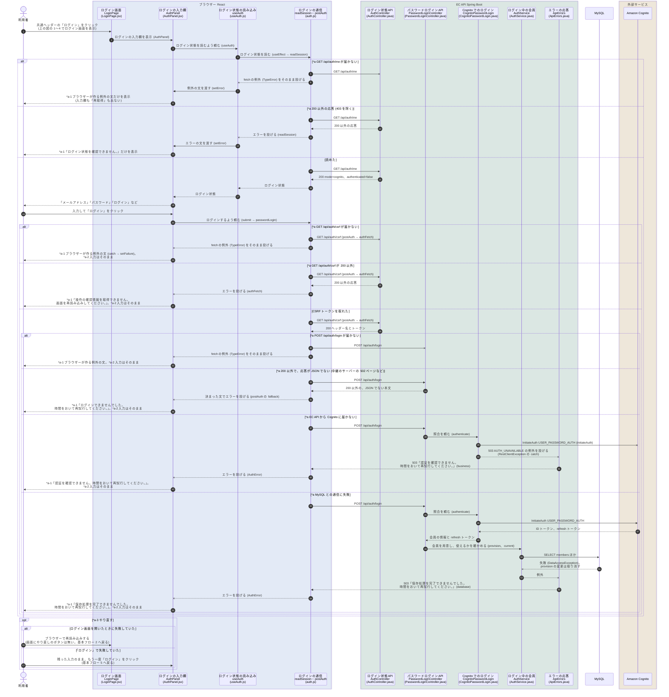

# EC-B01 ログインする

- ユースケース記述: [EC-B01_ログインする](<../../アーカイブ/ユースケース/kusakari-ec/EC-B01_ログインする.md>)
- 共通代替フロー: [00_全ユースケース共通の代替フロー](<00_全ユースケース共通の代替フロー.md>)
- 対象のコード: kusakari-ec の main（6bad7e3、2026-11-24 時点）

## シーケンス図

参加者は、上から「画面や役割の名前」「コンポーネント・クラスの名前」「ファイル名（かっこ付き）」の順に書いています。
ログインは EC の画面でメールアドレスとパスワードを受け取り、EC API が Amazon Cognito の `InitiateAuth` を呼びます。ブラウザーが Cognito の画面へ移るのは、代替フロー 7d の認証画面だけです。ブラウザーには `KUSAKARI_SESSION` の Cookie だけを渡し、トークンはサーバーの HTTP セッションに置きます。
共通代替フローの中身は、00 の図か、下の「共通代替フローを直接書いた図」を見てください。
代替フローのうち、エラーで終わるもの（6a・7a・7b・7e）は分かれる所だけを描き、結果と画面は Note に文で書いています。7c・7d は、そこでしか起きないやり取り（確認コードの送信、Cognito の認証画面）だけを矢印で描いています。

```mermaid
sequenceDiagram
    autonumber
    actor User as 利用者
    box rgba(47,111,219,0.10) ブラウザー React
        participant Header as 共通ヘッダー<br/>KusakariHeader<br/>(KusakariHeader.jsx)
        participant App as 画面の切り替え<br/>App<br/>(App.jsx)
        participant Login as ログイン画面<br/>LoginPage<br/>(LoginPage.jsx)
        participant Panel as ログインの入力欄<br/>AuthPanel<br/>(AuthPanel.jsx)
        participant Form as 確認コードの入力欄<br/>SignupForm<br/>(SignupForm.jsx)
        participant AuthJs as ログインの通信<br/>readSession・postAuth<br/>(auth.js)
    end
    box rgba(27,127,92,0.12) EC API Spring Boot
        participant AuthCtrl as ログイン状態API<br/>AuthController<br/>(AuthController.java)
        participant LoginCtrl as パスワードログインAPI<br/>PasswordLoginController<br/>(PasswordLoginController.java)
        participant SignupCtrl as 新規登録API<br/>SignupController<br/>(SignupController.java)
        participant Sec as 認証画面との連携<br/>oauth2Login<br/>(AuthConfiguration.java)
        participant Errs as エラーの応答<br/>ApiErrors<br/>(ApiErrors.java)
        participant CogP as Cognito でのログイン<br/>CognitoPasswordLogin<br/>(CognitoPasswordLogin.java)
        participant AuthSvc as ログイン中の会員<br/>AuthService<br/>(AuthService.java)
        participant Repo as 会員の読み書き<br/>AuthMemberRepository<br/>(AuthMemberRepository.java)
    end
    participant Db as MySQL
    box rgba(180,120,20,0.12) 外部サービス
        participant Cog as Amazon Cognito
    end

    Note over User,Cog: 共通代替フロー<br/>*a 通信に失敗した場合: 6、16、18、27、7d のページの移動の 31・35、49 に適用<br/>*b 未ログインの場合: ログインの前なので適用しない

    User->>Header: 共通ヘッダーの「ログイン」をクリック
    Header->>App: ログインのボタンが押されたことを伝える<br/>(onPanel('login') → openHeaderPanel)
    App->>Login: URL を /account/login?returnTo=今の画面 に変え、<br/>LoginPage を表示 (login → loginPath → navigate)
    Login->>Panel: ログインの入力欄を表示 (AuthPanel、mode は login)
    Panel->>AuthJs: 画面を開いたときに自動で<br/>ログイン状態を読むよう頼む (useAuth → readSession)
    AuthJs->>AuthCtrl: GET /api/auth/me
    AuthCtrl->>AuthSvc: ログイン状態をまとめるよう頼む (me → session)
    AuthSvc-->>AuthCtrl: 未ログイン (current が 401 を投げ、session が受け止める)
    AuthCtrl-->>AuthJs: 200 mode=cognito、authenticated=false
    AuthJs-->>Panel: ログイン状態
    Panel-->>User: 「ログイン」画面。「メールアドレス」「パスワード」「ログイン」、<br/>「パスワードを忘れた方・追加の本人確認」「新規登録」<br/>「招待キーで登録（店舗の担当者）」

    User->>Panel: 「メールアドレス」と「パスワード」を入力し、<br/>「ログイン」をクリック
    break 6a メールアドレスかパスワードが未入力
        Panel-->>User: 6a-1 ブラウザーが未入力の欄に入力を求める<br/>(input の required。通信しない)。6a-2 基本フロー 3 へ戻る
    end
    Panel->>Panel: 送信中にして入力欄を押せなくする<br/>(submit → setSubmitting(true))。ボタンは「ログイン中…」
    Panel->>AuthJs: メールアドレスとパスワードで<br/>ログインするよう頼む (passwordLogin)
    AuthJs->>AuthCtrl: 書き込みの前に CSRF トークンを取る<br/>GET /api/auth/csrf (postAuth → authFetch)
    AuthCtrl-->>AuthJs: 200 ヘッダー名とトークン (csrf)
    AuthJs->>LoginCtrl: POST /api/auth/login<br/>(email、password、returnTo、CSRF トークンのヘッダー付き)
    LoginCtrl->>CogP: メールアドレスとパスワードの照合を頼む (authenticate)
    CogP->>Cog: 照合する (initiateAuth、InitiateAuth USER_PASSWORD_AUTH)
    break 7a 一致するアカウントがない
        CogP--xErrs: 401 INVALID_CREDENTIALS の例外を投げる<br/>(NotAuthorizedException か UserNotFoundException を受けて)
        Note over Errs,Panel: 結果: 401 を返し、ログインしない。<br/>画面: 7a-1「メールアドレスまたはパスワードが正しくありません。」入力はそのまま (7a-2 基本フロー 3 へ)
    end
    break 7e 短時間にログインを繰り返し失敗した
        CogP--xErrs: 429 AUTH_RATE_LIMITED の例外を投げる<br/>(TooManyRequestsException を受けて)
        Note over Errs,Panel: 結果: 429 を返し、ログインしない。<br/>画面: 7e-1「試行回数が多すぎます。時間をおいて再試行してください。」入力はそのまま
    end
    break 7c メールアドレスの確認が済んでいない
        CogP--xErrs: 409 EMAIL_NOT_CONFIRMED の例外を投げる<br/>(UserNotConfirmedException を受けて)
        Panel->>Form: 確認コードの入力に切り替える<br/>(setPending、switchMode('confirm') → SignupForm)
        Form-->>User: 7c-1「(メールアドレス) に送信した6桁の確認コードを入力してください。」<br/>「確認コード」「確認して登録を完了」「確認コードを再送する」
        User->>Form: 7c-2 確認コードを入力し、「確認して登録を完了」をクリック
        Form->>SignupCtrl: 確認コードを送る POST /api/auth/signup/confirm<br/>(confirm → confirmSignUp。先に CSRF トークンを取る)
        SignupCtrl->>Cog: 確認コードを照合する<br/>(CognitoSignup.confirm、ConfirmSignUp)
        Note over Form,Cog: 結果: 確認できたら、覚えていたパスワードでログインし直す (passwordLogin。流れは 15〜20、36〜51 と同じ)。7c-3 基本フロー 8 へ。<br/>画面: コードが違う・期限切れ (記述なし) なら「確認コードが正しくありません。」などを出し、入力欄は残る。
    end
    break 7d 追加の本人確認やパスワードの変更が必要
        CogP--xErrs: 409 AUTH_CHALLENGE_REQUIRED の例外を投げる<br/>(ChallengeName のある応答か PasswordResetRequiredException を受けて)
        Note over Errs,Panel: 画面: 7d-1「追加の本人確認またはパスワード変更が必要です。認証画面で手続きを完了してください。」<br/>か「認証画面でメール確認またはパスワード再設定を完了してください。」
        User->>Panel: 7d-2「パスワードを忘れた方・追加の本人確認」をクリック
        Panel->>Sec: 認証画面へページごと移る (a 要素の href)<br/>GET /api/auth/login?managed=true → /api/auth/authorize/cognito
        Sec->>Cog: 認可要求 (PKCE、state、nonce) を作り、<br/>Cognito の /oauth2/authorize へ 302 (withPkce)
        Cog-->>User: 7d-3 Cognito の認証画面 (Managed Login)
        User->>Cog: 7d-4 追加の本人確認やパスワードの再設定を済ませる
        Cog->>Sec: GET /api/auth/callback/cognito (code と state)。<br/>認可コードをトークンに換える (oauth2Login、POST /oauth2/token)
        Note over Sec,Cog: 結果: 会員を用意して使えるかを確かめ (successHandler → provision、current。流れは 38〜44 と同じ)、戻り先へ 302 して基本フロー 8 へ。<br/>失敗したとき (記述なし) は /account/login?auth=failed に戻し、「認証が完了しませんでした。もう一度ログインしてください。」
    end
    Cog-->>CogP: ID トークン、アクセストークン、refresh トークン
    CogP-->>LoginCtrl: 会員の情報と refresh トークン (Login)<br/>ID トークンの署名、issuer、audience、期限は toUser で確かめた
    LoginCtrl->>AuthSvc: 会員を用意するよう頼む (provision)<br/>provision 全体が 1 つのトランザクション
    AuthSvc->>Repo: issuer と subject で会員を探す<br/>(findByIssuerAndSubject、SELECT members)
    Repo-->>AuthSvc: 会員 (なければなし)
    opt 初めてのログイン
        AuthSvc->>Repo: 購入者 (USER) の会員を追加する (saveAndFlush)
        Note over AuthSvc,Db: 結果: INSERT members。会員がいるときは、メール確認日時が空なら入れる (markEmailVerified)。
    end
    LoginCtrl->>AuthSvc: 会員が使えるかを確かめる (current、SELECT members)
    break 7b 利用停止中か退会済み (enabled が偽)
        AuthSvc--xLoginCtrl: 403 ACCOUNT_DISABLED の例外を投げる (ApiException)
        Note over LoginCtrl,Panel: 結果: 認証情報を消してセッションを無効にし (clearContext、invalidate)、403 を返す。<br/>画面: 7b-1「このアカウントは利用できません。」とログインの入力欄 (入力はそのまま)
    end
    AuthSvc-->>LoginCtrl: 会員
    LoginCtrl->>LoginCtrl: セッション ID を変え、refresh トークンと認証情報をセッションに保存し、<br/>戻り先を確かめる (changeSessionId、CognitoRefreshSession.store、saveContext、AuthUrls.safeReturn)
    LoginCtrl-->>AuthJs: 200 returnTo
    AuthJs-->>Panel: 戻り先 (ログイン状態が変わったことを kusakari-auth-changed で知らせる)
    Panel->>App: 「移動しています」を出し、戻り先の画面を<br/>読み込み直す (complete → window.location.replace)
    App->>AuthCtrl: GET /api/auth/me (useAuth → readSession)<br/>SessionValidityFilter が会員を確かめ、session が組織と店舗も読む
    AuthCtrl-->>App: 200 authenticated=true、email、name、accountType など
    App-->>User: 元の画面 (戻り先がなければトップ)、<br/>共通ヘッダーに「アカウント」
```

## 共通代替フローを直接書いた図

上の図の、ログイン画面を開いたときの `GET /api/auth/me` と、「ログイン」をクリックしたときの `GET /api/auth/csrf`・`POST /api/auth/login` に、この画面で起こる共通代替フロー（\*a）を書き込んだ図です。ログインの前なので、\*b（未ログインの場合）は適用しません。7c の確認コードの送信（`POST /api/auth/signup/confirm`）も、同じ `postAuth()` を通るので、失敗したときの表示は下の図と同じです（`SignupForm` の `run()` がエラーの文を出し、確認コードの入力欄が残ります）。7d のページの移動の \*a は [EC-B20](<EC-B20_パスワードを再設定する.md>) の「共通代替フローを直接書いた図」と同じなので省いています。

## ユースケース記述との差

- 6a: 未入力の検査は React のコードではなく、入力欄の `required` でブラウザーが行います。文言はブラウザーが出すもので、記述の「入力を求める表示」に当たります。サーバーでも `LoginRequest` の `@NotBlank`・`@Email`・`@Size` が検査し、違反すると 400 `INVALID_INPUT`「入力内容・文字数・数値の範囲を確認してください。」になります（`ApiErrors.invalid()`）。
- 7b: 記述にない応答が 2 つあります。組織から除名された担当者（`SHOP_STAFF`）は、`current()` が 403 `ACCOUNT_EXPELLED`「このアカウントは無効化されています。組織の管理者にお問い合わせください。」を返します。Cognito の ID トークンでメールアドレスが確認済みでないときは、`provision()` が 403 `EMAIL_UNVERIFIED`「メール確認が必要です。」を返します。どちらも図の 7b と同じく、エラーの文を出してログインさせません（`EMAIL_UNVERIFIED` は `provision()` の中なので、セッションを無効にする `catch` は通りません）。
- 7a-2・7b-2・7e-2: 記述は 7b・7e を「ユースケースを終了する」としていますが、画面はエラーの文を出し、ログインの入力欄と入力をそのまま残します。続けて入力し直せます。
- 7c: ログインの時点では確認コードを送り直しません。新規登録のときに届いたコードを入力します。届いていない、または期限切れのときは「確認コードを再送する」（EC-B16 の 11a-2 と同じ処理）を使います。記述の 7c にはこの手順がありません。409 の文「メールアドレスの確認が完了していません。確認コードを入力してください。」は画面に出ず、見出しが「メールアドレスの確認」に変わります。
- 7c-3: 確認コードの照合に失敗したとき（`CODE_MISMATCH`、`CODE_EXPIRED`）の扱いは、記述の 7c にありません。コードでは EC-B16 の 11a と同じ文を出します。
- 7d-4: 認証画面での手続きやトークンの交換に失敗したとき、`/account/login?auth=failed` に戻って「認証が完了しませんでした。もう一度ログインしてください。」と出します。記述にない枝です。
- 基本フロー 8: 戻り先は、ヘッダーの「ログイン」を押した画面の URL（`returnTo`）です。`AuthUrls.safeReturn()` が、EC と Canvas のオリジン以外の URL、`/account/login`、`/api/auth/` で始まる URL を EC の「/」に換えます。Canvas の画面から来た場合は Canvas へ戻ります。記述の「元の画面または『メイン』画面」に当たります。
- 基本フロー 2: ログイン画面を開くと、`LoginPage` と `AuthPanel` がそれぞれ `useAuth()` を呼ぶので、`GET /api/auth/me` を 2 回送ります。図では 1 回だけ書いています。ログインの後の `kusakari-auth-changed` でも、表示中の `useAuth()` が `GET /api/auth/me` を送り直しますが、すぐにページを読み込み直すので図には書いていません。
- 共通代替フロー \*a: ログインの通信は `api.js` を通らないので、00 の \*a-1 の共通の文（「サーバーに接続できません。…」）になりません。届かないときは `fetch()` の例外の文（ブラウザーが作る英語などの文）がそのまま出ます。CSRF トークンを取れないときの「操作の確認情報を取得できません。画面を再読み込みしてください。」は、`api.js` を通る画面と違い、この画面ではそのまま出ます。ログイン画面を開いたときの `GET /api/auth/me` に失敗すると、入力欄の代わりにエラーの文だけが出て、「再取得」のボタンはありません。
- 共通代替フロー \*a: Cognito の応答で Cognito の側のエラー（図の 7a・7c・7d・7e 以外）が返ったときは、503 `AUTH_UNAVAILABLE` でも文が「認証サービスに接続できません。時間をおいて再試行してください。」に変わります。Cognito に届かないときと、ID トークンを確かめられないとき（`toUser()`）は「認証を確認できません。時間をおいて再試行してください。」です。古い図は届かないときを「認証サービスに接続できません。」としていましたが、コードでは「認証を確認できません。」です。
- 共通代替フロー \*b: ログインの前のユースケースなので、適用しません。
- `GET /api/auth/me` が 403 を返したとき（ログインの後に利用停止になった会員など）、`readSession()` は応答の文（「このアカウントは利用できません。」など）を出します。事前条件がログアウト状態なので、図には書いていません。

## 確かめられなかったこと

- Cognito が `ChallengeName` を返す条件（多要素認証、仮パスワードの変更など）と、`TooManyRequestsException` になる回数や時間は、Cognito の User Pool の設定と Cognito の仕様で決まります。このリポジトリのコードでは確かめられません。
- 存在しないメールアドレスのとき Cognito が返す例外は、User Pool の `prevent_user_existence_errors` で変わります。実際の User Pool は kusakari-terraform で管理しており、その設定は確かめていません。どちらの例外でも 401 `INVALID_CREDENTIALS` になります。
- 代替フロー 7d の認証画面（Managed Login）の中の手順は Cognito の画面で、コードでは確かめられません。
- `oauth2Login()` が `/oauth2/token` の後に行う処理（ID トークンの検証、`/oauth2/userInfo` を呼ぶかどうか、セッション ID の変更）は Spring Security の中の処理で、Spring Security のソースまでは確かめていません。
- ログインの後に読み込み直したページで、`SessionValidityFilter` の `current()` が MySQL に届かなかったときの応答は確かめていません。`DataAccessException` はこのフィルターの `catch`（`ApiException` だけ）を通らず、`@RestControllerAdvice` の外で起きるので、`ApiErrors.database()` の 503 にならない可能性があります。

## 参照したコード

- [packages/site-header/KusakariHeader.jsx](https://github.com/abeouga/kusakari-ec/blob/6bad7e37c4135034fbe97e30309772fbe872e675/packages/site-header/KusakariHeader.jsx): `panelAction`、「ログイン」ボタン、「アカウント」リンク
- [frontend/src/App.jsx](https://github.com/abeouga/kusakari-ec/blob/6bad7e37c4135034fbe97e30309772fbe872e675/frontend/src/App.jsx): `openHeaderPanel`、`/account/login` で `LoginPage` を返す条件、`useAuth`
- [frontend/src/workspace/navigation.js](https://github.com/abeouga/kusakari-ec/blob/6bad7e37c4135034fbe97e30309772fbe872e675/frontend/src/workspace/navigation.js): `navigate`、`usePath`
- [frontend/src/auth.js](https://github.com/abeouga/kusakari-ec/blob/6bad7e37c4135034fbe97e30309772fbe872e675/frontend/src/auth.js): `login`、`loginPath`、`readSession`、`authFetch`、`postAuth`、`passwordLogin`、`confirmSignUp`、`AuthError`
- [frontend/src/useAuth.js](https://github.com/abeouga/kusakari-ec/blob/6bad7e37c4135034fbe97e30309772fbe872e675/frontend/src/useAuth.js): `useAuth`、`kusakari-auth-changed` の受け取り
- [frontend/src/components/LoginPage.jsx](https://github.com/abeouga/kusakari-ec/blob/6bad7e37c4135034fbe97e30309772fbe872e675/frontend/src/components/LoginPage.jsx): `LoginPage`、見出しの切り替え（`headings`）
- [frontend/src/components/AuthPanel.jsx](https://github.com/abeouga/kusakari-ec/blob/6bad7e37c4135034fbe97e30309772fbe872e675/frontend/src/components/AuthPanel.jsx): `submit`、`complete`、`switchMode`、`returnTo`、`auth=failed` の表示、「パスワードを忘れた方・追加の本人確認」のリンク
- [frontend/src/components/SignupForm.jsx](https://github.com/abeouga/kusakari-ec/blob/6bad7e37c4135034fbe97e30309772fbe872e675/frontend/src/components/SignupForm.jsx): `confirm`、`run`、確認コードの入力欄
- [backend/src/main/java/jp/kusakari/ec/auth/AuthController.java](https://github.com/abeouga/kusakari-ec/blob/6bad7e37c4135034fbe97e30309772fbe872e675/backend/src/main/java/jp/kusakari/ec/auth/AuthController.java): `me`、`csrf`、`login`（`managed=true`）
- [backend/src/main/java/jp/kusakari/ec/auth/PasswordLoginController.java](https://github.com/abeouga/kusakari-ec/blob/6bad7e37c4135034fbe97e30309772fbe872e675/backend/src/main/java/jp/kusakari/ec/auth/PasswordLoginController.java): `login`、`LoginRequest`
- [backend/src/main/java/jp/kusakari/ec/auth/CognitoPasswordLogin.java](https://github.com/abeouga/kusakari-ec/blob/6bad7e37c4135034fbe97e30309772fbe872e675/backend/src/main/java/jp/kusakari/ec/auth/CognitoPasswordLogin.java): `authenticate`、`initiateAuth`、`toUser`
- [backend/src/main/java/jp/kusakari/ec/auth/CognitoRefreshSession.java](https://github.com/abeouga/kusakari-ec/blob/6bad7e37c4135034fbe97e30309772fbe872e675/backend/src/main/java/jp/kusakari/ec/auth/CognitoRefreshSession.java): `store`
- [backend/src/main/java/jp/kusakari/ec/auth/AuthService.java](https://github.com/abeouga/kusakari-ec/blob/6bad7e37c4135034fbe97e30309772fbe872e675/backend/src/main/java/jp/kusakari/ec/auth/AuthService.java): `provision`、`current`、`session`、`organizationIdOf`、`storeIdsOf`
- [backend/src/main/java/jp/kusakari/ec/auth/AuthMember.java](https://github.com/abeouga/kusakari-ec/blob/6bad7e37c4135034fbe97e30309772fbe872e675/backend/src/main/java/jp/kusakari/ec/auth/AuthMember.java): `markEmailVerified`、`isEnabled`
- [backend/src/main/java/jp/kusakari/ec/auth/AuthMemberRepository.java](https://github.com/abeouga/kusakari-ec/blob/6bad7e37c4135034fbe97e30309772fbe872e675/backend/src/main/java/jp/kusakari/ec/auth/AuthMemberRepository.java): `findByIssuerAndSubject`
- [backend/src/main/java/jp/kusakari/ec/auth/AuthUrls.java](https://github.com/abeouga/kusakari-ec/blob/6bad7e37c4135034fbe97e30309772fbe872e675/backend/src/main/java/jp/kusakari/ec/auth/AuthUrls.java): `safeReturn`
- [backend/src/main/java/jp/kusakari/ec/auth/AuthConfiguration.java](https://github.com/abeouga/kusakari-ec/blob/6bad7e37c4135034fbe97e30309772fbe872e675/backend/src/main/java/jp/kusakari/ec/auth/AuthConfiguration.java): `cognitoClients`、`cognitoSecurity` の `oauth2Login`（`withPkce`、`successHandler`、`failureHandler`）
- [backend/src/main/java/jp/kusakari/ec/auth/SessionValidityFilter.java](https://github.com/abeouga/kusakari-ec/blob/6bad7e37c4135034fbe97e30309772fbe872e675/backend/src/main/java/jp/kusakari/ec/auth/SessionValidityFilter.java): `doFilterInternal`
- [backend/src/main/java/jp/kusakari/ec/auth/SignupController.java](https://github.com/abeouga/kusakari-ec/blob/6bad7e37c4135034fbe97e30309772fbe872e675/backend/src/main/java/jp/kusakari/ec/auth/SignupController.java): `confirm`、`ConfirmRequest`
- [backend/src/main/java/jp/kusakari/ec/auth/CognitoSignup.java](https://github.com/abeouga/kusakari-ec/blob/6bad7e37c4135034fbe97e30309772fbe872e675/backend/src/main/java/jp/kusakari/ec/auth/CognitoSignup.java): `confirm`、`call`、`translate`
- [backend/src/main/java/jp/kusakari/ec/common/web/ApiErrors.java](https://github.com/abeouga/kusakari-ec/blob/6bad7e37c4135034fbe97e30309772fbe872e675/backend/src/main/java/jp/kusakari/ec/common/web/ApiErrors.java): `business`、`invalid`、`database`
