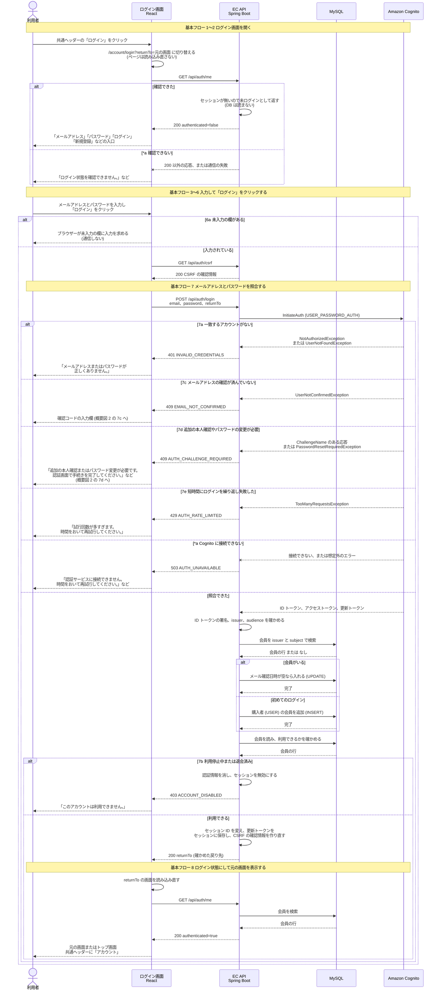
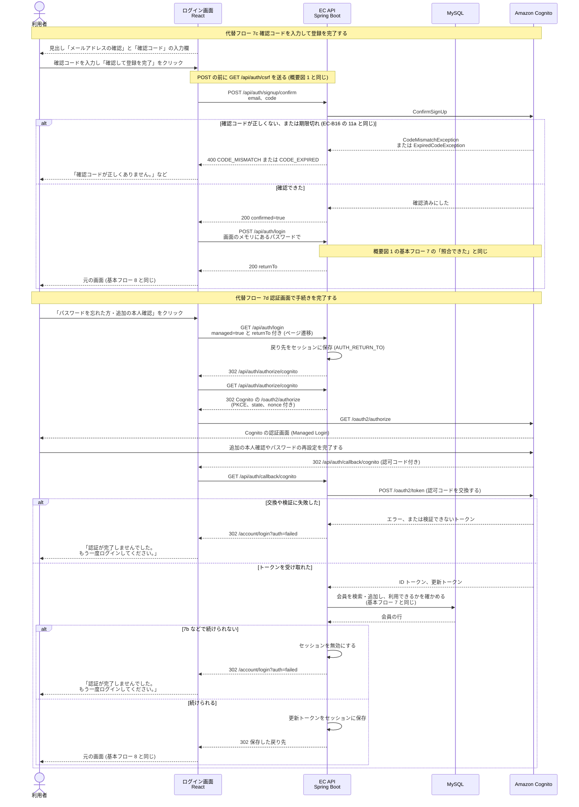
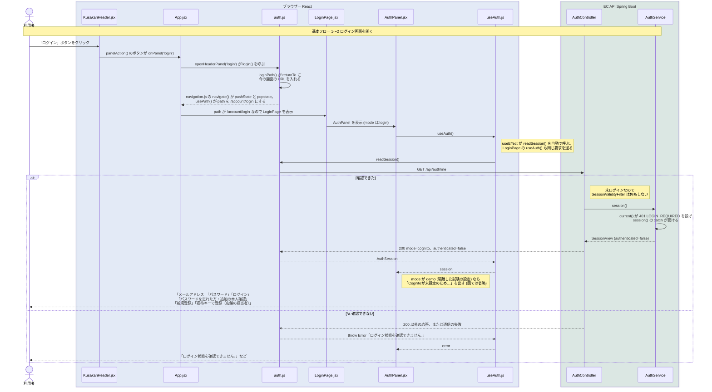
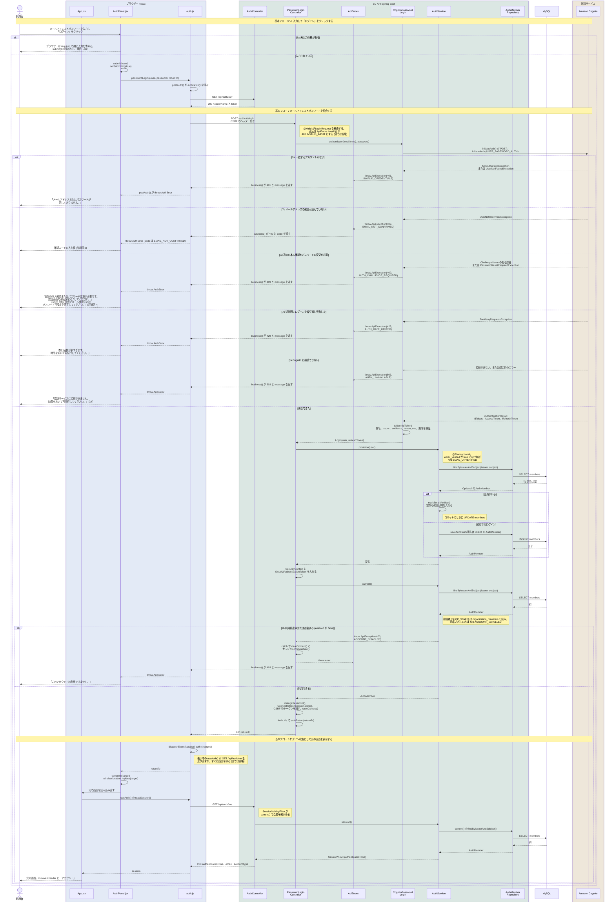
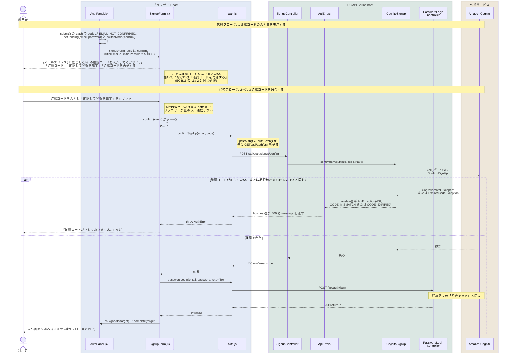
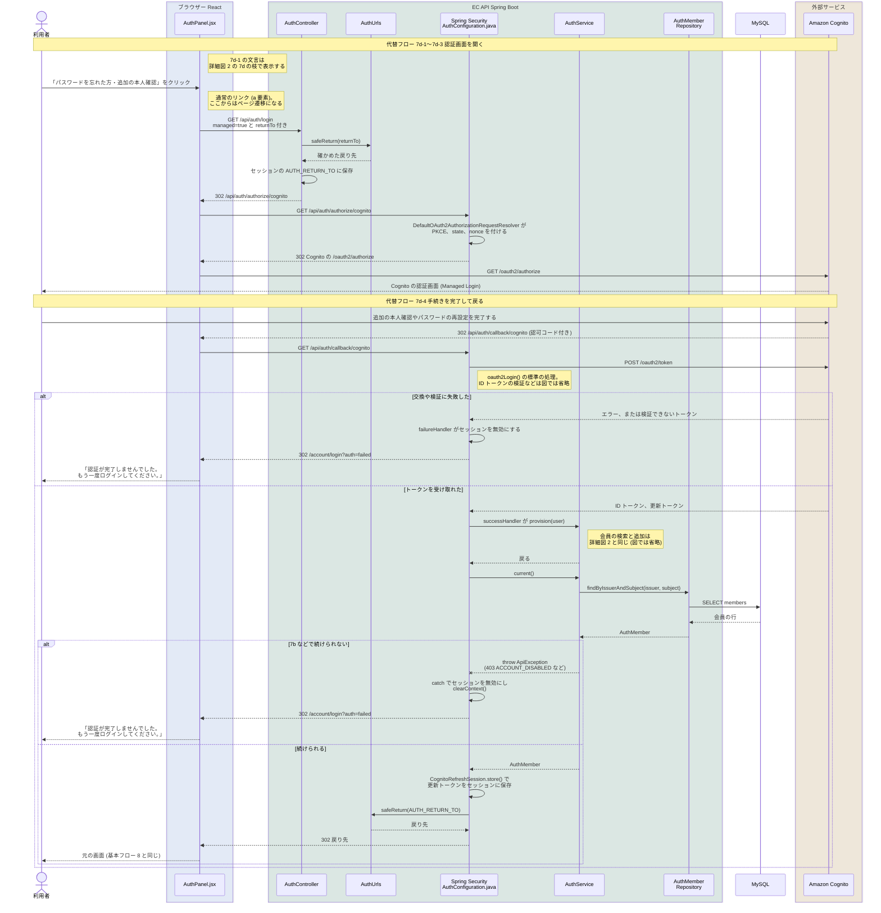

# EC-B01 ログインする

- ユースケース記述: [EC-B01_ログインする](<../../アーカイブ/ユースケース/kusakari-ec/EC-B01_ログインする.md>)
- 対象のコード: kusakari-ec の main（19a2be3、2026-11-20 時点）

ログインは EC の画面（`/account/login`）でメールアドレスとパスワードを受け取り、EC API が Amazon Cognito の `InitiateAuth` を呼びます。ブラウザーは Cognito と直接通信しません（代替フロー 7d の認証画面だけは例外です）。ブラウザーに渡すのは `KUSAKARI_SESSION` の Cookie だけで、トークンはサーバーの HTTP セッションに置きます。

## 概要図

### 概要図 1 基本フロー 1〜8

### 概要図 2 代替フロー 7c・7d

## 詳細図

### 詳細図 1 基本フロー 1〜2 ログイン画面を開く

### 詳細図 2 基本フロー 3〜8、代替フロー 6a・7a・7b・7e

### 詳細図 3 代替フロー 7c 確認コードを入力して登録を完了する

### 詳細図 4 代替フロー 7d 認証画面で手続きを完了する

## ユースケース記述との差

- 6a: 未入力の検査は React のコードではなく、入力欄の `required` でブラウザーが行います。文言はブラウザーが出すもので、記述の「入力を求める表示」に当たります。サーバーでも `LoginRequest` の `@NotBlank` が検査し、違反すると 400 `INVALID_INPUT`「入力内容・文字数・数値の範囲を確認してください。」になります。
- 7b: 記述にない応答が 2 つあります。組織から除名された担当者（`SHOP_STAFF`）は 403 `ACCOUNT_EXPELLED`「このアカウントは無効化されています。組織の管理者にお問い合わせください。」です。Cognito の ID トークンでメールアドレスが確認済みでないときは、`provision()` が 403 `EMAIL_UNVERIFIED`「メール確認が必要です。」にします。
- 7b-2・7e-2: 記述は「ユースケースを終了する」ですが、画面はエラーの文言を出し、ログインの入力欄をそのまま残します。続けて入力し直せます。
- 7c: ログインの時点では確認コードを送り直しません。新規登録のときに届いたコードを入力します。コードが届いていない、または期限切れのときは「確認コードを再送する」（EC-B16 の 11a-2 と同じ処理）を使います。記述の 7c にはこの手順がありません。また、409 の文言「メールアドレスの確認が完了していません。確認コードを入力してください。」は画面に出ず、見出しが「メールアドレスの確認」に変わります。
- 7c-3: 確認コードの照合に失敗したとき（`CODE_MISMATCH`、`CODE_EXPIRED` など）の扱いは、記述の 7c にありません。コードでは EC-B16 の 11a と同じ文言を出します。
- 7d-4: 認証画面での手続きやトークンの交換に失敗したとき、`/account/login?auth=failed` に戻り「認証が完了しませんでした。もう一度ログインしてください。」と表示します。記述にない枝です。
- 共通代替フロー *a: EC API が Cognito に接続できないときは 503 `AUTH_UNAVAILABLE` になります。ブラウザーから EC API に届かないときは、`postAuth()` が例外を言い換えないため、ブラウザーが出す `TypeError` の文言がそのまま表示されます（ログアウトの `logout()` だけは日本語の文言に言い換えています）。

## 確かめられなかったこと

- Cognito が `ChallengeName` を返す条件（多要素認証、仮パスワードの変更など）と、`TooManyRequestsException` になる回数や時間は、Cognito の User Pool の設定と Cognito の仕様で決まります。このリポジトリのコードでは確かめられません。
- 存在しないメールアドレスのとき Cognito が返す例外は、User Pool の `prevent_user_existence_errors` で変わります。EC の `infra/cognito/kusakari-ec-terraform/main.tf` では `ENABLED`（`NotAuthorizedException` を返す）ですが、実際の User Pool は kusakari-terraform で管理しており、その設定は確かめていません。どちらの例外でも 401 `INVALID_CREDENTIALS` になります。
- 代替フロー 7d の認証画面（Managed Login）の中の手順は Cognito の画面で、コードでは確かめられません。
- `oauth2Login()` が `/oauth2/token` の後に行う処理（ID トークンの検証、`/oauth2/userInfo` を呼ぶかどうか、セッション ID の変更）は Spring Security の中の処理です。この図では Spring Security のソースまでは確かめていません。

## 参照したコード

- [packages/site-header/KusakariHeader.jsx](https://github.com/abeouga/kusakari-ec/blob/19a2be307ee71a2cd87e538236c3c8c42929c5b3/packages/site-header/KusakariHeader.jsx): `panelAction()`、「ログイン」ボタン、「アカウント」リンク
- [frontend/src/App.jsx](https://github.com/abeouga/kusakari-ec/blob/19a2be307ee71a2cd87e538236c3c8c42929c5b3/frontend/src/App.jsx): `openHeaderPanel()`、`/account/login` で `LoginPage` を返す条件、`useAuth()`
- [frontend/src/workspace/navigation.js](https://github.com/abeouga/kusakari-ec/blob/19a2be307ee71a2cd87e538236c3c8c42929c5b3/frontend/src/workspace/navigation.js): `navigate()`、`usePath()`
- [frontend/src/auth.js](https://github.com/abeouga/kusakari-ec/blob/19a2be307ee71a2cd87e538236c3c8c42929c5b3/frontend/src/auth.js): `login()`、`loginPath()`、`readSession()`、`authFetch()`、`postAuth()`、`passwordLogin()`、`confirmSignUp()`、`AuthError`
- [frontend/src/useAuth.js](https://github.com/abeouga/kusakari-ec/blob/19a2be307ee71a2cd87e538236c3c8c42929c5b3/frontend/src/useAuth.js): `useAuth()`、`kusakari-auth-changed` の受け取り
- [frontend/src/components/LoginPage.jsx](https://github.com/abeouga/kusakari-ec/blob/19a2be307ee71a2cd87e538236c3c8c42929c5b3/frontend/src/components/LoginPage.jsx): `LoginPage`、見出しの切り替え（`headings`）
- [frontend/src/components/AuthPanel.jsx](https://github.com/abeouga/kusakari-ec/blob/19a2be307ee71a2cd87e538236c3c8c42929c5b3/frontend/src/components/AuthPanel.jsx): `submit()`、`complete()`、`switchMode()`、`auth=failed` の表示、「パスワードを忘れた方・追加の本人確認」のリンク
- [frontend/src/components/SignupForm.jsx](https://github.com/abeouga/kusakari-ec/blob/19a2be307ee71a2cd87e538236c3c8c42929c5b3/frontend/src/components/SignupForm.jsx): `confirm()`、`run()`、確認コードの入力欄
- [backend/src/main/java/jp/kusakari/ec/auth/AuthController.java](https://github.com/abeouga/kusakari-ec/blob/19a2be307ee71a2cd87e538236c3c8c42929c5b3/backend/src/main/java/jp/kusakari/ec/auth/AuthController.java): `me()`、`csrf()`、`login()`（`managed=true`）
- [backend/src/main/java/jp/kusakari/ec/auth/PasswordLoginController.java](https://github.com/abeouga/kusakari-ec/blob/19a2be307ee71a2cd87e538236c3c8c42929c5b3/backend/src/main/java/jp/kusakari/ec/auth/PasswordLoginController.java): `login()`、`LoginRequest`
- [backend/src/main/java/jp/kusakari/ec/auth/CognitoPasswordLogin.java](https://github.com/abeouga/kusakari-ec/blob/19a2be307ee71a2cd87e538236c3c8c42929c5b3/backend/src/main/java/jp/kusakari/ec/auth/CognitoPasswordLogin.java): `authenticate()`、`initiateAuth()`、`toUser()`
- [backend/src/main/java/jp/kusakari/ec/auth/CognitoRefreshSession.java](https://github.com/abeouga/kusakari-ec/blob/19a2be307ee71a2cd87e538236c3c8c42929c5b3/backend/src/main/java/jp/kusakari/ec/auth/CognitoRefreshSession.java): `store()`
- [backend/src/main/java/jp/kusakari/ec/auth/AuthService.java](https://github.com/abeouga/kusakari-ec/blob/19a2be307ee71a2cd87e538236c3c8c42929c5b3/backend/src/main/java/jp/kusakari/ec/auth/AuthService.java): `provision()`、`current()`、`session()`
- [backend/src/main/java/jp/kusakari/ec/auth/AuthMember.java](https://github.com/abeouga/kusakari-ec/blob/19a2be307ee71a2cd87e538236c3c8c42929c5b3/backend/src/main/java/jp/kusakari/ec/auth/AuthMember.java): `markEmailVerified()`、`withdraw()`、`enabled`
- [backend/src/main/java/jp/kusakari/ec/auth/AuthMemberRepository.java](https://github.com/abeouga/kusakari-ec/blob/19a2be307ee71a2cd87e538236c3c8c42929c5b3/backend/src/main/java/jp/kusakari/ec/auth/AuthMemberRepository.java): `findByIssuerAndSubject()`
- [backend/src/main/java/jp/kusakari/ec/auth/AuthUrls.java](https://github.com/abeouga/kusakari-ec/blob/19a2be307ee71a2cd87e538236c3c8c42929c5b3/backend/src/main/java/jp/kusakari/ec/auth/AuthUrls.java): `safeReturn()`
- [backend/src/main/java/jp/kusakari/ec/auth/AuthConfiguration.java](https://github.com/abeouga/kusakari-ec/blob/19a2be307ee71a2cd87e538236c3c8c42929c5b3/backend/src/main/java/jp/kusakari/ec/auth/AuthConfiguration.java): `cognitoClients()`、`cognitoSecurity()` の `oauth2Login()`、`successHandler`、`failureHandler`
- [backend/src/main/java/jp/kusakari/ec/auth/SessionValidityFilter.java](https://github.com/abeouga/kusakari-ec/blob/19a2be307ee71a2cd87e538236c3c8c42929c5b3/backend/src/main/java/jp/kusakari/ec/auth/SessionValidityFilter.java): `doFilterInternal()`
- [backend/src/main/java/jp/kusakari/ec/auth/SignupController.java](https://github.com/abeouga/kusakari-ec/blob/19a2be307ee71a2cd87e538236c3c8c42929c5b3/backend/src/main/java/jp/kusakari/ec/auth/SignupController.java): `confirm()`
- [backend/src/main/java/jp/kusakari/ec/auth/CognitoSignup.java](https://github.com/abeouga/kusakari-ec/blob/19a2be307ee71a2cd87e538236c3c8c42929c5b3/backend/src/main/java/jp/kusakari/ec/auth/CognitoSignup.java): `confirm()`、`call()`、`translate()`
- [backend/src/main/java/jp/kusakari/ec/common/web/ApiErrors.java](https://github.com/abeouga/kusakari-ec/blob/19a2be307ee71a2cd87e538236c3c8c42929c5b3/backend/src/main/java/jp/kusakari/ec/common/web/ApiErrors.java): `business()`、`invalid()`
- [infra/cognito/kusakari-ec-terraform/main.tf](https://github.com/abeouga/kusakari-ec/blob/19a2be307ee71a2cd87e538236c3c8c42929c5b3/infra/cognito/kusakari-ec-terraform/main.tf): `explicit_auth_flows`、`prevent_user_existence_errors`
- [docs/cognito-auth.md](https://github.com/abeouga/kusakari-ec/blob/19a2be307ee71a2cd87e538236c3c8c42929c5b3/docs/cognito-auth.md): ログインと Managed Login の決定
