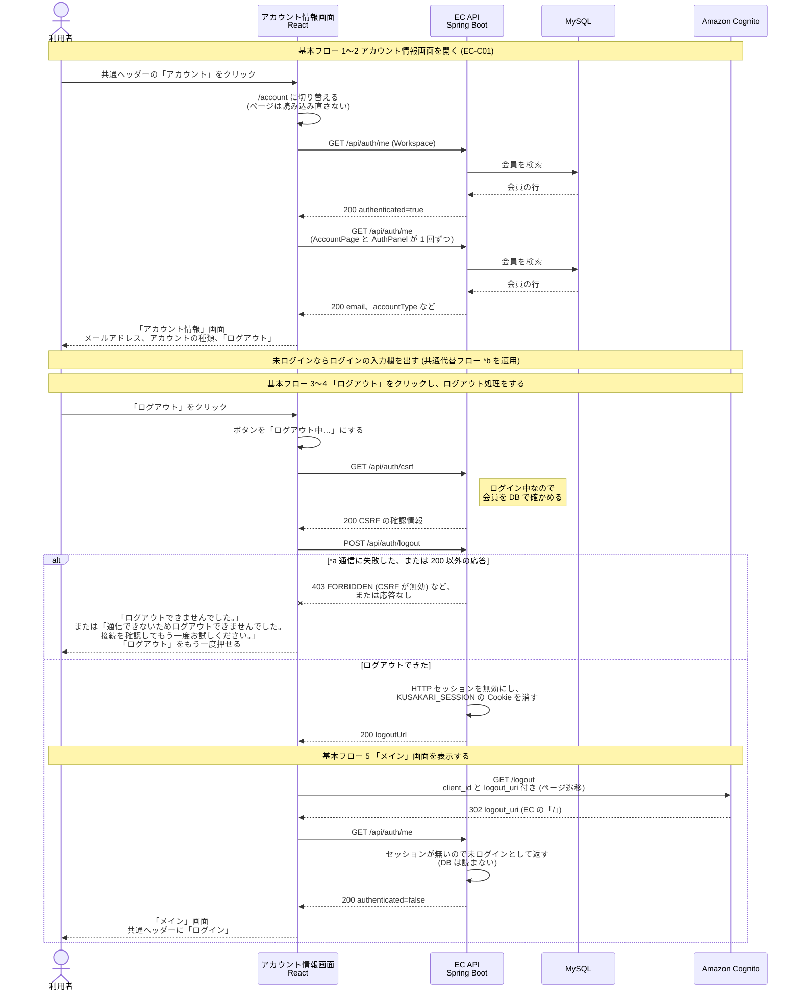
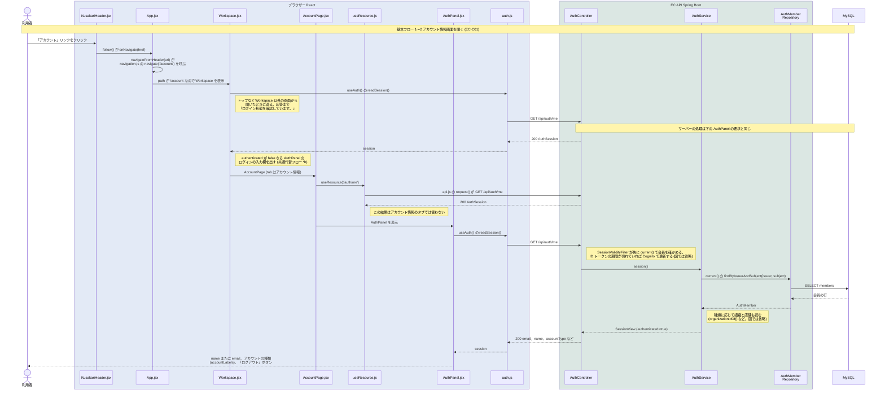
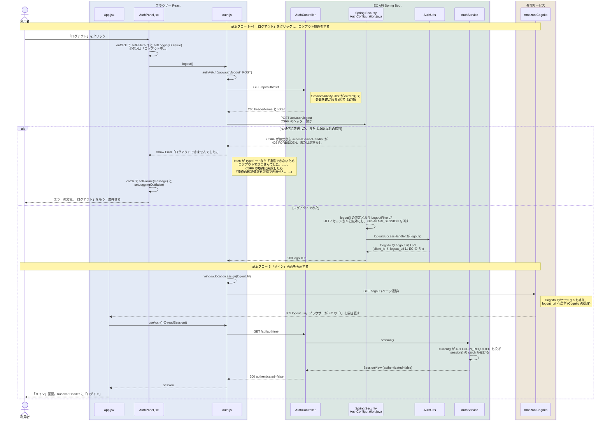

# EC-B02 ログアウトする

- ユースケース記述: [EC-B02_ログアウトする](<../../アーカイブ/ユースケース/kusakari-ec/EC-B02_ログアウトする.md>)
- 対象のコード: kusakari-ec の main（19a2be3、2026-11-20 時点）

ログアウトは 2 段階です。EC API が自分の HTTP セッションを無効にし、Cognito のログアウト用 URL（`logoutUrl`）を返します。ブラウザーはその URL へ移り、Cognito が EC の「/」へ戻します。

## 概要図

## 詳細図

### 詳細図 1 基本フロー 1〜2 アカウント情報画面を開く

### 詳細図 2 基本フロー 3〜5 ログアウトして「メイン」画面を表示する

## ユースケース記述との差

- 基本フロー 4: 記述の「ログアウト処理」は、コードでは 2 つです。EC API の `POST /api/auth/logout` が HTTP セッションを無効にして Cookie を消し、そのあとブラウザーが Cognito の `/logout` へ移って Cognito のセッションを終えます。Cognito の更新トークンは取り消しません（EC の `docs/auth-token-renewal.md` に書かれています）。
- 基本フロー 5: 戻る先は、どの画面からログアウトしても `AuthUrls.logout()` の `logout_uri`（EC の「/」）です。
- 基本フロー 1〜2: アカウント情報画面を開くと `GET /api/auth/me` を最大 3 回送ります（`Workspace` の `useAuth()`、`AccountPage` の `useResource('/auth/me')`、`AuthPanel` の `useAuth()`）。`AccountPage` の `useResource('/auth/me')` の結果は、「アカウント情報」のタブでは表示に使いません。
- 代替フロー: 記述は空ですが、通信に失敗したときと 200 以外の応答のとき、画面はエラーの文言を出して「ログアウト」をもう一度押せるようにします（共通代替フロー *a に当たります）。
- 関連情報: 庭シミュレーション画面から移るときに保存を待つ処理は Canvas 側にあります（Canvas の `EditorPage.jsx` の `requestNavigation()` が `flush()` で保存してから `window.location.assign()` で移ります）。この図は EC の処理だけを書いています。

## 確かめられなかったこと

- Cognito の `/logout` が Cognito のセッションを終えて `logout_uri` へ戻す動きは Cognito の処理で、コードでは確かめられません。`logout_uri` が User Pool のアプリクライアントの Logout URL と一致している必要があります（EC の `docs/cognito-setup.md` に登録する値があります）。
- `LogoutFilter` がセッションを無効にする細かい手順（`SecurityContextLogoutHandler` などの標準の処理）は Spring Security の中の処理で、この図では Spring Security のソースまでは確かめていません。

## 参照したコード

- [packages/site-header/KusakariHeader.jsx](https://github.com/abeouga/kusakari-ec/blob/19a2be307ee71a2cd87e538236c3c8c42929c5b3/packages/site-header/KusakariHeader.jsx): 「アカウント」リンク、`follow()`
- [frontend/src/App.jsx](https://github.com/abeouga/kusakari-ec/blob/19a2be307ee71a2cd87e538236c3c8c42929c5b3/frontend/src/App.jsx): `navigateFromHeader()`、`Workspace` を返す条件、`useAuth()`
- [frontend/src/workspace/navigation.js](https://github.com/abeouga/kusakari-ec/blob/19a2be307ee71a2cd87e538236c3c8c42929c5b3/frontend/src/workspace/navigation.js): `navigate()`、`usePath()`
- [frontend/src/workspace/Workspace.jsx](https://github.com/abeouga/kusakari-ec/blob/19a2be307ee71a2cd87e538236c3c8c42929c5b3/frontend/src/workspace/Workspace.jsx): `Workspace`、`buyerMenu`、未ログインのときの `AuthPanel`、`/account` で `AccountPage` を返す条件
- [frontend/src/workspace/AccountPage.jsx](https://github.com/abeouga/kusakari-ec/blob/19a2be307ee71a2cd87e538236c3c8c42929c5b3/frontend/src/workspace/AccountPage.jsx): `AccountPage`、`useResource('/auth/me')`、「アカウント情報」のタブ
- [frontend/src/workspace/useResource.js](https://github.com/abeouga/kusakari-ec/blob/19a2be307ee71a2cd87e538236c3c8c42929c5b3/frontend/src/workspace/useResource.js): `useResource()`、`reload()`
- [frontend/src/api.js](https://github.com/abeouga/kusakari-ec/blob/19a2be307ee71a2cd87e538236c3c8c42929c5b3/frontend/src/api.js): `request()`、`send()`、`readResponse()`
- [frontend/src/components/AuthPanel.jsx](https://github.com/abeouga/kusakari-ec/blob/19a2be307ee71a2cd87e538236c3c8c42929c5b3/frontend/src/components/AuthPanel.jsx): `accountLabels`、「ログアウト」ボタンの `onClick`
- [frontend/src/auth.js](https://github.com/abeouga/kusakari-ec/blob/19a2be307ee71a2cd87e538236c3c8c42929c5b3/frontend/src/auth.js): `readSession()`、`authFetch()`、`logout()`
- [frontend/src/useAuth.js](https://github.com/abeouga/kusakari-ec/blob/19a2be307ee71a2cd87e538236c3c8c42929c5b3/frontend/src/useAuth.js): `useAuth()`
- [backend/src/main/java/jp/kusakari/ec/auth/AuthController.java](https://github.com/abeouga/kusakari-ec/blob/19a2be307ee71a2cd87e538236c3c8c42929c5b3/backend/src/main/java/jp/kusakari/ec/auth/AuthController.java): `me()`、`csrf()`
- [backend/src/main/java/jp/kusakari/ec/auth/AuthConfiguration.java](https://github.com/abeouga/kusakari-ec/blob/19a2be307ee71a2cd87e538236c3c8c42929c5b3/backend/src/main/java/jp/kusakari/ec/auth/AuthConfiguration.java): `cognitoSecurity()` の `logout()`（`logoutUrl`、`deleteCookies`、`logoutSuccessHandler`）、`accessDeniedHandler`
- [backend/src/main/java/jp/kusakari/ec/auth/AuthUrls.java](https://github.com/abeouga/kusakari-ec/blob/19a2be307ee71a2cd87e538236c3c8c42929c5b3/backend/src/main/java/jp/kusakari/ec/auth/AuthUrls.java): `logout()`
- [backend/src/main/java/jp/kusakari/ec/auth/SessionValidityFilter.java](https://github.com/abeouga/kusakari-ec/blob/19a2be307ee71a2cd87e538236c3c8c42929c5b3/backend/src/main/java/jp/kusakari/ec/auth/SessionValidityFilter.java): `doFilterInternal()`（`/api/auth/logout` は対象外）
- [backend/src/main/java/jp/kusakari/ec/auth/AuthService.java](https://github.com/abeouga/kusakari-ec/blob/19a2be307ee71a2cd87e538236c3c8c42929c5b3/backend/src/main/java/jp/kusakari/ec/auth/AuthService.java): `session()`、`current()`
- [backend/src/main/java/jp/kusakari/ec/auth/AuthMemberRepository.java](https://github.com/abeouga/kusakari-ec/blob/19a2be307ee71a2cd87e538236c3c8c42929c5b3/backend/src/main/java/jp/kusakari/ec/auth/AuthMemberRepository.java): `findByIssuerAndSubject()`
- [backend/src/main/resources/application-cognito.properties](https://github.com/abeouga/kusakari-ec/blob/19a2be307ee71a2cd87e538236c3c8c42929c5b3/backend/src/main/resources/application-cognito.properties): セッションの Cookie 名 `KUSAKARI_SESSION`
- [docs/auth-token-renewal.md](https://github.com/abeouga/kusakari-ec/blob/19a2be307ee71a2cd87e538236c3c8c42929c5b3/docs/auth-token-renewal.md): ログアウトで更新トークンを取り消さないこと
- [docs/cognito-setup.md](https://github.com/abeouga/kusakari-ec/blob/19a2be307ee71a2cd87e538236c3c8c42929c5b3/docs/cognito-setup.md): Cognito に登録する Logout URL
- Canvas の [frontend/src/pages/EditorPage.jsx](https://github.com/abeouga/kusakari-canvas/blob/c19d497dfef15b119f9bce8ecb5c886a36da6b7d/frontend/src/pages/EditorPage.jsx): `requestNavigation()`（関連情報の確認だけ）
