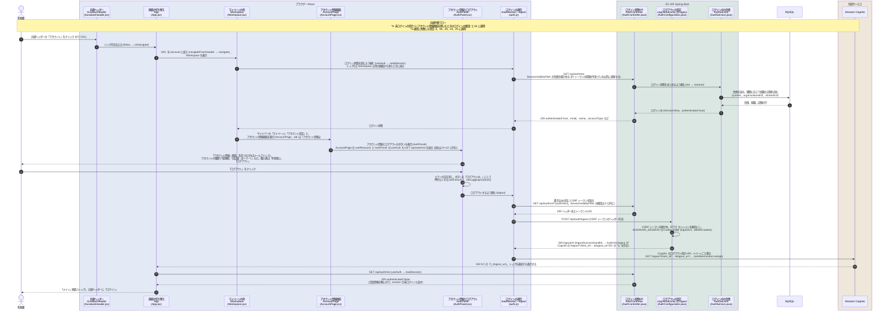
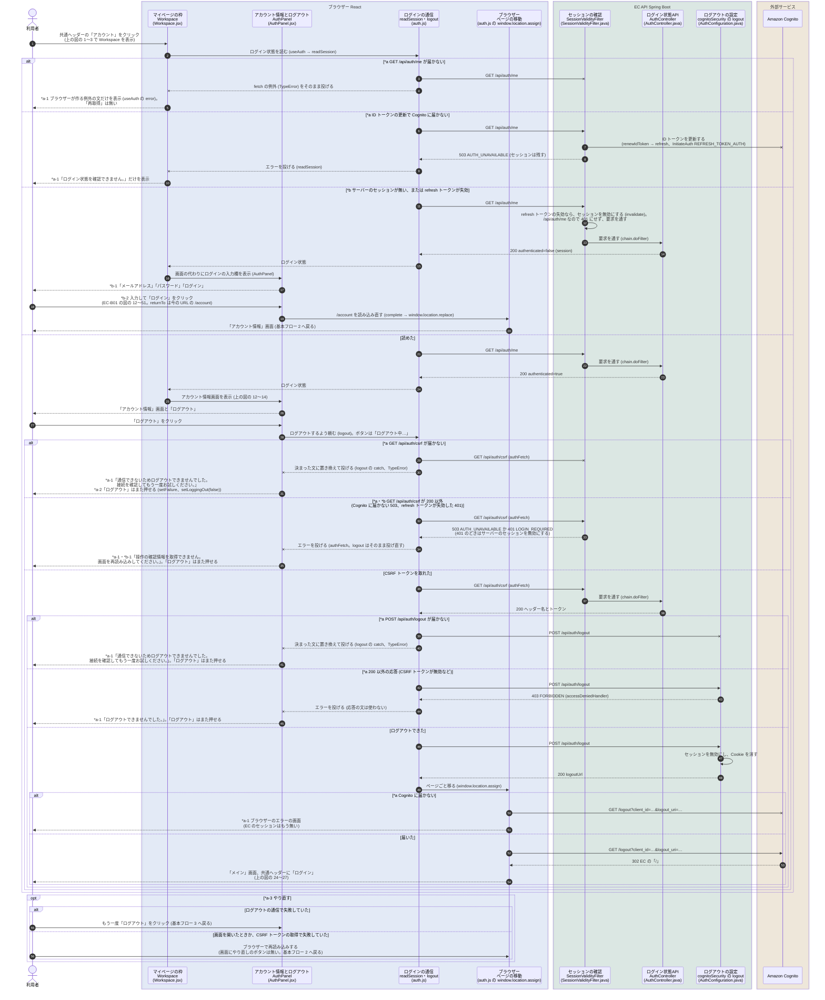

# EC-B02 ログアウトする

- ユースケース記述: [EC-B02_ログアウトする](<../../アーカイブ/ユースケース/kusakari-ec/EC-B02_ログアウトする.md>)
- 共通代替フロー: [00_全ユースケース共通の代替フロー](<00_全ユースケース共通の代替フロー.md>)
- 対象のコード: kusakari-ec の main（6bad7e3、2026-11-24 時点）

## シーケンス図

参加者は、上から「画面や役割の名前」「コンポーネント・クラスの名前」「ファイル名（かっこ付き）」の順に書いています。
ログアウトは 2 段階です。EC API が自分の HTTP セッションを無効にして、Cognito のログアウト用の URL（`logoutUrl`）を返します。ブラウザーはその URL へ移り、Cognito が EC の「/」へ戻します。
共通代替フローの中身は、00 の図か、下の「共通代替フローを直接書いた図」を見てください。
アカウント情報画面を開くと `GET /api/auth/me` を最大 3 回送りますが、同じ流れなので 2 回目と 3 回目は 13 の文にまとめています。

## 共通代替フローを直接書いた図

上の図の、アカウント情報画面を開いたときの `Workspace` の `GET /api/auth/me` と、「ログアウト」をクリックした後の `GET /api/auth/csrf`・`POST /api/auth/logout`・Cognito の `/logout` に、この画面で起こる共通代替フロー（\*a、\*b）を書き込んだ図です。`AccountPage` と `AuthPanel` が送る `GET /api/auth/me` は、`Workspace` の通信が通った直後に送るもので、失敗したときの表示は `Workspace` と同じ形（エラーの文だけ）なので省いています。

## ユースケース記述との差

- 基本フロー 4: 記述の「ログアウト処理」は、コードでは 2 つです。EC API の `POST /api/auth/logout` が HTTP セッションを無効にして Cookie を消し、そのあとブラウザーが Cognito の `/logout` へ移って Cognito のセッションを終えます。Cognito の refresh トークンは取り消しません（EC の `docs/auth-token-renewal.md`）。
- 基本フロー 5: 戻る先は、どの画面からログアウトしても `AuthUrls.logout()` の `logout_uri`（EC の「/」）です。
- 基本フロー 1〜2: アカウント情報画面を開くと `GET /api/auth/me` を最大 3 回送ります（`Workspace` の `useAuth()`、`AccountPage` の `useResource`（`/auth/me`）、`AuthPanel` の `useAuth()`）。`Workspace` の分は、トップなど `Workspace` 以外の画面から来たときだけです。`AccountPage` の `useResource`（`/auth/me`） の結果は、「アカウント情報」の画面では使いません。
- 基本フロー 2: 記述の EC-C01 の関連情報は「メールアドレスとアカウントの種類」ですが、画面は名前を先に出し、名前が無いときだけメールアドレスを出します。購入者（`USER`）の種類は「利用者」です。
- 代替フロー: 記述は空ですが、通信に失敗したときと 200 以外の応答のとき、画面はエラーの文を出して「ログアウト」をもう一度押せるようにします（共通代替フロー \*a）。ログアウトの通信は `api.js` を通らないので、00 の \*a-1 の共通の文（「サーバーに接続できません。…」）ではなく、`logout()` が決めた文が出ます。
- 共通代替フロー \*b: 使っている間にログインが切れても、`SessionNotice` のお知らせは出ません。アカウント情報画面を開いたときの `GET /api/auth/me` は 401 にならず、`Workspace` がログインの入力欄を出します。「ログアウト」の後の `GET /api/auth/csrf` が 401 になったときは、「操作の確認情報を取得できません。画面を再読み込みしてください。」が出ます。このときサーバーのセッションは無効になっているので、再読み込みするとログインの入力欄が出ます。Cognito の `/logout` へは移らないので、Cognito のセッションは残ります。
- `POST /api/auth/logout` は `SessionValidityFilter` の対象外です。サーバーのセッションが無くても、直前の `GET /api/auth/csrf` が新しいセッションと CSRF トークンを作るので、ログアウトは 200 になります。
- 関連情報: 庭シミュレーション画面から移るときに保存を待つ処理は Canvas 側にあります（Canvas の `EditorPage.jsx` の `requestNavigation` が `flush` で保存してから `window.location.assign` で移ります）。この図は EC の処理だけを書いています。

## 確かめられなかったこと

- Cognito の `/logout` が Cognito のセッションを終えて `logout_uri` へ戻す動きは Cognito の処理で、コードでは確かめられません。`logout_uri` が User Pool のアプリクライアントの Logout URL と一致している必要があります（EC の `docs/cognito-setup.md`）。
- `LogoutFilter` がセッションを無効にする細かい手順（`SecurityContextLogoutHandler` などの標準の処理）と、`CsrfFilter` が `LogoutFilter` より先に CSRF トークンを確かめる順番は、Spring Security の中の処理で、Spring Security のソースまでは確かめていません。
- `SessionValidityFilter` の `current()` が MySQL に届かなかったときの応答は確かめていません。`DataAccessException` はこのフィルターの `catch`（`ApiException` だけ）を通らないので、`ApiErrors.database()` の 503 にならない可能性があります。画面はどちらにしても「ログイン状態を確認できません。」か「操作の確認情報を取得できません。…」になるはずですが、動かしていません。

## 参照したコード

- [packages/site-header/KusakariHeader.jsx](https://github.com/abeouga/kusakari-ec/blob/6bad7e37c4135034fbe97e30309772fbe872e675/packages/site-header/KusakariHeader.jsx): 「アカウント」リンク、`follow`
- [frontend/src/App.jsx](https://github.com/abeouga/kusakari-ec/blob/6bad7e37c4135034fbe97e30309772fbe872e675/frontend/src/App.jsx): `navigateFromHeader`、`Workspace` を返す条件、`useAuth`
- [frontend/src/workspace/navigation.js](https://github.com/abeouga/kusakari-ec/blob/6bad7e37c4135034fbe97e30309772fbe872e675/frontend/src/workspace/navigation.js): `navigate`、`usePath`
- [frontend/src/workspace/Workspace.jsx](https://github.com/abeouga/kusakari-ec/blob/6bad7e37c4135034fbe97e30309772fbe872e675/frontend/src/workspace/Workspace.jsx): `Workspace`、`buyerMenu`、`accountSettings`、未ログインのときの `AuthPanel`、`/account` で `AccountPage` を返す条件
- [frontend/src/workspace/AccountPage.jsx](https://github.com/abeouga/kusakari-ec/blob/6bad7e37c4135034fbe97e30309772fbe872e675/frontend/src/workspace/AccountPage.jsx): `AccountPage`、`useResource` の `/auth/me`、「アカウント情報」の画面
- [frontend/src/workspace/useResource.js](https://github.com/abeouga/kusakari-ec/blob/6bad7e37c4135034fbe97e30309772fbe872e675/frontend/src/workspace/useResource.js): `useResource`、`reload`
- [frontend/src/api.js](https://github.com/abeouga/kusakari-ec/blob/6bad7e37c4135034fbe97e30309772fbe872e675/frontend/src/api.js): `request`
- [frontend/src/components/AuthPanel.jsx](https://github.com/abeouga/kusakari-ec/blob/6bad7e37c4135034fbe97e30309772fbe872e675/frontend/src/components/AuthPanel.jsx): `accountLabels`、「ログアウト」ボタンの `onClick`、`complete`
- [frontend/src/auth.js](https://github.com/abeouga/kusakari-ec/blob/6bad7e37c4135034fbe97e30309772fbe872e675/frontend/src/auth.js): `readSession`、`authFetch`、`logout`
- [frontend/src/useAuth.js](https://github.com/abeouga/kusakari-ec/blob/6bad7e37c4135034fbe97e30309772fbe872e675/frontend/src/useAuth.js): `useAuth`
- [backend/src/main/java/jp/kusakari/ec/auth/AuthController.java](https://github.com/abeouga/kusakari-ec/blob/6bad7e37c4135034fbe97e30309772fbe872e675/backend/src/main/java/jp/kusakari/ec/auth/AuthController.java): `me`、`csrf`
- [backend/src/main/java/jp/kusakari/ec/auth/AuthConfiguration.java](https://github.com/abeouga/kusakari-ec/blob/6bad7e37c4135034fbe97e30309772fbe872e675/backend/src/main/java/jp/kusakari/ec/auth/AuthConfiguration.java): `cognitoSecurity` の `logout`（`logoutUrl`、`deleteCookies`、`logoutSuccessHandler`）、`accessDeniedHandler`
- [backend/src/main/java/jp/kusakari/ec/auth/AuthUrls.java](https://github.com/abeouga/kusakari-ec/blob/6bad7e37c4135034fbe97e30309772fbe872e675/backend/src/main/java/jp/kusakari/ec/auth/AuthUrls.java): `logout`
- [backend/src/main/java/jp/kusakari/ec/auth/SessionValidityFilter.java](https://github.com/abeouga/kusakari-ec/blob/6bad7e37c4135034fbe97e30309772fbe872e675/backend/src/main/java/jp/kusakari/ec/auth/SessionValidityFilter.java): `doFilterInternal`（`/api/auth/logout` は対象外、`/api/auth/me` の 401 は通す）、`renewIdToken`
- [backend/src/main/java/jp/kusakari/ec/auth/CognitoPasswordLogin.java](https://github.com/abeouga/kusakari-ec/blob/6bad7e37c4135034fbe97e30309772fbe872e675/backend/src/main/java/jp/kusakari/ec/auth/CognitoPasswordLogin.java): `refresh`（ID トークンの更新、503 `AUTH_UNAVAILABLE`）
- [backend/src/main/java/jp/kusakari/ec/auth/AuthService.java](https://github.com/abeouga/kusakari-ec/blob/6bad7e37c4135034fbe97e30309772fbe872e675/backend/src/main/java/jp/kusakari/ec/auth/AuthService.java): `session`、`current`、`organizationIdOf`、`storeIdsOf`
- [backend/src/main/java/jp/kusakari/ec/auth/AuthMemberRepository.java](https://github.com/abeouga/kusakari-ec/blob/6bad7e37c4135034fbe97e30309772fbe872e675/backend/src/main/java/jp/kusakari/ec/auth/AuthMemberRepository.java): `findByIssuerAndSubject`
- [backend/src/main/resources/application-cognito.properties](https://github.com/abeouga/kusakari-ec/blob/6bad7e37c4135034fbe97e30309772fbe872e675/backend/src/main/resources/application-cognito.properties): セッションの Cookie 名 `KUSAKARI_SESSION`
- [docs/auth-token-renewal.md](https://github.com/abeouga/kusakari-ec/blob/6bad7e37c4135034fbe97e30309772fbe872e675/docs/auth-token-renewal.md): ログアウトで refresh トークンを取り消さないこと
- [docs/cognito-setup.md](https://github.com/abeouga/kusakari-ec/blob/6bad7e37c4135034fbe97e30309772fbe872e675/docs/cognito-setup.md): Cognito に登録する Logout URL
- Canvas の [frontend/src/pages/EditorPage.jsx](https://github.com/abeouga/kusakari-canvas/blob/7e9a8dd0a40f2b212ca20b3aa94f2dc984b00b7a/frontend/src/pages/EditorPage.jsx)（kusakari-canvas の main、7e9a8dd、2026-11-24 時点）: `requestNavigation`（関連情報の確認だけ）
