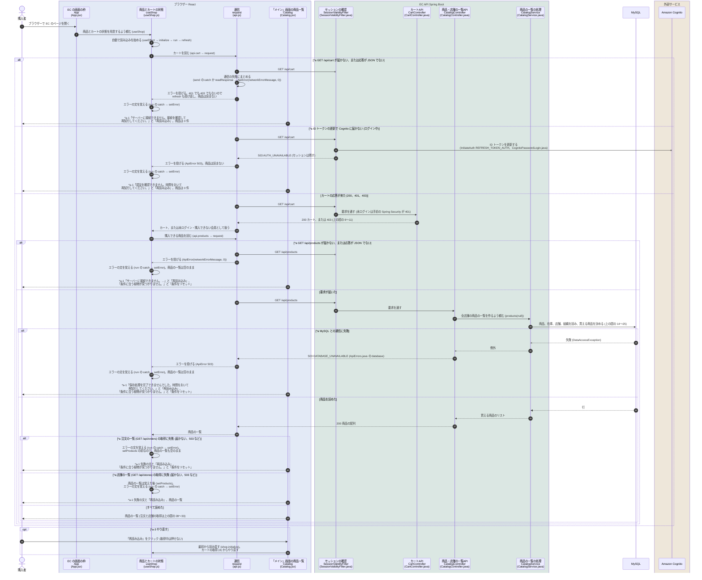

# EC-B03 商品を検索する

- ユースケース記述: [EC-B03_商品を検索する](<../../アーカイブ/ユースケース/kusakari-ec/EC-B03_商品を検索する.md>)
- 共通代替フロー: [00_全ユースケース共通の代替フロー](<00_全ユースケース共通の代替フロー.md>)
- 対象のコード: kusakari-ec の main（6bad7e3、2026-11-24 時点）

## シーケンス図

参加者は、上から「画面や役割の名前」「コンポーネント・クラスの名前」「ファイル名（かっこ付き）」の順に書いています。
商品は、EC のページを読み込んだとき（URL を直接開いた、再読み込み）に 1 回だけまとめて取得します。「商品を探す」のクリックと、検索・絞り込み・並べ替えは、取得済みの商品をブラウザーの中で絞り込むだけで、サーバーには問い合わせません。ページを読み込んだときの `GET /api/auth/me`（`App.jsx` と `useShop.js` の `useAuth()`）と、出店者の店舗の取得（`GET /api/seller/stores`）は、商品の検索に使わないので図に書いていません。
ログインは不要なので、共通代替フロー \*b は適用しません（ログインしていないときのカートの 401 は、未ログインとして扱う基本の流れです）。
代替フロー 6a は画面の中だけで終わるので、「条件をリセット」のクリックまでを描き、結果と画面は Note に文で書いています。カートを読めたときだけ行う注文の一覧の取得（opt）も、頼む矢印 1 本と Note にしています。

```mermaid
sequenceDiagram
    autonumber
    actor User as 購入者
    box rgba(47,111,219,0.10) ブラウザー React
        participant Header as 共通ヘッダー<br/>KusakariHeader<br/>(KusakariHeader.jsx)
        participant App as EC の画面の枠<br/>App<br/>(App.jsx)
        participant Shop as 商品とカートの状態<br/>useShop<br/>(useShop.js)
        participant Http as 通信<br/>request<br/>(api.js)
        participant Catalog as 「メイン」画面の商品一覧<br/>Catalog<br/>(Catalog.jsx)
        participant List as 商品カードとページ<br/>CatalogProducts<br/>(CatalogProducts.jsx)
    end
    box rgba(27,127,92,0.12) EC API Spring Boot
        participant Sec as ログインの確認<br/>AuthConfiguration<br/>(AuthConfiguration.java)
        participant CartCtrl as カートAPI<br/>CartController<br/>(CartController.java)
        participant OrderCtrl as 注文API<br/>OrderController<br/>(OrderController.java)
        participant CatCtrl as 商品・店舗の一覧API<br/>CatalogController<br/>(CatalogController.java)
        participant Svc as 商品の一覧の処理<br/>CatalogService<br/>(CatalogService.java)
        participant ProdRepo as 商品の読み書き<br/>ProductRepository<br/>(ProductRepository.java)
        participant InvRepo as 在庫の読み書き<br/>InventoryRepository<br/>(InventoryRepository.java)
        participant StoreRepo as 店舗の読み書き<br/>StoreRepository<br/>(StoreRepository.java)
        participant OrgRepo as 組織の読み書き<br/>OrganizationRepository<br/>(OrganizationRepository.java)
    end
    participant Db as MySQL

    Note over User,Db: 共通代替フロー<br/>*a 通信に失敗した場合: 6、13、28、31 に適用

    User->>App: ブラウザーで EC のページを開く<br/>(事前条件。URL を直接開いた、再読み込み)
    App->>Shop: 商品とカートの状態を用意するよう頼む (useShop)。画面を開いたときに<br/>自動で読み込みを始める (useEffect → initialize → run → refresh)
    App->>Catalog: パスが / なら商品一覧を表示する (Catalog)
    Catalog-->>User: 取得中は「植物を読み込んでいます…」
    Shop->>Http: カートを読む (api.cart → request)
    Http->>Sec: GET /api/cart
    alt ログインしていない
        Sec-->>Http: 401 LOGIN_REQUIRED「ログインしてください。」<br/>(authenticationEntryPoint)
        Http--xShop: エラーを投げる (readResponse → ApiError 401)。<br/>未ログインとして扱う (setSignedOut(true)、setCart(null))
    else ログインしている
        Sec->>CartCtrl: 要求を通す。購入者か運営者かを確かめ、カートを読む<br/>(resolve → AuthService.requireBuyer、CartService.read)
        CartCtrl-->>Http: 200 カート<br/>(店舗側か出店申請用のアカウントなら 403 BUYER_REQUIRED)
        Http-->>Shop: カート (setCart)。403 なら購入できない会員として扱う<br/>(setRefusedBuyer(true)、setCart(null))
    end
    Shop->>Http: 購入できる商品を読む (api.products → request)
    Http->>CatCtrl: GET /api/products (ログインしていなくてもよい)
    CatCtrl->>Svc: 全店舗の商品の一覧を作るよう頼む (products(null))<br/>読み取り専用のトランザクション
    Svc->>ProdRepo: 削除されていない商品を読む (findAllNotDeleted、SELECT products)<br/>在庫の公開状態が DELETED の商品を除く
    ProdRepo-->>Svc: 商品のリスト
    Svc->>InvRepo: 商品の在庫を読む (findAllById、SELECT inventory)
    InvRepo-->>Svc: 在庫のリスト
    Svc->>StoreRepo: 商品の店舗を読む (storeStates → findAllById、SELECT stores)
    StoreRepo-->>Svc: 店舗のリスト
    Svc->>OrgRepo: 店舗の組織を読む (findAllById、SELECT organizations)
    OrgRepo-->>Svc: 組織のリスト
    Svc->>Svc: 店舗・組織の側と商品ごとに買えない理由を決め、応答の形にする<br/>(storeReason、unavailableReason、ProductMapper.toView。商品の画像もここで読む)<br/>閉鎖済み、利用停止、組織の停止、閉鎖中、非公開、組織の受付停止中
    Svc->>Svc: おすすめの順に並べ (displayOrder。olive、lavender、rosemary、monstera を先に、<br/>残りは商品 ID の順)、買える商品だけを残す (filter(Listing::purchasable))<br/>在庫が 0 の商品は残す
    Svc-->>CatCtrl: 商品のリスト
    CatCtrl-->>Http: 200 商品の配列
    Http-->>Shop: 商品の一覧
    opt カートを読めた (購入者か運営者)
        Shop->>OrderCtrl: 注文の一覧を読む (api.orders → request)<br/>GET /api/orders
        Note over Shop,OrderCtrl: 結果: 200 注文の配列を受け取り、覚える (list、setOrders)。<br/>画面: 商品の検索には使わない。
    end
    Shop->>Shop: 商品の一覧を覚える (setProducts)
    Shop->>Http: 店舗の一覧を読む (api.stores → request)
    Http->>CatCtrl: GET /api/stores?latitude=35.6812&longitude=139.7671
    CatCtrl-->>Http: 200 店舗の配列 (stores)
    Http-->>Shop: 店舗の一覧 (setStores)
    Shop-->>Catalog: 商品の一覧 (shop.products)

    User->>Header: 共通ヘッダーの「商品を探す」をクリック
    Header->>App: 移動先の URL を渡す (follow → onNavigate → navigateFromHeader)
    App->>Catalog: URL を /#35;plants に変え (navigate)、パスが / なので「メイン」画面を表示し、<br/>商品一覧 (id plants) までスクロールする (scrollIntoView)
    Catalog->>List: 取得済みの商品から、カテゴリーのボタンと「出店者・ナーセリー」の<br/>選択肢を作り、条件に合う商品を渡す (開いた直後は「すべて」「おすすめ順」なので全件)
    List-->>User: 1 ページ 12 件の商品カード、「n–m件 / 全N件」、ページの切り替え

    loop 条件を変えるたび (基本フロー 3〜5)
        User->>Catalog: 「名前・品番・生産者で検索」欄に入力する (setSearch)、<br/>カテゴリーのボタン、「日照条件」「用途・植栽場所」「手入れレベル」「出店者・ナーセリー」、<br/>「価格上限（円）」、「在庫ありのみ」を変える (setCategory、setSunlight、setUseCase、<br/>setCareLevel、setNursery、setMaxPrice、setInStockOnly)、<br/>または並び順の一覧から「価格が安い順」などを選ぶ (setSort)
        Catalog->>Catalog: 取得済みの商品を、すべての条件で絞り込み (for と continue)、並び順のとおりに並べる (sort)<br/>検索語は前後の空白を除いて小文字にし、name、latinName、sku、<br/>description、nurseryName、useCase をつないだ文字列に含まれるか (includes)<br/>「おすすめ順」はサーバーの順のまま
        Catalog->>List: 条件が変わったので作り直し、1 ページ目に戻す (key=paginationKey)
        alt 条件に合う商品がある
            List-->>User: 6 条件に合う商品の一覧 (1 ページ目) と件数
        else 6a 該当商品がない
            Catalog-->>User: 6a-1「条件に合う植物が見つかりません。」と「条件をリセット」
            User->>Catalog: 「条件をリセット」をクリック
            Note over User,Catalog: 結果: 検索語、カテゴリー、絞り込み条件、「在庫ありのみ」を初期値に戻す (reset)。並び順は戻さない。<br/>画面: 条件を戻した商品一覧。6a-2 基本フロー 3 へ戻る。
        end
    end
```

## 共通代替フローを直接書いた図

上の図の、ページを読み込んだときの取得（`GET /api/cart`、`GET /api/products`、`GET /api/orders`、`GET /api/stores`）に、共通代替フロー \*a を書き込んだ図です。「商品を探す」のクリックと検索・絞り込みは通信しないので、共通代替フローは起こりません。この画面の失敗は `useResource.js` の `ResourceStatus` ではなく、`useShop.js` の `run()` が受け、`Catalog.jsx` が「再読み込み」と一緒に出します。

## ユースケース記述との差

- 検索語の対象が記述より広いです。記述は商品名・商品番号・生産者名ですが、コードは `name`、`latinName`（学名）、`sku`、`description`（説明文）、`nurseryName`、`useCase`（用途）をつないだ文字列に含まれるかで探します。前後の空白を除き、大文字と小文字は区別しません（`trim()`、`toLowerCase()`）。
- 「絞り込みを解除」と「条件をリセット」は、どちらも同じ `reset()` を呼びます。`reset()` は「絞り込み条件」だけでなく、検索語とカテゴリーと「在庫ありのみ」も初期値に戻します。並び順は戻しません。
- 記述にない処理です。商品の取得は EC のページを読み込んだときの `GET /api/products` 1 回だけで、「商品を探す」のクリックでも、条件を変えるたびにも、サーバーへは問い合わせません。別の画面（`/account` など）から「商品を探す」で戻っても取り直さないので、表示する在庫や価格はページを読み込んだ時点の値です。
- 記述にない処理です。「おすすめ順」は並べ替えをせず、サーバーの順のままです。サーバーは `CatalogService.displayOrder()` で `olive`、`lavender`、`rosemary`、`monstera` を先にし、残りを商品 ID の順に並べます。ほかの並び順は「価格が安い順」「価格が高い順」「新着順」「育てやすさ順」です。
- 記述にない処理です。カテゴリーのボタンと「出店者・ナーセリー」の選択肢は、`GET /api/categories` ではなく、取得した商品のカテゴリー名と生産者名から作ります。
- 記述にない処理です。一覧は 1 ページ 12 件で、条件や並び順を変えると 1 ページ目に戻ります（`CatalogProducts` を `key` で作り直すため）。
- 購入可能な商品の条件は、記述の関連情報とコードの `storeReason()`・`unavailableReason()` が一致しています。在庫の公開状態が `DELETED` の商品は、SQL の時点で除いています。
- 6a: 「条件に合う植物が見つかりません。」は、カートを読めたか、未ログインか、購入できない会員と分かったときだけ出ます（`shop.cart || shop.signedOut || shop.buyerBlocked`）。カートの取得が失敗したときは出ません。
- \*a: 失敗の表示は `Catalog.jsx` の中にあるので、「メイン」画面（パス `/`）でしか見えません。`/account` などで EC のページを読み込み、取得が失敗したときは、「商品を探す」で「メイン」画面に移ってからエラーの文と「再読み込み」が見えます。
- \*a: ページを読み込んだときの取得は、カート・商品・注文・店舗を 1 つの `run()` で続けて行います。カートの取得が 401・403 以外で失敗すると商品を読まず、注文の取得が失敗すると取得済みの商品も画面に出しません（`setProducts` が注文の取得の後にあるため）。

## 確かめられなかったこと

- 「マイページ」などの画面（`/account` など）から「商品を探す」を押したときに、商品一覧までスクロールするかは、画面では確かめていません。`navigateFromHeader()` は `navigate()` の直後に `getElementById('plants')` を呼びますが、この時点で「メイン」画面が描かれているかは、React の描画の順番によります。
- 商品の画像（`product_images`）を `ProductMapper.toView()` の中で商品ごとに読むこと（`ProductEntity.images` が `FetchType.LAZY`）は、SQL のログでは確かめていません。
- MySQL に接続できないときに 503 `DATABASE_UNAVAILABLE` になるかは、動かして確かめていません（00 の「確かめられなかったこと」と同じ）。

## 参照したコード

- [packages/site-header/KusakariHeader.jsx](https://github.com/abeouga/kusakari-ec/blob/6bad7e37c4135034fbe97e30309772fbe872e675/packages/site-header/KusakariHeader.jsx): 「商品を探す」のリンク、`follow`
- [frontend/src/App.jsx](https://github.com/abeouga/kusakari-ec/blob/6bad7e37c4135034fbe97e30309772fbe872e675/frontend/src/App.jsx): `navigateFromHeader`、`useShop` の呼び出し、`Catalog` の表示
- [frontend/src/workspace/navigation.js](https://github.com/abeouga/kusakari-ec/blob/6bad7e37c4135034fbe97e30309772fbe872e675/frontend/src/workspace/navigation.js): `navigate`、`usePath`
- [frontend/src/useShop.js](https://github.com/abeouga/kusakari-ec/blob/6bad7e37c4135034fbe97e30309772fbe872e675/frontend/src/useShop.js): `initialize`、`refresh`、`run`、`buyerBlocked`
- [frontend/src/api.js](https://github.com/abeouga/kusakari-ec/blob/6bad7e37c4135034fbe97e30309772fbe872e675/frontend/src/api.js): `api.cart`、`api.products`、`api.orders`、`api.stores`、`request`、`send`、`readResponse`、`networkErrorMessage`
- [frontend/src/components/Catalog.jsx](https://github.com/abeouga/kusakari-ec/blob/6bad7e37c4135034fbe97e30309772fbe872e675/frontend/src/components/Catalog.jsx): 絞り込みの `for`、並べ替え、`reset`、`paginationKey`、「条件に合う植物が見つかりません。」、「再読み込み」、「植物を読み込んでいます…」
- [frontend/src/components/CatalogProducts.jsx](https://github.com/abeouga/kusakari-ec/blob/6bad7e37c4135034fbe97e30309772fbe872e675/frontend/src/components/CatalogProducts.jsx): `PAGE_SIZE`、ページの切り替え、件数の表示
- [backend/src/main/java/jp/kusakari/ec/auth/AuthConfiguration.java](https://github.com/abeouga/kusakari-ec/blob/6bad7e37c4135034fbe97e30309772fbe872e675/backend/src/main/java/jp/kusakari/ec/auth/AuthConfiguration.java): `GET /api/products`・`GET /api/stores` の `permitAll`、`authenticationEntryPoint`
- [backend/src/main/java/jp/kusakari/ec/auth/SessionValidityFilter.java](https://github.com/abeouga/kusakari-ec/blob/6bad7e37c4135034fbe97e30309772fbe872e675/backend/src/main/java/jp/kusakari/ec/auth/SessionValidityFilter.java): `doFilterInternal`、`renewIdToken`
- [backend/src/main/java/jp/kusakari/ec/auth/CognitoPasswordLogin.java](https://github.com/abeouga/kusakari-ec/blob/6bad7e37c4135034fbe97e30309772fbe872e675/backend/src/main/java/jp/kusakari/ec/auth/CognitoPasswordLogin.java): ID トークンの更新、503 `AUTH_UNAVAILABLE`
- [backend/src/main/java/jp/kusakari/ec/commerce/controller/CartController.java](https://github.com/abeouga/kusakari-ec/blob/6bad7e37c4135034fbe97e30309772fbe872e675/backend/src/main/java/jp/kusakari/ec/commerce/controller/CartController.java): `get`
- [backend/src/main/java/jp/kusakari/ec/commerce/session/CartSessionResolver.java](https://github.com/abeouga/kusakari-ec/blob/6bad7e37c4135034fbe97e30309772fbe872e675/backend/src/main/java/jp/kusakari/ec/commerce/session/CartSessionResolver.java): `resolve`
- [backend/src/main/java/jp/kusakari/ec/auth/AuthService.java](https://github.com/abeouga/kusakari-ec/blob/6bad7e37c4135034fbe97e30309772fbe872e675/backend/src/main/java/jp/kusakari/ec/auth/AuthService.java): `requireBuyer`
- [backend/src/main/java/jp/kusakari/ec/commerce/controller/OrderController.java](https://github.com/abeouga/kusakari-ec/blob/6bad7e37c4135034fbe97e30309772fbe872e675/backend/src/main/java/jp/kusakari/ec/commerce/controller/OrderController.java): `list`
- [backend/src/main/java/jp/kusakari/ec/catalog/controller/CatalogController.java](https://github.com/abeouga/kusakari-ec/blob/6bad7e37c4135034fbe97e30309772fbe872e675/backend/src/main/java/jp/kusakari/ec/catalog/controller/CatalogController.java): `products`、`stores`
- [backend/src/main/java/jp/kusakari/ec/catalog/service/CatalogService.java](https://github.com/abeouga/kusakari-ec/blob/6bad7e37c4135034fbe97e30309772fbe872e675/backend/src/main/java/jp/kusakari/ec/catalog/service/CatalogService.java): `products`、`listings`、`storeStates`、`storeReason`、`unavailableReason`、`displayOrder`
- [backend/src/main/java/jp/kusakari/ec/catalog/mapper/ProductMapper.java](https://github.com/abeouga/kusakari-ec/blob/6bad7e37c4135034fbe97e30309772fbe872e675/backend/src/main/java/jp/kusakari/ec/catalog/mapper/ProductMapper.java): `toView`
- [backend/src/main/java/jp/kusakari/ec/catalog/persistence/repository/ProductRepository.java](https://github.com/abeouga/kusakari-ec/blob/6bad7e37c4135034fbe97e30309772fbe872e675/backend/src/main/java/jp/kusakari/ec/catalog/persistence/repository/ProductRepository.java): `findAllNotDeleted`
- [backend/src/main/java/jp/kusakari/ec/catalog/persistence/repository/InventoryRepository.java](https://github.com/abeouga/kusakari-ec/blob/6bad7e37c4135034fbe97e30309772fbe872e675/backend/src/main/java/jp/kusakari/ec/catalog/persistence/repository/InventoryRepository.java): `findAllById`（JpaRepository）
- [backend/src/main/java/jp/kusakari/ec/catalog/persistence/repository/StoreRepository.java](https://github.com/abeouga/kusakari-ec/blob/6bad7e37c4135034fbe97e30309772fbe872e675/backend/src/main/java/jp/kusakari/ec/catalog/persistence/repository/StoreRepository.java): `findAllById`（JpaRepository）
- [backend/src/main/java/jp/kusakari/ec/store/persistence/repository/OrganizationRepository.java](https://github.com/abeouga/kusakari-ec/blob/6bad7e37c4135034fbe97e30309772fbe872e675/backend/src/main/java/jp/kusakari/ec/store/persistence/repository/OrganizationRepository.java): `findAllById`（JpaRepository）
- [backend/src/main/java/jp/kusakari/ec/common/web/ApiErrors.java](https://github.com/abeouga/kusakari-ec/blob/6bad7e37c4135034fbe97e30309772fbe872e675/backend/src/main/java/jp/kusakari/ec/common/web/ApiErrors.java): `business`、`database`
