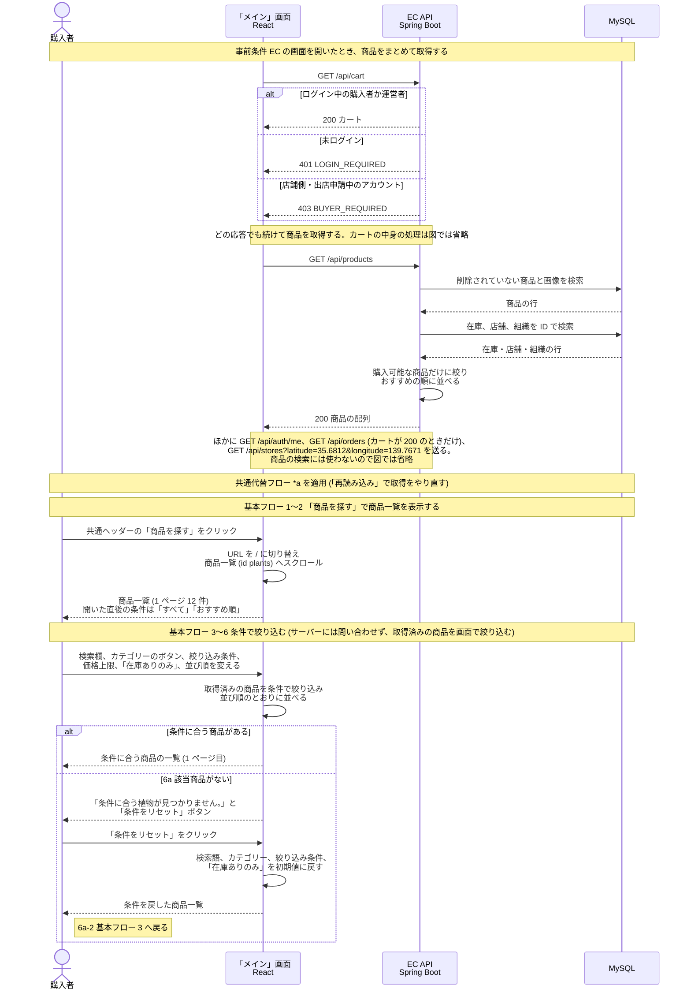
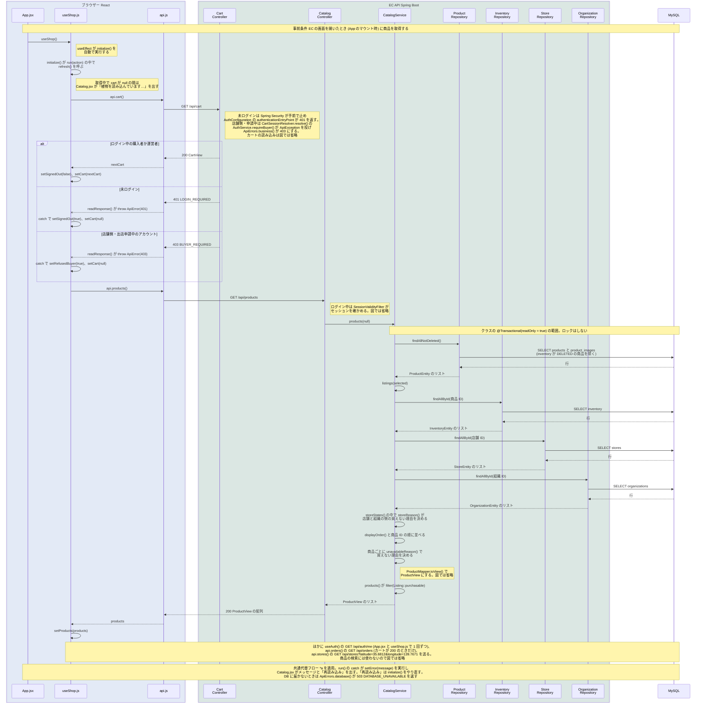
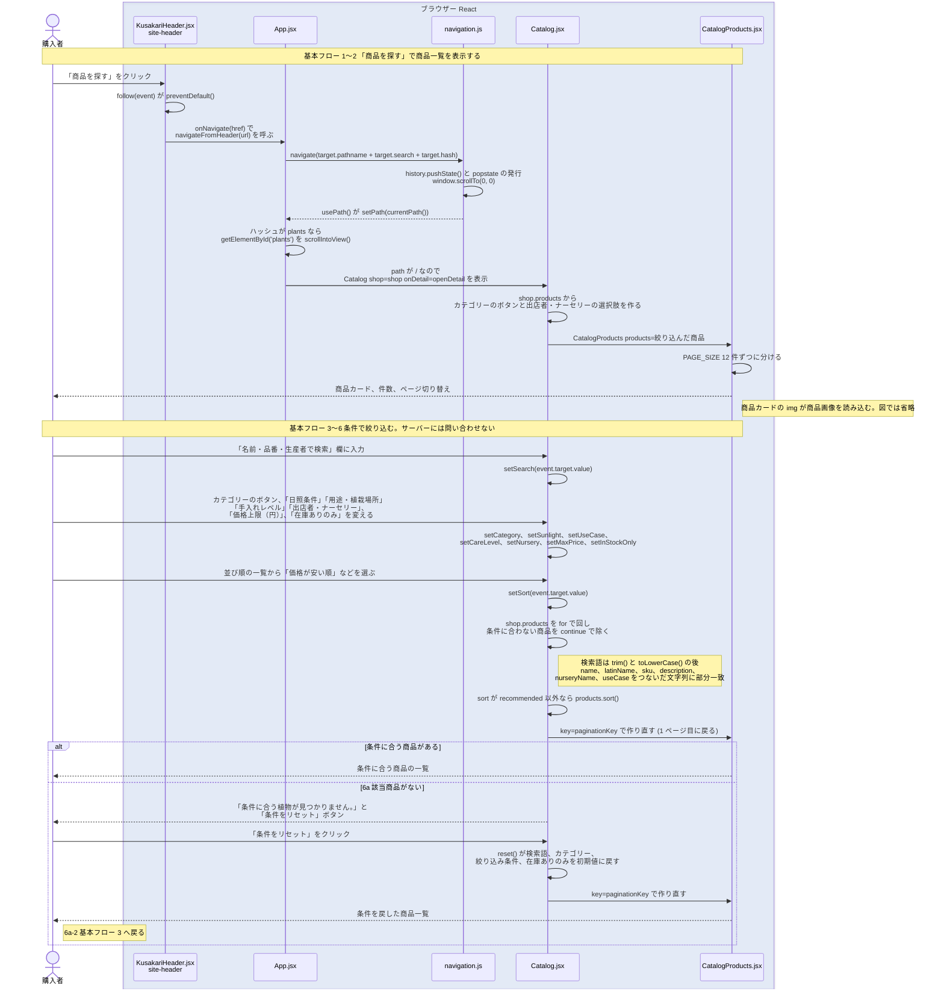

# EC-B03 商品を検索する

- ユースケース記述: [EC-B03_商品を検索する](<../../アーカイブ/ユースケース/kusakari-ec/EC-B03_商品を検索する.md>)
- 対象のコード: kusakari-ec の main（19a2be3、2026-11-20 時点）

商品の取得は、EC の画面を開いたとき（`App` が表示されたとき）に 1 回だけ行います。検索・絞り込み・並べ替えは、取得済みの商品をブラウザーの中で絞り込むだけで、サーバーには問い合わせません。そのため、図は「事前条件 画面を開いたときの取得」と「基本フロー 1〜6 検索と絞り込み」に分けています。ログインは不要なので、共通代替フロー *b は当てはまりません。

## 概要図

## 詳細図 1 事前条件 画面を開いたときの取得

## 詳細図 2 基本フロー 1〜6 検索と絞り込み

## ユースケース記述との差

- 検索語の対象が記述より広いです。記述は商品名・商品番号・生産者名ですが、コードは `name`、`latinName`（学名）、`sku`、`description`（説明文）、`nurseryName`、`useCase`（用途）をつないだ文字列に部分一致するかで探します。
- 「絞り込みを解除」と「条件をリセット」は、どちらも同じ `reset()` を呼びます。`reset()` は「絞り込み条件」だけでなく、検索語とカテゴリーと「在庫ありのみ」も初期値に戻します。並び順は戻しません。
- 記述にない処理です。商品の取得は画面を開いたときの `GET /api/products` 1 回だけで、条件を変えるたびにサーバーへ問い合わせることはありません。
- 記述にない処理です。「おすすめ順」は並べ替えをせず、サーバーの順のままです。サーバーは `CatalogService.displayOrder()` で `olive`、`lavender`、`rosemary`、`monstera` を先にし、残りを商品 ID の順に並べます。
- 記述にない処理です。カテゴリーのボタンと「出店者・ナーセリー」の選択肢は、`GET /api/categories` ではなく、取得した商品のカテゴリー名と生産者名から作ります。
- 記述にない処理です。一覧は 1 ページ 12 件で、条件や並び順を変えると 1 ページ目に戻ります（`CatalogProducts` を `key` で作り直すため）。
- 購入可能な商品の条件は、記述の関連情報とコードの `storeReason()`・`unavailableReason()` が一致しています。在庫の公開状態が `DELETED` の商品は、SQL の時点で除いています。

## 確かめられなかったこと

- 「マイページ」などの画面（`/account` など）から「商品を探す」を押したときに、商品一覧までスクロールするかは、画面では確かめていません。`navigateFromHeader()` は `navigate()` の直後に `getElementById('plants')` を呼びますが、この時点で「メイン」画面が描かれているかは、React の描画の順番によります。
- `GET /api/cart` が成功して `GET /api/products` が失敗したときは、`cart` が入っていて `products` が空のままなので、通信エラーと一緒に「条件に合う植物が見つかりません。」も出るとコードからは読めます。画面では確かめていません。

## 参照したコード

- [packages/site-header/KusakariHeader.jsx](https://github.com/abeouga/kusakari-ec/blob/19a2be307ee71a2cd87e538236c3c8c42929c5b3/packages/site-header/KusakariHeader.jsx): 「商品を探す」のリンク、`follow()`
- [frontend/src/App.jsx](https://github.com/abeouga/kusakari-ec/blob/19a2be307ee71a2cd87e538236c3c8c42929c5b3/frontend/src/App.jsx): `navigateFromHeader()`、`useShop()` の呼び出し、`Catalog` の表示
- [frontend/src/workspace/navigation.js](https://github.com/abeouga/kusakari-ec/blob/19a2be307ee71a2cd87e538236c3c8c42929c5b3/frontend/src/workspace/navigation.js): `navigate()`、`usePath()`、`currentPath()`
- [frontend/src/useShop.js](https://github.com/abeouga/kusakari-ec/blob/19a2be307ee71a2cd87e538236c3c8c42929c5b3/frontend/src/useShop.js): `initialize()`、`refresh()`、`run()`
- [frontend/src/api.js](https://github.com/abeouga/kusakari-ec/blob/19a2be307ee71a2cd87e538236c3c8c42929c5b3/frontend/src/api.js): `api.cart()`、`api.products()`、`request()`、`readResponse()`
- [frontend/src/components/Catalog.jsx](https://github.com/abeouga/kusakari-ec/blob/19a2be307ee71a2cd87e538236c3c8c42929c5b3/frontend/src/components/Catalog.jsx): 絞り込みの `for`、並べ替え、`reset()`、`paginationKey`、「条件に合う植物が見つかりません。」
- [frontend/src/components/CatalogProducts.jsx](https://github.com/abeouga/kusakari-ec/blob/19a2be307ee71a2cd87e538236c3c8c42929c5b3/frontend/src/components/CatalogProducts.jsx): `PAGE_SIZE`、ページの切り替え
- [backend/src/main/java/jp/kusakari/ec/commerce/controller/CartController.java](https://github.com/abeouga/kusakari-ec/blob/19a2be307ee71a2cd87e538236c3c8c42929c5b3/backend/src/main/java/jp/kusakari/ec/commerce/controller/CartController.java): `get()`
- [backend/src/main/java/jp/kusakari/ec/commerce/session/CartSessionResolver.java](https://github.com/abeouga/kusakari-ec/blob/19a2be307ee71a2cd87e538236c3c8c42929c5b3/backend/src/main/java/jp/kusakari/ec/commerce/session/CartSessionResolver.java): `resolve()`
- [backend/src/main/java/jp/kusakari/ec/auth/AuthService.java](https://github.com/abeouga/kusakari-ec/blob/19a2be307ee71a2cd87e538236c3c8c42929c5b3/backend/src/main/java/jp/kusakari/ec/auth/AuthService.java): `requireBuyer()`
- [backend/src/main/java/jp/kusakari/ec/auth/AuthConfiguration.java](https://github.com/abeouga/kusakari-ec/blob/19a2be307ee71a2cd87e538236c3c8c42929c5b3/backend/src/main/java/jp/kusakari/ec/auth/AuthConfiguration.java): `GET /api/products` の `permitAll()`、`authenticationEntryPoint`
- [backend/src/main/java/jp/kusakari/ec/catalog/controller/CatalogController.java](https://github.com/abeouga/kusakari-ec/blob/19a2be307ee71a2cd87e538236c3c8c42929c5b3/backend/src/main/java/jp/kusakari/ec/catalog/controller/CatalogController.java): `products()`
- [backend/src/main/java/jp/kusakari/ec/catalog/service/CatalogService.java](https://github.com/abeouga/kusakari-ec/blob/19a2be307ee71a2cd87e538236c3c8c42929c5b3/backend/src/main/java/jp/kusakari/ec/catalog/service/CatalogService.java): `products()`、`listings()`、`storeStates()`、`storeReason()`、`unavailableReason()`、`displayOrder()`
- [backend/src/main/java/jp/kusakari/ec/catalog/persistence/repository/ProductRepository.java](https://github.com/abeouga/kusakari-ec/blob/19a2be307ee71a2cd87e538236c3c8c42929c5b3/backend/src/main/java/jp/kusakari/ec/catalog/persistence/repository/ProductRepository.java): `findAllNotDeleted()`
- [backend/src/main/java/jp/kusakari/ec/catalog/persistence/repository/InventoryRepository.java](https://github.com/abeouga/kusakari-ec/blob/19a2be307ee71a2cd87e538236c3c8c42929c5b3/backend/src/main/java/jp/kusakari/ec/catalog/persistence/repository/InventoryRepository.java): `findAllById()`（JpaRepository）
- [backend/src/main/java/jp/kusakari/ec/catalog/persistence/repository/StoreRepository.java](https://github.com/abeouga/kusakari-ec/blob/19a2be307ee71a2cd87e538236c3c8c42929c5b3/backend/src/main/java/jp/kusakari/ec/catalog/persistence/repository/StoreRepository.java): `findAllById()`（JpaRepository）
- [backend/src/main/java/jp/kusakari/ec/store/persistence/repository/OrganizationRepository.java](https://github.com/abeouga/kusakari-ec/blob/19a2be307ee71a2cd87e538236c3c8c42929c5b3/backend/src/main/java/jp/kusakari/ec/store/persistence/repository/OrganizationRepository.java): `findAllById()`（JpaRepository）
- [backend/src/main/java/jp/kusakari/ec/common/web/ApiErrors.java](https://github.com/abeouga/kusakari-ec/blob/19a2be307ee71a2cd87e538236c3c8c42929c5b3/backend/src/main/java/jp/kusakari/ec/common/web/ApiErrors.java): `business()`、`database()`
