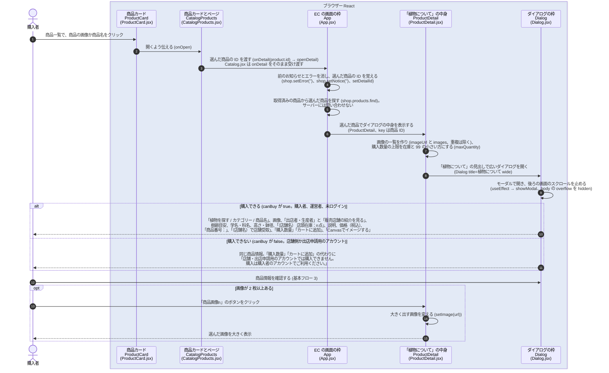

# EC-B04 商品詳細を確認する

- ユースケース記述: [EC-B04_商品詳細を確認する](<../../アーカイブ/ユースケース/kusakari-ec/EC-B04_商品詳細を確認する.md>)
- 共通代替フロー: [00_全ユースケース共通の代替フロー](<00_全ユースケース共通の代替フロー.md>)
- 対象のコード: kusakari-ec の main（6bad7e3、2026-11-24 時点）

## シーケンス図

参加者は、上から「画面や役割の名前」「コンポーネント・クラスの名前」「ファイル名（かっこ付き）」の順に書いています。
「植物について」ダイアログは、EC のページを読み込んだときに取得した商品（`useShop.js` の `products`）から、選んだ商品を探して表示します。開くときも画像を切り替えるときも、EC API とは通信しません（商品の取得は [EC-B03 商品を検索する](<EC-B03_商品を検索する.md>) の図の「事前条件」にあります）。そのため、共通代替フロー \*a・\*b は起こらず、図の最上部に共通代替フローの行も置いていません。「共通代替フローを直接書いた図」も省いています。商品の画像は `img` が読み込みますが、図には書いていません。

## ユースケース記述との差

- 記述にない処理です。開くときにサーバーから取り直さないので、ダイアログの在庫や価格は、EC のページを読み込んで商品を取得した時点の値です。
- 記述にない入口です。「メイン」画面の上部にある商品のカルーセル（`HeroProductCarousel.jsx`）の「（商品名）の商品詳細を見る」ボタンも、同じ `openDetail()` を呼びます。
- 記述にない処理です。ダイアログは、見出しの横の閉じるボタン（`aria-label` が「閉じる」）、Esc キー（`onCancel`）、ダイアログの外のクリックで、`App.jsx` の `close()` が呼ばれて閉じます。
- 記述にない内容です。ダイアログには「カートに追加」（EC-B07）、「販売店舗の紹介を見る」（EC-B05）、「Canvasでイメージする」のリンクもあります。在庫が 0 の商品は「購入数量」と「カートに追加」が押せません。
- 購入できるかは、`useShop.js` の `buyerBlocked` で決めます。サーバーがカートを 403 `BUYER_REQUIRED` で断ったか、ログイン中のアカウントの種類が店舗側か出店申請用（`isShopAccount`）なら、購入できません。
- ダイアログの「店舗受け取りのご案内」の文は「受取店舗はカートで指定できます。」です。受取店舗は商品の店舗で決まり、購入者は選びません（EC-B03 の関連情報、`ProductDetail.jsx` の先頭のコメント）。この文だけが今の仕様と合っていません。
- 事前条件は「トップ」画面と書いていますが、EC-B03 は同じ画面（パス `/`）を「メイン」画面と書いています。

## 参照したコード

- [frontend/src/components/ProductCard.jsx](https://github.com/abeouga/kusakari-ec/blob/6bad7e37c4135034fbe97e30309772fbe872e675/frontend/src/components/ProductCard.jsx): 画像（`product-photo`）と商品名（`product-name`）のボタンの `onOpen`
- [frontend/src/components/CatalogProducts.jsx](https://github.com/abeouga/kusakari-ec/blob/6bad7e37c4135034fbe97e30309772fbe872e675/frontend/src/components/CatalogProducts.jsx): `onOpen={() => onDetail(product.id)}`
- [frontend/src/components/Catalog.jsx](https://github.com/abeouga/kusakari-ec/blob/6bad7e37c4135034fbe97e30309772fbe872e675/frontend/src/components/Catalog.jsx): `onDetail` の受け渡し
- [frontend/src/App.jsx](https://github.com/abeouga/kusakari-ec/blob/6bad7e37c4135034fbe97e30309772fbe872e675/frontend/src/App.jsx): `openDetail`、`detail`、`close`、`canBuy`
- [frontend/src/components/ProductDetail.jsx](https://github.com/abeouga/kusakari-ec/blob/6bad7e37c4135034fbe97e30309772fbe872e675/frontend/src/components/ProductDetail.jsx): 画像の一覧、`maxQuantity`、`setImage`、`canBuy` の分岐、「店舗受け取りのご案内」
- [frontend/src/components/Dialog.jsx](https://github.com/abeouga/kusakari-ec/blob/6bad7e37c4135034fbe97e30309772fbe872e675/frontend/src/components/Dialog.jsx): `showModal`、`onCancel`、`onClick`、閉じるボタン
- [frontend/src/components/HeroProductCarousel.jsx](https://github.com/abeouga/kusakari-ec/blob/6bad7e37c4135034fbe97e30309772fbe872e675/frontend/src/components/HeroProductCarousel.jsx): 「商品詳細を見る」ボタンの `onDetail(product.id)`
- [frontend/src/auth.js](https://github.com/abeouga/kusakari-ec/blob/6bad7e37c4135034fbe97e30309772fbe872e675/frontend/src/auth.js): `buyerOnlyMessage`、`isShopAccount`
- [frontend/src/useShop.js](https://github.com/abeouga/kusakari-ec/blob/6bad7e37c4135034fbe97e30309772fbe872e675/frontend/src/useShop.js): `products`、`buyerBlocked`
