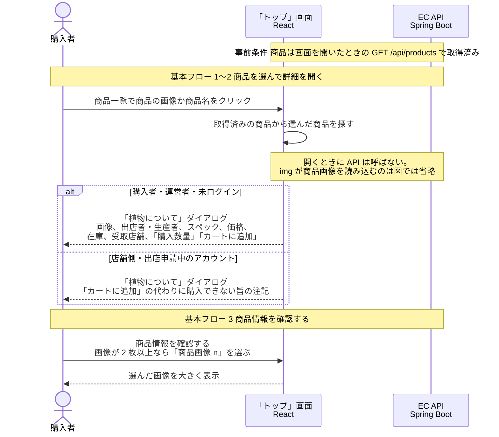
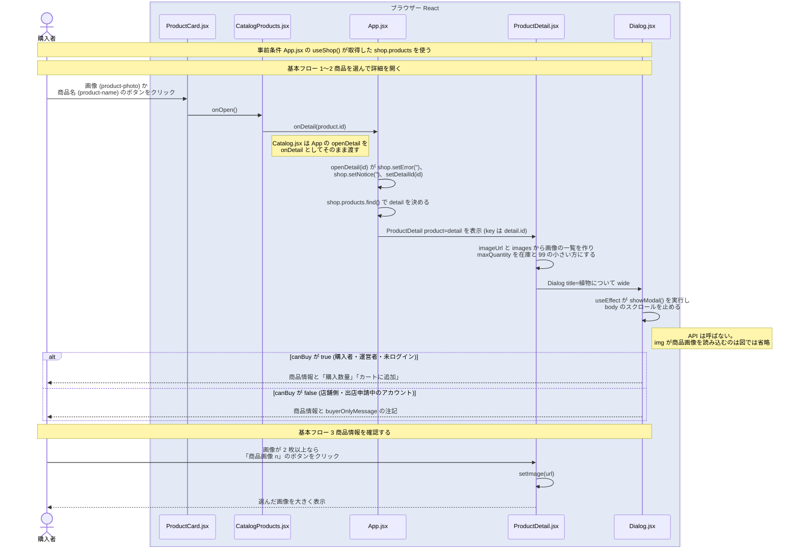

# EC-B04 商品詳細を確認する

- ユースケース記述: [EC-B04_商品詳細を確認する](<../../アーカイブ/ユースケース/kusakari-ec/EC-B04_商品詳細を確認する.md>)
- 対象のコード: kusakari-ec の main（19a2be3、2026-11-20 時点）

「植物について」ダイアログは、画面を開いたときに取得した商品（`useShop` の `products`）から選んだ商品を探して表示します。開くときに API は呼びません。商品の取得は [EC-B03 商品を検索する](<EC-B03_商品を検索する.md>) の「事前条件」の図にあります。基本フローに API を呼ぶステップがないので、共通代替フロー *a・*b を適用する場所はありません。

## 概要図

## 詳細図

## ユースケース記述との差

- 記述にない処理です。開くときにサーバーから取り直さないので、ダイアログの在庫や価格は、画面を開いて商品を取得した時点の値です。
- 記述にない入口です。「トップ」画面の上部にある商品のカルーセル（`HeroProductCarousel.jsx`）の「（商品名）の商品詳細を見る」ボタンも、同じ `openDetail()` を呼びます。
- 記述にない処理です。ダイアログは、見出しの横の閉じるボタン（`aria-label` が「閉じる」）、Esc キー、ダイアログの外のクリックで `App.jsx` の `close()` が呼ばれて閉じます。
- 記述にない内容です。ダイアログには「カートに追加」（EC-B07）、「販売店舗の紹介を見る」（EC-B05）、「Canvasでイメージする」のリンクもあります。
- ダイアログの「店舗受け取りのご案内」の文は「受取店舗はカートで指定できます。」です。受取店舗は商品の店舗で決まり、購入者は選びません（EC-B03 の関連情報、`ProductDetail.jsx` の先頭のコメント）。この文だけが今の仕様と合っていません。
- 事前条件は「トップ」画面と書いていますが、EC-B03 は同じ画面（パス `/`）を「メイン」画面と書いています。

## 参照したコード

- [frontend/src/components/ProductCard.jsx](https://github.com/abeouga/kusakari-ec/blob/19a2be307ee71a2cd87e538236c3c8c42929c5b3/frontend/src/components/ProductCard.jsx): 画像と商品名のボタンの `onOpen`
- [frontend/src/components/CatalogProducts.jsx](https://github.com/abeouga/kusakari-ec/blob/19a2be307ee71a2cd87e538236c3c8c42929c5b3/frontend/src/components/CatalogProducts.jsx): `onOpen={() => onDetail(product.id)}`
- [frontend/src/components/Catalog.jsx](https://github.com/abeouga/kusakari-ec/blob/19a2be307ee71a2cd87e538236c3c8c42929c5b3/frontend/src/components/Catalog.jsx): `onDetail` の受け渡し
- [frontend/src/App.jsx](https://github.com/abeouga/kusakari-ec/blob/19a2be307ee71a2cd87e538236c3c8c42929c5b3/frontend/src/App.jsx): `openDetail()`、`detail`、`close()`、`canBuy`
- [frontend/src/components/ProductDetail.jsx](https://github.com/abeouga/kusakari-ec/blob/19a2be307ee71a2cd87e538236c3c8c42929c5b3/frontend/src/components/ProductDetail.jsx): 画像の一覧、`maxQuantity`、`setImage()`、`canBuy` の分岐
- [frontend/src/components/Dialog.jsx](https://github.com/abeouga/kusakari-ec/blob/19a2be307ee71a2cd87e538236c3c8c42929c5b3/frontend/src/components/Dialog.jsx): `showModal()`、`onCancel`、`onClick`、閉じるボタン
- [frontend/src/components/HeroProductCarousel.jsx](https://github.com/abeouga/kusakari-ec/blob/19a2be307ee71a2cd87e538236c3c8c42929c5b3/frontend/src/components/HeroProductCarousel.jsx): 「商品詳細を見る」ボタンの `onDetail(product.id)`
- [frontend/src/auth.js](https://github.com/abeouga/kusakari-ec/blob/19a2be307ee71a2cd87e538236c3c8c42929c5b3/frontend/src/auth.js): `buyerOnlyMessage`、`isShopAccount()`
- [frontend/src/useShop.js](https://github.com/abeouga/kusakari-ec/blob/19a2be307ee71a2cd87e538236c3c8c42929c5b3/frontend/src/useShop.js): `products`、`buyerBlocked`
