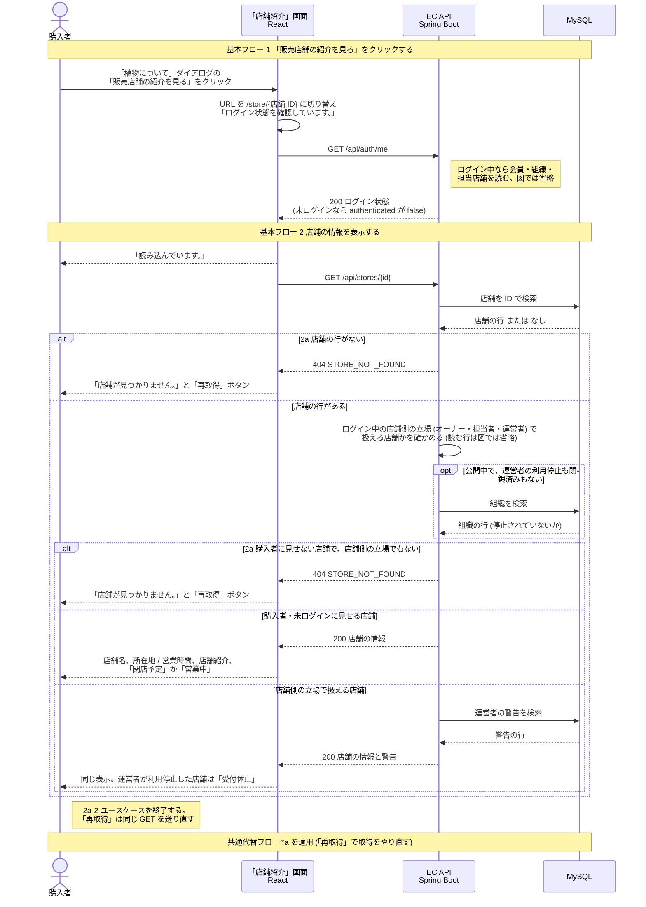
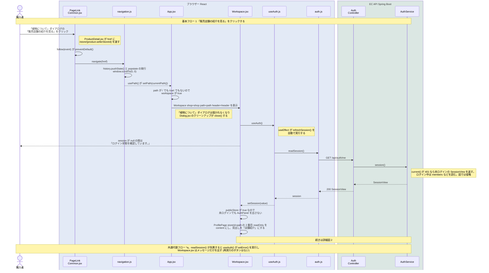
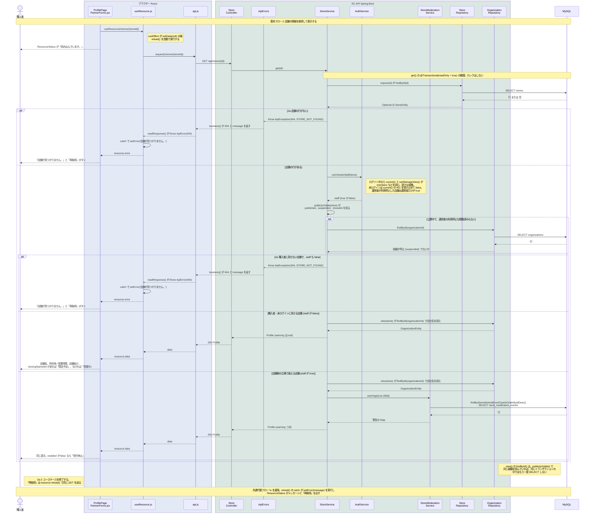

# EC-B05 販売店舗の情報を確認する

- ユースケース記述: [EC-B05_販売店舗の情報を確認する](<../../アーカイブ/ユースケース/kusakari-ec/EC-B05_販売店舗の情報を確認する.md>)
- 対象のコード: kusakari-ec の main（19a2be3、2026-11-20 時点）

「店舗紹介」画面（パス `/store/{店舗 ID}`）は、ログインしていなくても開ける `Workspace` の画面です。`Workspace` はログイン状態を `GET /api/auth/me` で確かめてから、店舗の情報を `GET /api/stores/{id}` で取得します。詳細図は「基本フロー 1 画面の切り替え」と「基本フロー 2 店舗の情報の取得と表示」に分けています。ログインは不要なので、共通代替フロー *b は当てはまりません。

## 概要図

## 詳細図 1 基本フロー 1 画面の切り替え

## 詳細図 2 基本フロー 2 店舗の情報の取得と表示

## ユースケース記述との差

- 関連情報は「出店者（オーナー・担当者）と運営者は、自分が扱える店舗を状態にかかわらず表示できる」としています。コードの `AuthService.canManageView()` は、運営者が利用停止した店舗では、運営者以外に `false` を返します。そのため、利用停止中の店舗は、オーナーと担当者にも 404「店舗が見つかりません。」になります。
- 営業状態の表示は「営業中」「閉店予定」のほかに「受付休止」があります（`enabled` が `false`、つまり運営者が利用停止した店舗）。購入者・未ログインには利用停止中の店舗が 404 になるので、「受付休止」を見るのは運営者だけです。
- 閉鎖済みの店舗を店舗側の立場で開くと、`closingStartedAt` が残っているので「閉店予定」と表示します。「閉鎖済み」の表示はありません。
- 記述の 2a は非公開・利用停止中・閉鎖済みの店舗を挙げています。コードは、店舗の組織が停止（`organizations.suspended` が true）のときも 404 にします。組織が受付停止中（停止の前の段階）の店舗は購入者にも表示し、「営業中」と出ます。
- 記述にない処理です。画面を開くたびに `Workspace` が `GET /api/auth/me` を送り、応答が来るまで「ログイン状態を確認しています。」を出します。この通信が失敗すると、`Workspace` はメッセージだけを出し、再実行のボタンはありません。共通代替フロー *a の *a-2（再実行を可能にする）と違います。
- 記述にない処理です。購入者・未ログインへの応答（`StoreService.Profile`）にも、担当者（`contact`）と問い合わせメール（`email`）が入っています。画面には出しません。
- 記述にない入口です。「店舗を探す」のダイアログ（`Stores.jsx`）の「店舗の紹介を見る」も、同じ `/store/{店舗 ID}` を開きます。
- 記述にない処理です。認証を省略する隔離テストの設定（`kusakari.auth.mode` が `demo`）では、`canViewAsStaff()` が常に `true` を返すので、どの店舗も表示されます。

## 確かめられなかったこと

- `view()` の中の `organizations.findById()` が、`publiclyVisible()` で読んだ組織を JPA の永続化コンテキストから返し、SQL を出さないことは、SQL のログでは確かめていません。
- 「店舗紹介」画面からブラウザーの「戻る」で「トップ」画面へ戻ると、`App.jsx` の `detailId` が残っているので「植物について」ダイアログがまた開くとコードからは読めます。画面では確かめていません。

## 参照したコード

- [frontend/src/components/ProductDetail.jsx](https://github.com/abeouga/kusakari-ec/blob/19a2be307ee71a2cd87e538236c3c8c42929c5b3/frontend/src/components/ProductDetail.jsx): 「販売店舗の紹介を見る」の `PageLink`
- [frontend/src/workspace/Common.jsx](https://github.com/abeouga/kusakari-ec/blob/19a2be307ee71a2cd87e538236c3c8c42929c5b3/frontend/src/workspace/Common.jsx): `PageLink`、`follow()`
- [frontend/src/workspace/navigation.js](https://github.com/abeouga/kusakari-ec/blob/19a2be307ee71a2cd87e538236c3c8c42929c5b3/frontend/src/workspace/navigation.js): `navigate()`、`usePath()`
- [frontend/src/App.jsx](https://github.com/abeouga/kusakari-ec/blob/19a2be307ee71a2cd87e538236c3c8c42929c5b3/frontend/src/App.jsx): `workspace` の判定、`Workspace` の表示、`detailId`
- [frontend/src/workspace/Workspace.jsx](https://github.com/abeouga/kusakari-ec/blob/19a2be307ee71a2cd87e538236c3c8c42929c5b3/frontend/src/workspace/Workspace.jsx): `publicStore`、`ProfilePage` の表示、見出し「店舗紹介」
- [frontend/src/useAuth.js](https://github.com/abeouga/kusakari-ec/blob/19a2be307ee71a2cd87e538236c3c8c42929c5b3/frontend/src/useAuth.js): `refreshSession()`
- [frontend/src/auth.js](https://github.com/abeouga/kusakari-ec/blob/19a2be307ee71a2cd87e538236c3c8c42929c5b3/frontend/src/auth.js): `readSession()`
- [frontend/src/workspace/PartnerForms.jsx](https://github.com/abeouga/kusakari-ec/blob/19a2be307ee71a2cd87e538236c3c8c42929c5b3/frontend/src/workspace/PartnerForms.jsx): `ProfilePage` の `readOnly` の表示、営業状態の文言
- [frontend/src/workspace/useResource.js](https://github.com/abeouga/kusakari-ec/blob/19a2be307ee71a2cd87e538236c3c8c42929c5b3/frontend/src/workspace/useResource.js): `useResource()`、`reload()`
- [frontend/src/workspace/ResourceView.jsx](https://github.com/abeouga/kusakari-ec/blob/19a2be307ee71a2cd87e538236c3c8c42929c5b3/frontend/src/workspace/ResourceView.jsx): `ResourceStatus`（「再取得」「読み込んでいます。」）
- [frontend/src/api.js](https://github.com/abeouga/kusakari-ec/blob/19a2be307ee71a2cd87e538236c3c8c42929c5b3/frontend/src/api.js): `request()`、`readResponse()`
- [frontend/src/components/Stores.jsx](https://github.com/abeouga/kusakari-ec/blob/19a2be307ee71a2cd87e538236c3c8c42929c5b3/frontend/src/components/Stores.jsx): 「店舗の紹介を見る」の `PageLink`
- [backend/src/main/java/jp/kusakari/ec/auth/AuthController.java](https://github.com/abeouga/kusakari-ec/blob/19a2be307ee71a2cd87e538236c3c8c42929c5b3/backend/src/main/java/jp/kusakari/ec/auth/AuthController.java): `me()`
- [backend/src/main/java/jp/kusakari/ec/auth/AuthService.java](https://github.com/abeouga/kusakari-ec/blob/19a2be307ee71a2cd87e538236c3c8c42929c5b3/backend/src/main/java/jp/kusakari/ec/auth/AuthService.java): `session()`、`current()`、`canViewAsStaff()`、`canManageView()`
- [backend/src/main/java/jp/kusakari/ec/auth/AuthConfiguration.java](https://github.com/abeouga/kusakari-ec/blob/19a2be307ee71a2cd87e538236c3c8c42929c5b3/backend/src/main/java/jp/kusakari/ec/auth/AuthConfiguration.java): `/api/auth/me` と `GET /api/stores/*` の `permitAll()`
- [backend/src/main/java/jp/kusakari/ec/store/controller/StoreController.java](https://github.com/abeouga/kusakari-ec/blob/19a2be307ee71a2cd87e538236c3c8c42929c5b3/backend/src/main/java/jp/kusakari/ec/store/controller/StoreController.java): `get()`
- [backend/src/main/java/jp/kusakari/ec/store/service/StoreService.java](https://github.com/abeouga/kusakari-ec/blob/19a2be307ee71a2cd87e538236c3c8c42929c5b3/backend/src/main/java/jp/kusakari/ec/store/service/StoreService.java): `get()`、`require()`、`publiclyVisible()`、`view()`、`notFound()`、`Profile`
- [backend/src/main/java/jp/kusakari/ec/store/service/StoreModerationService.java](https://github.com/abeouga/kusakari-ec/blob/19a2be307ee71a2cd87e538236c3c8c42929c5b3/backend/src/main/java/jp/kusakari/ec/store/service/StoreModerationService.java): `warnings()`
- [backend/src/main/java/jp/kusakari/ec/catalog/persistence/repository/StoreRepository.java](https://github.com/abeouga/kusakari-ec/blob/19a2be307ee71a2cd87e538236c3c8c42929c5b3/backend/src/main/java/jp/kusakari/ec/catalog/persistence/repository/StoreRepository.java): `findById()`（JpaRepository）
- [backend/src/main/java/jp/kusakari/ec/store/persistence/repository/OrganizationRepository.java](https://github.com/abeouga/kusakari-ec/blob/19a2be307ee71a2cd87e538236c3c8c42929c5b3/backend/src/main/java/jp/kusakari/ec/store/persistence/repository/OrganizationRepository.java): `findById()`（JpaRepository）
- [backend/src/main/java/jp/kusakari/ec/catalog/persistence/entity/StoreEntity.java](https://github.com/abeouga/kusakari-ec/blob/19a2be307ee71a2cd87e538236c3c8c42929c5b3/backend/src/main/java/jp/kusakari/ec/catalog/persistence/entity/StoreEntity.java): `startClosing()`、`completeClosing()`（閉鎖済みでも `closingStartedAt` は残る）
- [backend/src/main/java/jp/kusakari/ec/common/web/ApiErrors.java](https://github.com/abeouga/kusakari-ec/blob/19a2be307ee71a2cd87e538236c3c8c42929c5b3/backend/src/main/java/jp/kusakari/ec/common/web/ApiErrors.java): `business()`
