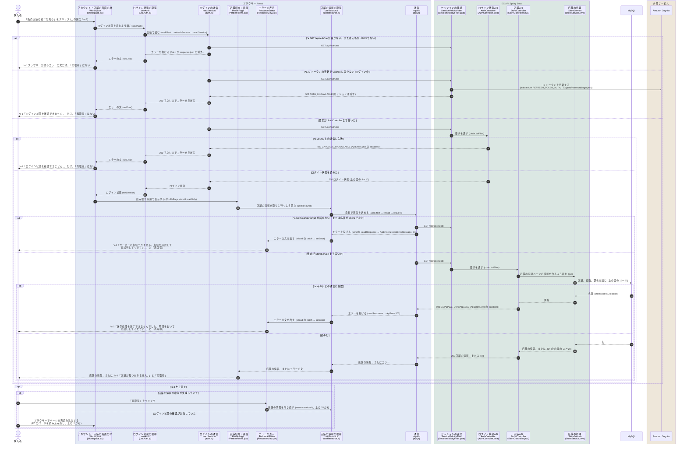

# EC-B05 販売店舗の情報を確認する

```mermaid
sequenceDiagram
    autonumber
    actor User as 購入者
    box rgba(47,111,219,0.10) ブラウザー React
        participant StoreLink as 「植物について」の店舗のリンク<br/>PageLink<br/>(Common.jsx)
        participant App as EC の画面の枠<br/>App<br/>(App.jsx)
        participant Work as アカウント・店舗の画面の枠<br/>Workspace<br/>(Workspace.jsx)
        participant UseAuth as ログイン状態の取得<br/>useAuth<br/>(useAuth.js)
        participant AuthJs as ログインの通信<br/>readSession<br/>(auth.js)
        participant Profile as 「店舗紹介」画面<br/>ProfilePage<br/>(PartnerForms.jsx)
        participant Res as 店舗の情報の取得<br/>useResource<br/>(useResource.js)
        participant Http as 通信<br/>request<br/>(api.js)
    end
    box rgba(27,127,92,0.12) EC API Spring Boot
        participant AuthCtrl as ログイン状態API<br/>AuthController<br/>(AuthController.java)
        participant Ctrl as 店舗API<br/>StoreController<br/>(StoreController.java)
        participant Svc as 店舗の処理<br/>StoreService<br/>(StoreService.java)
        participant AuthSvc as ログイン中の会員<br/>AuthService<br/>(AuthService.java)
        participant Mod as 運営者の警告<br/>StoreModerationService<br/>(StoreModerationService.java)
        participant StoreRepo as 店舗の読み書き<br/>StoreRepository<br/>(StoreRepository.java)
        participant OrgRepo as 組織の読み書き<br/>OrganizationRepository<br/>(OrganizationRepository.java)
    end
    participant Db as MySQL

    Note over User,Db: 共通代替フロー<br/>*a 通信に失敗した場合: 7、17 (「再取得」で送り直したときも) に適用

    User->>StoreLink: 「植物について」ダイアログの「販売店舗の紹介を見る」をクリック<br/>(ProductDetail.jsx が href に /store/{商品の店舗 ID} を渡す)
    StoreLink->>App: URL を /store/{店舗 ID} に変え (follow → navigate)、<br/>新しいパスを渡す (usePath)
    App->>Work: パスが / でも /cart でもないので Workspace を表示する。<br/>「植物について」ダイアログは描かなくなり、閉じる
    Work->>UseAuth: ログイン状態を読むよう頼む (useAuth)
    Work-->>User: 読み終わるまで「ログイン状態を確認しています。」
    UseAuth->>AuthJs: 画面を開いたときに自動で読む<br/>(useEffect → refreshSession → readSession)
    AuthJs->>AuthCtrl: GET /api/auth/me
    AuthCtrl->>AuthSvc: ログイン状態を作るよう頼む (session)。ログイン中の会員を確かめ (current)、<br/>未ログインなら 401 を受け止めて authenticated が false、<br/>ログイン中なら会員と組織・店舗の所属を読む
    AuthSvc-->>AuthCtrl: ログイン状態 (SessionView)
    AuthCtrl-->>AuthJs: 200 ログイン状態
    AuthJs-->>Work: ログイン状態 (useAuth の setSession)
    Work->>Work: パスが /store/ で始まるので、未ログインでもログイン欄を出さない (publicStore)。<br/>見出しは「店舗紹介」、サイドバーは「マイページ」「アカウント設定」
    Work->>Profile: 店舗 ID を渡して読み取り専用で表示する<br/>(ProfilePage storeId readOnly)
    Profile->>Res: 店舗の情報を取りに行くよう頼む (useResource('/stores/{店舗 ID}'))
    Res->>Http: 画面を開いたときに自動で通信を始める<br/>(useEffect → setData(null) → reload → request)
    Profile-->>User: 「読み込んでいます。」(ResourceStatus)
    Http->>Ctrl: GET /api/stores/{id} (ログインしていなくてもよい)
    Ctrl->>Svc: 店舗の公開ページの情報を作るよう頼む (get)<br/>読み取り専用のトランザクション
    Svc->>StoreRepo: 店舗を読む (require → findById、SELECT stores)
    StoreRepo-->>Svc: 店舗 (なければなし)
    Svc->>AuthSvc: 店舗側の立場で見られるかを確かめる (canViewAsStaff → canManageView)<br/>運営者なら見られる。運営者が利用停止した店舗は運営者だけ。<br/>オーナーは自分の組織の店舗、担当者は所属する店舗なら見られる。<br/>未ログイン (current の 401) と利用できないアカウント (403) は見られない
    AuthSvc-->>Svc: 店舗側の立場で見られるか (staff)
    Svc->>Svc: 購入者に見せる店舗かを確かめる (publiclyVisible)<br/>公開中で、運営者の利用停止も閉鎖済みもないか
    opt 公開中で、運営者の利用停止も閉鎖済みもない (組織の確認は記述なし)
        Svc->>OrgRepo: 店舗の組織を読む (findById)
        Note over Svc,OrgRepo: 結果: SELECT organizations。組織が停止 (suspended) でなければ購入者に見せる。
    end
    Svc->>OrgRepo: 会社名のために組織を読む (view → findById、SELECT organizations)<br/>(読んでいれば、同じトランザクションの中ではもう読まない)
    OrgRepo-->>Svc: 組織
    opt 店舗側の立場で見られる (staff が true。記述なし)
        Svc->>Mod: 運営者の今出ている警告を読む (warnings)
        Note over Svc,Mod: 結果: SELECT store_moderation_events (findByStoreIdInAndEventTypeInOrderByIdDesc) で読み、応答に入れる。<br/>購入者・未ログインには警告を入れない。
    end
    Svc-->>Ctrl: 店舗の情報 (Profile)
    Ctrl-->>Http: 200 店舗の情報
    Http-->>Res: 店舗の情報 (setData)
    Res-->>Profile: 店舗の情報
    Profile-->>User: 店舗名、「所在地 / 営業時間」、店舗紹介、<br/>closingStartedAt があれば「閉店予定」、なければ enabled で「営業中」か「受付休止」
```

- ユースケース記述: [EC-B05_販売店舗の情報を確認する](<../../アーカイブ/ユースケース/kusakari-ec/EC-B05_販売店舗の情報を確認する.md>)
- 共通代替フロー: [00_全ユースケース共通の代替フロー](<00_全ユースケース共通の代替フロー.md>)
- 対象のコード: kusakari-ec の main（6bad7e3、2026-11-24 時点）

## シーケンス図

参加者は、上から「画面や役割の名前」「コンポーネント・クラスの名前」「ファイル名（かっこ付き）」の順に書いています。
「店舗紹介」画面（パス `/store/{店舗 ID}`）は、ログインしていなくても開ける `Workspace` の画面です。`Workspace` は、ログイン状態を `GET /api/auth/me` で確かめてから、店舗の情報を `GET /api/stores/{id}` で取得します。
ログインは不要なので、共通代替フロー \*b は適用しません。
エラーの分岐は描かず、代替フローは図の下に並べています。条件つきの処理（店舗の組織の確認、運営者の警告の読み込み）は、opt の中を頼む矢印 1 本と Note にしています。

図に描いていない代替フロー：2a（店舗が見つからない）

## 共通代替フローを直接書いた図

上の図のログイン状態の確認（`GET /api/auth/me`）と店舗の情報の取得（`GET /api/stores/{id}`）に、共通代替フロー \*a を書き込んだ図です。ログイン状態の確認は `api.js` を通らないので、失敗したときの文と、やり直しの方法が \*a の決まりと違います。

## ユースケース記述との差

- 関連情報は「出店者（オーナー・担当者）と運営者は、自分が扱える店舗を状態にかかわらず表示できる」としています。コードの `AuthService.canManageView()` は、運営者が利用停止した店舗では、運営者以外に `false` を返します。そのため、利用停止中の店舗は、オーナーと担当者にも 404「店舗が見つかりません。」になります。
- 営業状態の表示は「営業中」「閉店予定」のほかに「受付休止」があります（`enabled` が `false`、つまり運営者が利用停止した店舗）。購入者・未ログインには利用停止中の店舗が 404 になるので、「受付休止」を見るのは運営者だけです。
- 閉鎖済みの店舗を店舗側の立場で開くと、`closingStartedAt` が残っているので「閉店予定」と表示します。「閉鎖済み」の表示はありません。
- 記述の 2a は非公開・利用停止中・閉鎖済みの店舗を挙げています。コードは、店舗の組織が停止（`organizations.suspended` が true）のときも 404 にします。組織が受付停止中（停止の前の段階）の店舗は購入者にも表示し、「営業中」と出ます。
- 2a-2「ユースケースを終了する」: 画面には「再取得」が出ます。押すと同じ `GET /api/stores/{id}` を送り直し、店舗がなければまた「店舗が見つかりません。」になります。
- 記述にない処理です。画面を開くたびに `Workspace` が `GET /api/auth/me` を送り、応答が来るまで「ログイン状態を確認しています。」を出します。この通信は `api.js` を通らないので、失敗すると `Workspace` はエラーの文だけを出し、「再取得」はありません。届かないときの文はブラウザーが作る文で、\*a-1 の「サーバーに接続できません。…」になりません。やり直すにはブラウザーで再読み込みします。
- \*a: ログイン中に ID トークンの更新で Cognito に届かないときは、先に送る `GET /api/auth/me` が 503 になり、店舗の情報は取りに行きません。そのため、`GET /api/stores/{id}` の 503 `AUTH_UNAVAILABLE` は図に書いていません。
- 記述にない処理です。「店舗紹介」画面のサイドバーには、購入者のメニュー（「マイページ」「アカウント設定」）が出ます。未ログインでも出ます。
- 記述にない処理です。購入者・未ログインへの応答（`StoreService.Profile`）にも、担当者（`contact`）と問い合わせメール（`email`）が入っています。画面には出しません。
- 記述にない入口です。「店舗を探す」のダイアログ（`Stores.jsx`）の「店舗の紹介を見る」も、同じ `/store/{店舗 ID}` を開きます。
- 記述にない処理です。認証を省略する隔離テストの設定（`kusakari.auth.mode` が `demo`）では、`canViewAsStaff()` が常に `true` を返すので、どの店舗も表示されます。

## 確かめられなかったこと

- `view()` の中の `organizations.findById()` が、`publiclyVisible()` で読んだ組織を JPA の永続化コンテキストから返し、SQL を出さないことは、SQL のログでは確かめていません。
- 「店舗紹介」画面からブラウザーの「戻る」で「メイン」画面へ戻ると、`App.jsx` の `detailId` が残っているので「植物について」ダイアログがまた開くとコードからは読めます。画面では確かめていません。
- ログイン中に MySQL に接続できないとき、`GET /api/auth/me` は `SessionValidityFilter` の `members.current()` で最初に DB を読みます。ここでの例外は `ApiErrors.database()` を通らない可能性があり、そのときの応答は確かめていません（00 の「確かめられなかったこと」と同じ）。

## 参照したコード

- [frontend/src/components/ProductDetail.jsx](https://github.com/abeouga/kusakari-ec/blob/6bad7e37c4135034fbe97e30309772fbe872e675/frontend/src/components/ProductDetail.jsx): 「販売店舗の紹介を見る」の `PageLink`
- [frontend/src/workspace/Common.jsx](https://github.com/abeouga/kusakari-ec/blob/6bad7e37c4135034fbe97e30309772fbe872e675/frontend/src/workspace/Common.jsx): `PageLink`、`follow`
- [frontend/src/workspace/navigation.js](https://github.com/abeouga/kusakari-ec/blob/6bad7e37c4135034fbe97e30309772fbe872e675/frontend/src/workspace/navigation.js): `navigate`、`usePath`
- [frontend/src/App.jsx](https://github.com/abeouga/kusakari-ec/blob/6bad7e37c4135034fbe97e30309772fbe872e675/frontend/src/App.jsx): `workspace` の判定、`Workspace` の表示、`detailId`
- [frontend/src/workspace/Workspace.jsx](https://github.com/abeouga/kusakari-ec/blob/6bad7e37c4135034fbe97e30309772fbe872e675/frontend/src/workspace/Workspace.jsx): `publicStore`、`ProfilePage` の表示、見出し「店舗紹介」、`error` の表示、「ログイン状態を確認しています。」
- [frontend/src/useAuth.js](https://github.com/abeouga/kusakari-ec/blob/6bad7e37c4135034fbe97e30309772fbe872e675/frontend/src/useAuth.js): `useAuth`、`refreshSession`
- [frontend/src/auth.js](https://github.com/abeouga/kusakari-ec/blob/6bad7e37c4135034fbe97e30309772fbe872e675/frontend/src/auth.js): `readSession`（「ログイン状態を確認できません。」）
- [frontend/src/workspace/PartnerForms.jsx](https://github.com/abeouga/kusakari-ec/blob/6bad7e37c4135034fbe97e30309772fbe872e675/frontend/src/workspace/PartnerForms.jsx): `ProfilePage` の `readOnly` の表示、営業状態の文言
- [frontend/src/workspace/useResource.js](https://github.com/abeouga/kusakari-ec/blob/6bad7e37c4135034fbe97e30309772fbe872e675/frontend/src/workspace/useResource.js): `useResource`、`reload`
- [frontend/src/workspace/ResourceView.jsx](https://github.com/abeouga/kusakari-ec/blob/6bad7e37c4135034fbe97e30309772fbe872e675/frontend/src/workspace/ResourceView.jsx): `ResourceStatus`（「再取得」「読み込んでいます。」）
- [frontend/src/api.js](https://github.com/abeouga/kusakari-ec/blob/6bad7e37c4135034fbe97e30309772fbe872e675/frontend/src/api.js): `request`、`send`、`readResponse`、`networkErrorMessage`
- [frontend/src/components/Stores.jsx](https://github.com/abeouga/kusakari-ec/blob/6bad7e37c4135034fbe97e30309772fbe872e675/frontend/src/components/Stores.jsx): 「店舗の紹介を見る」の `PageLink`
- [backend/src/main/java/jp/kusakari/ec/auth/AuthController.java](https://github.com/abeouga/kusakari-ec/blob/6bad7e37c4135034fbe97e30309772fbe872e675/backend/src/main/java/jp/kusakari/ec/auth/AuthController.java): `me`
- [backend/src/main/java/jp/kusakari/ec/auth/AuthService.java](https://github.com/abeouga/kusakari-ec/blob/6bad7e37c4135034fbe97e30309772fbe872e675/backend/src/main/java/jp/kusakari/ec/auth/AuthService.java): `session`、`current`、`canViewAsStaff`、`canManageView`
- [backend/src/main/java/jp/kusakari/ec/auth/AuthConfiguration.java](https://github.com/abeouga/kusakari-ec/blob/6bad7e37c4135034fbe97e30309772fbe872e675/backend/src/main/java/jp/kusakari/ec/auth/AuthConfiguration.java): `/api/auth/me` と `GET /api/stores/*` の `permitAll`
- [backend/src/main/java/jp/kusakari/ec/auth/SessionValidityFilter.java](https://github.com/abeouga/kusakari-ec/blob/6bad7e37c4135034fbe97e30309772fbe872e675/backend/src/main/java/jp/kusakari/ec/auth/SessionValidityFilter.java): `doFilterInternal`、`renewIdToken`
- [backend/src/main/java/jp/kusakari/ec/auth/CognitoPasswordLogin.java](https://github.com/abeouga/kusakari-ec/blob/6bad7e37c4135034fbe97e30309772fbe872e675/backend/src/main/java/jp/kusakari/ec/auth/CognitoPasswordLogin.java): ID トークンの更新、503 `AUTH_UNAVAILABLE`
- [backend/src/main/java/jp/kusakari/ec/store/controller/StoreController.java](https://github.com/abeouga/kusakari-ec/blob/6bad7e37c4135034fbe97e30309772fbe872e675/backend/src/main/java/jp/kusakari/ec/store/controller/StoreController.java): `get`
- [backend/src/main/java/jp/kusakari/ec/store/service/StoreService.java](https://github.com/abeouga/kusakari-ec/blob/6bad7e37c4135034fbe97e30309772fbe872e675/backend/src/main/java/jp/kusakari/ec/store/service/StoreService.java): `get`、`require`、`publiclyVisible`、`view`、`notFound`、`Profile`
- [backend/src/main/java/jp/kusakari/ec/store/service/StoreModerationService.java](https://github.com/abeouga/kusakari-ec/blob/6bad7e37c4135034fbe97e30309772fbe872e675/backend/src/main/java/jp/kusakari/ec/store/service/StoreModerationService.java): `warnings`
- [backend/src/main/java/jp/kusakari/ec/catalog/persistence/repository/StoreRepository.java](https://github.com/abeouga/kusakari-ec/blob/6bad7e37c4135034fbe97e30309772fbe872e675/backend/src/main/java/jp/kusakari/ec/catalog/persistence/repository/StoreRepository.java): `findById`（JpaRepository）
- [backend/src/main/java/jp/kusakari/ec/store/persistence/repository/OrganizationRepository.java](https://github.com/abeouga/kusakari-ec/blob/6bad7e37c4135034fbe97e30309772fbe872e675/backend/src/main/java/jp/kusakari/ec/store/persistence/repository/OrganizationRepository.java): `findById`（JpaRepository）
- [backend/src/main/java/jp/kusakari/ec/catalog/persistence/entity/StoreEntity.java](https://github.com/abeouga/kusakari-ec/blob/6bad7e37c4135034fbe97e30309772fbe872e675/backend/src/main/java/jp/kusakari/ec/catalog/persistence/entity/StoreEntity.java): `startClosing`、`completeClosing`（閉鎖済みでも `closingStartedAt` は残る）
- [backend/src/main/java/jp/kusakari/ec/common/web/ApiErrors.java](https://github.com/abeouga/kusakari-ec/blob/6bad7e37c4135034fbe97e30309772fbe872e675/backend/src/main/java/jp/kusakari/ec/common/web/ApiErrors.java): `business`、`database`
