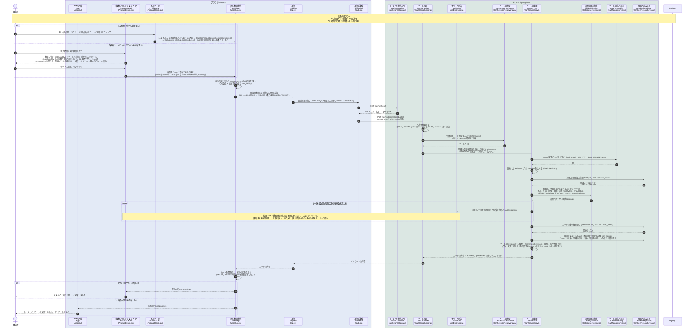
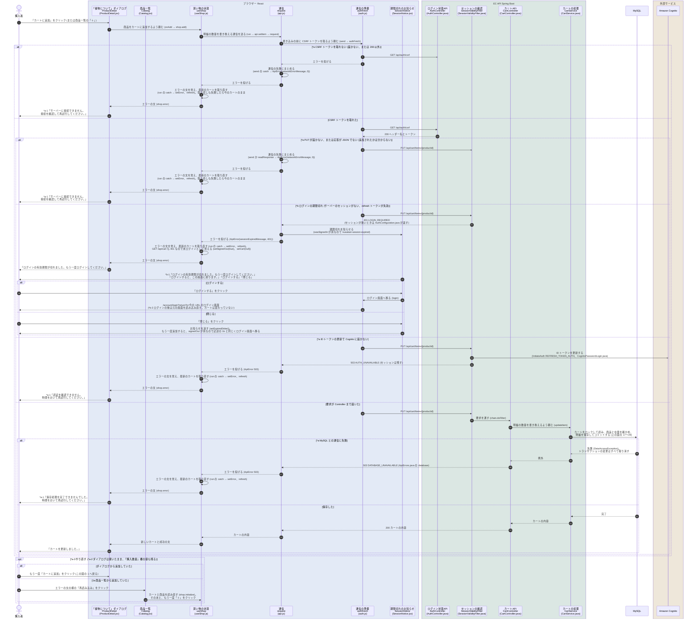

# EC-B07 商品をカートに追加する

- ユースケース記述: [EC-B07_商品をカートに追加する](<../../アーカイブ/ユースケース/kusakari-ec/EC-B07_商品をカートに追加する.md>)
- 共通代替フロー: [00_全ユースケース共通の代替フロー](<00_全ユースケース共通の代替フロー.md>)
- 対象のコード: kusakari-ec の main（6bad7e3、2026-11-24 時点）

## シーケンス図

参加者は、上から「画面や役割の名前」「コンポーネント・クラスの名前」「ファイル名（かっこ付き）」の順に書いています。
共通代替フローの中身は、00 の図か、下の「共通代替フローを直接書いた図」を見てください。
エラーは最重要の 4a（受取店舗の在庫数を超える）だけを描き、ほかの代替フローは図の下に並べています。4a のときの画面の後処理（`readResponse` が `ApiError` を投げる → `run` の catch でエラーの文を覚える → `refreshOnFailure` なので最新のカートを取り直す（`GET /api/cart` などの流れは EC-B08 の図と同じ）→ ダイアログか商品一覧の上にエラーの文を出す）は、図に描いていないほかの 4a でも同じです。取り直しの `GET /api/cart` にも共通代替フロー \*a・\*b が起こります。

「カートに追加」と商品一覧の「＋」は、どちらも `useShop` の `add()` を呼びます。`add()` は、画面が持っているカートの数量に追加する数量を足し、その合計を `PUT /api/cart/items/{productId}` で送ります。サーバーは送られた数量で明細を上書きします。カートは画面を開いたときに読み込み済みです（[EC-B08](<EC-B08_カートを確認する.md>) の図と同じ流れ）。

図に描いていない代替フロー：1b（未ログイン）、4a（数量が 99 を超える、販売を終了した、カートが 50 種類）、（記述なし）の分岐

## 共通代替フローを直接書いた図

上の図の追加の通信（CSRF トークンの取得と `PUT /api/cart/items/{productId}`）に、この画面で起こる共通代替フロー（\*a、\*b）を書き込んだ図です。どの失敗でも `run()` は最新のカートを取り直します（`refreshOnFailure`）。その `GET /api/cart` の \*a・\*b は [EC-B08](<EC-B08_カートを確認する.md>) の「共通代替フローを直接書いた図」と同じなので、ここでは結果だけを書いています。画面にエラーの文を出す所は、「植物について」ダイアログから追加したときは `ProductDetail`、商品一覧の「＋」から追加したときは `Catalog` です。

## ユースケース記述との差

- 4a のメッセージが記述と違います。記述の「追加すると商品数量の上限99点を超えます。」「カートの商品種類の上限50種類を超えます。」「販売終了または商品が見つかりません。」は、`CartService.addShoppingItems()`（[EC-B25](<../../アーカイブ/ユースケース/kusakari-ec/EC-B25_買い物リストから商品をカートに追加する.md>) の経路）の文言です。この経路（`CartService.updateItem()`）では次のとおりです。
  - 合計が 99 点を超える: `ItemRequest` の `@Max(99)` に違反し、`ApiErrors.invalid()` が 400 `INVALID_INPUT`「入力内容・文字数・数値の範囲を確認してください。」を返します。
  - 50 種類を超える: 400 `CART_LIMIT`「カートは50種類までです。」
  - 購入できない商品: 409 `PRODUCT_ARCHIVED`「この商品は販売を終了しています。カートから削除してください。」
  - 在庫不足の「受取店舗の在庫が不足しています。」（409 `OUT_OF_STOCK`）だけは記述と同じです。
- 記述の 4a の「商品が見つかりません」に当たる 404 `PRODUCT_NOT_FOUND`（`CatalogService.listing()`）は図に書いていません。商品はコードの中で行を消さない（論理削除だけ）ので、画面に出した商品で 404 になることはありません。
- 2a の検証は、ダイアログに入力した数量だけを `min(99, product.stock)` と比べます。カートにすでにある数量は足しません。足した合計が在庫数か 99 点を超えることは、サーバーの 4a で初めて分かります。
- 記述にない処理です。既にある商品への「加算」は、ブラウザーの `useShop.add()` が画面のカートの数量に足して行います。サーバーは送られた数量で明細を上書きします。画面のカートが古いと、サーバーは `revision` の違いで 409 `CART_CHANGED`「別の操作でカートが更新されました。最新の内容を確認してください。」を返します。記述の 4a にはこの場合がありません。
- サーバーの検査の順番は、`revision`（409 `CART_CHANGED`）、購入できるか（409 `PRODUCT_ARCHIVED`）、在庫（409 `OUT_OF_STOCK`）、種類数（400 `CART_LIMIT`）です。99 点の上限（400 `INVALID_INPUT`）は、それより前に Controller の入力の検査で見ます。
- 記述にない処理です。4a でも共通代替フローでも、`run()` は `refreshOnFailure` が true なので、`refresh()` で `GET /api/cart`、`GET /api/products`、`GET /api/orders` を送って画面のデータを取り直します。
- 共通代替フロー \*a で `PUT` の応答だけが届かなかった場合、サーバーでは追加が確定していることがあります。取り直しに成功すれば画面のカートに出ます。取り直しにも失敗して古いカートのままもう一度追加すると、古い `revision` を送るので 409 `CART_CHANGED` になり、二重には加算されません。
- \*b でログインが切れたときは、取り直しの `GET /api/cart` も 401 になり、`useShop` は未ログイン（`signedOut`）に変わってカートを忘れます。お知らせの「閉じる」を選んでも、次の追加は 1b と同じくログイン画面へ移ります。
- 1b は記述では商品一覧の「＋」だけです。コードでは、未ログインでも「植物について」ダイアログに「購入数量」と「カートに追加」が出ます（`canBuy` は店舗側・出店申請用のアカウントのときだけ false）。押すと同じく `login()` で「ログイン」画面へ移ります。
- 1b-2 のログインが終わると、戻り先のページを読み込み直します（パスワードのログインでは `AuthPanel.jsx` の `complete()` が `window.location.replace()` を呼びます）。「植物について」ダイアログを開いているかは URL に持たないので、ダイアログは閉じた状態に戻ります。基本フロー 1 へ戻るには、ダイアログを開き直します。
- 記述にない処理です。カートをまだ読み込めていない（`shop.cart` が null で未ログインでもない）ときに「カートに追加」を押すと、通信せずに「商品と店舗を読み込んでいます。しばらくしてから再試行してください。」を出します。商品一覧の「＋」は、このとき押せません（`Catalog.jsx` の `disabled`）。
- 店舗側・出店申請用のアカウントには「購入数量」「カートに追加」「＋」を出しません（`canBuy` が false）。事前条件が購入者のログインなので、図には書いていません。
- 事前条件は「トップ」画面、1a-1 は「メイン」画面と、同じ画面を違う名前で書いています。コードではどちらも `App.jsx` が `/` で表示する画面の `Catalog` です。

## 参照したコード

- [frontend/src/components/ProductDetail.jsx](https://github.com/abeouga/kusakari-ec/blob/6bad7e37c4135034fbe97e30309772fbe872e675/frontend/src/components/ProductDetail.jsx): 「購入数量」の `setQuantity`、`maxQuantity`、「カートに追加」の `disabled` と `onAdd(quantity)`、`notice` と `error` の表示
- [frontend/src/components/ProductCard.jsx](https://github.com/abeouga/kusakari-ec/blob/6bad7e37c4135034fbe97e30309772fbe872e675/frontend/src/components/ProductCard.jsx): 「＋」ボタンの `onAdd` と `disabled`
- [frontend/src/components/CatalogProducts.jsx](https://github.com/abeouga/kusakari-ec/blob/6bad7e37c4135034fbe97e30309772fbe872e675/frontend/src/components/CatalogProducts.jsx): `onAdd(product.id)`
- [frontend/src/components/Catalog.jsx](https://github.com/abeouga/kusakari-ec/blob/6bad7e37c4135034fbe97e30309772fbe872e675/frontend/src/components/Catalog.jsx): `onAdd={shop.add}`、`disabled` と `canBuy`、`shop.error` と「再読み込み」
- [frontend/src/App.jsx](https://github.com/abeouga/kusakari-ec/blob/6bad7e37c4135034fbe97e30309772fbe872e675/frontend/src/App.jsx): `canBuy`、`ProductDetail` の `onAdd`、トースト（「カートを見る」）、`LoginPage` の表示
- [frontend/src/useShop.js](https://github.com/abeouga/kusakari-ec/blob/6bad7e37c4135034fbe97e30309772fbe872e675/frontend/src/useShop.js): `add`、`setQuantity`、`run`（`refreshOnFailure`）、`refresh`、`signedOut`
- [frontend/src/api.js](https://github.com/abeouga/kusakari-ec/blob/6bad7e37c4135034fbe97e30309772fbe872e675/frontend/src/api.js): `api.setItem`、`api.cart`、`request`、`send`、`readResponse`、`ApiError`、`networkErrorMessage`、`sessionExpiredMessage`
- [frontend/src/auth.js](https://github.com/abeouga/kusakari-ec/blob/6bad7e37c4135034fbe97e30309772fbe872e675/frontend/src/auth.js): `authFetch`（`GET /api/auth/csrf`）、`login`、`wasSignedIn`
- [frontend/src/workspace/navigation.js](https://github.com/abeouga/kusakari-ec/blob/6bad7e37c4135034fbe97e30309772fbe872e675/frontend/src/workspace/navigation.js): `navigate`
- [frontend/src/components/AuthPanel.jsx](https://github.com/abeouga/kusakari-ec/blob/6bad7e37c4135034fbe97e30309772fbe872e675/frontend/src/components/AuthPanel.jsx): `complete`
- [frontend/src/components/SessionNotice.jsx](https://github.com/abeouga/kusakari-ec/blob/6bad7e37c4135034fbe97e30309772fbe872e675/frontend/src/components/SessionNotice.jsx): 期限切れのお知らせ
- [backend/src/main/java/jp/kusakari/ec/auth/AuthController.java](https://github.com/abeouga/kusakari-ec/blob/6bad7e37c4135034fbe97e30309772fbe872e675/backend/src/main/java/jp/kusakari/ec/auth/AuthController.java): `csrf`
- [backend/src/main/java/jp/kusakari/ec/commerce/controller/CartController.java](https://github.com/abeouga/kusakari-ec/blob/6bad7e37c4135034fbe97e30309772fbe872e675/backend/src/main/java/jp/kusakari/ec/commerce/controller/CartController.java): `updateItem`
- [backend/src/main/java/jp/kusakari/ec/commerce/dto/CommerceDtos.java](https://github.com/abeouga/kusakari-ec/blob/6bad7e37c4135034fbe97e30309772fbe872e675/backend/src/main/java/jp/kusakari/ec/commerce/dto/CommerceDtos.java): `ItemRequest`、`CartView`
- [backend/src/main/java/jp/kusakari/ec/commerce/session/CartSessionResolver.java](https://github.com/abeouga/kusakari-ec/blob/6bad7e37c4135034fbe97e30309772fbe872e675/backend/src/main/java/jp/kusakari/ec/commerce/session/CartSessionResolver.java): `resolve`
- [backend/src/main/java/jp/kusakari/ec/commerce/service/CartService.java](https://github.com/abeouga/kusakari-ec/blob/6bad7e37c4135034fbe97e30309772fbe872e675/backend/src/main/java/jp/kusakari/ec/commerce/service/CartService.java): `updateItem`、`checkRevision`、`requireLockedCart`、`view`、`addShoppingItems`（文言の比較）
- [backend/src/main/java/jp/kusakari/ec/commerce/persistence/repository/CartRepository.java](https://github.com/abeouga/kusakari-ec/blob/6bad7e37c4135034fbe97e30309772fbe872e675/backend/src/main/java/jp/kusakari/ec/commerce/persistence/repository/CartRepository.java): `findLocked`
- [backend/src/main/java/jp/kusakari/ec/commerce/persistence/repository/CartItemRepository.java](https://github.com/abeouga/kusakari-ec/blob/6bad7e37c4135034fbe97e30309772fbe872e675/backend/src/main/java/jp/kusakari/ec/commerce/persistence/repository/CartItemRepository.java): `findAllForCart`、`findById`・`save`（JpaRepository）
- [backend/src/main/java/jp/kusakari/ec/catalog/service/CatalogService.java](https://github.com/abeouga/kusakari-ec/blob/6bad7e37c4135034fbe97e30309772fbe872e675/backend/src/main/java/jp/kusakari/ec/catalog/service/CatalogService.java): `listing`、`listingsByIds`、`Listing.purchasable`、`unavailableReason`
- [backend/src/main/java/jp/kusakari/ec/auth/SessionValidityFilter.java](https://github.com/abeouga/kusakari-ec/blob/6bad7e37c4135034fbe97e30309772fbe872e675/backend/src/main/java/jp/kusakari/ec/auth/SessionValidityFilter.java): `doFilterInternal`（ID トークンの更新、401）
- [backend/src/main/java/jp/kusakari/ec/auth/CognitoPasswordLogin.java](https://github.com/abeouga/kusakari-ec/blob/6bad7e37c4135034fbe97e30309772fbe872e675/backend/src/main/java/jp/kusakari/ec/auth/CognitoPasswordLogin.java): ID トークンの更新、503 `AUTH_UNAVAILABLE`
- [backend/src/main/java/jp/kusakari/ec/auth/AuthConfiguration.java](https://github.com/abeouga/kusakari-ec/blob/6bad7e37c4135034fbe97e30309772fbe872e675/backend/src/main/java/jp/kusakari/ec/auth/AuthConfiguration.java): `authenticationEntryPoint`（401 `LOGIN_REQUIRED`）
- [backend/src/main/java/jp/kusakari/ec/common/web/ApiErrors.java](https://github.com/abeouga/kusakari-ec/blob/6bad7e37c4135034fbe97e30309772fbe872e675/backend/src/main/java/jp/kusakari/ec/common/web/ApiErrors.java): `invalid`、`business`、`database`
