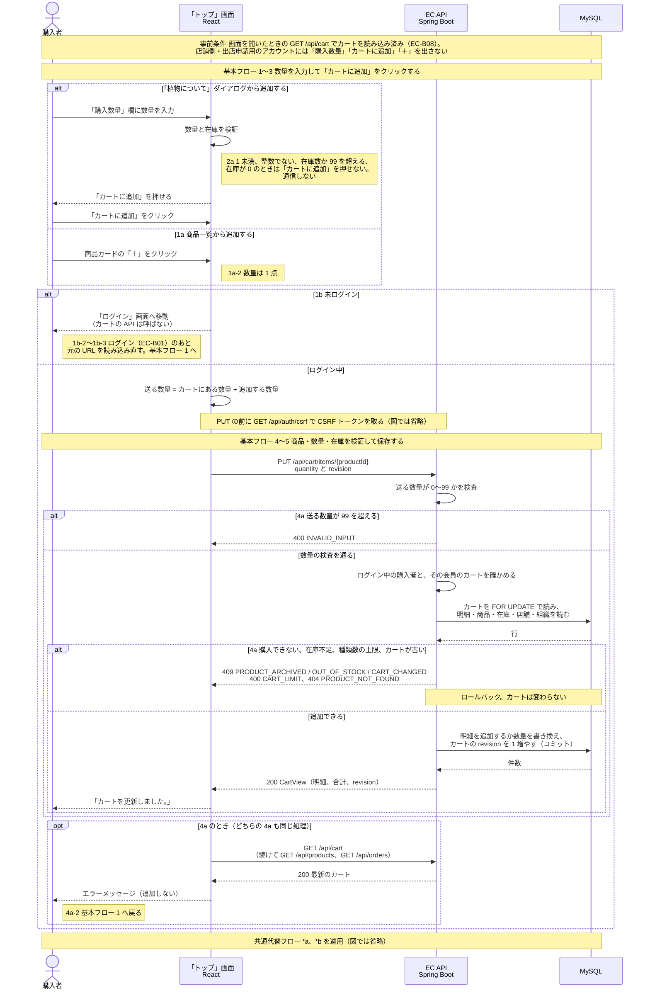
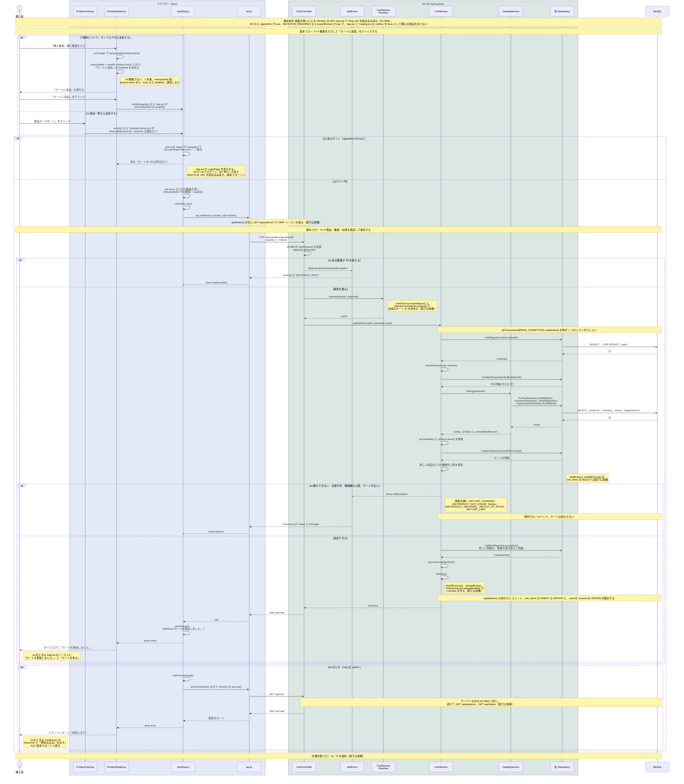

# EC-B07 商品をカートに追加する

- ユースケース記述: [EC-B07_商品をカートに追加する](<../../アーカイブ/ユースケース/kusakari-ec/EC-B07_商品をカートに追加する.md>)
- 対象のコード: kusakari-ec の main（19a2be3、2026-11-20 時点）

「カートに追加」と商品一覧の「＋」は、どちらも `useShop` の `add()` を呼びます。`add()` は画面が持っているカートの数量に追加する数量を足し、その合計を `PUT /api/cart/items/{productId}` で送ります。サーバーは送られた数量で明細を上書きします。カートは画面を開いたときに読み込み済みです。読み込みの流れは [EC-B08 カートを確認する](<EC-B08_カートを確認する.md>) の詳細図 1 にあります。

## 概要図

## 詳細図

## ユースケース記述との差

- 4a のメッセージが記述と違います。記述の「追加すると商品数量の上限99点を超えます。」「カートの商品種類の上限50種類を超えます。」「販売終了または商品が見つかりません。」は、`CartService.addShoppingItems()`（[EC-B25](<../../アーカイブ/ユースケース/kusakari-ec/EC-B25_買い物リストから商品をカートに追加する.md>) の経路）の文言です。この経路（`CartService.updateItem()`）では次のとおりです。
  - 合計が 99 点を超える: `ItemRequest` の `@Max(99)` に違反し、`ApiErrors.invalid()` が 400 `INVALID_INPUT`「入力内容・文字数・数値の範囲を確認してください。」を返します。
  - 50 種類を超える: 400 `CART_LIMIT`「カートは50種類までです。」
  - 購入できない商品: 409 `PRODUCT_ARCHIVED`「この商品は販売を終了しています。カートから削除してください。」
  - 商品が見つからない: 404 `PRODUCT_NOT_FOUND`「商品が見つかりません。」
  - 在庫不足の「受取店舗の在庫が不足しています。」（409 `OUT_OF_STOCK`）だけは記述と同じです。
- 2a の検証は、ダイアログに入力した数量だけを `min(99, product.stock)` と比べます。カートにすでにある数量は足しません。足した合計が在庫数か 99 点を超えることは、サーバーの 4a で初めて分かります。
- 記述にない処理です。既にある商品への「加算」は、ブラウザーの `useShop.add()` が画面のカートの数量に足して行います。サーバーは送られた数量で明細を上書きします。画面のカートが古いと、サーバーは `revision` の違いで 409 `CART_CHANGED`「別の操作でカートが更新されました。最新の内容を確認してください。」を返します。記述の 4a にはこの場合がありません。
- 記述にない処理です。4a のあと、`run()` は `refreshOnFailure` が true なので、`refresh()` で `GET /api/cart`、`GET /api/products`、`GET /api/orders` を送って画面のデータを取り直します。
- 1b は記述では商品一覧の「＋」だけです。コードでは、未ログインでも「植物について」ダイアログに「購入数量」と「カートに追加」が出ます（`canBuy` は店舗側・出店申請用のアカウントのときだけ false）。押すと同じく `login()` で「ログイン」画面へ移ります。
- 1b-2 のログインが終わると、戻り先のページを読み込み直します（パスワードのログインでは `AuthPanel.jsx` の `complete()` が `window.location.replace()` を呼びます）。「植物について」ダイアログを開いているかは URL に持たないので、ダイアログは閉じた状態に戻ります。基本フロー 1 へ戻るには、ダイアログを開き直します。
- 事前条件は「トップ」画面、1a-1 は「メイン」画面と、同じ画面を違う名前で書いています。コードではどちらも `App.jsx` が `/` で表示する画面の `Catalog` です。

## 確かめられなかったこと

- 1b-2 のログイン後の戻り先は、サーバーの `POST /api/auth/login` が返す `returnTo` です。サーバーが `returnTo` をどう検査するかは EC-B01 の範囲として追っていません。

## 参照したコード

- [frontend/src/components/ProductDetail.jsx](https://github.com/abeouga/kusakari-ec/blob/19a2be307ee71a2cd87e538236c3c8c42929c5b3/frontend/src/components/ProductDetail.jsx): 「購入数量」の `setQuantity()`、`maxQuantity`、「カートに追加」の `disabled` と `onAdd(quantity)`、`notice` と `error` の表示
- [frontend/src/components/ProductCard.jsx](https://github.com/abeouga/kusakari-ec/blob/19a2be307ee71a2cd87e538236c3c8c42929c5b3/frontend/src/components/ProductCard.jsx): 「＋」ボタンの `onAdd` と `disabled`
- [frontend/src/components/CatalogProducts.jsx](https://github.com/abeouga/kusakari-ec/blob/19a2be307ee71a2cd87e538236c3c8c42929c5b3/frontend/src/components/CatalogProducts.jsx): `onAdd(product.id)`
- [frontend/src/components/Catalog.jsx](https://github.com/abeouga/kusakari-ec/blob/19a2be307ee71a2cd87e538236c3c8c42929c5b3/frontend/src/components/Catalog.jsx): `onAdd={shop.add}`、`disabled` と `canBuy`、`shop.error` と「再読み込み」
- [frontend/src/App.jsx](https://github.com/abeouga/kusakari-ec/blob/19a2be307ee71a2cd87e538236c3c8c42929c5b3/frontend/src/App.jsx): `canBuy`、`ProductDetail` の `onAdd`、トースト（「カートを見る」）
- [frontend/src/useShop.js](https://github.com/abeouga/kusakari-ec/blob/19a2be307ee71a2cd87e538236c3c8c42929c5b3/frontend/src/useShop.js): `add()`、`setQuantity()`、`run()`、`refresh()`
- [frontend/src/api.js](https://github.com/abeouga/kusakari-ec/blob/19a2be307ee71a2cd87e538236c3c8c42929c5b3/frontend/src/api.js): `api.setItem()`、`api.cart()`、`request()`、`readResponse()`
- [frontend/src/auth.js](https://github.com/abeouga/kusakari-ec/blob/19a2be307ee71a2cd87e538236c3c8c42929c5b3/frontend/src/auth.js): `authFetch()`（CSRF トークン）、`login()`、`buyerOnlyMessage`
- [frontend/src/components/AuthPanel.jsx](https://github.com/abeouga/kusakari-ec/blob/19a2be307ee71a2cd87e538236c3c8c42929c5b3/frontend/src/components/AuthPanel.jsx): `complete()`
- [backend/src/main/java/jp/kusakari/ec/commerce/controller/CartController.java](https://github.com/abeouga/kusakari-ec/blob/19a2be307ee71a2cd87e538236c3c8c42929c5b3/backend/src/main/java/jp/kusakari/ec/commerce/controller/CartController.java): `updateItem()`
- [backend/src/main/java/jp/kusakari/ec/commerce/dto/CommerceDtos.java](https://github.com/abeouga/kusakari-ec/blob/19a2be307ee71a2cd87e538236c3c8c42929c5b3/backend/src/main/java/jp/kusakari/ec/commerce/dto/CommerceDtos.java): `ItemRequest`、`CartView`
- [backend/src/main/java/jp/kusakari/ec/commerce/session/CartSessionResolver.java](https://github.com/abeouga/kusakari-ec/blob/19a2be307ee71a2cd87e538236c3c8c42929c5b3/backend/src/main/java/jp/kusakari/ec/commerce/session/CartSessionResolver.java): `resolve()`
- [backend/src/main/java/jp/kusakari/ec/commerce/service/CartService.java](https://github.com/abeouga/kusakari-ec/blob/19a2be307ee71a2cd87e538236c3c8c42929c5b3/backend/src/main/java/jp/kusakari/ec/commerce/service/CartService.java): `updateItem()`、`checkRevision()`、`requireLockedCart()`、`view()`、`addShoppingItems()`（文言の比較）
- [backend/src/main/java/jp/kusakari/ec/commerce/persistence/repository/CartRepository.java](https://github.com/abeouga/kusakari-ec/blob/19a2be307ee71a2cd87e538236c3c8c42929c5b3/backend/src/main/java/jp/kusakari/ec/commerce/persistence/repository/CartRepository.java): `findLocked()`
- [backend/src/main/java/jp/kusakari/ec/commerce/persistence/repository/CartItemRepository.java](https://github.com/abeouga/kusakari-ec/blob/19a2be307ee71a2cd87e538236c3c8c42929c5b3/backend/src/main/java/jp/kusakari/ec/commerce/persistence/repository/CartItemRepository.java): `findAllForCart()`
- [backend/src/main/java/jp/kusakari/ec/catalog/service/CatalogService.java](https://github.com/abeouga/kusakari-ec/blob/19a2be307ee71a2cd87e538236c3c8c42929c5b3/backend/src/main/java/jp/kusakari/ec/catalog/service/CatalogService.java): `listing()`、`listingsByIds()`、`Listing.purchasable()`、`unavailableReason()`
- [backend/src/main/java/jp/kusakari/ec/catalog/persistence/repository/ProductRepository.java](https://github.com/abeouga/kusakari-ec/blob/19a2be307ee71a2cd87e538236c3c8c42929c5b3/backend/src/main/java/jp/kusakari/ec/catalog/persistence/repository/ProductRepository.java): `findByIdIn()`
- [backend/src/main/java/jp/kusakari/ec/common/web/ApiErrors.java](https://github.com/abeouga/kusakari-ec/blob/19a2be307ee71a2cd87e538236c3c8c42929c5b3/backend/src/main/java/jp/kusakari/ec/common/web/ApiErrors.java): `invalid()`、`business()`
