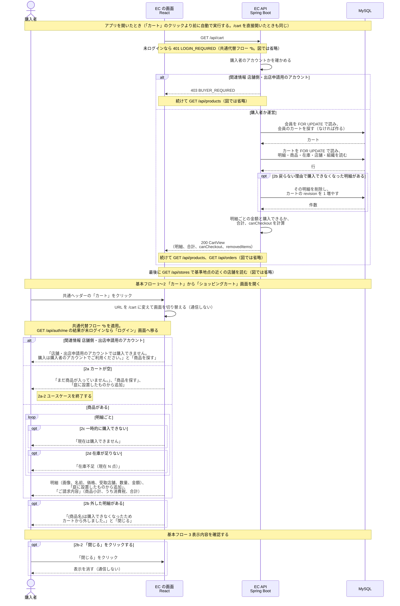
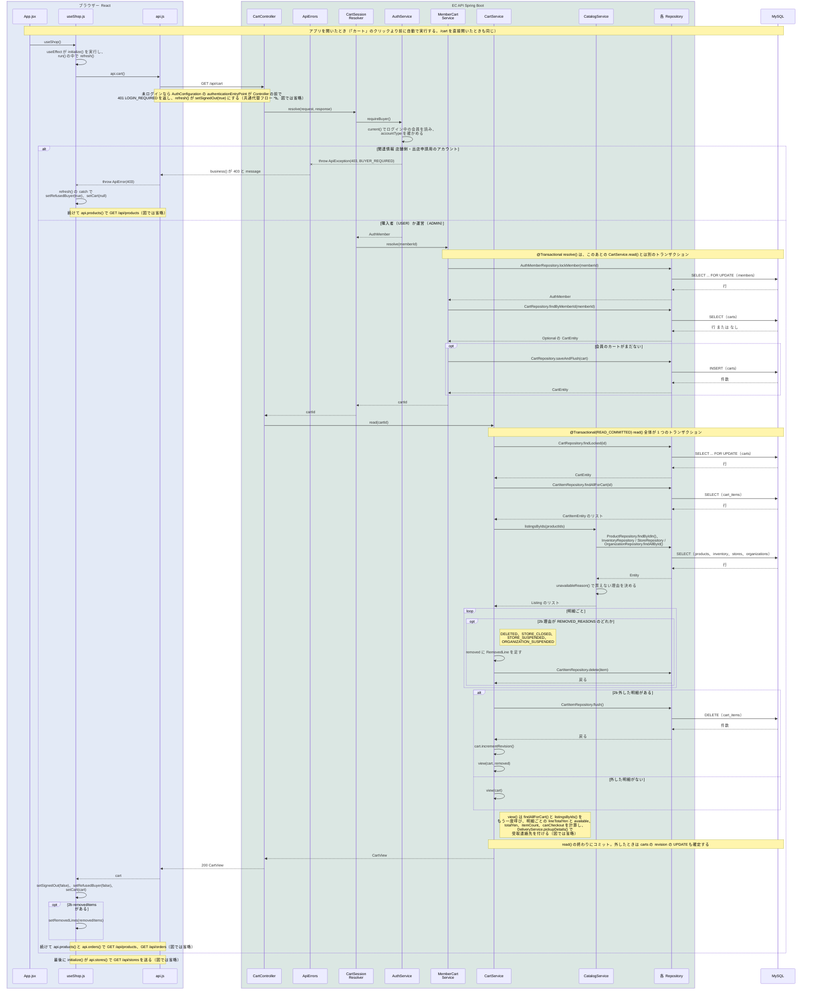
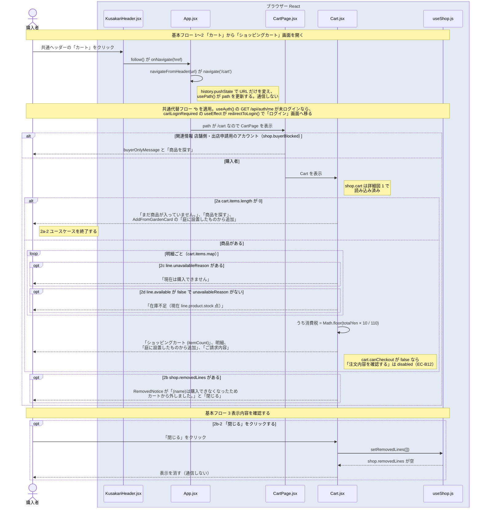

# EC-B08 カートを確認する

- ユースケース記述: [EC-B08_カートを確認する](<../../アーカイブ/ユースケース/kusakari-ec/EC-B08_カートを確認する.md>)
- 対象のコード: kusakari-ec の main（19a2be3、2026-11-20 時点）

カートのデータは、アプリを開いたときに `useShop` が `GET /api/cart` で読み込みます。共通ヘッダーの「カート」をクリックしても通信せず、読み込み済みのカートを「ショッピングカート」画面に表示します。購入できなくなった明細を外す処理（2b）は、この `GET /api/cart` の中でサーバーが行います。そのため詳細図は、アプリを開いたときの読み込み（詳細図 1）と、画面の表示（詳細図 2）に分けました。

## 概要図

## 詳細図 1 アプリを開いたときの読み込み

## 詳細図 2 基本フロー 1〜3 画面の表示

## ユースケース記述との差

- 記述では、基本フロー 2 で画面を表示するときにカートを読み、2b で明細を外すように読めます。コードでは「カート」のクリックでは通信しません。カートはアプリを開いたとき（`useShop` の `initialize()`）と、ほかの操作のあとの `refresh()` で読み込み済みです。2b の「外す」処理も、そのときの `GET /api/cart` の中でサーバーが行います。読み込んだあとに店舗が閉鎖されたなどの変化は、次に `GET /api/cart` を送るまで画面に出ません。
- 記述にない処理です。2b で明細を外すと、サーバーはカートの `revision` を 1 増やします。ほかの画面で開いていた古いカートの操作は、409 `CART_CHANGED` で断られます。`GET` ですが DB を書き換えます。
- 共通代替フロー *a の「再実行を可能にする」について、カートを読み込めなかったとき（`shop.cart` が null で `shop.error` がある）の「ショッピングカート」画面には、エラーメッセージと「商品を探す」だけが出ます。再実行のボタンはありません。「商品を探す」で戻る「トップ」画面の一覧には「再読み込み」（`shop.initialize`）があります。
- 記述にない表示です。各明細に「この商品を庭に配置」（Canvas へのリンク）が出ます。見出しは「ショッピングカート (商品の点数)」です。
- 記述にない処理です。「うち消費税」はサーバーから受け取らず、画面が `Math.floor(totalYen × 10 / 110)` で計算します。商品小計（`subtotalYen`）と合計（`totalYen`）はサーバーが計算し、送料がないので同じ値です。
- 2b、2c、2d の条件は、記述とコードが一致しています。2b はサーバーの `CatalogService.REMOVED_REASONS`（`DELETED`、`STORE_CLOSED`、`STORE_SUSPENDED`、`ORGANIZATION_SUSPENDED`）、2c はそれ以外の `unavailableReason`（`STORE_CLOSING`、`STORE_UNPUBLISHED`、`ORGANIZATION_NOT_ACCEPTING`、`PRODUCT_SUSPENDED`、`HIDDEN`）、2d は `unavailableReason` が null で在庫が数量より少ない明細です。

## 参照したコード

- [packages/site-header/KusakariHeader.jsx](https://github.com/abeouga/kusakari-ec/blob/19a2be307ee71a2cd87e538236c3c8c42929c5b3/packages/site-header/KusakariHeader.jsx): 「カート」のリンク、`follow()`
- [frontend/src/App.jsx](https://github.com/abeouga/kusakari-ec/blob/19a2be307ee71a2cd87e538236c3c8c42929c5b3/frontend/src/App.jsx): `useShop()` の呼び出し、`navigateFromHeader()`、`cartLoginRequired` と `redirectToLogin()`、`CartPage` の表示、`canBuy`
- [frontend/src/workspace/navigation.js](https://github.com/abeouga/kusakari-ec/blob/19a2be307ee71a2cd87e538236c3c8c42929c5b3/frontend/src/workspace/navigation.js): `navigate()`、`usePath()`
- [frontend/src/useAuth.js](https://github.com/abeouga/kusakari-ec/blob/19a2be307ee71a2cd87e538236c3c8c42929c5b3/frontend/src/useAuth.js): `readSession()` の呼び出し
- [frontend/src/auth.js](https://github.com/abeouga/kusakari-ec/blob/19a2be307ee71a2cd87e538236c3c8c42929c5b3/frontend/src/auth.js): `readSession()`（`GET /api/auth/me`）、`redirectToLogin()`、`isShopAccount()`、`buyerOnlyMessage`
- [frontend/src/useShop.js](https://github.com/abeouga/kusakari-ec/blob/19a2be307ee71a2cd87e538236c3c8c42929c5b3/frontend/src/useShop.js): `initialize()`、`refresh()`、`run()`、`buyerBlocked`、`removedLines` と `setRemovedLines()`
- [frontend/src/api.js](https://github.com/abeouga/kusakari-ec/blob/19a2be307ee71a2cd87e538236c3c8c42929c5b3/frontend/src/api.js): `api.cart()`、`api.products()`、`api.orders()`、`api.stores()`、`readResponse()`
- [frontend/src/components/CartPage.jsx](https://github.com/abeouga/kusakari-ec/blob/19a2be307ee71a2cd87e538236c3c8c42929c5b3/frontend/src/components/CartPage.jsx): `shop.buyerBlocked` の分岐、「商品を探す」
- [frontend/src/components/Cart.jsx](https://github.com/abeouga/kusakari-ec/blob/19a2be307ee71a2cd87e538236c3c8c42929c5b3/frontend/src/components/Cart.jsx): 空のカート、明細の表示（「現在は購入できません」「在庫不足」）、「ご請求内容」、`RemovedNotice`
- [frontend/src/components/GardenItemsDialog.jsx](https://github.com/abeouga/kusakari-ec/blob/19a2be307ee71a2cd87e538236c3c8c42929c5b3/frontend/src/components/GardenItemsDialog.jsx): `AddFromGardenCard`（開くまでは通信しない）
- [backend/src/main/java/jp/kusakari/ec/commerce/controller/CartController.java](https://github.com/abeouga/kusakari-ec/blob/19a2be307ee71a2cd87e538236c3c8c42929c5b3/backend/src/main/java/jp/kusakari/ec/commerce/controller/CartController.java): `get()`
- [backend/src/main/java/jp/kusakari/ec/commerce/session/CartSessionResolver.java](https://github.com/abeouga/kusakari-ec/blob/19a2be307ee71a2cd87e538236c3c8c42929c5b3/backend/src/main/java/jp/kusakari/ec/commerce/session/CartSessionResolver.java): `resolve()`
- [backend/src/main/java/jp/kusakari/ec/auth/AuthService.java](https://github.com/abeouga/kusakari-ec/blob/19a2be307ee71a2cd87e538236c3c8c42929c5b3/backend/src/main/java/jp/kusakari/ec/auth/AuthService.java): `requireBuyer()`、`current()`
- [backend/src/main/java/jp/kusakari/ec/auth/MemberCartService.java](https://github.com/abeouga/kusakari-ec/blob/19a2be307ee71a2cd87e538236c3c8c42929c5b3/backend/src/main/java/jp/kusakari/ec/auth/MemberCartService.java): `resolve()`
- [backend/src/main/java/jp/kusakari/ec/auth/AuthMemberRepository.java](https://github.com/abeouga/kusakari-ec/blob/19a2be307ee71a2cd87e538236c3c8c42929c5b3/backend/src/main/java/jp/kusakari/ec/auth/AuthMemberRepository.java): `lockMember()`
- [backend/src/main/java/jp/kusakari/ec/auth/AuthConfiguration.java](https://github.com/abeouga/kusakari-ec/blob/19a2be307ee71a2cd87e538236c3c8c42929c5b3/backend/src/main/java/jp/kusakari/ec/auth/AuthConfiguration.java): `authenticationEntryPoint`
- [backend/src/main/java/jp/kusakari/ec/commerce/service/CartService.java](https://github.com/abeouga/kusakari-ec/blob/19a2be307ee71a2cd87e538236c3c8c42929c5b3/backend/src/main/java/jp/kusakari/ec/commerce/service/CartService.java): `read()`、`view()`、`requireLockedCart()`
- [backend/src/main/java/jp/kusakari/ec/commerce/dto/CommerceDtos.java](https://github.com/abeouga/kusakari-ec/blob/19a2be307ee71a2cd87e538236c3c8c42929c5b3/backend/src/main/java/jp/kusakari/ec/commerce/dto/CommerceDtos.java): `CartView`、`CartLine`、`RemovedLine`
- [backend/src/main/java/jp/kusakari/ec/commerce/persistence/repository/CartRepository.java](https://github.com/abeouga/kusakari-ec/blob/19a2be307ee71a2cd87e538236c3c8c42929c5b3/backend/src/main/java/jp/kusakari/ec/commerce/persistence/repository/CartRepository.java): `findByMemberId()`、`findLocked()`
- [backend/src/main/java/jp/kusakari/ec/commerce/persistence/repository/CartItemRepository.java](https://github.com/abeouga/kusakari-ec/blob/19a2be307ee71a2cd87e538236c3c8c42929c5b3/backend/src/main/java/jp/kusakari/ec/commerce/persistence/repository/CartItemRepository.java): `findAllForCart()`
- [backend/src/main/java/jp/kusakari/ec/commerce/service/DeliveryService.java](https://github.com/abeouga/kusakari-ec/blob/19a2be307ee71a2cd87e538236c3c8c42929c5b3/backend/src/main/java/jp/kusakari/ec/commerce/service/DeliveryService.java): `pickupDetails()`
- [backend/src/main/java/jp/kusakari/ec/catalog/service/CatalogService.java](https://github.com/abeouga/kusakari-ec/blob/19a2be307ee71a2cd87e538236c3c8c42929c5b3/backend/src/main/java/jp/kusakari/ec/catalog/service/CatalogService.java): `listingsByIds()`、`REMOVED_REASONS`、`unavailableReason()`、`storeReason()`
- [backend/src/main/java/jp/kusakari/ec/catalog/persistence/repository/ProductRepository.java](https://github.com/abeouga/kusakari-ec/blob/19a2be307ee71a2cd87e538236c3c8c42929c5b3/backend/src/main/java/jp/kusakari/ec/catalog/persistence/repository/ProductRepository.java): `findByIdIn()`
- [backend/src/main/java/jp/kusakari/ec/common/web/ApiErrors.java](https://github.com/abeouga/kusakari-ec/blob/19a2be307ee71a2cd87e538236c3c8c42929c5b3/backend/src/main/java/jp/kusakari/ec/common/web/ApiErrors.java): `business()`
