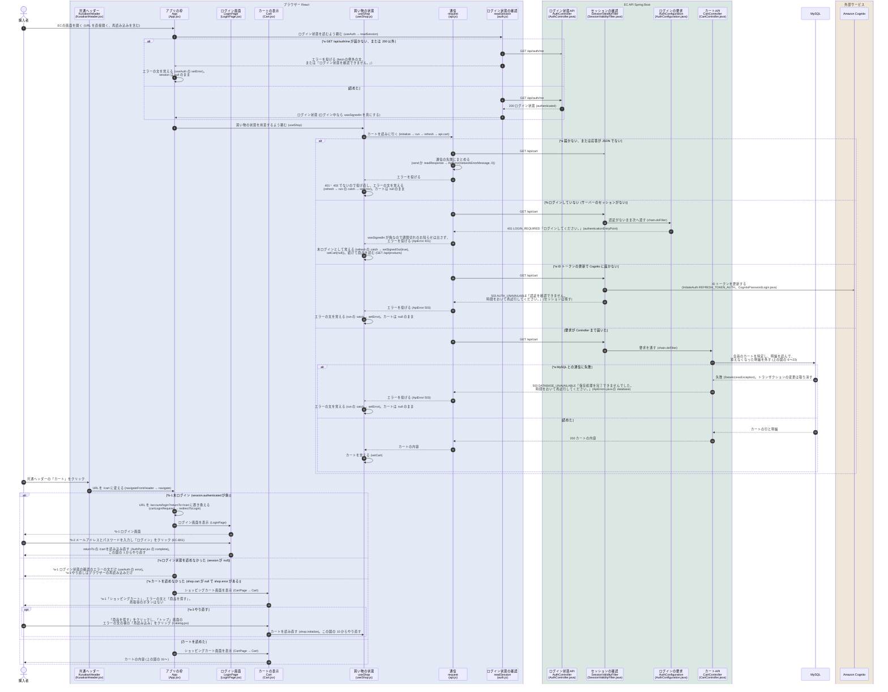

# EC-B08 カートを確認する

```mermaid
sequenceDiagram
    autonumber
    actor User as 購入者
    box rgba(47,111,219,0.10) ブラウザー React
        participant Header as 共通ヘッダー<br/>KusakariHeader<br/>(KusakariHeader.jsx)
        participant App as アプリの枠<br/>App<br/>(App.jsx)
        participant Page as ショッピングカート画面<br/>CartPage<br/>(CartPage.jsx)
        participant Cart as カートの表示<br/>Cart<br/>(Cart.jsx)
        participant Shop as 買い物の状態<br/>useShop<br/>(useShop.js)
        participant Http as 通信<br/>request<br/>(api.js)
    end
    box rgba(27,127,92,0.12) EC API Spring Boot
        participant Ctrl as カートAPI<br/>CartController<br/>(CartController.java)
        participant Resolver as カートの特定<br/>CartSessionResolver<br/>(CartSessionResolver.java)
        participant Auth as ログイン中の会員<br/>AuthService<br/>(AuthService.java)
        participant MemberCart as 会員のカート<br/>MemberCartService<br/>(MemberCartService.java)
        participant Svc as カートの処理<br/>CartService<br/>(CartService.java)
        participant Catalog as 商品の販売状態<br/>CatalogService<br/>(CatalogService.java)
        participant CartRepo as カートの読み書き<br/>CartRepository<br/>(CartRepository.java)
        participant ItemRepo as 明細の読み書き<br/>CartItemRepository<br/>(CartItemRepository.java)
    end
    participant Db as MySQL

    Note over User,Db: 共通代替フロー<br/>*b 未ログインの場合: 2 (ログイン状態の確認)、5、30 に適用<br/>*a 通信に失敗した場合: 2、5 に適用

    User->>App: EC の画面 (「トップ」画面など) を開く
    App->>App: ログイン状態を読む<br/>(useAuth → readSession、GET /api/auth/me)
    App->>Shop: 買い物の状態を用意するよう頼む (useShop)
    Shop->>Http: 画面を開いたときに自動でカートを読みに行く<br/>(initialize → run → refresh → api.cart → request)
    Http->>Ctrl: GET /api/cart
    Ctrl->>Resolver: 会員のカートを特定するよう頼む (resolve)
    Resolver->>Auth: ログイン中の人が購入できるアカウントかを確かめる (requireBuyer)
    Auth-->>Resolver: ログイン中の会員 (購入者 (USER) か運営者 (ADMIN))
    Resolver->>MemberCart: 会員のカートの ID を求めるよう頼む (resolve)。resolve 全体が 1 つのトランザクション<br/>会員の行をロックして読む (lockMember、SELECT ... FOR UPDATE members)
    MemberCart->>CartRepo: 会員のカートを探す (findByMemberId、SELECT carts)
    CartRepo-->>MemberCart: カート (なければなし)
    opt 会員のカートがまだない (記述なし)
        MemberCart->>CartRepo: 新しいカートを保存する (saveAndFlush)
        Note over MemberCart,CartRepo: 結果: INSERT carts で新しいカートを作り、その ID を使う。
    end
    MemberCart-->>Resolver: カートの ID (ここでコミット)
    Resolver-->>Ctrl: カートの ID
    Ctrl->>Svc: カートを読むよう頼む (read)<br/>read 全体が 1 つのトランザクション
    Svc->>CartRepo: カートの行をロックして読む (findLocked、SELECT ... FOR UPDATE carts)
    CartRepo-->>Svc: カート
    Svc->>ItemRepo: カートの明細を読む (findAllForCart、SELECT cart_items)
    ItemRepo-->>Svc: 明細のリスト
    Svc->>Catalog: 明細の商品が今買えるか、買えない理由を調べるよう頼む (listingsByIds)<br/>商品・在庫・店舗・組織を読む (findByIdIn、findAllById、<br/>SELECT products、inventory、stores、organizations)
    Catalog-->>Svc: 商品ごとの販売状態 (Listing、買えない理由の unavailableReason)
    opt 2b 戻らない理由で買えなくなった明細がある<br/>(DELETED、STORE_CLOSED、STORE_SUSPENDED、ORGANIZATION_SUSPENDED)
        Svc->>ItemRepo: 2b-1 明細を外す (明細ごとに delete、まとめて flush)
        Note over Svc,ItemRepo: 結果: DELETE cart_items。外した明細を覚え (RemovedLine)、カートの revision を 1 増やす (incrementRevision)。
    end
    Svc->>Svc: 明細と販売状態を読み直し、明細ごとの金額 (lineTotalYen) と<br/>買えるか (available)、合計、点数、注文に進めるか (canCheckout) を計算し、<br/>受取連絡先を付ける (view → findAllForCart、listingsByIds、pickupDetails)
    Svc-->>Ctrl: カートの内容 (CartView)。read の終わりにコミット
    Ctrl-->>Http: 200 カートの内容 (revision、items、subtotalYen、<br/>totalYen、itemCount、canCheckout、removedItems)
    Http-->>Shop: カートの内容
    Shop->>Shop: カートを覚える (setCart)。外した明細があれば覚える (setRemovedLines)。<br/>続けて商品・注文履歴・近くの店舗を読む (api.products、api.orders、api.stores、<br/>GET /api/products、GET /api/orders、GET /api/stores)

    User->>Header: 共通ヘッダーの「カート」をクリック
    Header->>App: URL を /cart に変え、画面を切り替える。通信しない<br/>(follow → onNavigate → navigateFromHeader → navigate)
    App->>Page: path が /cart でログイン中なので、<br/>ショッピングカート画面を表示 (CartPage)
    Page->>Cart: 読み込み済みのカートで表示するよう頼む (Cart)
    Cart->>Cart: 明細ごとに注意書きを決め (cart.items.map。2c unavailableReason があれば<br/>「現在は購入できません」、2d available が偽で unavailableReason がなければ<br/>「在庫不足（現在 N 点）」)、うち消費税を計算する (Math.floor(totalYen × 10 / 110))
    Cart-->>User: 「ショッピングカート (点数)」、明細ごとの画像・名前・価格・<br/>受取店舗・数量・金額と 2c-1・2d-1 の注意書き、「庭に設置したものから追加」、<br/>「ご請求内容」(商品小計、うち消費税、合計)、「注文内容を確認する」(canCheckout が偽なら押せない)。<br/>2b-1 外した明細があれば「(商品名)は購入できなくなったためカートから外しました。」と「閉じる」
    opt 2b 外した明細がある (shop.removedLines)
        User->>Cart: 2b-2「閉じる」をクリック
        Note over User,Cart: 結果: 通信せず、外した明細を忘れる (setRemovedLines([]))。<br/>画面: お知らせを消す。2b-3 基本フロー 3 へ進む。
    end
```

- ユースケース記述: [EC-B08_カートを確認する](<../../アーカイブ/ユースケース/kusakari-ec/EC-B08_カートを確認する.md>)
- 共通代替フロー: [00_全ユースケース共通の代替フロー](<00_全ユースケース共通の代替フロー.md>)
- 対象のコード: kusakari-ec の main（6bad7e3、2026-11-24 時点）

## シーケンス図

参加者は、上から「画面や役割の名前」「コンポーネント・クラスの名前」「ファイル名（かっこ付き）」の順に書いています。
共通代替フローの中身は、00 の図か、下の「共通代替フローを直接書いた図」を見てください。
エラーの分岐は描かず、代替フローは図の下に並べています。2b（買えなくなった明細を外す、お知らせを閉じる）は `opt` の中を矢印 1 本と Note にしています。

カートは、EC の画面を開いたときに `useShop` が `GET /api/cart` で読み込みます。共通ヘッダーの「カート」をクリックしても通信せず、読み込み済みのカートを「ショッピングカート」画面に出します。購入できなくなった明細を外す処理（2b）も、画面を開いたときの `GET /api/cart` の中でサーバーが行います。そのため図は、画面を開く操作から始めています。

図に描いていない代替フロー：2a（カートが空）、関連情報（店舗側・出店申請用のアカウントの 403）

## 共通代替フローを直接書いた図

上の図の、画面を開いたときのログイン状態の確認（`GET /api/auth/me`）とカートの読み込み（`GET /api/cart`）、「カート」のクリックに、この画面で起こる共通代替フロー（\*a、\*b）を書き込んだ図です。`GET /api/cart` が Controller に届いた後の流れは上の図の 6〜23 と同じなので、まとめて書いています。`GET /api/products`、`GET /api/orders`、`GET /api/stores` の失敗は省いています。

## ユースケース記述との差

- 記述では、基本フロー 2 で画面を表示するときにカートを読み、2b で明細を外すように読めます。コードでは「カート」のクリックでは通信しません。カートは画面を開いたとき（`useShop` の `initialize()`）と、ほかの操作のあとの `refresh()` で読み込み済みです。2b の「外す」処理も、そのときの `GET /api/cart` の中でサーバーが行います。読み込んだあとに店舗が閉鎖されたなどの変化は、次に `GET /api/cart` を送るまで画面に出ません。
- 記述にない処理です。2b で明細を外すと、サーバーはカートの `revision` を 1 増やします。ほかの画面で開いていた古いカートの操作は、409 `CART_CHANGED` で断られます。`GET` ですが DB を書き換えます。
- 記述にない処理です。会員のカートがまだなければ、`MemberCartService.resolve()` が `GET /api/cart` の中でカートの行を作ります。この処理は、カートを読む `CartService.read()` とは別のトランザクションです。
- \*b について、画面を開いたときにサーバーのセッションが切れていた場合は、期限切れのお知らせ（`SessionNotice`）は出ず、ログインしていない場合と同じ扱いになります。`wasSignedIn()` は、そのページで `GET /api/auth/me` がログイン中を返したときだけ真になるためです。
- 共通代替フロー \*a の「再実行を可能にする」について、カートを読み込めなかったとき（`shop.cart` が null で `shop.error` がある）の「ショッピングカート」画面には、エラーの文と「商品を探す」だけが出ます。再実行のボタンはありません。「商品を探す」で戻る「トップ」画面の一覧の上に「再読み込み」（`shop.initialize`）があります。`GET /api/auth/me` に失敗したときは、`App.jsx` がその文だけを出し、やり直しはブラウザーの再読み込みだけです。
- 記述にない表示です。各明細に「この商品を庭に配置」（Canvas へのリンク）が出ます。見出しは「ショッピングカート (商品の点数)」です。
- 記述にない処理です。「うち消費税」はサーバーから受け取らず、画面が `Math.floor(totalYen × 10 / 110)` で計算します。商品小計（`subtotalYen`）と合計（`totalYen`）はサーバーが計算し、送料がないので同じ値です。
- 2b、2c、2d の条件は、記述とコードが一致しています。2b はサーバーの `CatalogService.REMOVED_REASONS`（`DELETED`、`STORE_CLOSED`、`STORE_SUSPENDED`、`ORGANIZATION_SUSPENDED`）、2c はそれ以外の `unavailableReason`（`STORE_CLOSING`、`STORE_UNPUBLISHED`、`ORGANIZATION_NOT_ACCEPTING`、`PRODUCT_SUSPENDED`、`HIDDEN`）、2d は `unavailableReason` が null で在庫が数量より少ない明細です。
- 「庭に設置したものから追加」（`AddFromGardenCard`）は、クリックしてダイアログを開くまで通信しません。ダイアログの中は EC-B24 の範囲です。

## 参照したコード

- [packages/site-header/KusakariHeader.jsx](https://github.com/abeouga/kusakari-ec/blob/6bad7e37c4135034fbe97e30309772fbe872e675/packages/site-header/KusakariHeader.jsx): 「カート」のリンク、`follow`
- [frontend/src/App.jsx](https://github.com/abeouga/kusakari-ec/blob/6bad7e37c4135034fbe97e30309772fbe872e675/frontend/src/App.jsx): `useShop` の呼び出し、`navigateFromHeader`、`cartLoginRequired` と `redirectToLogin`、ログイン状態の確認中とエラーの表示、`CartPage` の表示
- [frontend/src/workspace/navigation.js](https://github.com/abeouga/kusakari-ec/blob/6bad7e37c4135034fbe97e30309772fbe872e675/frontend/src/workspace/navigation.js): `navigate`、`redirect`、`usePath`
- [frontend/src/useAuth.js](https://github.com/abeouga/kusakari-ec/blob/6bad7e37c4135034fbe97e30309772fbe872e675/frontend/src/useAuth.js): `useAuth`（`readSession` の呼び出しとエラー）
- [frontend/src/auth.js](https://github.com/abeouga/kusakari-ec/blob/6bad7e37c4135034fbe97e30309772fbe872e675/frontend/src/auth.js): `readSession`（`GET /api/auth/me`）、`wasSignedIn`、`redirectToLogin`、`isShopAccount`、`buyerOnlyMessage`
- [frontend/src/useShop.js](https://github.com/abeouga/kusakari-ec/blob/6bad7e37c4135034fbe97e30309772fbe872e675/frontend/src/useShop.js): `initialize`、`refresh`、`run`、`buyerBlocked`、`removedLines` と `setRemovedLines`
- [frontend/src/api.js](https://github.com/abeouga/kusakari-ec/blob/6bad7e37c4135034fbe97e30309772fbe872e675/frontend/src/api.js): `api.cart`、`api.products`、`api.orders`、`api.stores`、`request`、`send`、`readResponse`、`networkErrorMessage`
- [frontend/src/components/CartPage.jsx](https://github.com/abeouga/kusakari-ec/blob/6bad7e37c4135034fbe97e30309772fbe872e675/frontend/src/components/CartPage.jsx): `shop.buyerBlocked` の分岐、「商品を探す」
- [frontend/src/components/Cart.jsx](https://github.com/abeouga/kusakari-ec/blob/6bad7e37c4135034fbe97e30309772fbe872e675/frontend/src/components/Cart.jsx): カートを読めなかったときと空のカートの表示、明細の表示（「現在は購入できません」「在庫不足」）、「ご請求内容」、`RemovedNotice`
- [frontend/src/components/Catalog.jsx](https://github.com/abeouga/kusakari-ec/blob/6bad7e37c4135034fbe97e30309772fbe872e675/frontend/src/components/Catalog.jsx): `shop.error` と「再読み込み」
- [frontend/src/components/GardenItemsDialog.jsx](https://github.com/abeouga/kusakari-ec/blob/6bad7e37c4135034fbe97e30309772fbe872e675/frontend/src/components/GardenItemsDialog.jsx): `AddFromGardenCard`（開くまでは通信しない）
- [frontend/src/components/LoginPage.jsx](https://github.com/abeouga/kusakari-ec/blob/6bad7e37c4135034fbe97e30309772fbe872e675/frontend/src/components/LoginPage.jsx): `LoginPage`
- [frontend/src/components/AuthPanel.jsx](https://github.com/abeouga/kusakari-ec/blob/6bad7e37c4135034fbe97e30309772fbe872e675/frontend/src/components/AuthPanel.jsx): `complete`（`returnTo` の読み込み直し）
- [backend/src/main/java/jp/kusakari/ec/commerce/controller/CartController.java](https://github.com/abeouga/kusakari-ec/blob/6bad7e37c4135034fbe97e30309772fbe872e675/backend/src/main/java/jp/kusakari/ec/commerce/controller/CartController.java): `get`
- [backend/src/main/java/jp/kusakari/ec/commerce/session/CartSessionResolver.java](https://github.com/abeouga/kusakari-ec/blob/6bad7e37c4135034fbe97e30309772fbe872e675/backend/src/main/java/jp/kusakari/ec/commerce/session/CartSessionResolver.java): `resolve`
- [backend/src/main/java/jp/kusakari/ec/auth/AuthService.java](https://github.com/abeouga/kusakari-ec/blob/6bad7e37c4135034fbe97e30309772fbe872e675/backend/src/main/java/jp/kusakari/ec/auth/AuthService.java): `requireBuyer`、`current`
- [backend/src/main/java/jp/kusakari/ec/auth/MemberCartService.java](https://github.com/abeouga/kusakari-ec/blob/6bad7e37c4135034fbe97e30309772fbe872e675/backend/src/main/java/jp/kusakari/ec/auth/MemberCartService.java): `resolve`
- [backend/src/main/java/jp/kusakari/ec/auth/AuthMemberRepository.java](https://github.com/abeouga/kusakari-ec/blob/6bad7e37c4135034fbe97e30309772fbe872e675/backend/src/main/java/jp/kusakari/ec/auth/AuthMemberRepository.java): `lockMember`
- [backend/src/main/java/jp/kusakari/ec/commerce/service/CartService.java](https://github.com/abeouga/kusakari-ec/blob/6bad7e37c4135034fbe97e30309772fbe872e675/backend/src/main/java/jp/kusakari/ec/commerce/service/CartService.java): `read`、`view`、`requireLockedCart`
- [backend/src/main/java/jp/kusakari/ec/commerce/dto/CommerceDtos.java](https://github.com/abeouga/kusakari-ec/blob/6bad7e37c4135034fbe97e30309772fbe872e675/backend/src/main/java/jp/kusakari/ec/commerce/dto/CommerceDtos.java): `CartView`、`CartLine`、`RemovedLine`
- [backend/src/main/java/jp/kusakari/ec/commerce/persistence/repository/CartRepository.java](https://github.com/abeouga/kusakari-ec/blob/6bad7e37c4135034fbe97e30309772fbe872e675/backend/src/main/java/jp/kusakari/ec/commerce/persistence/repository/CartRepository.java): `findByMemberId`、`findLocked`
- [backend/src/main/java/jp/kusakari/ec/commerce/persistence/repository/CartItemRepository.java](https://github.com/abeouga/kusakari-ec/blob/6bad7e37c4135034fbe97e30309772fbe872e675/backend/src/main/java/jp/kusakari/ec/commerce/persistence/repository/CartItemRepository.java): `findAllForCart`
- [backend/src/main/java/jp/kusakari/ec/commerce/service/DeliveryService.java](https://github.com/abeouga/kusakari-ec/blob/6bad7e37c4135034fbe97e30309772fbe872e675/backend/src/main/java/jp/kusakari/ec/commerce/service/DeliveryService.java): `pickupDetails`
- [backend/src/main/java/jp/kusakari/ec/catalog/service/CatalogService.java](https://github.com/abeouga/kusakari-ec/blob/6bad7e37c4135034fbe97e30309772fbe872e675/backend/src/main/java/jp/kusakari/ec/catalog/service/CatalogService.java): `listingsByIds`、`REMOVED_REASONS`、`unavailableReason`、`storeReason`
- [backend/src/main/java/jp/kusakari/ec/auth/SessionValidityFilter.java](https://github.com/abeouga/kusakari-ec/blob/6bad7e37c4135034fbe97e30309772fbe872e675/backend/src/main/java/jp/kusakari/ec/auth/SessionValidityFilter.java): `doFilterInternal`（ID トークンの更新）
- [backend/src/main/java/jp/kusakari/ec/auth/CognitoPasswordLogin.java](https://github.com/abeouga/kusakari-ec/blob/6bad7e37c4135034fbe97e30309772fbe872e675/backend/src/main/java/jp/kusakari/ec/auth/CognitoPasswordLogin.java): ID トークンの更新、503 `AUTH_UNAVAILABLE`
- [backend/src/main/java/jp/kusakari/ec/auth/AuthConfiguration.java](https://github.com/abeouga/kusakari-ec/blob/6bad7e37c4135034fbe97e30309772fbe872e675/backend/src/main/java/jp/kusakari/ec/auth/AuthConfiguration.java): `authenticationEntryPoint`（401 `LOGIN_REQUIRED`）
- [backend/src/main/java/jp/kusakari/ec/auth/AuthController.java](https://github.com/abeouga/kusakari-ec/blob/6bad7e37c4135034fbe97e30309772fbe872e675/backend/src/main/java/jp/kusakari/ec/auth/AuthController.java): `me`
- [backend/src/main/java/jp/kusakari/ec/common/web/ApiErrors.java](https://github.com/abeouga/kusakari-ec/blob/6bad7e37c4135034fbe97e30309772fbe872e675/backend/src/main/java/jp/kusakari/ec/common/web/ApiErrors.java): `business`、`database`
