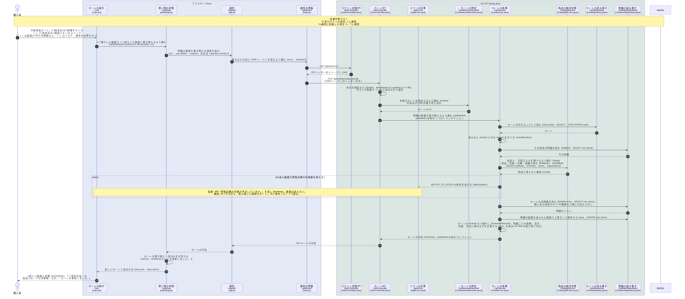
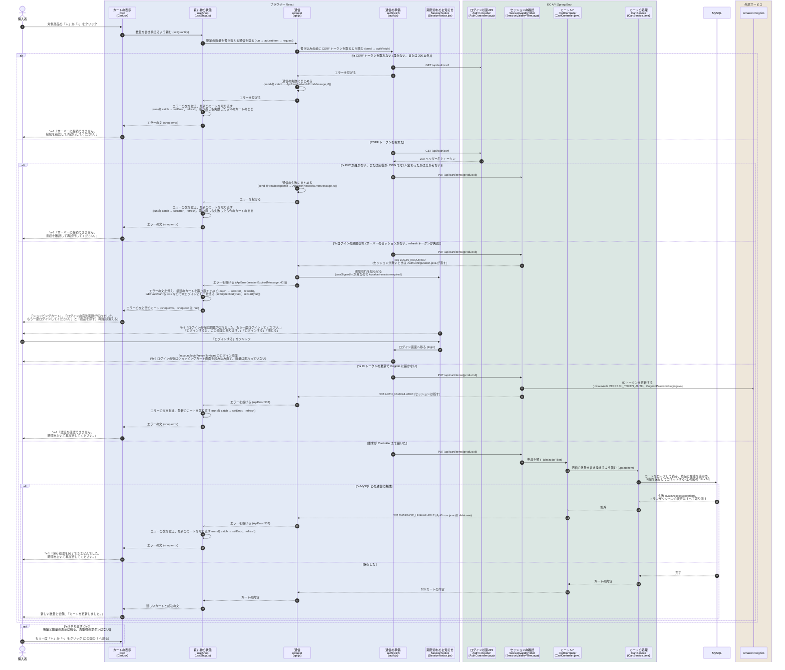

# EC-B09 カートの数量を変更する

- ユースケース記述: [EC-B09_カートの数量を変更する](<../../アーカイブ/ユースケース/kusakari-ec/EC-B09_カートの数量を変更する.md>)
- 共通代替フロー: [00_全ユースケース共通の代替フロー](<00_全ユースケース共通の代替フロー.md>)
- 対象のコード: kusakari-ec の main（6bad7e3、2026-11-24 時点）

## シーケンス図

参加者は、上から「画面や役割の名前」「コンポーネント・クラスの名前」「ファイル名（かっこ付き）」の順に書いています。
共通代替フローの中身は、00 の図か、下の「共通代替フローを直接書いた図」を見てください。
エラーは最重要の 2a（受取店舗の在庫数を超える）だけを描き、ほかの代替フローは図の下に並べています。エラーのときの画面の後処理（`readResponse` が `ApiError` を投げる → `run` の catch でエラーの文を覚える → `refreshOnFailure` なので最新のカートを取り直す（`GET /api/cart` などの流れは EC-B08 の図と同じ）→ エラーの文と最新のカートを出す）は、図に描いていないほかのエラーでも同じです。取り直しの `GET /api/cart` にも共通代替フロー \*a・\*b が起こります。

「＋」と「−」は、どちらも `useShop` の `setQuantity()` に、1 つ増やした数量か 1 つ減らした数量を渡します。サーバーは [EC-B07](<EC-B07_商品をカートに追加する.md>) と同じ `PUT /api/cart/items/{productId}`（`CartService.updateItem()`）で、送られた数量で明細を上書きします。サーバーは数量と在庫より先に `revision` を比べます（3a）。

図に描いていない代替フロー：2a（購入できない明細）、3a（別の操作でカートが更新されていた）

## 共通代替フローを直接書いた図

上の図の変更の通信（CSRF トークンの取得と `PUT /api/cart/items/{productId}`）に、この画面で起こる共通代替フロー（\*a、\*b）を書き込んだ図です。どの失敗でも `run()` は最新のカートを取り直します（`refreshOnFailure`）。その `GET /api/cart` の \*a・\*b は [EC-B08](<EC-B08_カートを確認する.md>) の「共通代替フローを直接書いた図」と同じなので、ここでは結果だけを書いています。

## ユースケース記述との差

- 2a-1 は「変更前の内容を維持する」ですが、コードはどの失敗でも `refresh()` で最新のカートを取り直して表示します。数量は保存されていないので、ほかの操作がなければ表示は変更前と同じです。
- 記述にない処理です。一時的に購入できない明細（EC-B08 の 2c）でも「＋」「−」は押せます（`disabled` は数量と在庫と `busy` だけで決まる）。押すとサーバーは 409 `PRODUCT_ARCHIVED`「この商品は販売を終了しています。カートから削除してください。」を返します。理由が一時的なもの（非表示、公開停止、閉鎖中など）でも「販売を終了しています」と出ます。
- 記述にない処理です。在庫不足の明細（EC-B08 の 2d、数量が在庫数より多い）では「＋」は押せず、「−」で 1 つ減らしても在庫数を超えている間は 409 `OUT_OF_STOCK`「受取店舗の在庫が不足しています。」になります。数量が在庫数より 2 つ以上多いと「−」では減らせず、削除（EC-B10）だけができます。
- 2a の「数量が無効」は、画面のボタンの制限（1〜99 と在庫数）で起こらないので、図に書いていません。サーバーの入力の検査（`ItemRequest` の `@Min(0)`・`@Max(99)`、違反なら 400 `INVALID_INPUT`）はあります。
- サーバーの検査の順番は記述と逆です。記述は 2（数量と在庫の検証）のあとに 3（保存）ですが、サーバーは最初に `checkRevision()` で `revision` を比べ（3a の 409 `CART_CHANGED`）、そのあとで商品と在庫を検査します（2a）。
- 3a の「保存に失敗した場合」には、共通代替フロー \*a の DB の失敗（503 `DATABASE_UNAVAILABLE`）も入ります。画面の動き（エラーの文を出して `refresh()`）は同じです。`ApiErrors.conflict()` の 409 `DATA_CHANGED` も同じ扱いになりますが、カートの行をロックしてから書くので、起こる場面は確かめていません。
- 共通代替フロー \*a で `PUT` の応答だけが届かなかった場合、サーバーでは変更が確定していることがあります。取り直しにも失敗して古いカートのままもう一度押すと、古い `revision` を送るので 409 `CART_CHANGED` になり、最新のカートを取り直します。
- \*b でログインが切れたときは、取り直しの `GET /api/cart` も 401 になり、`useShop` がカートを忘れるので、ショッピングカート画面の明細が消えてエラーの文と「商品を探す」だけになります。
- 記述にない処理です。「うち消費税」はサーバーから受け取らず、画面が `Math.floor(totalYen × 10 / 110)` で計算します。

## 参照したコード

- [frontend/src/components/Cart.jsx](https://github.com/abeouga/kusakari-ec/blob/6bad7e37c4135034fbe97e30309772fbe872e675/frontend/src/components/Cart.jsx): 「＋」「−」ボタンの `disabled` と `onClick`、「ご請求内容」、`shop.notice` と `shop.error` の表示、カートを読めないときの表示
- [frontend/src/useShop.js](https://github.com/abeouga/kusakari-ec/blob/6bad7e37c4135034fbe97e30309772fbe872e675/frontend/src/useShop.js): `setQuantity`、`run`（`refreshOnFailure`）、`refresh`
- [frontend/src/api.js](https://github.com/abeouga/kusakari-ec/blob/6bad7e37c4135034fbe97e30309772fbe872e675/frontend/src/api.js): `api.setItem`、`api.cart`、`request`、`send`、`readResponse`、`ApiError`、`networkErrorMessage`、`sessionExpiredMessage`
- [frontend/src/auth.js](https://github.com/abeouga/kusakari-ec/blob/6bad7e37c4135034fbe97e30309772fbe872e675/frontend/src/auth.js): `authFetch`（`GET /api/auth/csrf`）、`wasSignedIn`、`login`
- [frontend/src/components/SessionNotice.jsx](https://github.com/abeouga/kusakari-ec/blob/6bad7e37c4135034fbe97e30309772fbe872e675/frontend/src/components/SessionNotice.jsx): 期限切れのお知らせ
- [backend/src/main/java/jp/kusakari/ec/auth/AuthController.java](https://github.com/abeouga/kusakari-ec/blob/6bad7e37c4135034fbe97e30309772fbe872e675/backend/src/main/java/jp/kusakari/ec/auth/AuthController.java): `csrf`
- [backend/src/main/java/jp/kusakari/ec/commerce/controller/CartController.java](https://github.com/abeouga/kusakari-ec/blob/6bad7e37c4135034fbe97e30309772fbe872e675/backend/src/main/java/jp/kusakari/ec/commerce/controller/CartController.java): `updateItem`
- [backend/src/main/java/jp/kusakari/ec/commerce/dto/CommerceDtos.java](https://github.com/abeouga/kusakari-ec/blob/6bad7e37c4135034fbe97e30309772fbe872e675/backend/src/main/java/jp/kusakari/ec/commerce/dto/CommerceDtos.java): `ItemRequest`、`CartView`
- [backend/src/main/java/jp/kusakari/ec/commerce/session/CartSessionResolver.java](https://github.com/abeouga/kusakari-ec/blob/6bad7e37c4135034fbe97e30309772fbe872e675/backend/src/main/java/jp/kusakari/ec/commerce/session/CartSessionResolver.java): `resolve`
- [backend/src/main/java/jp/kusakari/ec/commerce/service/CartService.java](https://github.com/abeouga/kusakari-ec/blob/6bad7e37c4135034fbe97e30309772fbe872e675/backend/src/main/java/jp/kusakari/ec/commerce/service/CartService.java): `updateItem`、`checkRevision`、`requireLockedCart`、`view`
- [backend/src/main/java/jp/kusakari/ec/commerce/persistence/repository/CartRepository.java](https://github.com/abeouga/kusakari-ec/blob/6bad7e37c4135034fbe97e30309772fbe872e675/backend/src/main/java/jp/kusakari/ec/commerce/persistence/repository/CartRepository.java): `findLocked`
- [backend/src/main/java/jp/kusakari/ec/commerce/persistence/repository/CartItemRepository.java](https://github.com/abeouga/kusakari-ec/blob/6bad7e37c4135034fbe97e30309772fbe872e675/backend/src/main/java/jp/kusakari/ec/commerce/persistence/repository/CartItemRepository.java): `findAllForCart`、`findById`・`save`（JpaRepository）
- [backend/src/main/java/jp/kusakari/ec/catalog/service/CatalogService.java](https://github.com/abeouga/kusakari-ec/blob/6bad7e37c4135034fbe97e30309772fbe872e675/backend/src/main/java/jp/kusakari/ec/catalog/service/CatalogService.java): `listing`、`Listing.purchasable`、`unavailableReason`
- [backend/src/main/java/jp/kusakari/ec/auth/SessionValidityFilter.java](https://github.com/abeouga/kusakari-ec/blob/6bad7e37c4135034fbe97e30309772fbe872e675/backend/src/main/java/jp/kusakari/ec/auth/SessionValidityFilter.java): `doFilterInternal`（ID トークンの更新、401）
- [backend/src/main/java/jp/kusakari/ec/auth/CognitoPasswordLogin.java](https://github.com/abeouga/kusakari-ec/blob/6bad7e37c4135034fbe97e30309772fbe872e675/backend/src/main/java/jp/kusakari/ec/auth/CognitoPasswordLogin.java): ID トークンの更新、503 `AUTH_UNAVAILABLE`
- [backend/src/main/java/jp/kusakari/ec/auth/AuthConfiguration.java](https://github.com/abeouga/kusakari-ec/blob/6bad7e37c4135034fbe97e30309772fbe872e675/backend/src/main/java/jp/kusakari/ec/auth/AuthConfiguration.java): `authenticationEntryPoint`（401 `LOGIN_REQUIRED`）
- [backend/src/main/java/jp/kusakari/ec/common/web/ApiErrors.java](https://github.com/abeouga/kusakari-ec/blob/6bad7e37c4135034fbe97e30309772fbe872e675/backend/src/main/java/jp/kusakari/ec/common/web/ApiErrors.java): `business`、`invalid`、`conflict`、`database`
