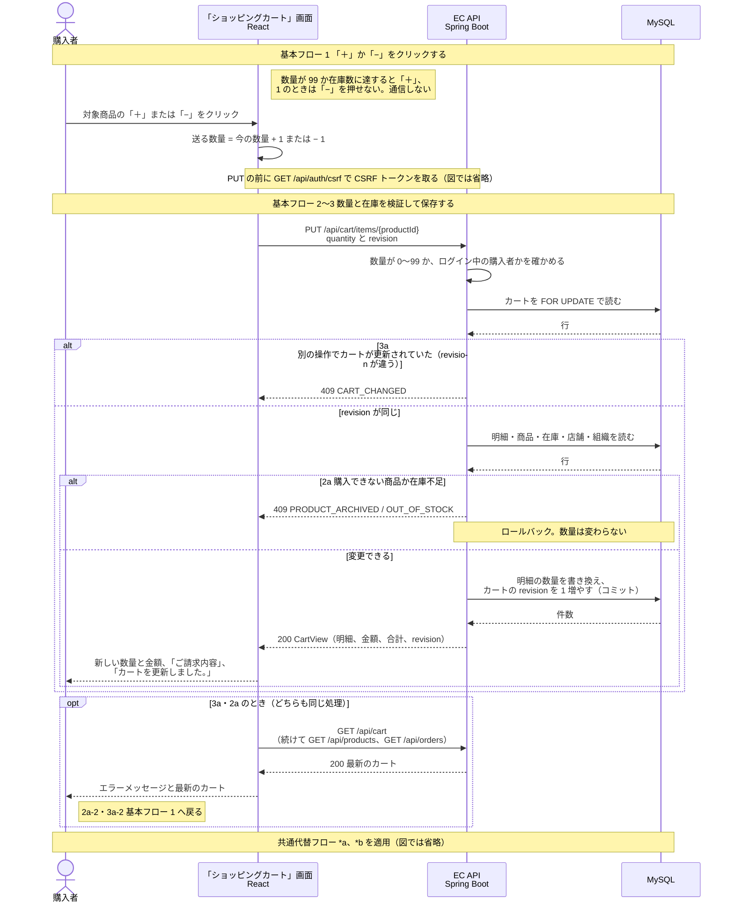
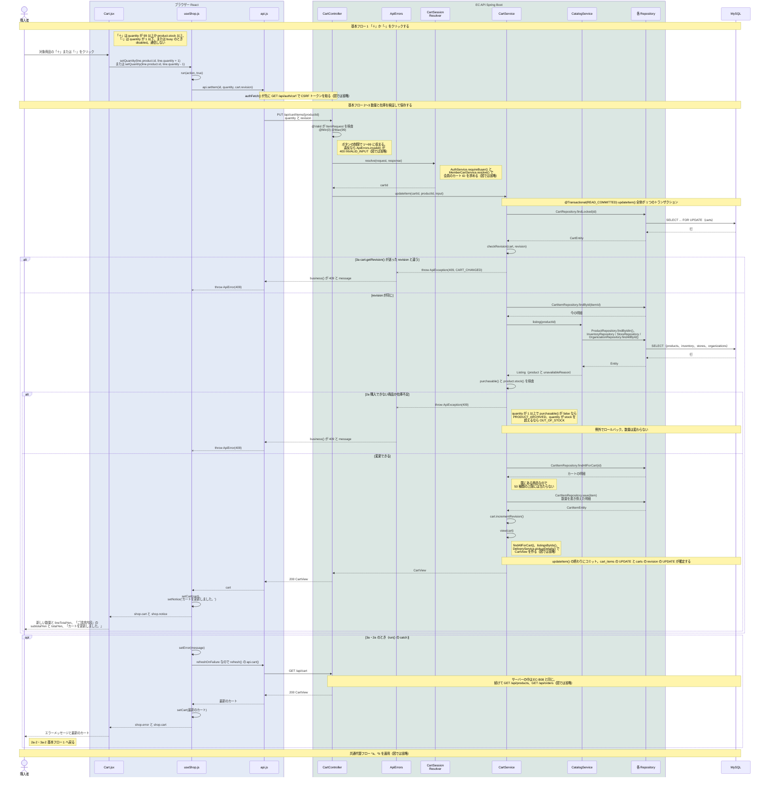

# EC-B09 カートの数量を変更する

- ユースケース記述: [EC-B09_カートの数量を変更する](<../../アーカイブ/ユースケース/kusakari-ec/EC-B09_カートの数量を変更する.md>)
- 対象のコード: kusakari-ec の main（19a2be3、2026-11-20 時点）

「＋」と「−」は、どちらも `useShop` の `setQuantity()` に 1 つ増やした数量か 1 つ減らした数量を渡します。サーバーは EC-B07 と同じ `PUT /api/cart/items/{productId}`（`CartService.updateItem()`）で、送られた数量で明細を上書きします。サーバーは数量と在庫より先に `revision` を比べるので、図では 3a の枝が 2a の枝より先に出ます。

## 概要図

## 詳細図

## ユースケース記述との差

- 2a-1 は「変更前の内容を維持する」ですが、コードはどの失敗でも `refresh()` で最新のカートを取り直して表示します。数量は保存されていないので、ほかの操作がなければ表示は変更前と同じです。
- 記述にない処理です。一時的に購入できない明細（EC-B08 の 2c）でも「＋」「−」は押せます（`disabled` は数量と在庫と `busy` だけで決まる）。押すとサーバーは 409 `PRODUCT_ARCHIVED`「この商品は販売を終了しています。カートから削除してください。」を返します。理由が一時的なもの（非表示、公開停止、閉鎖中など）でも「販売を終了しています」と出ます。
- 記述にない処理です。在庫不足の明細（EC-B08 の 2d、数量が在庫数より多い）では「＋」は押せず、「−」で 1 つ減らしても在庫数を超えている間は 409 `OUT_OF_STOCK`「受取店舗の在庫が不足しています。」になります。数量が在庫数より 2 つ以上多いと「−」では減らせず、削除（EC-B10）だけができます。
- サーバーの検査の順番は記述と逆です。記述は 2（数量と在庫の検証）のあとに 3（保存）ですが、サーバーは最初に `checkRevision()` で `revision` を比べ（3a の 409 `CART_CHANGED`）、そのあとで商品と在庫を検査します（2a）。
- 3a の「保存に失敗した場合」には、`ApiErrors` が返す DB の失敗（503 `DATABASE_UNAVAILABLE`、409 `DATA_CHANGED`）も入ります。画面の動き（エラーを出して `refresh()`）は同じです。
- 記述にない処理です。「うち消費税」はサーバーから受け取らず、画面が `Math.floor(totalYen × 10 / 110)` で計算します。

## 参照したコード

- [frontend/src/components/Cart.jsx](https://github.com/abeouga/kusakari-ec/blob/19a2be307ee71a2cd87e538236c3c8c42929c5b3/frontend/src/components/Cart.jsx): 「＋」「−」ボタンの `disabled` と `onClick`、「ご請求内容」、`shop.notice` と `shop.error` の表示
- [frontend/src/useShop.js](https://github.com/abeouga/kusakari-ec/blob/19a2be307ee71a2cd87e538236c3c8c42929c5b3/frontend/src/useShop.js): `setQuantity()`、`run()`（`refreshOnFailure`）、`refresh()`
- [frontend/src/api.js](https://github.com/abeouga/kusakari-ec/blob/19a2be307ee71a2cd87e538236c3c8c42929c5b3/frontend/src/api.js): `api.setItem()`、`api.cart()`、`request()`、`readResponse()`
- [frontend/src/auth.js](https://github.com/abeouga/kusakari-ec/blob/19a2be307ee71a2cd87e538236c3c8c42929c5b3/frontend/src/auth.js): `authFetch()`（CSRF トークン）
- [backend/src/main/java/jp/kusakari/ec/commerce/controller/CartController.java](https://github.com/abeouga/kusakari-ec/blob/19a2be307ee71a2cd87e538236c3c8c42929c5b3/backend/src/main/java/jp/kusakari/ec/commerce/controller/CartController.java): `updateItem()`
- [backend/src/main/java/jp/kusakari/ec/commerce/dto/CommerceDtos.java](https://github.com/abeouga/kusakari-ec/blob/19a2be307ee71a2cd87e538236c3c8c42929c5b3/backend/src/main/java/jp/kusakari/ec/commerce/dto/CommerceDtos.java): `ItemRequest`、`CartView`
- [backend/src/main/java/jp/kusakari/ec/commerce/session/CartSessionResolver.java](https://github.com/abeouga/kusakari-ec/blob/19a2be307ee71a2cd87e538236c3c8c42929c5b3/backend/src/main/java/jp/kusakari/ec/commerce/session/CartSessionResolver.java): `resolve()`
- [backend/src/main/java/jp/kusakari/ec/commerce/service/CartService.java](https://github.com/abeouga/kusakari-ec/blob/19a2be307ee71a2cd87e538236c3c8c42929c5b3/backend/src/main/java/jp/kusakari/ec/commerce/service/CartService.java): `updateItem()`、`checkRevision()`、`requireLockedCart()`、`view()`
- [backend/src/main/java/jp/kusakari/ec/commerce/persistence/repository/CartRepository.java](https://github.com/abeouga/kusakari-ec/blob/19a2be307ee71a2cd87e538236c3c8c42929c5b3/backend/src/main/java/jp/kusakari/ec/commerce/persistence/repository/CartRepository.java): `findLocked()`
- [backend/src/main/java/jp/kusakari/ec/commerce/persistence/repository/CartItemRepository.java](https://github.com/abeouga/kusakari-ec/blob/19a2be307ee71a2cd87e538236c3c8c42929c5b3/backend/src/main/java/jp/kusakari/ec/commerce/persistence/repository/CartItemRepository.java): `findAllForCart()`
- [backend/src/main/java/jp/kusakari/ec/catalog/service/CatalogService.java](https://github.com/abeouga/kusakari-ec/blob/19a2be307ee71a2cd87e538236c3c8c42929c5b3/backend/src/main/java/jp/kusakari/ec/catalog/service/CatalogService.java): `listing()`、`Listing.purchasable()`、`unavailableReason()`
- [backend/src/main/java/jp/kusakari/ec/common/web/ApiErrors.java](https://github.com/abeouga/kusakari-ec/blob/19a2be307ee71a2cd87e538236c3c8c42929c5b3/backend/src/main/java/jp/kusakari/ec/common/web/ApiErrors.java): `business()`、`invalid()`、`conflict()`、`database()`
