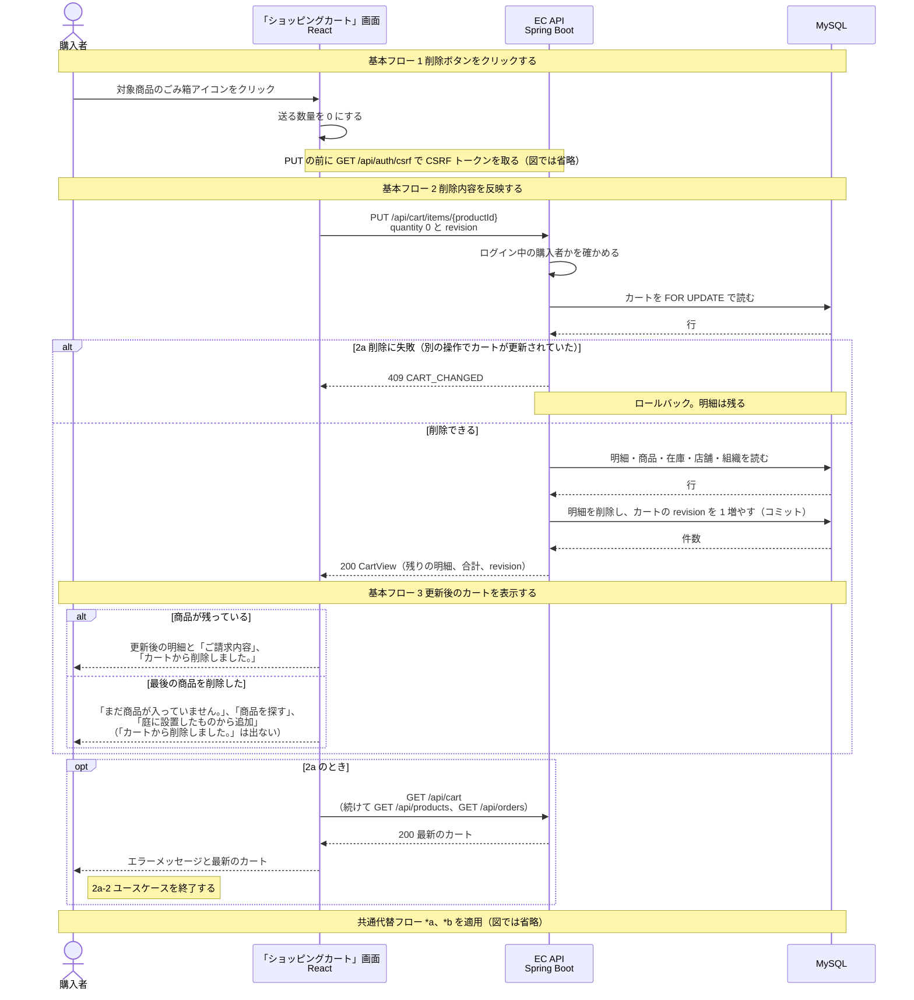
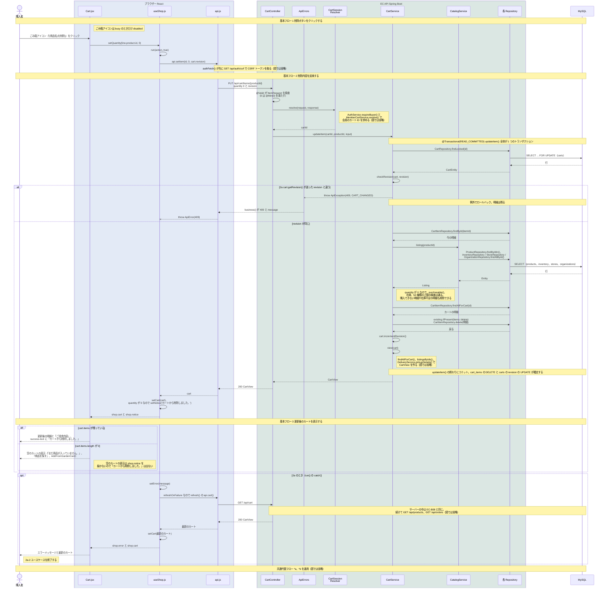

# EC-B10 カートから商品を削除する

- ユースケース記述: [EC-B10_カートから商品を削除する](<../../アーカイブ/ユースケース/kusakari-ec/EC-B10_カートから商品を削除する.md>)
- 対象のコード: kusakari-ec の main（19a2be3、2026-11-20 時点）

削除のための API はありません。ごみ箱アイコンは `useShop` の `setQuantity()` に数量 0 を渡し、EC-B07・EC-B09 と同じ `PUT /api/cart/items/{productId}`（`CartService.updateItem()`）を送ります。サーバーは数量が 0 のとき、購入できるか・在庫・種類数の検査をせずに明細を削除します。削除の前に確認のダイアログは出ません。

## 概要図

## 詳細図

## ユースケース記述との差

- 基本フロー 3 の「カートから削除しました。」は、最後の 1 件を削除してカートが空になったときには出ません。`useShop` は `setNotice('カートから削除しました。')` を呼びますが、`Cart.jsx` の空のカートの表示は `shop.notice` を描きません。
- 記述にない処理です。削除は数量 0 の `PUT /api/cart/items/{productId}` です。数量が 0 のときサーバーは購入できるかと在庫を検査しないので、一時的に購入できない明細（EC-B08 の 2c）や在庫不足の明細（EC-B08 の 2d）も削除できます。
- 2a の「削除エラー」は、サーバーが返したメッセージです。たとえば `revision` が違うと「別の操作でカートが更新されました。最新の内容を確認してください。」（409 `CART_CHANGED`）、DB の失敗では `ApiErrors.database()` の「保存処理を完了できませんでした。時間をおいて再試行してください。」（503 `DATABASE_UNAVAILABLE`）です。

## 参照したコード

- [frontend/src/components/Cart.jsx](https://github.com/abeouga/kusakari-ec/blob/19a2be307ee71a2cd87e538236c3c8c42929c5b3/frontend/src/components/Cart.jsx): ごみ箱アイコンの `onClick` と `disabled`、空のカートの表示、`shop.notice` の表示
- [frontend/src/useShop.js](https://github.com/abeouga/kusakari-ec/blob/19a2be307ee71a2cd87e538236c3c8c42929c5b3/frontend/src/useShop.js): `setQuantity()`、`run()`（`refreshOnFailure`）、`refresh()`
- [frontend/src/api.js](https://github.com/abeouga/kusakari-ec/blob/19a2be307ee71a2cd87e538236c3c8c42929c5b3/frontend/src/api.js): `api.setItem()`、`api.cart()`、`request()`、`readResponse()`
- [frontend/src/auth.js](https://github.com/abeouga/kusakari-ec/blob/19a2be307ee71a2cd87e538236c3c8c42929c5b3/frontend/src/auth.js): `authFetch()`（CSRF トークン）
- [backend/src/main/java/jp/kusakari/ec/commerce/controller/CartController.java](https://github.com/abeouga/kusakari-ec/blob/19a2be307ee71a2cd87e538236c3c8c42929c5b3/backend/src/main/java/jp/kusakari/ec/commerce/controller/CartController.java): `updateItem()`
- [backend/src/main/java/jp/kusakari/ec/commerce/dto/CommerceDtos.java](https://github.com/abeouga/kusakari-ec/blob/19a2be307ee71a2cd87e538236c3c8c42929c5b3/backend/src/main/java/jp/kusakari/ec/commerce/dto/CommerceDtos.java): `ItemRequest`、`CartView`
- [backend/src/main/java/jp/kusakari/ec/commerce/session/CartSessionResolver.java](https://github.com/abeouga/kusakari-ec/blob/19a2be307ee71a2cd87e538236c3c8c42929c5b3/backend/src/main/java/jp/kusakari/ec/commerce/session/CartSessionResolver.java): `resolve()`
- [backend/src/main/java/jp/kusakari/ec/commerce/service/CartService.java](https://github.com/abeouga/kusakari-ec/blob/19a2be307ee71a2cd87e538236c3c8c42929c5b3/backend/src/main/java/jp/kusakari/ec/commerce/service/CartService.java): `updateItem()`（`quantity` が 0 の分岐）、`checkRevision()`、`requireLockedCart()`、`view()`
- [backend/src/main/java/jp/kusakari/ec/commerce/persistence/repository/CartRepository.java](https://github.com/abeouga/kusakari-ec/blob/19a2be307ee71a2cd87e538236c3c8c42929c5b3/backend/src/main/java/jp/kusakari/ec/commerce/persistence/repository/CartRepository.java): `findLocked()`
- [backend/src/main/java/jp/kusakari/ec/commerce/persistence/repository/CartItemRepository.java](https://github.com/abeouga/kusakari-ec/blob/19a2be307ee71a2cd87e538236c3c8c42929c5b3/backend/src/main/java/jp/kusakari/ec/commerce/persistence/repository/CartItemRepository.java): `findAllForCart()`
- [backend/src/main/java/jp/kusakari/ec/catalog/service/CatalogService.java](https://github.com/abeouga/kusakari-ec/blob/19a2be307ee71a2cd87e538236c3c8c42929c5b3/backend/src/main/java/jp/kusakari/ec/catalog/service/CatalogService.java): `listing()`
- [backend/src/main/java/jp/kusakari/ec/common/web/ApiErrors.java](https://github.com/abeouga/kusakari-ec/blob/19a2be307ee71a2cd87e538236c3c8c42929c5b3/backend/src/main/java/jp/kusakari/ec/common/web/ApiErrors.java): `business()`、`database()`
