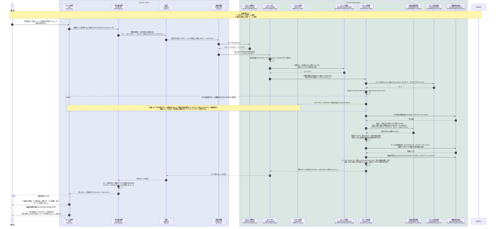
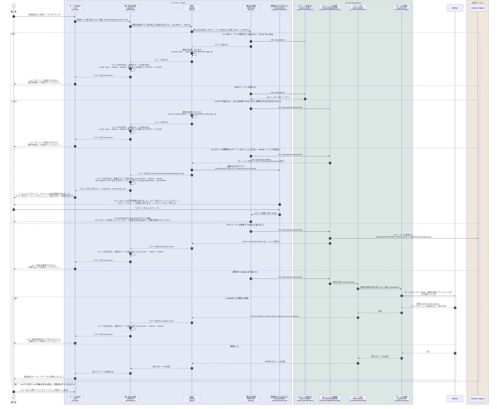

# EC-B10 カートから商品を削除する

- ユースケース記述: [EC-B10_カートから商品を削除する](<../../アーカイブ/ユースケース/kusakari-ec/EC-B10_カートから商品を削除する.md>)
- 共通代替フロー: [00_全ユースケース共通の代替フロー](<00_全ユースケース共通の代替フロー.md>)
- 対象のコード: kusakari-ec の main（6bad7e3、2026-11-24 時点）

## シーケンス図

参加者は、上から「画面や役割の名前」「コンポーネント・クラスの名前」「ファイル名（かっこ付き）」の順に書いています。
共通代替フローの中身は、00 の図か、下の「共通代替フローを直接書いた図」を見てください。
代替フロー 2a はエラーで終わるので、分かれる所だけを描き、結果と画面は Note に文で書いています。エラーのときの画面の後処理（`readResponse` が `ApiError` を投げる → `run` の catch でエラーの文を覚える → `refreshOnFailure` なので最新のカートを取り直す（`GET /api/cart` などの流れは EC-B08 の図と同じ）→ エラーの文と最新のカートを出す）は、共通代替フローの失敗でも同じです。取り直しの `GET /api/cart` にも共通代替フロー \*a・\*b が起こります。

削除のための API はありません。ごみ箱アイコンは `useShop` の `setQuantity()` に数量 0 を渡し、[EC-B07](<EC-B07_商品をカートに追加する.md>)・[EC-B09](<EC-B09_カートの数量を変更する.md>) と同じ `PUT /api/cart/items/{productId}`（`CartService.updateItem()`）を送ります。サーバーは数量が 0 のとき、購入できるか・在庫・種類数の検査を通して明細を削除します。削除の前に確認のダイアログは出ません。

## 共通代替フローを直接書いた図

上の図の削除の通信（CSRF トークンの取得と `PUT /api/cart/items/{productId}`）に、この画面で起こる共通代替フロー（\*a、\*b）を書き込んだ図です。どの失敗でも `run()` は最新のカートを取り直します（`refreshOnFailure`）。その `GET /api/cart` の \*a・\*b は [EC-B08](<EC-B08_カートを確認する.md>) の「共通代替フローを直接書いた図」と同じなので、ここでは結果だけを書いています。

## ユースケース記述との差

- 基本フロー 3 の「カートから削除しました。」は、最後の 1 件を削除してカートが空になったときには出ません。`useShop` は `setNotice('カートから削除しました。')` を呼びますが、`Cart.jsx` の空のカートの表示は `shop.notice` を描きません。
- 記述にない処理です。削除は数量 0 の `PUT /api/cart/items/{productId}` です。数量が 0 のときサーバーは購入できるかと在庫を検査しないので、一時的に購入できない明細（EC-B08 の 2c）や在庫不足の明細（EC-B08 の 2d）も削除できます。
- 2a の「削除エラー」は、サーバーが返した文です。画面から起こるのは、`revision` が違うときの「別の操作でカートが更新されました。最新の内容を確認してください。」（409 `CART_CHANGED`）と、共通代替フロー \*a の DB の失敗の「保存処理を完了できませんでした。時間をおいて再試行してください。」（503 `DATABASE_UNAVAILABLE`）です。どちらも、エラーの文を出して最新のカートを取り直します。
- `CatalogService.listing()` は商品の行がないと 404 `PRODUCT_NOT_FOUND` を返しますが、商品の行は消さない（論理削除だけ）ので、カートの明細の削除では起こりません。図に書いていません。
- 共通代替フロー \*a で `PUT` の応答だけが届かなかった場合、サーバーでは削除が確定していることがあります。取り直しにも失敗して古いカートのままもう一度押すと、古い `revision` を送るので 409 `CART_CHANGED` になり、最新のカートを取り直します。
- \*b でログインが切れたときは、取り直しの `GET /api/cart` も 401 になり、`useShop` がカートを忘れるので、ショッピングカート画面の明細が消えてエラーの文と「商品を探す」だけになります。

## 参照したコード

- [frontend/src/components/Cart.jsx](https://github.com/abeouga/kusakari-ec/blob/6bad7e37c4135034fbe97e30309772fbe872e675/frontend/src/components/Cart.jsx): ごみ箱アイコンの `onClick` と `disabled`、空のカートの表示、`shop.notice` と `shop.error` の表示、カートを読めないときの表示
- [frontend/src/useShop.js](https://github.com/abeouga/kusakari-ec/blob/6bad7e37c4135034fbe97e30309772fbe872e675/frontend/src/useShop.js): `setQuantity`、`run`（`refreshOnFailure`）、`refresh`
- [frontend/src/api.js](https://github.com/abeouga/kusakari-ec/blob/6bad7e37c4135034fbe97e30309772fbe872e675/frontend/src/api.js): `api.setItem`、`api.cart`、`request`、`send`、`readResponse`、`ApiError`、`networkErrorMessage`、`sessionExpiredMessage`
- [frontend/src/auth.js](https://github.com/abeouga/kusakari-ec/blob/6bad7e37c4135034fbe97e30309772fbe872e675/frontend/src/auth.js): `authFetch`（`GET /api/auth/csrf`）、`wasSignedIn`、`login`
- [frontend/src/components/SessionNotice.jsx](https://github.com/abeouga/kusakari-ec/blob/6bad7e37c4135034fbe97e30309772fbe872e675/frontend/src/components/SessionNotice.jsx): 期限切れのお知らせ
- [backend/src/main/java/jp/kusakari/ec/auth/AuthController.java](https://github.com/abeouga/kusakari-ec/blob/6bad7e37c4135034fbe97e30309772fbe872e675/backend/src/main/java/jp/kusakari/ec/auth/AuthController.java): `csrf`
- [backend/src/main/java/jp/kusakari/ec/commerce/controller/CartController.java](https://github.com/abeouga/kusakari-ec/blob/6bad7e37c4135034fbe97e30309772fbe872e675/backend/src/main/java/jp/kusakari/ec/commerce/controller/CartController.java): `updateItem`
- [backend/src/main/java/jp/kusakari/ec/commerce/dto/CommerceDtos.java](https://github.com/abeouga/kusakari-ec/blob/6bad7e37c4135034fbe97e30309772fbe872e675/backend/src/main/java/jp/kusakari/ec/commerce/dto/CommerceDtos.java): `ItemRequest`、`CartView`
- [backend/src/main/java/jp/kusakari/ec/commerce/session/CartSessionResolver.java](https://github.com/abeouga/kusakari-ec/blob/6bad7e37c4135034fbe97e30309772fbe872e675/backend/src/main/java/jp/kusakari/ec/commerce/session/CartSessionResolver.java): `resolve`
- [backend/src/main/java/jp/kusakari/ec/commerce/service/CartService.java](https://github.com/abeouga/kusakari-ec/blob/6bad7e37c4135034fbe97e30309772fbe872e675/backend/src/main/java/jp/kusakari/ec/commerce/service/CartService.java): `updateItem`（`quantity` が 0 の分岐）、`checkRevision`、`requireLockedCart`、`view`
- [backend/src/main/java/jp/kusakari/ec/commerce/persistence/repository/CartRepository.java](https://github.com/abeouga/kusakari-ec/blob/6bad7e37c4135034fbe97e30309772fbe872e675/backend/src/main/java/jp/kusakari/ec/commerce/persistence/repository/CartRepository.java): `findLocked`
- [backend/src/main/java/jp/kusakari/ec/commerce/persistence/repository/CartItemRepository.java](https://github.com/abeouga/kusakari-ec/blob/6bad7e37c4135034fbe97e30309772fbe872e675/backend/src/main/java/jp/kusakari/ec/commerce/persistence/repository/CartItemRepository.java): `findAllForCart`、`findById`・`delete`（JpaRepository）
- [backend/src/main/java/jp/kusakari/ec/catalog/service/CatalogService.java](https://github.com/abeouga/kusakari-ec/blob/6bad7e37c4135034fbe97e30309772fbe872e675/backend/src/main/java/jp/kusakari/ec/catalog/service/CatalogService.java): `listing`
- [backend/src/main/java/jp/kusakari/ec/auth/SessionValidityFilter.java](https://github.com/abeouga/kusakari-ec/blob/6bad7e37c4135034fbe97e30309772fbe872e675/backend/src/main/java/jp/kusakari/ec/auth/SessionValidityFilter.java): `doFilterInternal`（ID トークンの更新、401）
- [backend/src/main/java/jp/kusakari/ec/auth/CognitoPasswordLogin.java](https://github.com/abeouga/kusakari-ec/blob/6bad7e37c4135034fbe97e30309772fbe872e675/backend/src/main/java/jp/kusakari/ec/auth/CognitoPasswordLogin.java): ID トークンの更新、503 `AUTH_UNAVAILABLE`
- [backend/src/main/java/jp/kusakari/ec/auth/AuthConfiguration.java](https://github.com/abeouga/kusakari-ec/blob/6bad7e37c4135034fbe97e30309772fbe872e675/backend/src/main/java/jp/kusakari/ec/auth/AuthConfiguration.java): `authenticationEntryPoint`（401 `LOGIN_REQUIRED`）
- [backend/src/main/java/jp/kusakari/ec/common/web/ApiErrors.java](https://github.com/abeouga/kusakari-ec/blob/6bad7e37c4135034fbe97e30309772fbe872e675/backend/src/main/java/jp/kusakari/ec/common/web/ApiErrors.java): `business`、`database`
