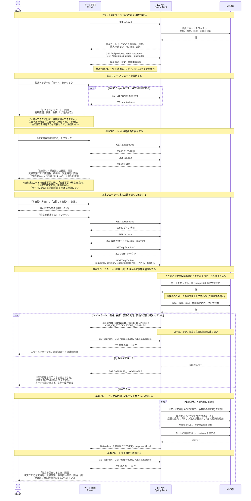
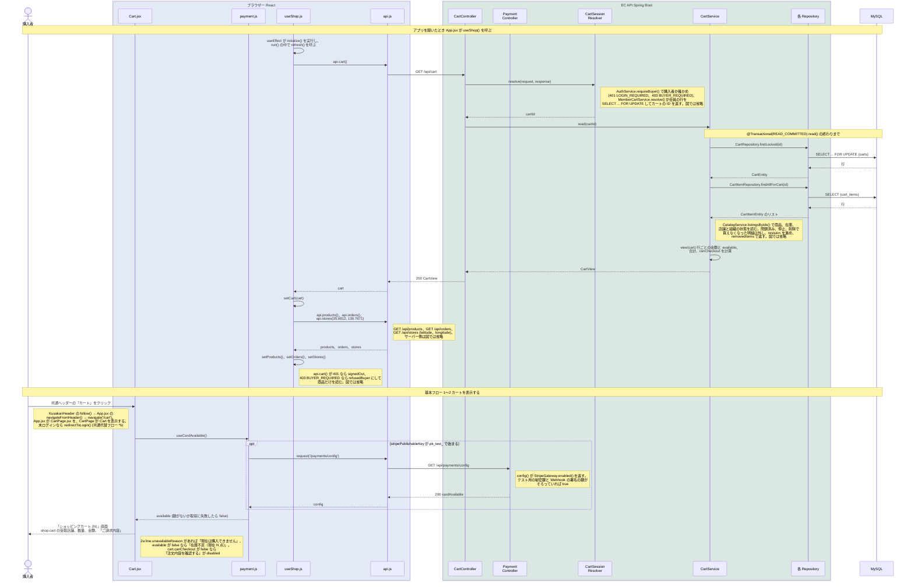
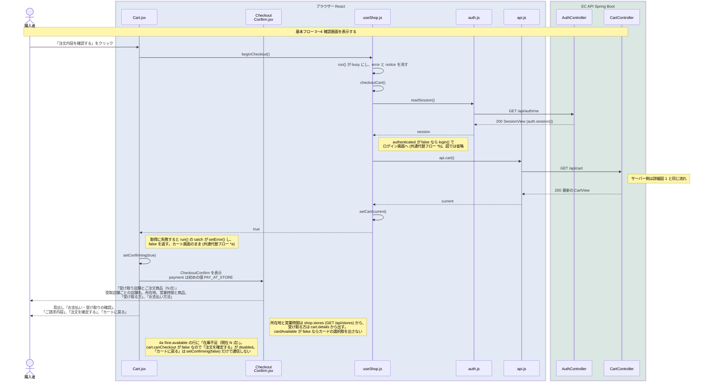
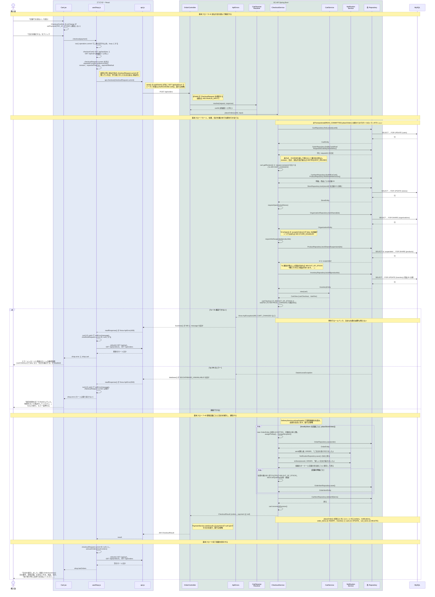
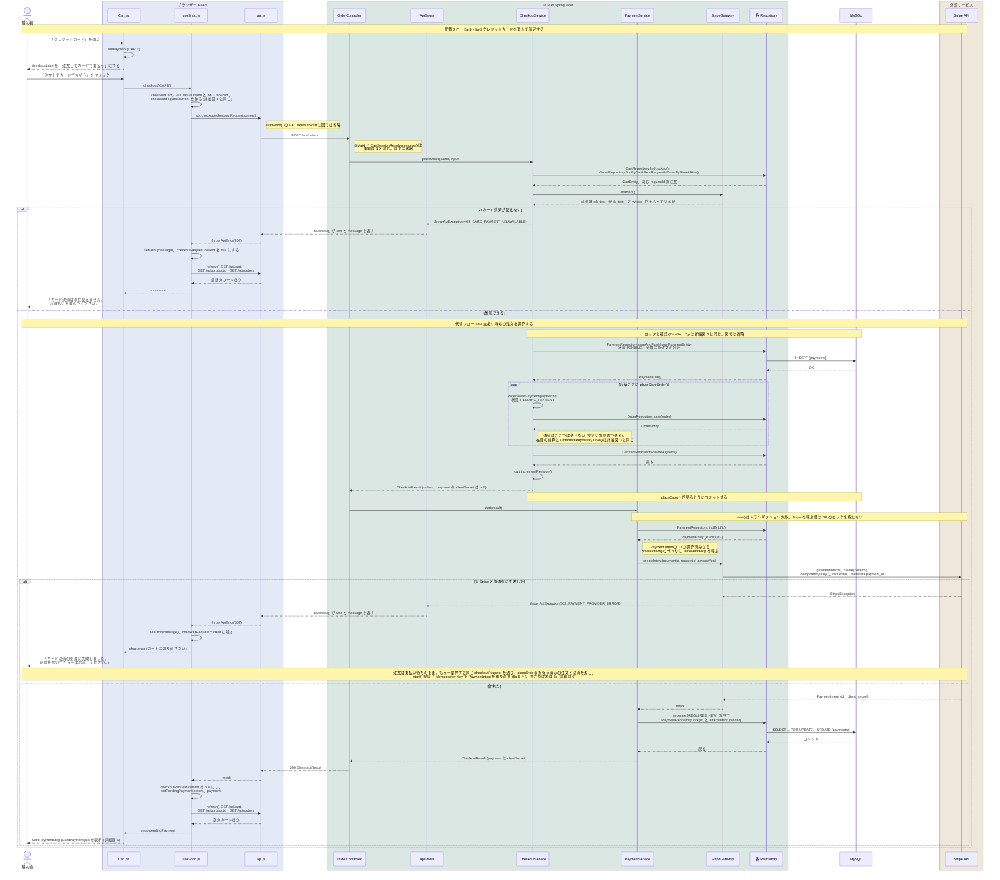
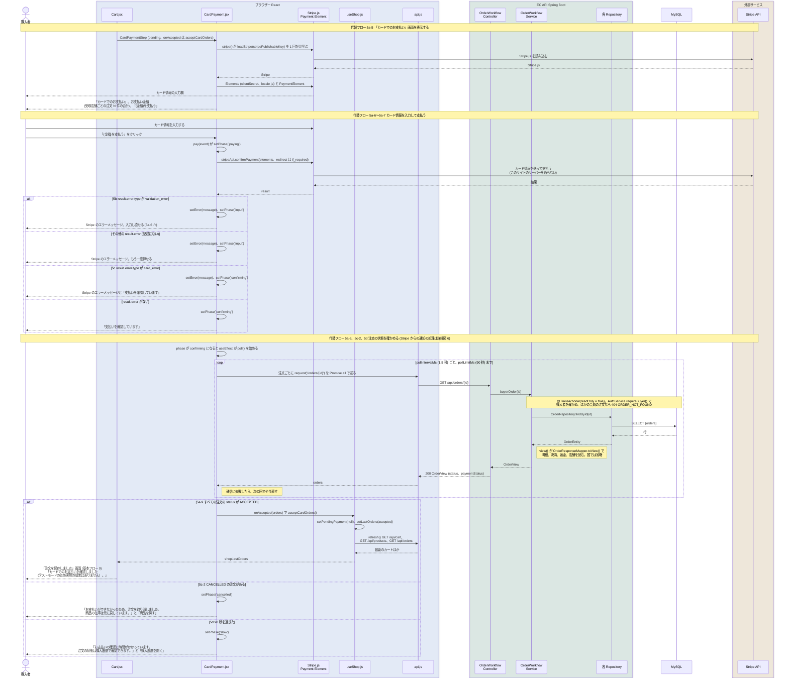
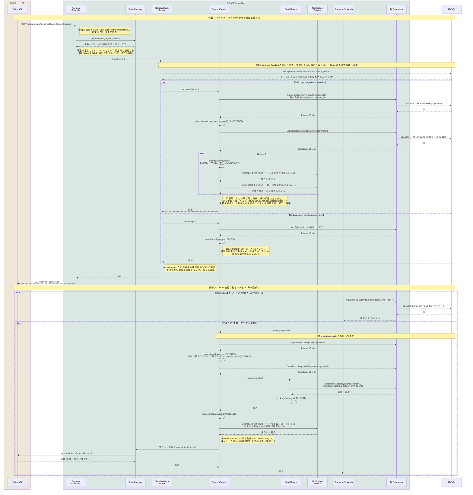

# EC-B12 商品を購入する

- ユースケース記述: [EC-B12_商品を購入する](<../../アーカイブ/ユースケース/kusakari-ec/EC-B12_商品を購入する.md>)
- 対象のコード: kusakari-ec の main（19a2be3、2026-11-20 時点）

支払方法で流れが大きく分かれるので、図を分けています。

- 概要図 1、詳細図 1〜3: 基本フロー（店舗でお支払い）と、代替フロー 2a、4a、7a〜7e、7g
- 概要図 2、詳細図 4〜6: 代替フロー 5a〜5f、7f（クレジットカード）

## 概要図

### 概要図 1 基本フロー 1〜9（店舗でお支払い）

### 概要図 2 代替フロー 5a〜5f、7f（クレジットカード）

```mermaid
sequenceDiagram
    actor User as 購入者
    participant Page as カート画面<br/>React
    participant Api as EC API<br/>Spring Boot
    participant Db as MySQL
    box rgba(180,120,20,0.12) 外部サービス
        participant Stripe as Stripe
    end

    Note over User,Stripe: 代替フロー 5a-1〜5a-3 クレジットカードを選んで確定する
    User->>Page: 「お支払い方法」で「クレジットカード」を選ぶ
    Page-->>User: ボタンの表示を「注文してカードで支払う」に変える (通信しない)
    User->>Page: 「注文してカードで支払う」をクリック
    Page->>Api: GET /api/auth/me、GET /api/cart、GET /api/auth/csrf
    Api-->>Page: 200 ログイン状態、最新のカート、CSRF トークン
    Page->>Api: POST /api/orders<br/>requestId、revision、expectedTotalYen、CARD
    Api->>Db: カートをロックし、同じ requestId の注文を探す
    Db-->>Api: 行
    alt 7f カード決済が使えない (サーバーに Stripe の鍵がそろっていない)
        Api-->>Page: 409 CARD_PAYMENT_UNAVAILABLE
        Page->>Api: GET /api/cart、GET /api/products、GET /api/orders
        Api-->>Page: 200 最新のカートほか
        Page-->>User: 「カード決済は現在使えません。店頭払いを選んでください。」
    else 確定できる
        Note over User,Stripe: 代替フロー 5a-4 支払い待ちの注文を保存する (7a〜7e、7g は概要図 1 と同じ)
        Api->>Db: 店舗、組織、商品、在庫の順にロックして確かめる
        Api->>Db: 決済 (PENDING、全注文の合計) を追加
        loop 受取店舗ごと
            Api->>Db: 注文 (支払い待ち PENDING_PAYMENT) を追加し、<br/>在庫を減らし、明細を追加
        end
        Api->>Db: カートの明細を消し、revision を進める
        Db-->>Api: コミット (通知はまだ送らない)
        Api->>Stripe: PaymentIntent を作る<br/>金額は全注文の合計、Idempotency-Key は requestId
        alt 5f Stripe との通信に失敗した
            Stripe-->>Api: エラー
            Api-->>Page: 502 PAYMENT_PROVIDER_ERROR
            Page-->>User: 「カード決済の処理に失敗しました。<br/>時間をおいてもう一度お試しください。」
            Note over User,Stripe: 注文は支払い待ちのまま。もう一度押すと同じ requestId を送り、<br/>保存済みの注文で PaymentIntent を作り直す (5a-5 へ)。押さなければ 30 分後に 5e
        else 作れた
            Stripe-->>Api: PaymentIntent の ID と client_secret
            Api->>Db: 決済に PaymentIntent の ID を記録 (別のトランザクション)
            Db-->>Api: コミット
            Api-->>Page: 200 orders (支払い待ち)、payment (clientSecret、amountYen)
            Page->>Api: GET /api/cart、GET /api/products、GET /api/orders
            Api-->>Page: 200 空のカートほか
        end
    end

    Note over User,Stripe: 代替フロー 5a-5〜5a-7 カード情報を Stripe へ送る
    Page->>Stripe: Stripe.js を読み込み、client_secret で入力欄を作る
    Stripe-->>Page: カード情報の入力欄
    Page-->>User: 「カードでのお支払い」画面<br/>お支払い金額 (受取店舗ごとの注文 N 件の合計)、<br/>カード情報の入力欄、「(金額)を支払う」
    User->>Page: カード情報を入力し、「(金額)を支払う」をクリック
    Page->>Stripe: confirmPayment<br/>カード情報はこのサイトのサーバーを通らない
    alt 5b 入力に不備がある (validation_error)
        Stripe-->>Page: error
        Page-->>User: Stripe のエラーメッセージ。入力欄に戻る (5a-6 へ)
    else その他のエラー (記述にない)
        Stripe-->>Page: error
        Page-->>User: Stripe のエラーメッセージ。もう一度押せる
    else 5c カードが断られた (card_error)
        Stripe-->>Page: error
        Page-->>User: Stripe のエラーメッセージと「支払いを確認しています」
    else 支払いを受け付けた
        Stripe-->>Page: error なし
        Page-->>User: 「支払いを確認しています」
    end

    Note over User,Stripe: 代替フロー 5a-8、5c-1 Stripe からの通知 (画面の確認と並行して届く)
    Stripe->>Api: POST /api/payments/stripe/webhook
    Api->>Api: 署名を確かめる
    Api->>Db: 通知の ID を記録 (同じ通知の 2 回目は何もしない)
    Db-->>Api: 記録できた行の数
    alt 5a-8 payment_intent.succeeded
        Api->>Db: 決済と注文をロックし、決済を SUCCEEDED、<br/>注文を注文受付 ACCEPTED にする
        Api->>Db: 購入者と店舗の会員への通知を追加 (基本フロー 8)
        Db-->>Api: コミット
    else 5c-1 payment_intent.payment_failed
        Api->>Db: 決済と注文をロックし、決済を FAILED、<br/>注文を CANCELLED にし、在庫を戻す
        Api->>Db: 購入者に「ご注文を取り消しました」の通知を追加
        Db-->>Api: コミット
        Api->>Stripe: コミットの後に PaymentIntent を取り消す
        Stripe-->>Api: 結果 (失敗はログに残すだけ)
    end
    Api-->>Stripe: 200 received、processed

    Note over User,Stripe: 代替フロー 5a-9、5c-2、5d 画面が注文の状態を確かめる
    loop 1.5 秒ごと、最大 90 秒、注文ごとに
        Page->>Api: GET /api/orders/{id}
        Api->>Db: 注文、明細、決済、返金、店舗を読む
        Db-->>Api: 行
        Api-->>Page: 200 注文 (status)
    end
    alt 5a-9 すべての注文が ACCEPTED
        Page->>Api: GET /api/cart、GET /api/products、GET /api/orders
        Api-->>Page: 200 空のカートほか
        Page-->>User: 「注文を保存しました」画面 (基本フロー 9)<br/>「カードでのお支払いを確認しました<br/>（テストモードのため実際の請求はありません）。」
    else 5c-2 CANCELLED の注文がある
        Page-->>User: 「お支払いができなかったため、注文を取り消しました。<br/>商品の在庫は元に戻しています。」と「商品を探す」
    else 5d 90 秒たっても決まらない
        Page-->>User: 「お支払いの確認に時間がかかっています。<br/>注文の状態は購入履歴で確認できます。」と「購入履歴を開く」
    end

    Note over User,Stripe: 代替フロー 5e 支払い待ちのまま 30 分が過ぎた (画面の操作とは別に動く)
    loop 1 分ごと
        Api->>Db: 作ってから 30 分を過ぎた支払い待ちの決済を探す
        Db-->>Api: 決済の ID
        loop 決済ごと (1 件ずつ別のトランザクション)
            Api->>Db: 決済を EXPIRED、注文を CANCELLED にし、在庫を戻す
            Api->>Db: 購入者に「ご注文を取り消しました」の通知を追加
            Db-->>Api: コミット
            Api->>Stripe: PaymentIntent を取り消す
            Stripe-->>Api: 結果 (失敗はログに残すだけ)
        end
    end
```

## 詳細図

### 詳細図 1 アプリを開いたとき、基本フロー 1〜2

### 詳細図 2 基本フロー 3〜4

### 詳細図 3 基本フロー 5〜9、代替フロー 7a〜7e、7g

### 詳細図 4 代替フロー 5a-1〜5a-4、5f、7f（カードの注文と PaymentIntent）

### 詳細図 5 代替フロー 5a-5〜5a-7、5a-9、5b、5c-2、5d（画面での支払いと結果の確認）

### 詳細図 6 代替フロー 5a-8、5c-1、5e（Stripe からの通知と時間切れ）

## ユースケース記述との差

- 7a と 7b は、確認画面を開いた後の変更では起きません。`useShop.js` の `checkout()` は、送る直前に `GET /api/cart` でカートを取り直し、その `revision` と `totalYen` で注文の要求を作ります。そのため、確認画面を開いた後に別の画面でカートや価格が変わっても、最新の内容と価格で注文が保存されます（表示中のカートは送る直前に最新に置き換わります）。409 `CART_CHANGED` と 409 `PRICE_CHANGED` になるのは、取り直しから `POST /api/orders` までの間に変わったときと、503 や通信の失敗の後の再試行で前の注文の要求をそのまま送ったときです。
- 7c の文は 2 種類あります。カート全体の確認（`canCheckout`）で止まると「在庫が変更されました。数量を変更してください。」、店舗ごとの保存の中の在庫の確認で止まると「在庫が変更されました。もう一度確認してください。」です。記述は前者だけです。
- 7e のエラーコードは 7c と同じ `OUT_OF_STOCK` です。文は記述と同じ「購入できない商品があります。カートを確認してください。」です。
- 7d-3 で購入者が商品を削除する前に、取り直しの `GET /api/cart`（`CartService.read()`）が、閉鎖済み・停止中の店舗と停止中の組織の明細をカートから外し、「（商品名）は購入できなくなったためカートから外しました。」を出します。購入者が削除する必要があるのは、閉鎖中・非公開・組織の受付停止のように一時的な理由の明細です。
- 事後条件の「失敗時は…カートの内容が維持されている」は、カードの支払いの失敗（5c）と時間切れ（5e）には当てはまりません。カードの注文は 5a-4 でカートを空にし、取り消しで戻すのは在庫だけです。
- 5c で注文を取り消したとき、画面には記述の文のほかに、Stripe のエラーメッセージも出ます。
- 5e の取り消しは 1 分ごとの定期処理（`PaymentExpiryJob`）で行うので、30 分を過ぎてから最大で約 1 分遅れます。30 分は `kusakari.ec.payment-timeout-minutes` の既定値です。
- コードにあって記述にない処理です。
  - Stripe の `confirmPayment()` が `validation_error` と `card_error` 以外のエラーを返すと、メッセージを出して入力欄に戻り、もう一度押せます。
  - 取り消した注文に後から支払いの成功が届くと、注文を取り消したまま全額を返金し、購入者に「お支払いを返金します」を通知します（`PaymentService.succeeded()`）。
  - サーバーは次の応答も返します。409 `REQUEST_REUSED`（同じ `requestId` で内容が違う）、409 `EMPTY_CART`（カートが空）、404 `CART_NOT_FOUND`、400 `INVALID_INPUT`（`CheckoutRequest` の検査）、409 `DATA_CHANGED`（`ApiErrors.conflict()`）。409 のときは画面がカートを取り直します。
  - 運営のアカウント（`ADMIN`）も購入できます（`AuthService.requireBuyer()`）。
- 基本フロー 4 の受取店舗の所在地と営業時間は、カートではなく、アプリを開いたときの `GET /api/stores` の結果（`shop.stores`）から出しています。

## 確かめられなかったこと

- Stripe.js（`loadStripe()`、Payment Element、`confirmPayment()`）の中の通信は、Kusakari のコードの外です。図の「Stripe.js を読み込む」「カード情報を送って支払う」は、`CardPayment.jsx` のコメントと ADR（`docs/decisions/2026-11-13-stripe-card-payment.md`）の記述をもとにしています。`validation_error` のときに Stripe へ通信するかは確かめていません。
- カードが断られたときに Stripe が `payment_intent.payment_failed` の通知を送ることは、Stripe の仕様です。コードで確かめたのは、その通知を受けたときの処理だけです。
- Stripe の通知が EC API に届くかは動かす環境しだいで、コードでは確かめられません。ADR の「他の PC での用意」は、開発中は Stripe CLI の `stripe listen` で通知を転送する手順を書いています。通知が届かなければ、支払っても注文受付にならず、画面は 5d になり、30 分後に 5e で取り消されます。

## 参照したコード

- [frontend/src/App.jsx](https://github.com/abeouga/kusakari-ec/blob/19a2be307ee71a2cd87e538236c3c8c42929c5b3/frontend/src/App.jsx): `useShop()`、`navigateFromHeader()`、`/cart` の `redirectToLogin()` と `CartPage` の表示
- [packages/site-header/KusakariHeader.jsx](https://github.com/abeouga/kusakari-ec/blob/19a2be307ee71a2cd87e538236c3c8c42929c5b3/packages/site-header/KusakariHeader.jsx): `follow()`、「カート」のリンク
- [frontend/src/components/CartPage.jsx](https://github.com/abeouga/kusakari-ec/blob/19a2be307ee71a2cd87e538236c3c8c42929c5b3/frontend/src/components/CartPage.jsx): `CartPage`
- [frontend/src/components/Cart.jsx](https://github.com/abeouga/kusakari-ec/blob/19a2be307ee71a2cd87e538236c3c8c42929c5b3/frontend/src/components/Cart.jsx): `Cart`（`confirming`、`payment`、`checkoutLabel`、ボタンの `disabled`）、`OrderSummary`
- [frontend/src/components/CheckoutConfirm.jsx](https://github.com/abeouga/kusakari-ec/blob/19a2be307ee71a2cd87e538236c3c8c42929c5b3/frontend/src/components/CheckoutConfirm.jsx): `CheckoutConfirm`、`pickupGroups()`
- [frontend/src/components/CardPayment.jsx](https://github.com/abeouga/kusakari-ec/blob/19a2be307ee71a2cd87e538236c3c8c42929c5b3/frontend/src/components/CardPayment.jsx): `CardPaymentStep`、`CardForm`、`pay()`、`poll()`、`pollIntervalMs`、`pollLimitMs`
- [frontend/src/payment.js](https://github.com/abeouga/kusakari-ec/blob/19a2be307ee71a2cd87e538236c3c8c42929c5b3/frontend/src/payment.js): `paymentMethods`、`stripePublishableKey`、`useCardAvailable()`
- [frontend/src/useShop.js](https://github.com/abeouga/kusakari-ec/blob/19a2be307ee71a2cd87e538236c3c8c42929c5b3/frontend/src/useShop.js): `refresh()`、`run()`、`initialize()`、`checkoutCart()`、`beginCheckout()`、`checkout()`、`acceptCardOrders()`
- [frontend/src/auth.js](https://github.com/abeouga/kusakari-ec/blob/19a2be307ee71a2cd87e538236c3c8c42929c5b3/frontend/src/auth.js): `readSession()`、`authFetch()`、`login()`、`redirectToLogin()`
- [frontend/src/api.js](https://github.com/abeouga/kusakari-ec/blob/19a2be307ee71a2cd87e538236c3c8c42929c5b3/frontend/src/api.js): `request()`、`send()`、`readResponse()`、`api.cart()`、`api.checkout()`
- [backend/src/main/java/jp/kusakari/ec/commerce/controller/CartController.java](https://github.com/abeouga/kusakari-ec/blob/19a2be307ee71a2cd87e538236c3c8c42929c5b3/backend/src/main/java/jp/kusakari/ec/commerce/controller/CartController.java): `get()`
- [backend/src/main/java/jp/kusakari/ec/commerce/controller/OrderController.java](https://github.com/abeouga/kusakari-ec/blob/19a2be307ee71a2cd87e538236c3c8c42929c5b3/backend/src/main/java/jp/kusakari/ec/commerce/controller/OrderController.java): `checkout()`
- [backend/src/main/java/jp/kusakari/ec/commerce/controller/OrderWorkflowController.java](https://github.com/abeouga/kusakari-ec/blob/19a2be307ee71a2cd87e538236c3c8c42929c5b3/backend/src/main/java/jp/kusakari/ec/commerce/controller/OrderWorkflowController.java): `buyer()`（`GET /api/orders/{id}`）
- [backend/src/main/java/jp/kusakari/ec/commerce/service/OrderWorkflowService.java](https://github.com/abeouga/kusakari-ec/blob/19a2be307ee71a2cd87e538236c3c8c42929c5b3/backend/src/main/java/jp/kusakari/ec/commerce/service/OrderWorkflowService.java): `buyerOrder()`
- [backend/src/main/java/jp/kusakari/ec/commerce/session/CartSessionResolver.java](https://github.com/abeouga/kusakari-ec/blob/19a2be307ee71a2cd87e538236c3c8c42929c5b3/backend/src/main/java/jp/kusakari/ec/commerce/session/CartSessionResolver.java): `resolve()`
- [backend/src/main/java/jp/kusakari/ec/auth/MemberCartService.java](https://github.com/abeouga/kusakari-ec/blob/19a2be307ee71a2cd87e538236c3c8c42929c5b3/backend/src/main/java/jp/kusakari/ec/auth/MemberCartService.java): `resolve()`
- [backend/src/main/java/jp/kusakari/ec/auth/AuthController.java](https://github.com/abeouga/kusakari-ec/blob/19a2be307ee71a2cd87e538236c3c8c42929c5b3/backend/src/main/java/jp/kusakari/ec/auth/AuthController.java): `me()`、`csrf()`
- [backend/src/main/java/jp/kusakari/ec/auth/AuthService.java](https://github.com/abeouga/kusakari-ec/blob/19a2be307ee71a2cd87e538236c3c8c42929c5b3/backend/src/main/java/jp/kusakari/ec/auth/AuthService.java): `requireBuyer()`、`current()`、`session()`
- [backend/src/main/java/jp/kusakari/ec/commerce/service/CartService.java](https://github.com/abeouga/kusakari-ec/blob/19a2be307ee71a2cd87e538236c3c8c42929c5b3/backend/src/main/java/jp/kusakari/ec/commerce/service/CartService.java): `read()`、`view()`
- [backend/src/main/java/jp/kusakari/ec/catalog/service/CatalogService.java](https://github.com/abeouga/kusakari-ec/blob/19a2be307ee71a2cd87e538236c3c8c42929c5b3/backend/src/main/java/jp/kusakari/ec/catalog/service/CatalogService.java): `listingsByIds()`、`storeReason()`、`REMOVED_REASONS`、`stores()`
- [backend/src/main/java/jp/kusakari/ec/commerce/service/CheckoutService.java](https://github.com/abeouga/kusakari-ec/blob/19a2be307ee71a2cd87e538236c3c8c42929c5b3/backend/src/main/java/jp/kusakari/ec/commerce/service/CheckoutService.java): `placeOrder()`、`requireOpen()`、`requireNotSuspended()`、`placeStoreOrder()`
- [backend/src/main/java/jp/kusakari/ec/commerce/service/DeliveryService.java](https://github.com/abeouga/kusakari-ec/blob/19a2be307ee71a2cd87e538236c3c8c42929c5b3/backend/src/main/java/jp/kusakari/ec/commerce/service/DeliveryService.java): `pickupDetails()`
- [backend/src/main/java/jp/kusakari/ec/commerce/service/StockReturn.java](https://github.com/abeouga/kusakari-ec/blob/19a2be307ee71a2cd87e538236c3c8c42929c5b3/backend/src/main/java/jp/kusakari/ec/commerce/service/StockReturn.java): `restock()`
- [backend/src/main/java/jp/kusakari/ec/commerce/dto/CommerceDtos.java](https://github.com/abeouga/kusakari-ec/blob/19a2be307ee71a2cd87e538236c3c8c42929c5b3/backend/src/main/java/jp/kusakari/ec/commerce/dto/CommerceDtos.java): `CheckoutRequest`、`CheckoutResult`、`CardPayment`、`CartView`、`CartLine`
- [backend/src/main/java/jp/kusakari/ec/commerce/persistence/entity/OrderEntity.java](https://github.com/abeouga/kusakari-ec/blob/19a2be307ee71a2cd87e538236c3c8c42929c5b3/backend/src/main/java/jp/kusakari/ec/commerce/persistence/entity/OrderEntity.java): `awaitPayment()`、`acceptPayment()`、`cancelUnpaid()`、`assignPickup()`、`changeRecipient()`
- [backend/src/main/java/jp/kusakari/ec/notification/service/NotificationService.java](https://github.com/abeouga/kusakari-ec/blob/19a2be307ee71a2cd87e538236c3c8c42929c5b3/backend/src/main/java/jp/kusakari/ec/notification/service/NotificationService.java): `send()`、`toStore()`
- [backend/src/main/java/jp/kusakari/ec/payment/controller/PaymentController.java](https://github.com/abeouga/kusakari-ec/blob/19a2be307ee71a2cd87e538236c3c8c42929c5b3/backend/src/main/java/jp/kusakari/ec/payment/controller/PaymentController.java): `config()`、`webhook()`
- [backend/src/main/java/jp/kusakari/ec/payment/service/PaymentService.java](https://github.com/abeouga/kusakari-ec/blob/19a2be307ee71a2cd87e538236c3c8c42929c5b3/backend/src/main/java/jp/kusakari/ec/payment/service/PaymentService.java): `start()`、`succeeded()`、`failed()`、`expire()`、`cancelUnpaid()`、`lockFor()`
- [backend/src/main/java/jp/kusakari/ec/payment/service/StripeGateway.java](https://github.com/abeouga/kusakari-ec/blob/19a2be307ee71a2cd87e538236c3c8c42929c5b3/backend/src/main/java/jp/kusakari/ec/payment/service/StripeGateway.java): `enabled()`、`createIntent()`、`retrieveIntent()`、`cancelIntent()`、`signatureValid()`
- [backend/src/main/java/jp/kusakari/ec/payment/service/StripeWebhookService.java](https://github.com/abeouga/kusakari-ec/blob/19a2be307ee71a2cd87e538236c3c8c42929c5b3/backend/src/main/java/jp/kusakari/ec/payment/service/StripeWebhookService.java): `handle()`
- [backend/src/main/java/jp/kusakari/ec/payment/service/PaymentExpiryJob.java](https://github.com/abeouga/kusakari-ec/blob/19a2be307ee71a2cd87e538236c3c8c42929c5b3/backend/src/main/java/jp/kusakari/ec/payment/service/PaymentExpiryJob.java): `expireUnpaid()`
- [backend/src/main/java/jp/kusakari/ec/payment/service/AfterCommit.java](https://github.com/abeouga/kusakari-ec/blob/19a2be307ee71a2cd87e538236c3c8c42929c5b3/backend/src/main/java/jp/kusakari/ec/payment/service/AfterCommit.java): `run()`
- [backend/src/main/java/jp/kusakari/ec/payment/persistence/entity/PaymentEntity.java](https://github.com/abeouga/kusakari-ec/blob/19a2be307ee71a2cd87e538236c3c8c42929c5b3/backend/src/main/java/jp/kusakari/ec/payment/persistence/entity/PaymentEntity.java): `succeed()`、`close()`、`attachIntent()`
- [backend/src/main/java/jp/kusakari/ec/payment/persistence/repository/PaymentRepository.java](https://github.com/abeouga/kusakari-ec/blob/19a2be307ee71a2cd87e538236c3c8c42929c5b3/backend/src/main/java/jp/kusakari/ec/payment/persistence/repository/PaymentRepository.java): `lock()`、`lockByIntent()`、`findPendingBefore()`
- [backend/src/main/java/jp/kusakari/ec/commerce/persistence/repository/CartRepository.java](https://github.com/abeouga/kusakari-ec/blob/19a2be307ee71a2cd87e538236c3c8c42929c5b3/backend/src/main/java/jp/kusakari/ec/commerce/persistence/repository/CartRepository.java): `findLocked()`
- [backend/src/main/java/jp/kusakari/ec/commerce/persistence/repository/OrderRepository.java](https://github.com/abeouga/kusakari-ec/blob/19a2be307ee71a2cd87e538236c3c8c42929c5b3/backend/src/main/java/jp/kusakari/ec/commerce/persistence/repository/OrderRepository.java): `findByCartIdAndRequestIdOrderByStoreIdAsc()`、`lockByPayment()`
- [backend/src/main/java/jp/kusakari/ec/catalog/persistence/repository/StoreRepository.java](https://github.com/abeouga/kusakari-ec/blob/19a2be307ee71a2cd87e538236c3c8c42929c5b3/backend/src/main/java/jp/kusakari/ec/catalog/persistence/repository/StoreRepository.java): `lock()`
- [backend/src/main/java/jp/kusakari/ec/store/persistence/repository/OrganizationRepository.java](https://github.com/abeouga/kusakari-ec/blob/19a2be307ee71a2cd87e538236c3c8c42929c5b3/backend/src/main/java/jp/kusakari/ec/store/persistence/repository/OrganizationRepository.java): `lockShared()`
- [backend/src/main/java/jp/kusakari/ec/catalog/persistence/repository/ProductRepository.java](https://github.com/abeouga/kusakari-ec/blob/19a2be307ee71a2cd87e538236c3c8c42929c5b3/backend/src/main/java/jp/kusakari/ec/catalog/persistence/repository/ProductRepository.java): `findStoreReferences()`、`lockSharedSuspension()`
- [backend/src/main/java/jp/kusakari/ec/catalog/persistence/repository/InventoryRepository.java](https://github.com/abeouga/kusakari-ec/blob/19a2be307ee71a2cd87e538236c3c8c42929c5b3/backend/src/main/java/jp/kusakari/ec/catalog/persistence/repository/InventoryRepository.java): `lockAll()`
- [backend/src/main/java/jp/kusakari/ec/common/web/ApiErrors.java](https://github.com/abeouga/kusakari-ec/blob/19a2be307ee71a2cd87e538236c3c8c42929c5b3/backend/src/main/java/jp/kusakari/ec/common/web/ApiErrors.java): `business()`、`database()`、`conflict()`、`invalid()`
- [backend/src/main/java/jp/kusakari/ec/auth/AuthConfiguration.java](https://github.com/abeouga/kusakari-ec/blob/19a2be307ee71a2cd87e538236c3c8c42929c5b3/backend/src/main/java/jp/kusakari/ec/auth/AuthConfiguration.java): Webhook の CSRF の除外と認証なしの許可
- [docs/decisions/2026-11-13-stripe-card-payment.md](https://github.com/abeouga/kusakari-ec/blob/19a2be307ee71a2cd87e538236c3c8c42929c5b3/docs/decisions/2026-11-13-stripe-card-payment.md): カード決済の決定（Stripe の呼び出しの時点、Webhook、時間切れ）
