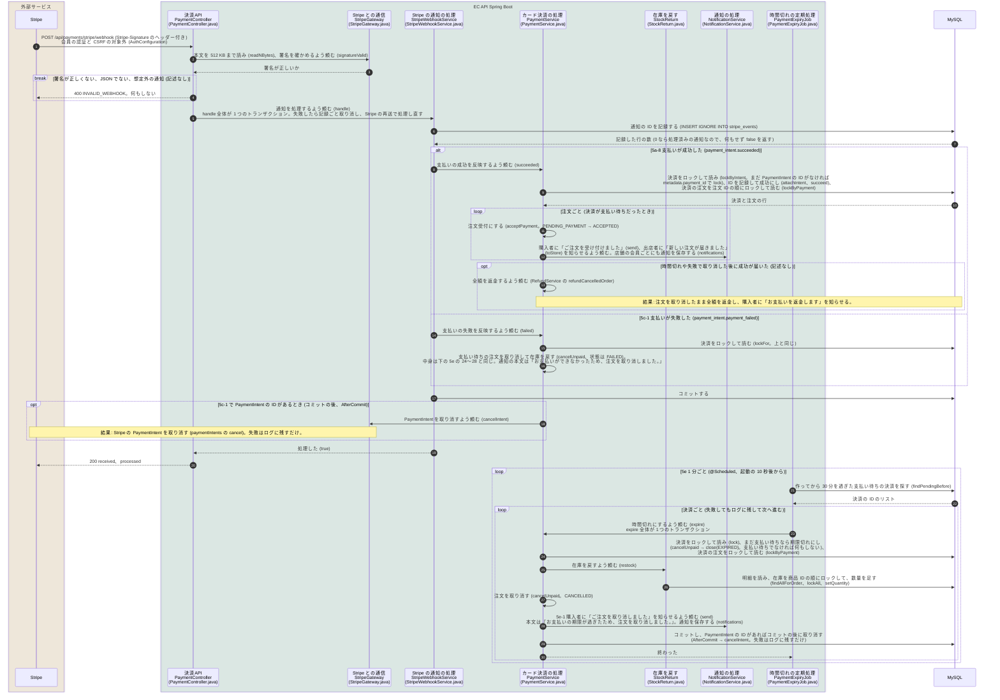
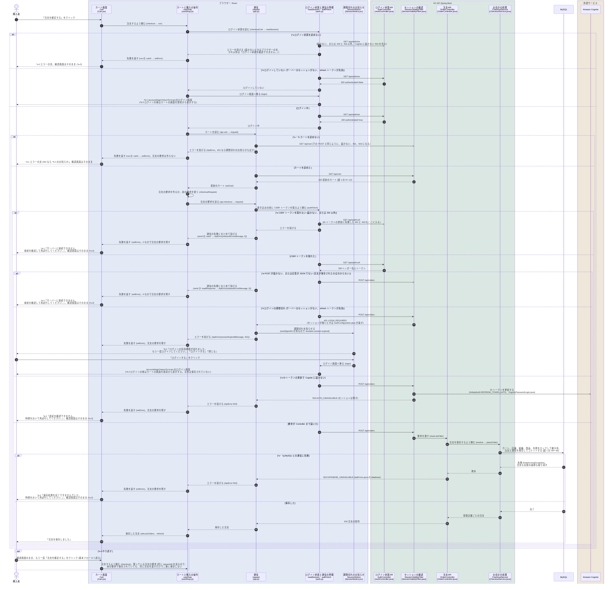

# EC-B12 商品を購入する

- ユースケース記述: [EC-B12_商品を購入する](<../../アーカイブ/ユースケース/kusakari-ec/EC-B12_商品を購入する.md>)
- 共通代替フロー: [00_全ユースケース共通の代替フロー](<00_全ユースケース共通の代替フロー.md>)
- 対象のコード: kusakari-ec の main（6bad7e3、2026-11-24 時点）

## シーケンス図

参加者は、上から「画面や役割の名前」「コンポーネント・クラスの名前」「ファイル名（かっこ付き）」の順に書いています。
共通代替フローの中身は、00 の図か、下の「共通代替フローを直接書いた図」を見てください。
代替フローのうち、画面の中だけで終わるもの（2a・4a・5b）とエラーで終わるもの（7a〜7e・7f・7g・5f）は、分かれる所だけを描き、結果と画面は Note に文で書いています。エラーのときの画面の後処理（`readResponse` が `ApiError` を投げる → `run` の `catch` がエラーの文を出す → 409 なら注文の要求を捨ててカートを取り直す、それ以外は注文の要求を残す）は、どれも同じです。条件つきの処理（カード決済の設定の読み込み、返金、`PaymentIntent` の取り消し）は、頼む矢印 1 本と Note に寄せています。

支払方法で流れが大きく分かれ、カードでは Stripe からの通知と時間切れの処理が画面の操作とは別に動くので、図を 3 つに分けています。

- 図 1: 基本フロー 1〜9（店舗でお支払い）と、代替フロー 2a、4a、7a〜7e、7g
- 図 2: 代替フロー 5a〜5d、5f、7f（クレジットカードを選んでから、画面で支払いの結果を確かめるまで）
- 図 3: 代替フロー 5a-8、5c-1、5e（Stripe からの通知と、支払い待ちの時間切れ）。ブラウザーの通信がないので、共通代替フローは適用しません

### 図 1 店舗でお支払い

```mermaid
sequenceDiagram
    autonumber
    actor User as 購入者
    box rgba(47,111,219,0.10) ブラウザー React
        participant App as 画面の切り替え<br/>App<br/>(App.jsx)
        participant Header as 共通ヘッダー<br/>KusakariHeader<br/>(KusakariHeader.jsx)
        participant Cart as カート画面<br/>Cart<br/>(Cart.jsx)
        participant Confirm as 確認画面の中身<br/>CheckoutConfirm<br/>(CheckoutConfirm.jsx)
        participant Pay as カードを選べるか<br/>useCardAvailable<br/>(payment.js)
        participant Shop as カートと購入の操作<br/>useShop<br/>(useShop.js)
        participant AuthJs as ログイン状態と通信の準備<br/>readSession・authFetch<br/>(auth.js)
        participant Http as 通信<br/>request<br/>(api.js)
    end
    box rgba(27,127,92,0.12) EC API Spring Boot
        participant AuthCtrl as ログイン状態API<br/>AuthController<br/>(AuthController.java)
        participant CartCtrl as カートAPI<br/>CartController<br/>(CartController.java)
        participant PayCtrl as 決済API<br/>PaymentController<br/>(PaymentController.java)
        participant OrderCtrl as 注文API<br/>OrderController<br/>(OrderController.java)
        participant Errs as エラーの応答<br/>ApiErrors<br/>(ApiErrors.java)
        participant Session as 購入者のカート<br/>CartSessionResolver<br/>(CartSessionResolver.java)
        participant CartSvc as カートの処理<br/>CartService<br/>(CartService.java)
        participant Checkout as お会計の処理<br/>CheckoutService<br/>(CheckoutService.java)
        participant PaySvc as カード決済の処理<br/>PaymentService<br/>(PaymentService.java)
        participant Ntf as 通知の処理<br/>NotificationService<br/>(NotificationService.java)
    end
    participant Db as MySQL

    Note over User,Db: 共通代替フロー<br/>*b 未ログインの場合: 4 (アプリを開いたときのカートの取得)、26・39 (ログイン状態の確認)、28、41、48、取り直しの 72 に適用<br/>*a 通信に失敗した場合: 4、26、28、39、41、46、48、取り直しの 72 に適用

    User->>App: Kusakari のトップなど、共通ヘッダーのある画面を開く
    App->>Shop: カートと商品を読み込むよう頼む<br/>(useShop → initialize → run → refresh)
    Shop->>Http: カートを読む (api.cart → request)
    Http->>CartCtrl: GET /api/cart
    CartCtrl->>Session: 購入者のカートを調べるよう頼む (resolve)<br/>requireBuyer と MemberCartService の resolve。中身は EC-B13 の図と同じ
    Session-->>CartCtrl: カートの ID
    CartCtrl->>CartSvc: カートを開くよう頼む (read)<br/>read 全体が 1 つのトランザクション
    CartSvc->>Db: カートをロックして読み (findLocked、SELECT ... FOR UPDATE carts)、明細を読み<br/>(findAllForCart)、商品、在庫、店舗と組織の状態を読む (CatalogService の listingsByIds)
    Db-->>CartSvc: カートと明細の行、商品ごとの値段、在庫、買えるか
    CartSvc->>CartSvc: 店舗の閉鎖・停止、組織の停止、商品の削除で買えなくなった明細を外し<br/>(REMOVED_REASONS。外したら incrementRevision)、行ごとの金額と購入できるか、<br/>合計、注文に進めるか (canCheckout) を計算する (view)
    CartSvc-->>CartCtrl: カート (revision、行ごとの受取店舗、金額、available、<br/>unavailableReason、合計、canCheckout、受取連絡先、removedItems)
    CartCtrl-->>Http: 200 カート
    Http-->>Shop: カート (setCart)
    Shop->>Http: 商品、注文、店舗を順に読む (api.products、api.orders、<br/>api.stores(35.6812, 139.7671))。GET /api/products、GET /api/orders、GET /api/stores
    Http-->>Shop: 商品、注文、営業中の店舗 (setProducts、setOrders、setStores)

    User->>Header: 共通ヘッダーの「カート」をクリック
    Header->>App: 移る先の URL を渡す (follow → onNavigate の navigateFromHeader)
    App->>Cart: URL を /cart に変え (navigate)、CartPage の中に Cart を表示<br/>(カートは読み直さない)
    Cart->>Pay: カードを選べるかを調べるよう頼む (useCardAvailable)
    opt 画面にテスト用の公開鍵 (pk_test_) がある (stripePublishableKey)
        Pay->>PayCtrl: カード決済の設定を読む (request)<br/>GET /api/payments/config
        Note over Pay,PayCtrl: 結果: 200 cardAvailable (サーバーに Stripe の鍵がそろっているか。StripeGateway の enabled)。<br/>画面: 鍵がない、取得に失敗したときは false で、カードの選択肢を出さない。
    end
    Pay-->>Cart: カードを選べるか
    Cart-->>User: 「ショッピングカート (N)」、商品ごとの受取店舗、数量、金額、<br/>「ご請求内容」、「注文内容を確認する」
    break 2a 購入できない商品か、在庫不足の商品がある
        Cart-->>User: 2a-1 その商品に「現在は購入できません」(unavailableReason) か<br/>「在庫不足（現在 N 点）」(available が false)。canCheckout が false なので<br/>「注文内容を確認する」を押せない (2a-2 EC-B09・EC-B10 で直して、2 へ戻る)
    end

    User->>Cart: 「注文内容を確認する」をクリック
    Cart->>Shop: 確認画面の前にカートを取り直すよう頼む<br/>(beginCheckout → run → checkoutCart)
    Shop->>AuthCtrl: ログイン状態を読む (auth.js の readSession)<br/>GET /api/auth/me
    AuthCtrl-->>Shop: 200 ログイン中 (session。ログインしていなければ login でログイン画面へ)
    Shop->>CartCtrl: カートを読む (api.cart → request)<br/>GET /api/cart。中身は 5〜11 と同じ
    CartCtrl-->>Shop: 200 最新のカート (setCart)
    Shop-->>Cart: 取り直せた (beginCheckout が true)
    Cart->>Confirm: 確認画面に切り替え (setConfirming(true))、CheckoutConfirm を表示<br/>支払方法の初めの値は「店舗でお支払い」(PAY_AT_STORE)
    Confirm-->>User: 「受け取り店舗とご注文商品（N点）」、受取店舗ごとの店舗名、<br/>所在地、営業時間 (shop.stores から) と商品、「受け取る方」、「お支払い方法」<br/>(カードを選べなければ「店舗でお支払い」だけ)
    Cart-->>User: 見出し「お支払い・受け取りの確認」、「ご請求内容」、<br/>「お支払い方法 店舗でお支払い」、「注文を確定する」、「カートに戻る」
    break 4a 最新のカートで在庫不足になっていた
        Cart-->>User: 4a-1 その商品に「在庫不足（現在 N 点）」。<br/>canCheckout が false なので「注文を確定する」を押せない
        Note over User,Cart: 画面: 4a-2「カートに戻る」を押すと、通信せずにカートの画面に戻す (setConfirming(false))。<br/>4a-3 代替フロー 2a へ。
    end

    User->>Confirm: 「お支払い方法」で「店舗でお支払い」を選ぶ
    Confirm->>Cart: 選んだ支払方法を伝える (onPayment → setPayment)。通信しない
    User->>Cart: 「注文を確定する」をクリック
    Cart->>Shop: 注文するよう頼む (checkout('PAY_AT_STORE'))<br/>run が二重の実行を止めて busy にし、ボタンは「保存中…」
    Shop->>AuthCtrl: ログイン状態を読む (checkoutCart → readSession)<br/>GET /api/auth/me
    AuthCtrl-->>Shop: 200 ログイン中
    Shop->>CartCtrl: カートを読む (api.cart → request)<br/>GET /api/cart。中身は 5〜11 と同じ
    CartCtrl-->>Shop: 200 最新のカート (setCart)
    Shop->>Shop: 注文の要求を作る (checkoutRequest)<br/>requestId (crypto.randomUUID)、最新のカートの revision と合計 (expectedTotalYen)、支払方法。<br/>同じ支払方法の前の要求が残っていれば、作り直さずにそのまま送る
    Shop->>Http: 注文の要求を送る (api.checkout → request)
    Http->>AuthJs: 書き込みの前に CSRF トークンを取るよう頼む (authFetch)
    AuthJs->>AuthCtrl: GET /api/auth/csrf
    AuthCtrl-->>AuthJs: 200 ヘッダー名とトークン (csrf)
    AuthJs->>OrderCtrl: POST /api/orders<br/>(requestId、revision、expectedTotalYen、paymentMethod は PAY_AT_STORE)
    OrderCtrl->>Checkout: 入力を検査し (@Valid CheckoutRequest)、購入者のカートを調べて<br/>(CartSessionResolver の resolve。5〜6 と同じ)、注文を保存するよう頼む (placeOrder)<br/>placeOrder 全体が 1 つのトランザクション (READ_COMMITTED)
    Checkout->>Db: カートをロックして読み (findLocked、SELECT ... FOR UPDATE carts)、<br/>同じ requestId の注文を探す (findByCartIdAndRequestIdOrderByStoreIdAsc)
    Db-->>Checkout: カートの行、注文の行 (なければなし)
    Checkout->>Checkout: 同じ requestId の注文があれば、それを返して終える (二重注文の防止。<br/>revision、合計、支払方法が違えば 409 REQUEST_REUSED)
    Checkout->>Db: 明細と商品ごとの店舗を読み (findAllForCart、findStoreReferences)、<br/>店舗を ID の順にロックして組織を共有ロックで読み (StoreRepository の lock、requireOpen → lockShared)、<br/>運営による商品の停止を共有ロックで読み (requireNotSuspended → lockSharedSuspension)、<br/>在庫を商品 ID の順にロックして読む (InventoryRepository の lockAll)
    Db-->>Checkout: 明細、店舗、組織、商品の停止の有無、在庫の行
    Checkout->>CartSvc: ロックした在庫でカートを計算し直すよう頼む (view)
    CartSvc-->>Checkout: canCheckout と合計
    break 7a〜7e 確定できない (7a revision が違う、7b 合計が違う、7c canCheckout が false、<br/>7d 受け付けない店舗がある、7e 停止中の商品がある)
        Checkout--xErrs: 409 の例外を投げる (ApiException)。CART_CHANGED、PRICE_CHANGED、<br/>OUT_OF_STOCK、STORE_DISABLED (明細がなければ EMPTY_CART)
        Note over Errs,Cart: 結果: トランザクションを取り消し、注文も在庫の減算も残さず、409 と文を返す。注文の要求を捨て、カートと商品と注文を取り直す (refresh)。<br/>画面: エラーの文と最新のカートの確認画面 (7a・7b は基本フロー 5 へ、7c・7d・7e は「カートに戻る」から代替フロー 2a か EC-B10 へ)。
    end
    break 7g 保存に失敗した (MySQL との通信の失敗。*a と同じ)
        Db--xCheckout: 失敗 (DataAccessException)
        Note over Checkout,Cart: 結果: トランザクションを取り消し、503 DATABASE_UNAVAILABLE を返す。注文の要求を残し、カートは取り直さない。<br/>画面: 7g-1「保存処理を完了できませんでした。時間をおいて再試行してください。」。7g-2 もう一度押すと同じ requestId で送る。
    end
    Checkout->>Db: 受取連絡先を読む (DeliveryService の pickupDetails)
    Db-->>Checkout: お名前、電話番号、連絡先
    loop 受取店舗ごと (店舗 ID の順、placeStoreOrder)
        Checkout->>Db: 注文を保存する (OrderRepository の save)。注文受付 (ACCEPTED)、<br/>手数料の率と額、受取店舗の所在地と営業時間、受取連絡先 (assignPickup、changeRecipient)
        Checkout->>Ntf: 購入者に知らせるよう頼む (send)。「ご注文を受け付けました」、<br/>本文は「注文番号 / 店舗名」。通知を保存する (notifications)
        Checkout->>Ntf: 出店者に知らせるよう頼む (toStore)。「新しい注文が届きました」、本文は注文番号<br/>組織のオーナーと、店舗にロールのある担当者のうち利用中の会員ごとに保存する (notifications)
        loop その店舗の明細ごと
            Checkout->>Db: 在庫を確かめて減らし (setQuantity。足りなければ 409 OUT_OF_STOCK<br/>「在庫が変更されました。もう一度確認してください。」)、注文の明細を保存する (OrderItemRepository の save)
        end
    end
    Checkout->>Db: カートの明細を消し (deleteAll)、カートの revision を進めて<br/>(incrementRevision)、コミットする
    Db-->>Checkout: 完了
    Checkout-->>OrderCtrl: 受取店舗ごとの注文 (payment はなし)
    OrderCtrl->>PaySvc: 支払いを始めるよう頼む (start)
    PaySvc-->>OrderCtrl: payment がないので、そのまま返す
    OrderCtrl-->>Http: 200 注文の配列 (payment は null)
    Http-->>Shop: 保存した注文
    Shop->>Http: 注文の要求を捨て (checkoutRequest を null)、保存した注文を覚え (setLastOrders)、<br/>カートと商品と注文を取り直す (refresh)。流れは 3〜15 と同じ
    Http-->>Shop: 空のカート、商品、注文
    Shop-->>Cart: 保存した注文 (shop.lastOrders)
    Cart-->>User: 「注文を保存しました」。注文が複数なら「受取店舗ごとにN件の注文に分けて保存しました。」<br/>注文ごとの注文日時、注文番号、受取店舗、所在地、受取連絡先、お支払い方法、<br/>「受け取り時に店頭でお支払いください。」、商品、合計。「お買い物を続ける」
```

### 図 2 クレジットカード

図 1 の確認画面（35 の前）からの続きです。

```mermaid
sequenceDiagram
    autonumber
    actor User as 購入者
    box rgba(47,111,219,0.10) ブラウザー React
        participant Cart as カート画面<br/>Cart<br/>(Cart.jsx)
        participant Confirm as 確認画面の中身<br/>CheckoutConfirm<br/>(CheckoutConfirm.jsx)
        participant Card as カードでのお支払い<br/>CardPaymentStep・CardForm<br/>(CardPayment.jsx)
        participant StripeJs as Stripe の入力欄<br/>Elements・PaymentElement<br/>(@stripe/react-stripe-js)
        participant Shop as カートと購入の操作<br/>useShop<br/>(useShop.js)
        participant Http as 通信<br/>request<br/>(api.js)
    end
    box rgba(27,127,92,0.12) EC API Spring Boot
        participant OrderCtrl as 注文API<br/>OrderController<br/>(OrderController.java)
        participant WfCtrl as 注文の手続きAPI<br/>OrderWorkflowController<br/>(OrderWorkflowController.java)
        participant Errs as エラーの応答<br/>ApiErrors<br/>(ApiErrors.java)
        participant Checkout as お会計の処理<br/>CheckoutService<br/>(CheckoutService.java)
        participant PaySvc as カード決済の処理<br/>PaymentService<br/>(PaymentService.java)
        participant Gateway as Stripe との通信<br/>StripeGateway<br/>(StripeGateway.java)
        participant WfSvc as 注文の手続きの処理<br/>OrderWorkflowService<br/>(OrderWorkflowService.java)
    end
    participant Db as MySQL
    box rgba(180,120,20,0.12) 外部サービス
        participant Stripe as Stripe
    end

    Note over User,Stripe: 共通代替フロー<br/>*b 未ログインの場合: 6 (ログイン状態の確認とカートの取得)、7、取り直しの 31・52、状態の確認の 47 に適用<br/>*a 通信に失敗した場合: 6 (ログイン状態の確認、カートの取得、CSRF トークンの取得)、7、取り直しの 31・52、状態の確認の 47 (失敗は画面に出さない) に適用

    User->>Confirm: 5a-1「お支払い方法」で「クレジットカード」を選ぶ<br/>(カードを選べるときだけ出る)
    Confirm->>Cart: 選んだ支払方法を伝える (onPayment → setPayment('CARD'))
    Cart-->>User: 5a-2 ボタンを「注文してカードで支払う」にする (checkoutLabel)。通信しない
    User->>Cart: 5a-3「注文してカードで支払う」をクリック
    Cart->>Shop: 注文するよう頼む (checkout('CARD'))
    Shop->>Http: ログイン状態とカートを取り直し、注文の要求を作って送る<br/>(checkoutCart → api.checkout)。流れは図 1 の 39〜48 と同じ
    Http->>OrderCtrl: POST /api/orders (paymentMethod は CARD)
    OrderCtrl->>Checkout: 入力を検査し、購入者のカートを調べて、<br/>注文を保存するよう頼む (@Valid、resolve → placeOrder)
    Checkout->>Db: カートをロックして読み、同じ requestId の注文を探す<br/>(findLocked、findByCartIdAndRequestIdOrderByStoreIdAsc。図 1 の 50〜52)
    Db-->>Checkout: カートの行、保存済みの注文 (なければなし)
    Checkout->>Gateway: カード決済を使えるかを確かめる (enabled)
    Gateway-->>Checkout: テスト用の秘密鍵 (sk_test_ か rk_test_) と<br/>Webhook の署名の鍵 (whsec_) がそろっているか
    break 7f カード決済が使えない
        Checkout--xErrs: 409 CARD_PAYMENT_UNAVAILABLE の例外を投げる (ApiException)
        Note over Errs,Cart: 結果: 409 を返し、注文しない。注文の要求を捨て、カートと商品と注文を取り直す (refresh)。<br/>画面: 7f-1「カード決済は現在使えません。店頭払いを選んでください。」と確認画面 (7f-2 基本フロー 5 へ戻る)。
    end
    Checkout->>Db: 7a〜7e を確かめ、店舗、組織、商品、在庫をロックする<br/>(図 1 の 53〜56。確定できないときと 7g は図 1 と同じ)
    Db-->>Checkout: ロックした行
    Checkout->>Db: 5a-4 決済を保存する (PaymentRepository の saveAndFlush)<br/>状態は PENDING、金額は全部の注文の合計
    loop 受取店舗ごと (店舗 ID の順、placeStoreOrder)
        Checkout->>Db: 注文を支払い待ち (awaitPayment、PENDING_PAYMENT) で保存し、<br/>在庫を減らして明細を保存する。通知はまだ送らない
    end
    Checkout->>Db: カートの明細を消し、revision を進めて、コミットする
    Db-->>Checkout: 完了
    Checkout-->>OrderCtrl: 支払い待ちの注文と決済 (clientSecret はまだない)
    OrderCtrl->>PaySvc: 支払いを始めるよう頼む (start)<br/>トランザクションの外。Stripe を呼ぶ間は DB のロックを持たない
    PaySvc->>Gateway: 決済を読み (findById。PENDING)、PaymentIntent を作るよう頼む (createIntent)<br/>PaymentIntent の ID が保存済みなら作らずに読む (retrieveIntent)
    Gateway->>Stripe: PaymentIntent を作る (paymentIntents の create)<br/>金額は合計、円、metadata.payment_id、Idempotency-Key は requestId
    break 5f Stripe との通信に失敗した
        Stripe--xGateway: 失敗 (StripeException)
        Note over Gateway,Cart: 結果: 502 PAYMENT_PROVIDER_ERROR (unavailable) を返す。注文は支払い待ちのままで、注文の要求を残し、カートは取り直さない。<br/>画面: 5f-1「カード決済の処理に失敗しました。時間をおいてもう一度お試しください。」(5f-2 もう一度押すと同じ requestId を送り、保存済みの注文と決済で 21 からやり直す。押さなければ 30 分後に 5e)。
    end
    Stripe-->>Gateway: PaymentIntent の ID と client_secret
    Gateway-->>PaySvc: PaymentIntent
    PaySvc->>Db: 別のトランザクションで決済をロックし、PaymentIntent の ID を記録する<br/>(separate、lock、attachIntent)
    PaySvc-->>OrderCtrl: 支払い待ちの注文と決済 (clientSecret、amountYen)
    OrderCtrl-->>Http: 200 注文の配列と payment
    Http-->>Shop: 支払い待ちの注文と決済
    Shop->>Http: 注文の要求を捨て、支払い待ちを覚え (checkoutRequest を null、setPendingPayment)、<br/>カートと商品と注文を取り直す (refresh。図 1 の 3〜15)
    Http-->>Shop: 空のカート、商品、注文
    Shop-->>Cart: 支払い待ち (shop.pendingPayment)
    Cart->>Card: 「カードでのお支払い」を表示 (CardPaymentStep)
    Card->>StripeJs: Stripe.js を読み込み (loadStripe。1 回だけ)、<br/>client_secret で入力欄を作る (Elements、PaymentElement、locale は ja)
    StripeJs->>Stripe: Stripe.js と入力欄を読み込む
    Stripe-->>StripeJs: 入力欄
    Card-->>User: 5a-5「カードでのお支払い」、カード情報の入力欄、お支払い金額<br/>(受取店舗ごとの注文 N 件の合計)、「(金額)を支払う」
    User->>StripeJs: カード情報を入力する
    User->>Card: 5a-6「(金額)を支払う」をクリック
    Card->>StripeJs: 支払い中にして (pay → setPhase('paying'))、支払うよう頼む<br/>(confirmPayment、redirect は if_required)。ボタンは「支払い中…」
    StripeJs->>Stripe: 5a-7 カード情報を送って支払う (このサイトのサーバーを通らない)
    Stripe-->>StripeJs: 結果
    StripeJs-->>Card: 結果 (result)
    break 5b 入力に不備がある (result.error.type が validation_error)、またはそのほかのエラー (記述なし)
        Card-->>User: 5b-1 Stripe のエラーの文。入力欄に戻る<br/>(setPhase('input')。5b-2 5a-6 へ戻る)
    end
    Card-->>User: 「支払いを確認しています」(setPhase('confirming'))<br/>5c カードが断られた (card_error) ときは、Stripe のエラーの文も出す
    loop 1.5 秒ごと (pollIntervalMs)、90 秒まで (pollLimitMs)
        Card->>WfCtrl: 注文ごとに状態を読む (poll → request、Promise.all)<br/>GET /api/orders/{id}
        WfCtrl->>WfSvc: 購入者の注文を読むよう頼む (buyerOrder)。読み取りだけのトランザクション<br/>購入者かを確かめ (requireBuyer)、注文、明細、決済、返金、店舗を読む<br/>(findById。ほかの会員の注文なら 404 ORDER_NOT_FOUND)
        WfSvc-->>WfCtrl: 注文 (view)
        WfCtrl-->>Card: 200 注文 (status、paymentStatus)。通信に失敗したら、次の回でやり直す
    end
    alt 5a-9 すべての注文が注文受付 (図 3 の 5a-8 の後)
        Card->>Shop: 受け付けた注文を渡す (onAccepted → acceptCardOrders)
        Shop->>Http: 支払い待ちを消し (setPendingPayment(null))、保存した注文を覚えて<br/>(setLastOrders)、カートと商品と注文を取り直す (refresh。図 1 の 3〜15)
        Http-->>Shop: 空のカート、商品、注文
        Cart-->>User: 「注文を保存しました」(基本フロー 9 と同じ表示)。カードの注文には<br/>「カードでのお支払いを確認しました（テストモードのため実際の請求はありません）。」
    else 5c-2 取り消した注文がある (図 3 の 5c-1 の後)
        Card-->>User: (Stripe のエラーの文と)「お支払いができなかったため、注文を取り消しました。<br/>商品の在庫は元に戻しています。」と「商品を探す」(setPhase('cancelled')。5c-3 終了)
    else 5d 90 秒を過ぎても決まらない
        Card-->>User: 5d-1「お支払いの確認に時間がかかっています。注文の状態は<br/>購入履歴で確認できます。」と「購入履歴を開く」(setPhase('slow')。5d-2 終了)
    end
```

### 図 3 Stripe からの通知と時間切れ

画面の操作とは別に動きます。Stripe からの通知は、図 2 の「支払いを確認しています」と並行して届きます。

## 共通代替フローを直接書いた図

図 1 の「注文を確定する」の通信（ログイン状態の確認、カートの取り直し、CSRF トークンの取得、`POST /api/orders`）に、この画面で起こる共通代替フロー（\*a、\*b）を書き込んだ図です。

- 「注文内容を確認する」（図 1 の 24〜33）も同じ `checkoutCart()` を通るので、ログイン状態の確認とカートの取り直しの \*a・\*b はこの図の 3〜20 と同じです。失敗するとカートの画面のまま、エラーの文が出ます。
- 図 2 の「注文してカードで支払う」も、この図と同じ通信を通ります。違いは図 2 の 5f（502）が加わることです。
- アプリを開いたときのカートの取得（図 1 の 4）は、401 なら「ログインしていない」として商品だけを読み（`signedOut`）、カートの URL ではログイン画面へ移ります（`App.jsx` の `redirectToLogin()`、\*b-1）。そのほかの失敗では、カートの画面にエラーの文と「商品を探す」が出て、「再取得」はありません。

## ユースケース記述との差

- 7a と 7b は、確認画面を開いた後の変更では起きにくくなっています。`useShop.js` の `checkout()` は、送る直前に `GET /api/cart` でカートを取り直し、その `revision` と合計で注文の要求を作ります。そのため、確認画面を開いた後に別の画面でカートや価格が変わっても、最新の内容と価格で注文が保存されます（表示中のカートは送る直前に最新に置き換わります）。409 `CART_CHANGED` と 409 `PRICE_CHANGED` になるのは、取り直しから `POST /api/orders` までの間に変わったときと、通信の失敗や 503 の後の再試行で前の注文の要求をそのまま送ったときです。
- 7c の文は 2 種類あります。カート全体の確認（`canCheckout`）で止まると「在庫が変更されました。数量を変更してください。」、店舗ごとの保存の中の在庫の確認で止まると「在庫が変更されました。もう一度確認してください。」です。記述は前者だけです。
- 7e のエラーコードは 7c と同じ `OUT_OF_STOCK` です。文は記述と同じ「購入できない商品があります。カートを確認してください。」です。
- 7d-3 で購入者が商品を削除する前に、取り直しの `GET /api/cart`（`CartService.read()`）が、閉鎖済み・停止中の店舗と停止中の組織、削除された商品の明細をカートから外し、「（商品名）は購入できなくなったためカートから外しました。」を出します。購入者が削除する必要があるのは、閉鎖中・非公開・組織の受付停止のように一時的な理由の明細です。
- 7g（保存に失敗した場合）は、共通代替フロー \*a の「MySQL との通信に失敗」と同じ 503 `DATABASE_UNAVAILABLE` です。7g-2 の「もう一度押せる」は、`useShop.js` が 409 以外の失敗では注文の要求（`checkoutRequest`）を残すので、同じ `requestId` で送り直す動きです。通信が届かなかった場合（\*a）も同じで、前の要求で注文が保存されていれば、その注文を返すだけになります（関連情報「同じ注文は1回だけ記録する」）。
- 基本フロー 4 の受取店舗の所在地と営業時間は、カートではなく、アプリを開いたときの `GET /api/stores` の結果（`shop.stores`）から出しています。
- 基本フロー 2 のカートは、アプリを開いたときに `useShop.js` が読んだものです。共通ヘッダーの「カート」を押しても、カートは読み直しません（読み直すのは「注文内容を確認する」を押したとき）。
- 事後条件の「失敗時は…カートの内容が維持されている」は、カードの支払いの失敗（5c）と時間切れ（5e）には当てはまりません。カードの注文は 5a-4 でカートを空にし、取り消しで戻すのは在庫だけです。
- 5c で注文を取り消したとき、画面には記述の文のほかに、Stripe のエラーの文も出ます。
- 5e の取り消しは 1 分ごとの定期処理（`PaymentExpiryJob`）で行うので、30 分を過ぎてから最大で約 1 分遅れます。30 分は `kusakari.ec.payment-timeout-minutes` の既定値です。購入者への「ご注文を取り消しました」は、注文の数にかかわらず決済ごとに 1 件です。
- 5f-2 でもう一度押すと、`checkout()` は先にカートを取り直します。サーバーのカートは 5a-4 で空になっているので、コードの上では、`PaymentIntent` ができるまでの間、カートの画面は空のカートの表示になります（動かして確かめていません）。
- 5f の後に 30 分を過ぎてから（5e で取り消された後に）もう一度押すと、`placeOrder()` は取り消し済みの注文を返し、`PaymentService.start()` は決済が支払い待ちでないので `clientSecret` を付けません。画面は `clientSecret` がないと店頭払いと同じく完了の扱いにするので（`useShop.js` の `checkout()`）、コードの上では、取り消した注文に「注文を保存しました」と「カードでのお支払いを確認しました…」が出ます。記述にない動きで、動かして確かめていません。
- コードにあって記述にない処理です。
  - Stripe の `confirmPayment()` が `validation_error` と `card_error` 以外のエラーを返すと、エラーの文を出して入力欄に戻り、もう一度押せます。
  - 取り消した注文に後から支払いの成功が届くと、注文を取り消したまま全額を返金し、購入者に「お支払いを返金します」を通知します（`PaymentService.succeeded()`）。
  - サーバーは次の応答も返します。409 `REQUEST_REUSED`（同じ `requestId` で内容が違う）、409 `EMPTY_CART`（カートが空）、404 `CART_NOT_FOUND`、400 `INVALID_INPUT`（`CheckoutRequest` の検査）、409 `DATA_CHANGED`（`ApiErrors.conflict()`）。409 のときは画面がカートを取り直します。
  - 運営のアカウント（`ADMIN`）も購入できます（`AuthService.requireBuyer()`）。
  - 図 2 の注文の状態の確認（`GET /api/orders/{id}`）は、失敗しても画面に出さず、次の回でやり直します。401 のときは `readResponse()` が期限切れのお知らせ（`SessionNotice`）を出します。
  - `GET /api/payments/config` に失敗すると、エラーを出さずにカードの選択肢を出しません。
- 店舗側・出店申請用のアカウントは、カートの画面に「店舗・出店申請用のアカウントでは購入できません。…」が出て購入できません（`CartPage.jsx`、関連情報）。事前条件が購入者のログインなので、図には描いていません。

## 確かめられなかったこと

- Stripe.js（`loadStripe()`、Payment Element、`confirmPayment()`）の中の通信は、Kusakari のコードの外です。図の「Stripe.js と入力欄を読み込む」「カード情報を送って支払う」は、`CardPayment.jsx` のコメントと ADR（`docs/decisions/2026-11-13-stripe-card-payment.md`）の記述をもとにしています。`validation_error` のときに Stripe へ通信するかは確かめていません。
- カードが断られたときに Stripe が `payment_intent.payment_failed` の通知を送ることは、Stripe の仕様です。コードで確かめたのは、その通知を受けたときの処理だけです。
- Stripe の通知が EC API に届くかは動かす環境しだいで、コードでは確かめられません。通知が届かなければ、支払っても注文受付にならず、画面は 5d になり、30 分後に 5e で取り消されます。
- 図 1 の「商品、注文、店舗を読む」（`GET /api/products`、`GET /api/orders`、`GET /api/stores`）の EC API の中は、このユースケースでは描いていません。

## 参照したコード

- [frontend/src/App.jsx](https://github.com/abeouga/kusakari-ec/blob/6bad7e37c4135034fbe97e30309772fbe872e675/frontend/src/App.jsx): `useShop`、`navigateFromHeader`、`/cart` の `redirectToLogin` と `CartPage` の表示
- [packages/site-header/KusakariHeader.jsx](https://github.com/abeouga/kusakari-ec/blob/6bad7e37c4135034fbe97e30309772fbe872e675/packages/site-header/KusakariHeader.jsx): `follow`、「カート」のリンク
- [frontend/src/workspace/navigation.js](https://github.com/abeouga/kusakari-ec/blob/6bad7e37c4135034fbe97e30309772fbe872e675/frontend/src/workspace/navigation.js): `navigate`
- [frontend/src/components/CartPage.jsx](https://github.com/abeouga/kusakari-ec/blob/6bad7e37c4135034fbe97e30309772fbe872e675/frontend/src/components/CartPage.jsx): `CartPage`（`buyerOnlyMessage`）
- [frontend/src/components/Cart.jsx](https://github.com/abeouga/kusakari-ec/blob/6bad7e37c4135034fbe97e30309772fbe872e675/frontend/src/components/Cart.jsx): `Cart`（`confirming`、`payment`、`checkoutLabel`、ボタンの `disabled`、完了の表示）、`OrderSummary`、`RemovedNotice`
- [frontend/src/components/CheckoutConfirm.jsx](https://github.com/abeouga/kusakari-ec/blob/6bad7e37c4135034fbe97e30309772fbe872e675/frontend/src/components/CheckoutConfirm.jsx): `CheckoutConfirm`、`pickupGroups`
- [frontend/src/components/CardPayment.jsx](https://github.com/abeouga/kusakari-ec/blob/6bad7e37c4135034fbe97e30309772fbe872e675/frontend/src/components/CardPayment.jsx): `CardPaymentStep`、`CardForm`、`stripe`、`pay`、`poll`、`pollIntervalMs`、`pollLimitMs`
- [frontend/src/payment.js](https://github.com/abeouga/kusakari-ec/blob/6bad7e37c4135034fbe97e30309772fbe872e675/frontend/src/payment.js): `paymentMethods`、`stripePublishableKey`、`useCardAvailable`、`paymentLabel`
- [frontend/src/useShop.js](https://github.com/abeouga/kusakari-ec/blob/6bad7e37c4135034fbe97e30309772fbe872e675/frontend/src/useShop.js): `refresh`、`run`、`initialize`、`checkoutCart`、`beginCheckout`、`checkout`、`acceptCardOrders`
- [frontend/src/auth.js](https://github.com/abeouga/kusakari-ec/blob/6bad7e37c4135034fbe97e30309772fbe872e675/frontend/src/auth.js): `readSession`、`authFetch`、`wasSignedIn`、`login`、`redirectToLogin`
- [frontend/src/api.js](https://github.com/abeouga/kusakari-ec/blob/6bad7e37c4135034fbe97e30309772fbe872e675/frontend/src/api.js): `request`、`send`、`readResponse`、`ApiError`、`api.cart`、`api.checkout`、`networkErrorMessage`、`sessionExpiredMessage`
- [frontend/src/components/SessionNotice.jsx](https://github.com/abeouga/kusakari-ec/blob/6bad7e37c4135034fbe97e30309772fbe872e675/frontend/src/components/SessionNotice.jsx): 期限切れのお知らせ
- [backend/src/main/java/jp/kusakari/ec/commerce/controller/CartController.java](https://github.com/abeouga/kusakari-ec/blob/6bad7e37c4135034fbe97e30309772fbe872e675/backend/src/main/java/jp/kusakari/ec/commerce/controller/CartController.java): `get`
- [backend/src/main/java/jp/kusakari/ec/commerce/controller/OrderController.java](https://github.com/abeouga/kusakari-ec/blob/6bad7e37c4135034fbe97e30309772fbe872e675/backend/src/main/java/jp/kusakari/ec/commerce/controller/OrderController.java): `checkout`
- [backend/src/main/java/jp/kusakari/ec/commerce/controller/OrderWorkflowController.java](https://github.com/abeouga/kusakari-ec/blob/6bad7e37c4135034fbe97e30309772fbe872e675/backend/src/main/java/jp/kusakari/ec/commerce/controller/OrderWorkflowController.java): `buyer`（`GET /api/orders/{id}`）
- [backend/src/main/java/jp/kusakari/ec/commerce/service/OrderWorkflowService.java](https://github.com/abeouga/kusakari-ec/blob/6bad7e37c4135034fbe97e30309772fbe872e675/backend/src/main/java/jp/kusakari/ec/commerce/service/OrderWorkflowService.java): `buyerOrder`
- [backend/src/main/java/jp/kusakari/ec/commerce/session/CartSessionResolver.java](https://github.com/abeouga/kusakari-ec/blob/6bad7e37c4135034fbe97e30309772fbe872e675/backend/src/main/java/jp/kusakari/ec/commerce/session/CartSessionResolver.java): `resolve`
- [backend/src/main/java/jp/kusakari/ec/auth/MemberCartService.java](https://github.com/abeouga/kusakari-ec/blob/6bad7e37c4135034fbe97e30309772fbe872e675/backend/src/main/java/jp/kusakari/ec/auth/MemberCartService.java): `resolve`
- [backend/src/main/java/jp/kusakari/ec/auth/AuthController.java](https://github.com/abeouga/kusakari-ec/blob/6bad7e37c4135034fbe97e30309772fbe872e675/backend/src/main/java/jp/kusakari/ec/auth/AuthController.java): `me`、`csrf`
- [backend/src/main/java/jp/kusakari/ec/auth/AuthService.java](https://github.com/abeouga/kusakari-ec/blob/6bad7e37c4135034fbe97e30309772fbe872e675/backend/src/main/java/jp/kusakari/ec/auth/AuthService.java): `requireBuyer`、`current`、`session`
- [backend/src/main/java/jp/kusakari/ec/commerce/service/CartService.java](https://github.com/abeouga/kusakari-ec/blob/6bad7e37c4135034fbe97e30309772fbe872e675/backend/src/main/java/jp/kusakari/ec/commerce/service/CartService.java): `read`、`view`
- [backend/src/main/java/jp/kusakari/ec/catalog/service/CatalogService.java](https://github.com/abeouga/kusakari-ec/blob/6bad7e37c4135034fbe97e30309772fbe872e675/backend/src/main/java/jp/kusakari/ec/catalog/service/CatalogService.java): `listingsByIds`、`REMOVED_REASONS`
- [backend/src/main/java/jp/kusakari/ec/commerce/service/CheckoutService.java](https://github.com/abeouga/kusakari-ec/blob/6bad7e37c4135034fbe97e30309772fbe872e675/backend/src/main/java/jp/kusakari/ec/commerce/service/CheckoutService.java): `placeOrder`、`requireOpen`、`requireNotSuspended`、`placeStoreOrder`
- [backend/src/main/java/jp/kusakari/ec/commerce/service/DeliveryService.java](https://github.com/abeouga/kusakari-ec/blob/6bad7e37c4135034fbe97e30309772fbe872e675/backend/src/main/java/jp/kusakari/ec/commerce/service/DeliveryService.java): `pickupDetails`
- [backend/src/main/java/jp/kusakari/ec/commerce/service/StockReturn.java](https://github.com/abeouga/kusakari-ec/blob/6bad7e37c4135034fbe97e30309772fbe872e675/backend/src/main/java/jp/kusakari/ec/commerce/service/StockReturn.java): `restock`
- [backend/src/main/java/jp/kusakari/ec/commerce/dto/CommerceDtos.java](https://github.com/abeouga/kusakari-ec/blob/6bad7e37c4135034fbe97e30309772fbe872e675/backend/src/main/java/jp/kusakari/ec/commerce/dto/CommerceDtos.java): `CheckoutRequest`、`CheckoutResult`、`CardPayment`、`CartLine`
- [backend/src/main/java/jp/kusakari/ec/commerce/persistence/entity/OrderEntity.java](https://github.com/abeouga/kusakari-ec/blob/6bad7e37c4135034fbe97e30309772fbe872e675/backend/src/main/java/jp/kusakari/ec/commerce/persistence/entity/OrderEntity.java): `awaitPayment`、`acceptPayment`、`cancelUnpaid`、`assignPickup`、`changeRecipient`
- [backend/src/main/java/jp/kusakari/ec/notification/service/NotificationService.java](https://github.com/abeouga/kusakari-ec/blob/6bad7e37c4135034fbe97e30309772fbe872e675/backend/src/main/java/jp/kusakari/ec/notification/service/NotificationService.java): `send`、`toStore`
- [backend/src/main/java/jp/kusakari/ec/payment/controller/PaymentController.java](https://github.com/abeouga/kusakari-ec/blob/6bad7e37c4135034fbe97e30309772fbe872e675/backend/src/main/java/jp/kusakari/ec/payment/controller/PaymentController.java): `config`、`webhook`
- [backend/src/main/java/jp/kusakari/ec/payment/service/PaymentService.java](https://github.com/abeouga/kusakari-ec/blob/6bad7e37c4135034fbe97e30309772fbe872e675/backend/src/main/java/jp/kusakari/ec/payment/service/PaymentService.java): `start`、`succeeded`、`failed`、`expire`、`cancelUnpaid`、`lockFor`
- [backend/src/main/java/jp/kusakari/ec/payment/service/StripeGateway.java](https://github.com/abeouga/kusakari-ec/blob/6bad7e37c4135034fbe97e30309772fbe872e675/backend/src/main/java/jp/kusakari/ec/payment/service/StripeGateway.java): `enabled`、`createIntent`、`retrieveIntent`、`cancelIntent`、`signatureValid`、`unavailable`
- [backend/src/main/java/jp/kusakari/ec/payment/service/StripeWebhookService.java](https://github.com/abeouga/kusakari-ec/blob/6bad7e37c4135034fbe97e30309772fbe872e675/backend/src/main/java/jp/kusakari/ec/payment/service/StripeWebhookService.java): `handle`
- [backend/src/main/java/jp/kusakari/ec/payment/service/PaymentExpiryJob.java](https://github.com/abeouga/kusakari-ec/blob/6bad7e37c4135034fbe97e30309772fbe872e675/backend/src/main/java/jp/kusakari/ec/payment/service/PaymentExpiryJob.java): `expireUnpaid`
- [backend/src/main/java/jp/kusakari/ec/payment/service/AfterCommit.java](https://github.com/abeouga/kusakari-ec/blob/6bad7e37c4135034fbe97e30309772fbe872e675/backend/src/main/java/jp/kusakari/ec/payment/service/AfterCommit.java): `run`
- [backend/src/main/java/jp/kusakari/ec/payment/persistence/entity/PaymentEntity.java](https://github.com/abeouga/kusakari-ec/blob/6bad7e37c4135034fbe97e30309772fbe872e675/backend/src/main/java/jp/kusakari/ec/payment/persistence/entity/PaymentEntity.java): `isPending`、`succeed`、`close`、`attachIntent`
- [backend/src/main/java/jp/kusakari/ec/payment/persistence/repository/PaymentRepository.java](https://github.com/abeouga/kusakari-ec/blob/6bad7e37c4135034fbe97e30309772fbe872e675/backend/src/main/java/jp/kusakari/ec/payment/persistence/repository/PaymentRepository.java): `lock`、`lockByIntent`、`findPendingBefore`、`findByCartIdAndRequestId`
- [backend/src/main/java/jp/kusakari/ec/commerce/persistence/repository/CartRepository.java](https://github.com/abeouga/kusakari-ec/blob/6bad7e37c4135034fbe97e30309772fbe872e675/backend/src/main/java/jp/kusakari/ec/commerce/persistence/repository/CartRepository.java): `findLocked`
- [backend/src/main/java/jp/kusakari/ec/commerce/persistence/repository/CartItemRepository.java](https://github.com/abeouga/kusakari-ec/blob/6bad7e37c4135034fbe97e30309772fbe872e675/backend/src/main/java/jp/kusakari/ec/commerce/persistence/repository/CartItemRepository.java): `findAllForCart`
- [backend/src/main/java/jp/kusakari/ec/commerce/persistence/repository/OrderRepository.java](https://github.com/abeouga/kusakari-ec/blob/6bad7e37c4135034fbe97e30309772fbe872e675/backend/src/main/java/jp/kusakari/ec/commerce/persistence/repository/OrderRepository.java): `findByCartIdAndRequestIdOrderByStoreIdAsc`、`lockByPayment`
- [backend/src/main/java/jp/kusakari/ec/catalog/persistence/repository/StoreRepository.java](https://github.com/abeouga/kusakari-ec/blob/6bad7e37c4135034fbe97e30309772fbe872e675/backend/src/main/java/jp/kusakari/ec/catalog/persistence/repository/StoreRepository.java): `lock`
- [backend/src/main/java/jp/kusakari/ec/store/persistence/repository/OrganizationRepository.java](https://github.com/abeouga/kusakari-ec/blob/6bad7e37c4135034fbe97e30309772fbe872e675/backend/src/main/java/jp/kusakari/ec/store/persistence/repository/OrganizationRepository.java): `lockShared`
- [backend/src/main/java/jp/kusakari/ec/catalog/persistence/repository/ProductRepository.java](https://github.com/abeouga/kusakari-ec/blob/6bad7e37c4135034fbe97e30309772fbe872e675/backend/src/main/java/jp/kusakari/ec/catalog/persistence/repository/ProductRepository.java): `findStoreReferences`、`lockSharedSuspension`
- [backend/src/main/java/jp/kusakari/ec/catalog/persistence/repository/InventoryRepository.java](https://github.com/abeouga/kusakari-ec/blob/6bad7e37c4135034fbe97e30309772fbe872e675/backend/src/main/java/jp/kusakari/ec/catalog/persistence/repository/InventoryRepository.java): `lockAll`
- [backend/src/main/java/jp/kusakari/ec/auth/SessionValidityFilter.java](https://github.com/abeouga/kusakari-ec/blob/6bad7e37c4135034fbe97e30309772fbe872e675/backend/src/main/java/jp/kusakari/ec/auth/SessionValidityFilter.java): `doFilterInternal`、`renewIdToken`
- [backend/src/main/java/jp/kusakari/ec/auth/CognitoPasswordLogin.java](https://github.com/abeouga/kusakari-ec/blob/6bad7e37c4135034fbe97e30309772fbe872e675/backend/src/main/java/jp/kusakari/ec/auth/CognitoPasswordLogin.java): ID トークンの更新、503 `AUTH_UNAVAILABLE`
- [backend/src/main/java/jp/kusakari/ec/auth/AuthConfiguration.java](https://github.com/abeouga/kusakari-ec/blob/6bad7e37c4135034fbe97e30309772fbe872e675/backend/src/main/java/jp/kusakari/ec/auth/AuthConfiguration.java): `authenticationEntryPoint`（401 `LOGIN_REQUIRED`）、Webhook の CSRF の除外と認証なしの許可
- [backend/src/main/java/jp/kusakari/ec/common/web/ApiErrors.java](https://github.com/abeouga/kusakari-ec/blob/6bad7e37c4135034fbe97e30309772fbe872e675/backend/src/main/java/jp/kusakari/ec/common/web/ApiErrors.java): `business`、`database`、`conflict`、`invalid`
- [docs/decisions/2026-11-13-stripe-card-payment.md](https://github.com/abeouga/kusakari-ec/blob/6bad7e37c4135034fbe97e30309772fbe872e675/docs/decisions/2026-11-13-stripe-card-payment.md): カード決済の決定（Stripe の呼び出しの時点、Webhook、時間切れ）
