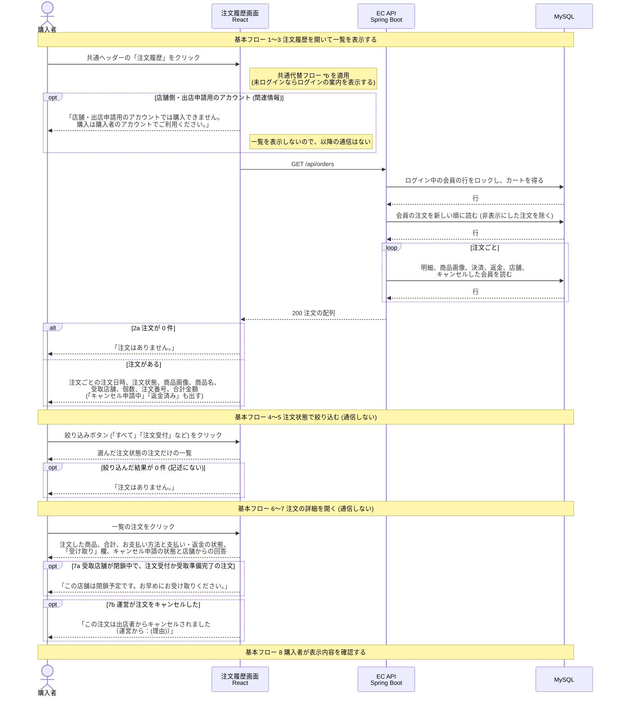
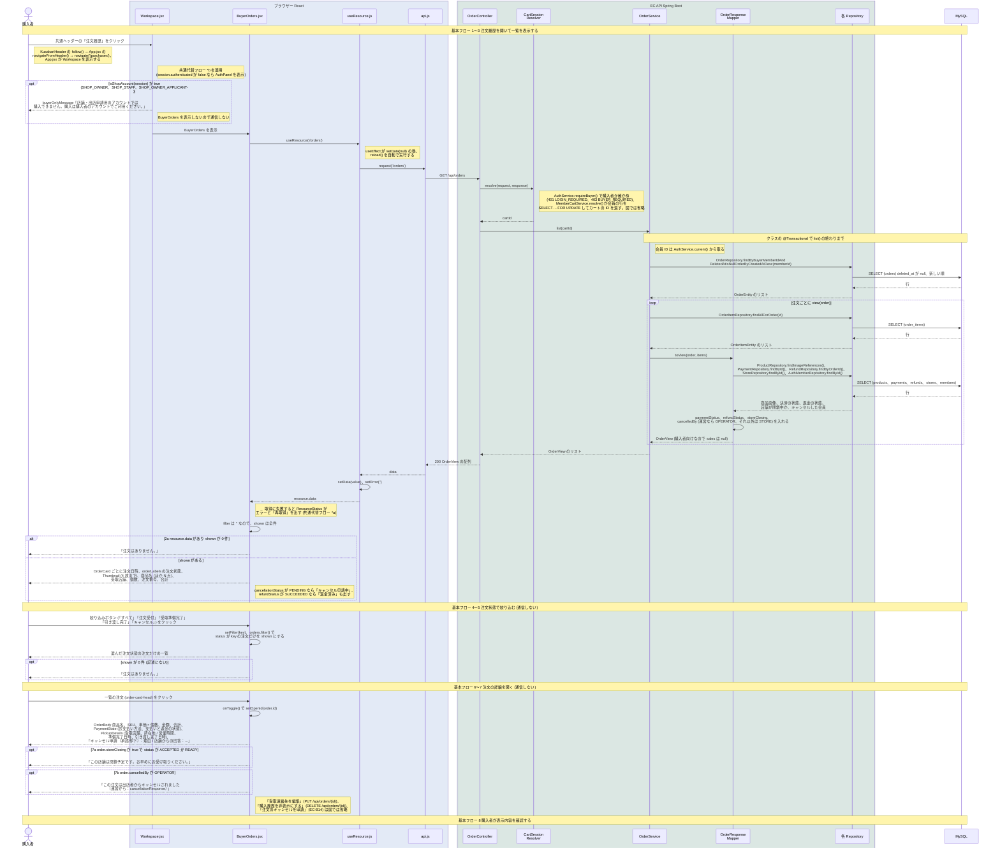

# EC-B13 注文履歴を確認する

- ユースケース記述: [EC-B13_注文履歴を確認する](<../../アーカイブ/ユースケース/kusakari-ec/EC-B13_注文履歴を確認する.md>)
- 対象のコード: kusakari-ec の main（19a2be3、2026-11-20 時点）

## 概要図

## 詳細図

## ユースケース記述との差

- 基本フロー 7 の「商品番号」は、画面では「SKU」という見出しの後に値を出します（`BuyerOrders.jsx` の `OrderBody` の `SKU {line.sku}`）。「商品番号」という文言は出ません。
- 「注文はありません。」は、注文が 0 件のとき（2a）だけでなく、絞り込んだ結果が 0 件のときにも出ます。条件は `resource.data && shown.length === 0` です。
- 7b の判定は、注文をキャンセルした会員が運営（`isAdmin()`）かどうかです（`OrderResponseMapper` の `cancelledBy`）。店舗の閉鎖・組織の停止によるまとめてキャンセルのほか、運営のアカウントが出店者の画面からキャンセル申請を承認した場合も、7b の文が出ます。このとき「キャンセル申請（承認）：理由」の行も一緒に出ます。
- 注文の詳細は、一覧の取得（`GET /api/orders`）で受け取ったデータを開くだけで、詳細を取り直す通信はありません。
- コードにあって記述にない処理です。
  - アプリを開いたときに `useShop.js` の `refresh()` も `GET /api/orders` を呼び、`shop.orders` に入れます。注文履歴画面はこれを使わず、`BuyerOrders` の `useResource('/orders')` で取り直します。
  - 運営のアカウント（`ADMIN`）も、自分の注文履歴を見られます（`AuthService.requireBuyer()`）。
  - 絞り込みボタンに「支払い待ち」はありません。支払い待ちの注文は「すべて」でだけ出ます。

## 参照したコード

- [packages/site-header/KusakariHeader.jsx](https://github.com/abeouga/kusakari-ec/blob/19a2be307ee71a2cd87e538236c3c8c42929c5b3/packages/site-header/KusakariHeader.jsx): `follow()`、「注文履歴」のリンク
- [frontend/src/App.jsx](https://github.com/abeouga/kusakari-ec/blob/19a2be307ee71a2cd87e538236c3c8c42929c5b3/frontend/src/App.jsx): `navigateFromHeader()`、`Workspace` の表示
- [frontend/src/workspace/Workspace.jsx](https://github.com/abeouga/kusakari-ec/blob/19a2be307ee71a2cd87e538236c3c8c42929c5b3/frontend/src/workspace/Workspace.jsx): `/purchases` の分岐、`AuthPanel`、`isShopAccount()` と `buyerOnlyMessage`
- [frontend/src/workspace/BuyerOrders.jsx](https://github.com/abeouga/kusakari-ec/blob/19a2be307ee71a2cd87e538236c3c8c42929c5b3/frontend/src/workspace/BuyerOrders.jsx): `BuyerOrders`、`filters`、`OrderCard`、`OrderBody`、`Thumbnail`
- [frontend/src/workspace/OrderPages.jsx](https://github.com/abeouga/kusakari-ec/blob/19a2be307ee71a2cd87e538236c3c8c42929c5b3/frontend/src/workspace/OrderPages.jsx): `orderLabels`、`cancellationLabels`、`PaymentState`、`PickupDetails`
- [frontend/src/payment.js](https://github.com/abeouga/kusakari-ec/blob/19a2be307ee71a2cd87e538236c3c8c42929c5b3/frontend/src/payment.js): `paymentStatusLabels`、`refundStatusLabels`、`paymentLabel()`
- [frontend/src/workspace/useResource.js](https://github.com/abeouga/kusakari-ec/blob/19a2be307ee71a2cd87e538236c3c8c42929c5b3/frontend/src/workspace/useResource.js): `useResource()`、`reload()`
- [frontend/src/workspace/ResourceView.jsx](https://github.com/abeouga/kusakari-ec/blob/19a2be307ee71a2cd87e538236c3c8c42929c5b3/frontend/src/workspace/ResourceView.jsx): `ResourceStatus`
- [frontend/src/api.js](https://github.com/abeouga/kusakari-ec/blob/19a2be307ee71a2cd87e538236c3c8c42929c5b3/frontend/src/api.js): `request()`、`readResponse()`
- [frontend/src/auth.js](https://github.com/abeouga/kusakari-ec/blob/19a2be307ee71a2cd87e538236c3c8c42929c5b3/frontend/src/auth.js): `isShopAccount()`、`buyerOnlyMessage`
- [frontend/src/useShop.js](https://github.com/abeouga/kusakari-ec/blob/19a2be307ee71a2cd87e538236c3c8c42929c5b3/frontend/src/useShop.js): `refresh()`（`api.orders()`）
- [backend/src/main/java/jp/kusakari/ec/commerce/controller/OrderController.java](https://github.com/abeouga/kusakari-ec/blob/19a2be307ee71a2cd87e538236c3c8c42929c5b3/backend/src/main/java/jp/kusakari/ec/commerce/controller/OrderController.java): `list()`
- [backend/src/main/java/jp/kusakari/ec/commerce/session/CartSessionResolver.java](https://github.com/abeouga/kusakari-ec/blob/19a2be307ee71a2cd87e538236c3c8c42929c5b3/backend/src/main/java/jp/kusakari/ec/commerce/session/CartSessionResolver.java): `resolve()`
- [backend/src/main/java/jp/kusakari/ec/auth/MemberCartService.java](https://github.com/abeouga/kusakari-ec/blob/19a2be307ee71a2cd87e538236c3c8c42929c5b3/backend/src/main/java/jp/kusakari/ec/auth/MemberCartService.java): `resolve()`
- [backend/src/main/java/jp/kusakari/ec/auth/AuthService.java](https://github.com/abeouga/kusakari-ec/blob/19a2be307ee71a2cd87e538236c3c8c42929c5b3/backend/src/main/java/jp/kusakari/ec/auth/AuthService.java): `requireBuyer()`、`current()`
- [backend/src/main/java/jp/kusakari/ec/commerce/service/OrderService.java](https://github.com/abeouga/kusakari-ec/blob/19a2be307ee71a2cd87e538236c3c8c42929c5b3/backend/src/main/java/jp/kusakari/ec/commerce/service/OrderService.java): `list()`、`view()`
- [backend/src/main/java/jp/kusakari/ec/commerce/mapper/OrderResponseMapper.java](https://github.com/abeouga/kusakari-ec/blob/19a2be307ee71a2cd87e538236c3c8c42929c5b3/backend/src/main/java/jp/kusakari/ec/commerce/mapper/OrderResponseMapper.java): `toView()`（`paymentStatus`、`refundStatus`、`storeClosing`、`cancelledBy`）
- [backend/src/main/java/jp/kusakari/ec/commerce/persistence/repository/OrderRepository.java](https://github.com/abeouga/kusakari-ec/blob/19a2be307ee71a2cd87e538236c3c8c42929c5b3/backend/src/main/java/jp/kusakari/ec/commerce/persistence/repository/OrderRepository.java): `findByBuyerMemberIdAndDeletedAtIsNullOrderByCreatedAtDesc()`
- [backend/src/main/java/jp/kusakari/ec/commerce/persistence/repository/OrderItemRepository.java](https://github.com/abeouga/kusakari-ec/blob/19a2be307ee71a2cd87e538236c3c8c42929c5b3/backend/src/main/java/jp/kusakari/ec/commerce/persistence/repository/OrderItemRepository.java): `findAllForOrder()`
- [backend/src/main/java/jp/kusakari/ec/catalog/persistence/entity/StoreEntity.java](https://github.com/abeouga/kusakari-ec/blob/19a2be307ee71a2cd87e538236c3c8c42929c5b3/backend/src/main/java/jp/kusakari/ec/catalog/persistence/entity/StoreEntity.java): `isClosing()`
- [backend/src/main/java/jp/kusakari/ec/commerce/persistence/entity/OrderEntity.java](https://github.com/abeouga/kusakari-ec/blob/19a2be307ee71a2cd87e538236c3c8c42929c5b3/backend/src/main/java/jp/kusakari/ec/commerce/persistence/entity/OrderEntity.java): `decideCancellation()`、`cancelByOperator()`（`cancelledByMemberId` と `cancellationResponse`）
