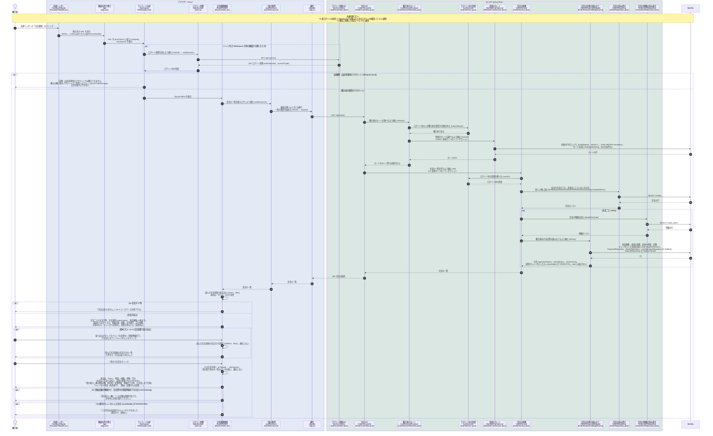
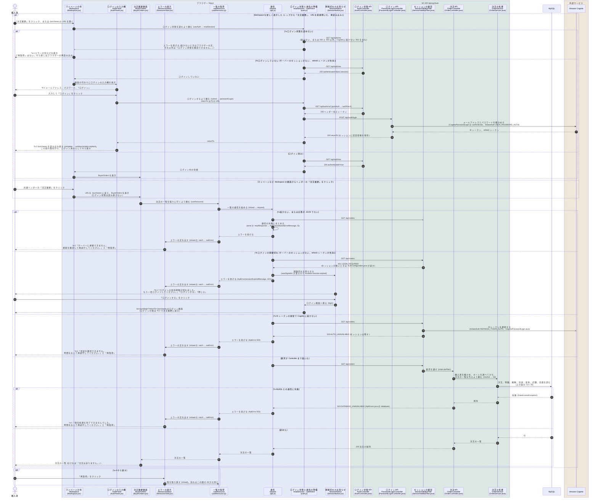

# EC-B13 注文履歴を確認する

- ユースケース記述: [EC-B13_注文履歴を確認する](<../../アーカイブ/ユースケース/kusakari-ec/EC-B13_注文履歴を確認する.md>)
- 共通代替フロー: [00_全ユースケース共通の代替フロー](<00_全ユースケース共通の代替フロー.md>)
- 対象のコード: kusakari-ec の main（6bad7e3、2026-11-24 時点）

## シーケンス図

参加者は、上から「画面や役割の名前」「コンポーネント・クラスの名前」「ファイル名（かっこ付き）」の順に書いています。
共通代替フローの中身は、00 の図か、下の「共通代替フローを直接書いた図」を見てください。

## 共通代替フローを直接書いた図

上の図の通信に、この画面で起こる共通代替フロー（\*a、\*b）を書き込んだ図です。`useAuth()` が `GET /api/auth/me` でログイン状態を読むのは、`Workspace` を新しく表示したとき（トップなど `Workspace` の外の画面からヘッダーの「注文履歴」を押した、`/purchases` の URL を直接開いた、再読み込みした）だけです。マイページなど `Workspace` の画面からヘッダーの「注文履歴」を押したときは読み直しません。

## ユースケース記述との差

- 基本フロー 7 の「商品番号」は、画面では「SKU」の後に値を出します（`BuyerOrders.jsx` の `OrderBody` の `SKU {line.sku}`）。「商品番号」という文言は出ません。
- 「注文はありません。」は、注文が 0 件のとき（2a）だけでなく、絞り込んだ結果が 0 件のときにも出ます。条件は `resource.data && shown.length === 0` です。
- 絞り込みボタンに「支払い待ち」はありません。支払い待ちの注文は「すべて」でだけ出ます。
- 7b の判定は、注文をキャンセルした会員が運営（`isAdmin()`）かどうかです（`OrderResponseMapper` の `cancelledBy`）。店舗の閉鎖・組織の停止によるまとめてキャンセルのほか、運営のアカウントが出店者の画面からキャンセル申請を承認した場合も、7b の文が出ます。このとき「キャンセル申請（承認）：理由」の行も一緒に出ます。
- 注文の詳細は、一覧の取得（`GET /api/orders`）で受け取ったデータを開くだけで、詳細を取り直す通信はありません。
- 「準備完了日時」「引き渡し完了日時」は、まだなら「未完了」と出ます（`PickupDetails`）。
- `GET /api/orders` は、注文を読む前に `CartSessionResolver.resolve()` を通ります。会員の行をロックし、カートが無ければ作ります（`MemberCartService.resolve()`）。返したカートの ID は一覧では使いません。記述にない処理です。
- 共通ヘッダーの「注文履歴」をトップなど `Workspace` の外の画面から押すと、`Workspace` を新しく表示するので、`GET /api/auth/me` でログイン状態を読み直します。マイページなど `Workspace` の画面から押したときは読み直しません。
- コードにあって記述にない処理です。
  - アプリを開いたときに `useShop.js` の `refresh()` も `GET /api/orders` を呼び、`shop.orders` に入れます。注文履歴の画面はこれを使わず、`BuyerOrders` の `useResource('/orders')` で取り直します。
  - 運営のアカウント（`ADMIN`）も、自分の注文履歴を見られます（`AuthService.requireBuyer()`）。
  - 注文の詳細には「受取連絡先を編集」（`PUT /api/orders/{id}`）、「購入履歴を非表示にする」（`DELETE /api/orders/{id}`）、「注文のキャンセルを申請」（[EC-B14](<EC-B14_注文キャンセルを申請する.md>)）もあります。関連情報に書かれた操作なので、この図には描いていません。
- 店舗側・出店申請用のアカウントで開いたときの文（`buyerOnlyMessage`）は、事前条件の外ですが、関連情報に書かれているので図に入れています。API を直接呼ぶと 403 `BUYER_REQUIRED` になります（`AuthService.requireBuyer()`）。

## 参照したコード

- [packages/site-header/KusakariHeader.jsx](https://github.com/abeouga/kusakari-ec/blob/6bad7e37c4135034fbe97e30309772fbe872e675/packages/site-header/KusakariHeader.jsx): `follow`、「注文履歴」のリンク
- [frontend/src/App.jsx](https://github.com/abeouga/kusakari-ec/blob/6bad7e37c4135034fbe97e30309772fbe872e675/frontend/src/App.jsx): `navigateFromHeader`、`Workspace` の表示
- [frontend/src/workspace/navigation.js](https://github.com/abeouga/kusakari-ec/blob/6bad7e37c4135034fbe97e30309772fbe872e675/frontend/src/workspace/navigation.js): `navigate`
- [frontend/src/workspace/Workspace.jsx](https://github.com/abeouga/kusakari-ec/blob/6bad7e37c4135034fbe97e30309772fbe872e675/frontend/src/workspace/Workspace.jsx): `/purchases` の分岐、`error` の表示、未ログインの `AuthPanel`、`isShopAccount` と `buyerOnlyMessage`
- [frontend/src/workspace/BuyerOrders.jsx](https://github.com/abeouga/kusakari-ec/blob/6bad7e37c4135034fbe97e30309772fbe872e675/frontend/src/workspace/BuyerOrders.jsx): `BuyerOrders`、`filters`、`OrderCard`、`OrderBody`、`Thumbnail`
- [frontend/src/workspace/OrderPages.jsx](https://github.com/abeouga/kusakari-ec/blob/6bad7e37c4135034fbe97e30309772fbe872e675/frontend/src/workspace/OrderPages.jsx): `orderLabels`、`cancellationLabels`、`PaymentState`、`PickupDetails`
- [frontend/src/payment.js](https://github.com/abeouga/kusakari-ec/blob/6bad7e37c4135034fbe97e30309772fbe872e675/frontend/src/payment.js): `paymentStatusLabels`、`refundStatusLabels`、`paymentLabel`
- [frontend/src/workspace/useResource.js](https://github.com/abeouga/kusakari-ec/blob/6bad7e37c4135034fbe97e30309772fbe872e675/frontend/src/workspace/useResource.js): `useResource`、`reload`
- [frontend/src/workspace/ResourceView.jsx](https://github.com/abeouga/kusakari-ec/blob/6bad7e37c4135034fbe97e30309772fbe872e675/frontend/src/workspace/ResourceView.jsx): `ResourceStatus`（エラーの文と「再取得」）
- [frontend/src/api.js](https://github.com/abeouga/kusakari-ec/blob/6bad7e37c4135034fbe97e30309772fbe872e675/frontend/src/api.js): `request`、`send`、`readResponse`、`ApiError`、`networkErrorMessage`、`sessionExpiredMessage`
- [frontend/src/auth.js](https://github.com/abeouga/kusakari-ec/blob/6bad7e37c4135034fbe97e30309772fbe872e675/frontend/src/auth.js): `readSession`、`isShopAccount`、`buyerOnlyMessage`、`wasSignedIn`、`login`、`postAuth`、`passwordLogin`
- [frontend/src/useAuth.js](https://github.com/abeouga/kusakari-ec/blob/6bad7e37c4135034fbe97e30309772fbe872e675/frontend/src/useAuth.js): `useAuth`
- [frontend/src/components/AuthPanel.jsx](https://github.com/abeouga/kusakari-ec/blob/6bad7e37c4135034fbe97e30309772fbe872e675/frontend/src/components/AuthPanel.jsx): `AuthPanel`、`submit`、`complete`
- [frontend/src/components/SessionNotice.jsx](https://github.com/abeouga/kusakari-ec/blob/6bad7e37c4135034fbe97e30309772fbe872e675/frontend/src/components/SessionNotice.jsx): 期限切れのお知らせ
- [frontend/src/useShop.js](https://github.com/abeouga/kusakari-ec/blob/6bad7e37c4135034fbe97e30309772fbe872e675/frontend/src/useShop.js): `refresh`（`api.orders()`）
- [backend/src/main/java/jp/kusakari/ec/commerce/controller/OrderController.java](https://github.com/abeouga/kusakari-ec/blob/6bad7e37c4135034fbe97e30309772fbe872e675/backend/src/main/java/jp/kusakari/ec/commerce/controller/OrderController.java): `list`
- [backend/src/main/java/jp/kusakari/ec/commerce/session/CartSessionResolver.java](https://github.com/abeouga/kusakari-ec/blob/6bad7e37c4135034fbe97e30309772fbe872e675/backend/src/main/java/jp/kusakari/ec/commerce/session/CartSessionResolver.java): `resolve`
- [backend/src/main/java/jp/kusakari/ec/auth/MemberCartService.java](https://github.com/abeouga/kusakari-ec/blob/6bad7e37c4135034fbe97e30309772fbe872e675/backend/src/main/java/jp/kusakari/ec/auth/MemberCartService.java): `resolve`
- [backend/src/main/java/jp/kusakari/ec/auth/AuthMemberRepository.java](https://github.com/abeouga/kusakari-ec/blob/6bad7e37c4135034fbe97e30309772fbe872e675/backend/src/main/java/jp/kusakari/ec/auth/AuthMemberRepository.java): `lockMember`
- [backend/src/main/java/jp/kusakari/ec/auth/AuthService.java](https://github.com/abeouga/kusakari-ec/blob/6bad7e37c4135034fbe97e30309772fbe872e675/backend/src/main/java/jp/kusakari/ec/auth/AuthService.java): `requireBuyer`、`current`、`session`
- [backend/src/main/java/jp/kusakari/ec/commerce/service/OrderService.java](https://github.com/abeouga/kusakari-ec/blob/6bad7e37c4135034fbe97e30309772fbe872e675/backend/src/main/java/jp/kusakari/ec/commerce/service/OrderService.java): `list`、`view`
- [backend/src/main/java/jp/kusakari/ec/commerce/mapper/OrderResponseMapper.java](https://github.com/abeouga/kusakari-ec/blob/6bad7e37c4135034fbe97e30309772fbe872e675/backend/src/main/java/jp/kusakari/ec/commerce/mapper/OrderResponseMapper.java): `toView`（`paymentStatus`、`refundStatus`、`storeClosing`、`cancelledBy`）
- [backend/src/main/java/jp/kusakari/ec/commerce/persistence/repository/OrderRepository.java](https://github.com/abeouga/kusakari-ec/blob/6bad7e37c4135034fbe97e30309772fbe872e675/backend/src/main/java/jp/kusakari/ec/commerce/persistence/repository/OrderRepository.java): `findByBuyerMemberIdAndDeletedAtIsNullOrderByCreatedAtDesc`
- [backend/src/main/java/jp/kusakari/ec/commerce/persistence/repository/OrderItemRepository.java](https://github.com/abeouga/kusakari-ec/blob/6bad7e37c4135034fbe97e30309772fbe872e675/backend/src/main/java/jp/kusakari/ec/commerce/persistence/repository/OrderItemRepository.java): `findAllForOrder`
- [backend/src/main/java/jp/kusakari/ec/catalog/persistence/repository/ProductRepository.java](https://github.com/abeouga/kusakari-ec/blob/6bad7e37c4135034fbe97e30309772fbe872e675/backend/src/main/java/jp/kusakari/ec/catalog/persistence/repository/ProductRepository.java): `findImageReferences`
- [backend/src/main/java/jp/kusakari/ec/payment/persistence/repository/RefundRepository.java](https://github.com/abeouga/kusakari-ec/blob/6bad7e37c4135034fbe97e30309772fbe872e675/backend/src/main/java/jp/kusakari/ec/payment/persistence/repository/RefundRepository.java): `findByOrderId`
- [backend/src/main/java/jp/kusakari/ec/catalog/persistence/entity/StoreEntity.java](https://github.com/abeouga/kusakari-ec/blob/6bad7e37c4135034fbe97e30309772fbe872e675/backend/src/main/java/jp/kusakari/ec/catalog/persistence/entity/StoreEntity.java): `isClosing`
- [backend/src/main/java/jp/kusakari/ec/auth/AuthController.java](https://github.com/abeouga/kusakari-ec/blob/6bad7e37c4135034fbe97e30309772fbe872e675/backend/src/main/java/jp/kusakari/ec/auth/AuthController.java): `me`、`csrf`
- [backend/src/main/java/jp/kusakari/ec/auth/PasswordLoginController.java](https://github.com/abeouga/kusakari-ec/blob/6bad7e37c4135034fbe97e30309772fbe872e675/backend/src/main/java/jp/kusakari/ec/auth/PasswordLoginController.java): `POST /api/auth/login`
- [backend/src/main/java/jp/kusakari/ec/auth/SessionValidityFilter.java](https://github.com/abeouga/kusakari-ec/blob/6bad7e37c4135034fbe97e30309772fbe872e675/backend/src/main/java/jp/kusakari/ec/auth/SessionValidityFilter.java): `doFilterInternal`、`renewIdToken`
- [backend/src/main/java/jp/kusakari/ec/auth/CognitoPasswordLogin.java](https://github.com/abeouga/kusakari-ec/blob/6bad7e37c4135034fbe97e30309772fbe872e675/backend/src/main/java/jp/kusakari/ec/auth/CognitoPasswordLogin.java): `authenticate`、`refresh`、503 `AUTH_UNAVAILABLE`
- [backend/src/main/java/jp/kusakari/ec/auth/AuthConfiguration.java](https://github.com/abeouga/kusakari-ec/blob/6bad7e37c4135034fbe97e30309772fbe872e675/backend/src/main/java/jp/kusakari/ec/auth/AuthConfiguration.java): `authenticationEntryPoint`（401 `LOGIN_REQUIRED`）
- [backend/src/main/java/jp/kusakari/ec/common/web/ApiErrors.java](https://github.com/abeouga/kusakari-ec/blob/6bad7e37c4135034fbe97e30309772fbe872e675/backend/src/main/java/jp/kusakari/ec/common/web/ApiErrors.java): `database`
