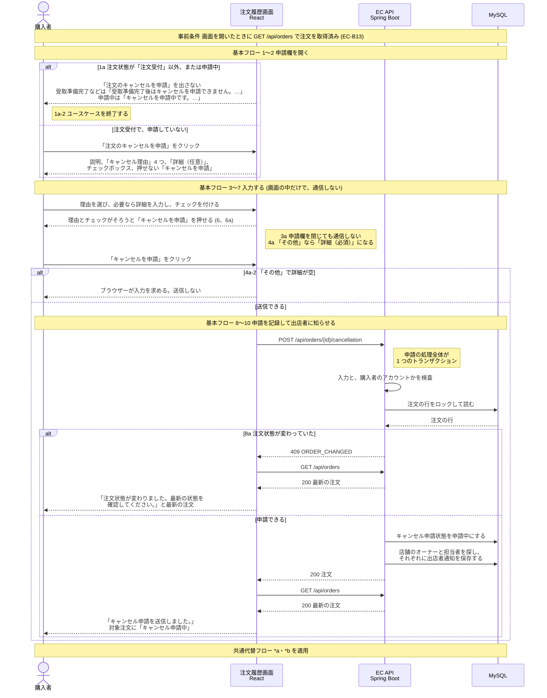
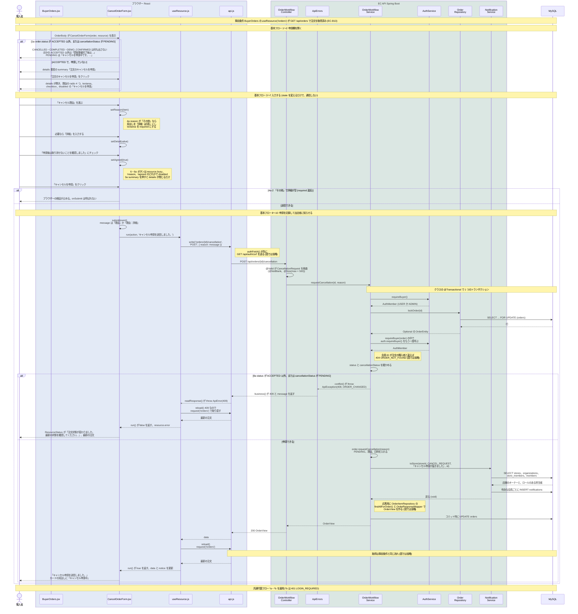

# EC-B14 注文キャンセルを申請する

- ユースケース記述: [EC-B14_注文キャンセルを申請する](<../../アーカイブ/ユースケース/kusakari-ec/EC-B14_注文キャンセルを申請する.md>)
- 対象のコード: kusakari-ec の main（19a2be3、2026-11-20 時点）

## 概要図

## 詳細図

## ユースケース記述との差

- 1a の文「受取準備完了後はキャンセルを申請できません。受取店舗へお問い合わせください。」は、`CancelOrderForm` で `ACCEPTED`・`CANCELLED`・`COMPLETED`・`DEMO_CONFIRMED` 以外のすべての状態に出ます。注文履歴の API（`OrderService.list()`）は支払い待ち（`PENDING_PAYMENT`）の注文も返すので、支払い待ちの注文にも「受取準備完了後は…」が出ます。記述は受取準備完了の場合だけを書いています。
- 基本フロー 10 のあと、対象注文のカードの見出しに「キャンセル申請中」が出るほか、申請欄のあった場所に「キャンセルを申請中です。店舗の回答は通知一覧でもお知らせします。」が出ます（`cancellationStatus` が `PENDING` になるため）。記述には後者がありません。
- 基本フロー 9 の出店者への通知は、申請の記録と同じトランザクションの中で保存します。宛先は、店舗の組織のオーナーと、その店舗でロールが割り振られた担当者のうち、利用中の会員です（`NotificationService.toStore()`）。
- サーバーは次の応答も返しますが、記述にはありません。画面の操作では起きにくいため、図では枝にしていません。
  - 400 `INVALID_INPUT`「入力内容・文字数・数値の範囲を確認してください。」: 理由が空か 500 文字を超えるとき。画面は理由を選ばないとボタンを押せず、詳細の `maxLength` で合計を 500 文字以内にしています。
  - 403 `BUYER_REQUIRED`: 店舗側と出店申請用のアカウントのとき。画面はこれらのアカウントに注文履歴を出しません（`Workspace.jsx` の `isShopAccount()`）。
  - 404 `ORDER_NOT_FOUND`「注文が見つかりません。」: 注文がないか、ほかの購入者の注文のとき。

## 参照したコード

- [frontend/src/workspace/CancelOrderForm.jsx](https://github.com/abeouga/kusakari-ec/blob/19a2be307ee71a2cd87e538236c3c8c42929c5b3/frontend/src/workspace/CancelOrderForm.jsx): `CancelOrderForm`、`submit()`、状態ごとの表示とボタンの `disabled`
- [frontend/src/workspace/BuyerOrders.jsx](https://github.com/abeouga/kusakari-ec/blob/19a2be307ee71a2cd87e538236c3c8c42929c5b3/frontend/src/workspace/BuyerOrders.jsx): `BuyerOrders`、`OrderCard`、`OrderBody`、「キャンセル申請中」の表示
- [frontend/src/workspace/useResource.js](https://github.com/abeouga/kusakari-ec/blob/19a2be307ee71a2cd87e538236c3c8c42929c5b3/frontend/src/workspace/useResource.js): `useResource()`、`run()`、`reload()`、`write()`
- [frontend/src/workspace/ResourceView.jsx](https://github.com/abeouga/kusakari-ec/blob/19a2be307ee71a2cd87e538236c3c8c42929c5b3/frontend/src/workspace/ResourceView.jsx): `ResourceStatus`
- [frontend/src/api.js](https://github.com/abeouga/kusakari-ec/blob/19a2be307ee71a2cd87e538236c3c8c42929c5b3/frontend/src/api.js): `request()`、`send()`、`readResponse()`
- [frontend/src/auth.js](https://github.com/abeouga/kusakari-ec/blob/19a2be307ee71a2cd87e538236c3c8c42929c5b3/frontend/src/auth.js): `authFetch()`（GET 以外の前に `/api/auth/csrf` を読む）
- [backend/src/main/java/jp/kusakari/ec/commerce/controller/OrderWorkflowController.java](https://github.com/abeouga/kusakari-ec/blob/19a2be307ee71a2cd87e538236c3c8c42929c5b3/backend/src/main/java/jp/kusakari/ec/commerce/controller/OrderWorkflowController.java): `request()`、`CancellationRequest`
- [backend/src/main/java/jp/kusakari/ec/commerce/service/OrderWorkflowService.java](https://github.com/abeouga/kusakari-ec/blob/19a2be307ee71a2cd87e538236c3c8c42929c5b3/backend/src/main/java/jp/kusakari/ec/commerce/service/OrderWorkflowService.java): `requestCancellation()`、`requireBuyer()`、`conflict()`、`missing()`、`view()`
- [backend/src/main/java/jp/kusakari/ec/commerce/persistence/repository/OrderRepository.java](https://github.com/abeouga/kusakari-ec/blob/19a2be307ee71a2cd87e538236c3c8c42929c5b3/backend/src/main/java/jp/kusakari/ec/commerce/persistence/repository/OrderRepository.java): `lockOrder()`（`@Lock(PESSIMISTIC_WRITE)`）
- [backend/src/main/java/jp/kusakari/ec/commerce/persistence/entity/OrderEntity.java](https://github.com/abeouga/kusakari-ec/blob/19a2be307ee71a2cd87e538236c3c8c42929c5b3/backend/src/main/java/jp/kusakari/ec/commerce/persistence/entity/OrderEntity.java): `requestCancellation()`
- [backend/src/main/java/jp/kusakari/ec/notification/service/NotificationService.java](https://github.com/abeouga/kusakari-ec/blob/19a2be307ee71a2cd87e538236c3c8c42929c5b3/backend/src/main/java/jp/kusakari/ec/notification/service/NotificationService.java): `toStore()`
- [backend/src/main/java/jp/kusakari/ec/auth/AuthService.java](https://github.com/abeouga/kusakari-ec/blob/19a2be307ee71a2cd87e538236c3c8c42929c5b3/backend/src/main/java/jp/kusakari/ec/auth/AuthService.java): `requireBuyer()`、`current()`
- [backend/src/main/java/jp/kusakari/ec/common/web/ApiErrors.java](https://github.com/abeouga/kusakari-ec/blob/19a2be307ee71a2cd87e538236c3c8c42929c5b3/backend/src/main/java/jp/kusakari/ec/common/web/ApiErrors.java): `business()`、`invalid()`
- [backend/src/main/java/jp/kusakari/ec/commerce/service/OrderService.java](https://github.com/abeouga/kusakari-ec/blob/19a2be307ee71a2cd87e538236c3c8c42929c5b3/backend/src/main/java/jp/kusakari/ec/commerce/service/OrderService.java): `list()`（取り直しの GET /api/orders）
