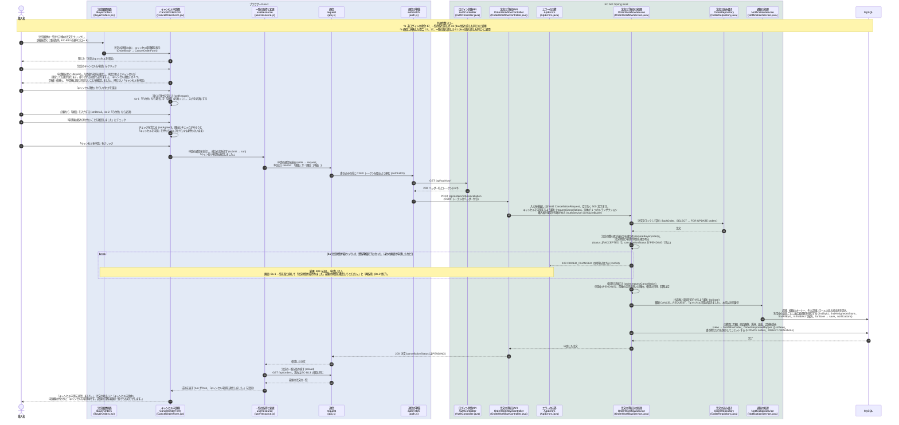
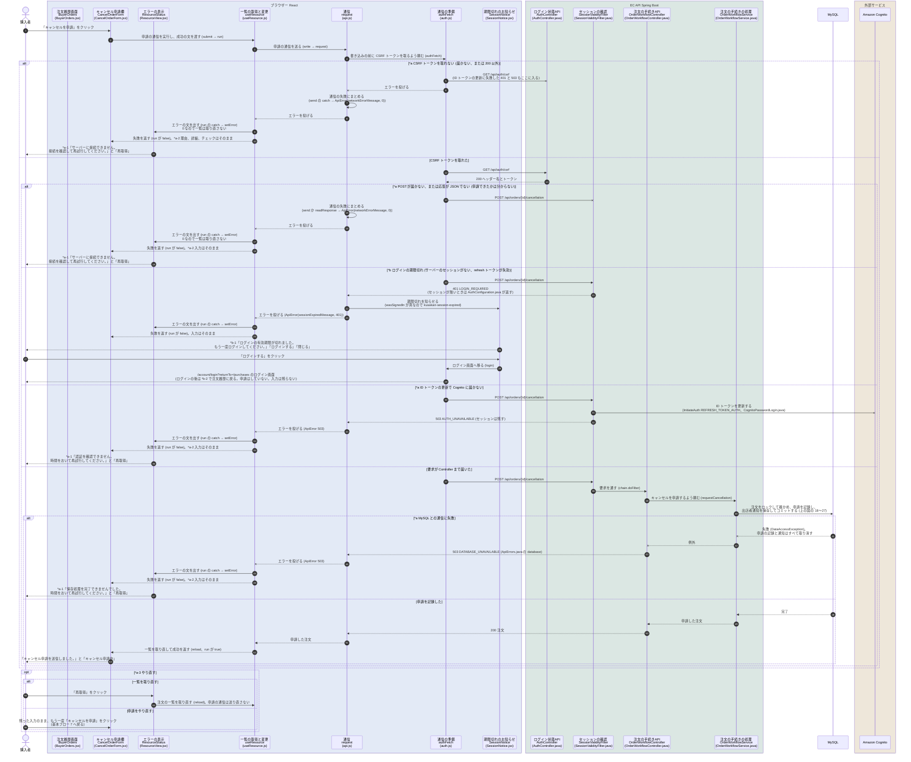

# EC-B14 注文キャンセルを申請する

- ユースケース記述: [EC-B14_注文キャンセルを申請する](<../../アーカイブ/ユースケース/kusakari-ec/EC-B14_注文キャンセルを申請する.md>)
- 共通代替フロー: [00_全ユースケース共通の代替フロー](<00_全ユースケース共通の代替フロー.md>)
- 対象のコード: kusakari-ec の main（6bad7e3、2026-11-24 時点）

## シーケンス図

参加者は、上から「画面や役割の名前」「コンポーネント・クラスの名前」「ファイル名（かっこ付き）」の順に書いています。
共通代替フローの中身は、00 の図か、下の「共通代替フローを直接書いた図」を見てください。
注文履歴の画面を開いて注文を取るまでは [EC-B13](<EC-B13_注文履歴を確認する.md>) の図のとおりです。
エラーは最重要の 8a だけを描き、ほかの代替フローは図の下に並べています。8a のエラーの後処理（`readResponse` が `ApiError` を投げる → 409 なので `reload` で一覧を取り直す → `run` が false → エラーの文と「再取得」を出す）は、Note の「画面:」の 1 行にまとめています。

図に描いていない代替フロー：1a（申請対象外の注文）、3a（申請をやめる）、4a（「その他」で詳細が空）

## 共通代替フローを直接書いた図

上の図の申請の通信（CSRF トークンの取得と `POST /api/orders/{id}/cancellation`）に、この画面で起こる共通代替フロー（\*a、\*b）を書き込んだ図です。注文履歴の画面を開いて注文を取る通信の \*a・\*b は、[EC-B13](<EC-B13_注文履歴を確認する.md>) の「共通代替フローを直接書いた図」と同じなので省いています。

## ユースケース記述との差

- 1a の文「受取準備完了後はキャンセルを申請できません。受取店舗へお問い合わせください。」は、`CancelOrderForm` で `ACCEPTED`・`CANCELLED`・`COMPLETED`・`DEMO_CONFIRMED` 以外のすべての状態に出ます。注文履歴の API（`OrderService.list()`）は支払い待ち（`PENDING_PAYMENT`）の注文も返すので、支払い待ちの注文にも「受取準備完了後は…」が出ます。記述は受取準備完了の場合だけを書いています。キャンセル・引き渡し完了・旧注文には何も出ません。
- 3a は、申請欄（`details` 要素）の見出しをもう一度押して閉じるだけです。選んだ理由・詳細・チェックは画面に残り、もう一度開くとそのまま出ます。
- 基本フロー 10 のあと、注文の見出しに「キャンセル申請中」が出るほか、申請欄のあった場所に「キャンセルを申請中です。店舗の回答は通知一覧でもお知らせします。」が出ます（`cancellationStatus` が `PENDING` になるため）。記述には後者がありません。
- 基本フロー 8 の申請の記録では、理由の前後の空白を取り除いて保存し、店舗からの回答を空に戻します（`OrderEntity.requestCancellation()`）。却下のあとに申請し直したときも、前の回答は消えます。
- 基本フロー 9 の出店者への通知は、申請の記録と同じトランザクションの中で保存します。宛先は、店舗の組織のオーナーと、その店舗でロールが割り振られた担当者のうち、利用中の会員です（`NotificationService.toStore()`）。通知のタイトルは「キャンセル申請が届きました」、本文は注文番号です。
- 「詳細」の入力欄の上限（`maxDetailLength`）は、いちばん長い理由と「：」を足しても 500 文字に収まるように決めています。サーバーは理由と詳細をつないだ文を 500 文字まで受け付けます（`CancellationRequest` の `@Size(max = 500)`）。
- \*b で期限切れのお知らせから「ログインする」を選ぶと、ログインの後に注文履歴を最初から表示し直すので、入力していた理由と詳細は残りません。
- サーバーは次の応答も返しますが、記述にはありません。画面の操作では起きにくいため、図では枝にしていません。
  - 400 `INVALID_INPUT`「入力内容・文字数・数値の範囲を確認してください。」: 理由が空か 500 文字を超えるとき。画面は理由を選ばないとボタンを押せず、詳細の `maxLength` で合計を 500 文字以内にしています。
  - 403 `BUYER_REQUIRED`: 店舗側と出店申請用のアカウントのとき。画面はこれらのアカウントに注文履歴を出しません（`Workspace.jsx` の `isShopAccount()`）。
  - 404 `ORDER_NOT_FOUND`「注文が見つかりません。」: 注文がないか、ほかの購入者の注文のとき。画面は一覧を取り直します（`useResource.js` の `run()`）。
- 申請の前の `GET /api/auth/csrf` も `SessionValidityFilter` を通ります。ID トークンの期限が切れていて refresh トークンも失効していると、この要求が 401 になり、`send()` が「サーバーに接続できません。…」に置き換えるので、\*b のお知らせではなく \*a-1 の文が出ます。

## 参照したコード

- [frontend/src/workspace/CancelOrderForm.jsx](https://github.com/abeouga/kusakari-ec/blob/6bad7e37c4135034fbe97e30309772fbe872e675/frontend/src/workspace/CancelOrderForm.jsx): `CancelOrderForm`、`reasons`、`maxDetailLength`、`submit`、状態ごとの表示とボタンの `disabled`
- [frontend/src/workspace/BuyerOrders.jsx](https://github.com/abeouga/kusakari-ec/blob/6bad7e37c4135034fbe97e30309772fbe872e675/frontend/src/workspace/BuyerOrders.jsx): `BuyerOrders`、`OrderCard`（「キャンセル申請中」）、`OrderBody`
- [frontend/src/workspace/useResource.js](https://github.com/abeouga/kusakari-ec/blob/6bad7e37c4135034fbe97e30309772fbe872e675/frontend/src/workspace/useResource.js): `useResource`、`run`、`reload`、`write`
- [frontend/src/workspace/ResourceView.jsx](https://github.com/abeouga/kusakari-ec/blob/6bad7e37c4135034fbe97e30309772fbe872e675/frontend/src/workspace/ResourceView.jsx): `ResourceStatus`（エラーの文と「再取得」）
- [frontend/src/api.js](https://github.com/abeouga/kusakari-ec/blob/6bad7e37c4135034fbe97e30309772fbe872e675/frontend/src/api.js): `request`、`send`、`readResponse`、`ApiError`、`networkErrorMessage`、`sessionExpiredMessage`
- [frontend/src/auth.js](https://github.com/abeouga/kusakari-ec/blob/6bad7e37c4135034fbe97e30309772fbe872e675/frontend/src/auth.js): `authFetch`（`GET /api/auth/csrf`）、`wasSignedIn`、`login`
- [frontend/src/components/SessionNotice.jsx](https://github.com/abeouga/kusakari-ec/blob/6bad7e37c4135034fbe97e30309772fbe872e675/frontend/src/components/SessionNotice.jsx): 期限切れのお知らせ
- [backend/src/main/java/jp/kusakari/ec/auth/AuthController.java](https://github.com/abeouga/kusakari-ec/blob/6bad7e37c4135034fbe97e30309772fbe872e675/backend/src/main/java/jp/kusakari/ec/auth/AuthController.java): `csrf`
- [backend/src/main/java/jp/kusakari/ec/commerce/controller/OrderWorkflowController.java](https://github.com/abeouga/kusakari-ec/blob/6bad7e37c4135034fbe97e30309772fbe872e675/backend/src/main/java/jp/kusakari/ec/commerce/controller/OrderWorkflowController.java): `request`、`CancellationRequest`
- [backend/src/main/java/jp/kusakari/ec/commerce/service/OrderWorkflowService.java](https://github.com/abeouga/kusakari-ec/blob/6bad7e37c4135034fbe97e30309772fbe872e675/backend/src/main/java/jp/kusakari/ec/commerce/service/OrderWorkflowService.java): `requestCancellation`、`requireBuyer`、`conflict`、`missing`、`view`
- [backend/src/main/java/jp/kusakari/ec/commerce/persistence/repository/OrderRepository.java](https://github.com/abeouga/kusakari-ec/blob/6bad7e37c4135034fbe97e30309772fbe872e675/backend/src/main/java/jp/kusakari/ec/commerce/persistence/repository/OrderRepository.java): `lockOrder`
- [backend/src/main/java/jp/kusakari/ec/commerce/persistence/entity/OrderEntity.java](https://github.com/abeouga/kusakari-ec/blob/6bad7e37c4135034fbe97e30309772fbe872e675/backend/src/main/java/jp/kusakari/ec/commerce/persistence/entity/OrderEntity.java): `requestCancellation`
- [backend/src/main/java/jp/kusakari/ec/notification/service/NotificationService.java](https://github.com/abeouga/kusakari-ec/blob/6bad7e37c4135034fbe97e30309772fbe872e675/backend/src/main/java/jp/kusakari/ec/notification/service/NotificationService.java): `toStore`
- [backend/src/main/java/jp/kusakari/ec/notification/persistence/entity/NotificationEntity.java](https://github.com/abeouga/kusakari-ec/blob/6bad7e37c4135034fbe97e30309772fbe872e675/backend/src/main/java/jp/kusakari/ec/notification/persistence/entity/NotificationEntity.java): `CANCEL_REQUEST`、`forStore`
- [backend/src/main/java/jp/kusakari/ec/store/persistence/repository/StoreMemberRepository.java](https://github.com/abeouga/kusakari-ec/blob/6bad7e37c4135034fbe97e30309772fbe872e675/backend/src/main/java/jp/kusakari/ec/store/persistence/repository/StoreMemberRepository.java): `findAssignedAtStore`
- [backend/src/main/java/jp/kusakari/ec/commerce/mapper/OrderResponseMapper.java](https://github.com/abeouga/kusakari-ec/blob/6bad7e37c4135034fbe97e30309772fbe872e675/backend/src/main/java/jp/kusakari/ec/commerce/mapper/OrderResponseMapper.java): `toView`
- [backend/src/main/java/jp/kusakari/ec/auth/AuthService.java](https://github.com/abeouga/kusakari-ec/blob/6bad7e37c4135034fbe97e30309772fbe872e675/backend/src/main/java/jp/kusakari/ec/auth/AuthService.java): `requireBuyer`、`current`
- [backend/src/main/java/jp/kusakari/ec/commerce/service/OrderService.java](https://github.com/abeouga/kusakari-ec/blob/6bad7e37c4135034fbe97e30309772fbe872e675/backend/src/main/java/jp/kusakari/ec/commerce/service/OrderService.java): `list`（取り直しの `GET /api/orders`）
- [backend/src/main/java/jp/kusakari/ec/auth/SessionValidityFilter.java](https://github.com/abeouga/kusakari-ec/blob/6bad7e37c4135034fbe97e30309772fbe872e675/backend/src/main/java/jp/kusakari/ec/auth/SessionValidityFilter.java): `doFilterInternal`、`renewIdToken`
- [backend/src/main/java/jp/kusakari/ec/auth/CognitoPasswordLogin.java](https://github.com/abeouga/kusakari-ec/blob/6bad7e37c4135034fbe97e30309772fbe872e675/backend/src/main/java/jp/kusakari/ec/auth/CognitoPasswordLogin.java): ID トークンの更新、503 `AUTH_UNAVAILABLE`
- [backend/src/main/java/jp/kusakari/ec/auth/AuthConfiguration.java](https://github.com/abeouga/kusakari-ec/blob/6bad7e37c4135034fbe97e30309772fbe872e675/backend/src/main/java/jp/kusakari/ec/auth/AuthConfiguration.java): `authenticationEntryPoint`（401 `LOGIN_REQUIRED`）
- [backend/src/main/java/jp/kusakari/ec/common/web/ApiErrors.java](https://github.com/abeouga/kusakari-ec/blob/6bad7e37c4135034fbe97e30309772fbe872e675/backend/src/main/java/jp/kusakari/ec/common/web/ApiErrors.java): `business`、`invalid`、`database`
