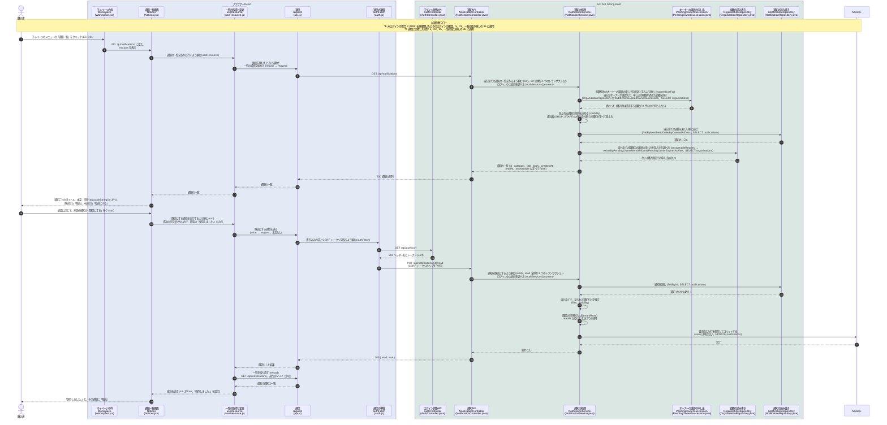
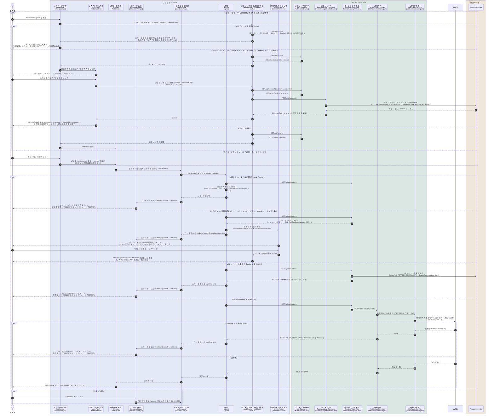
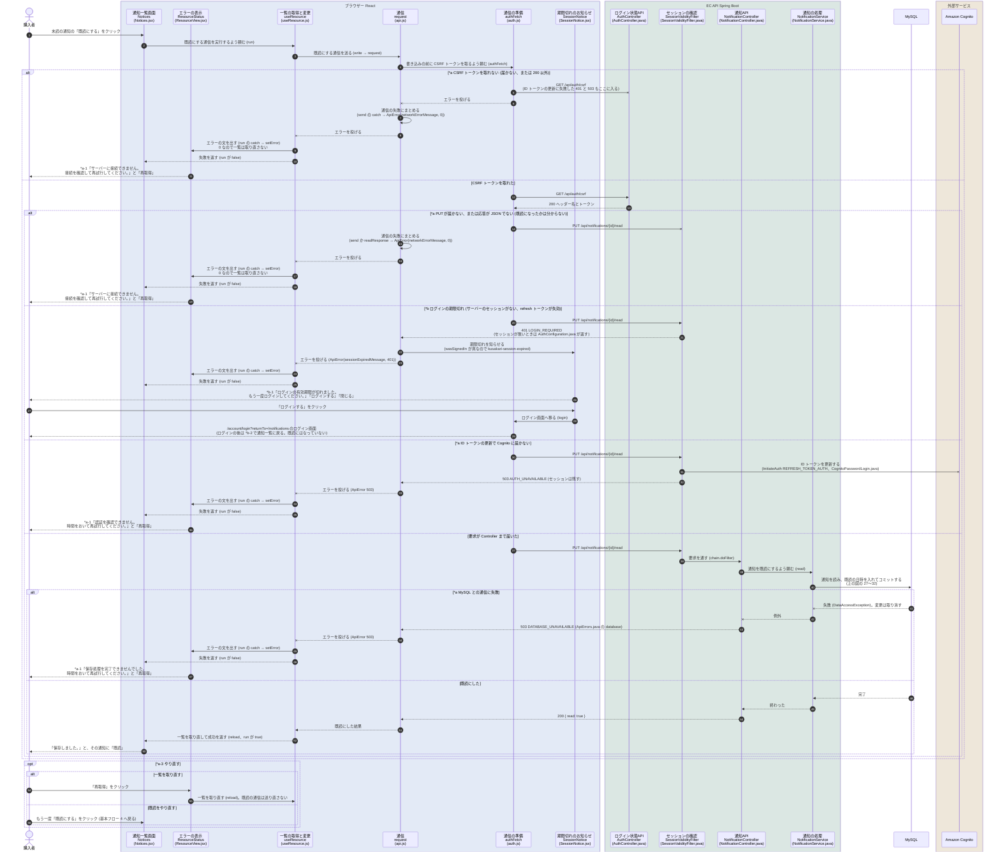

# EC-B15 利用者通知を確認する

- ユースケース記述: [EC-B15_利用者通知を確認する](<../../アーカイブ/ユースケース/kusakari-ec/EC-B15_利用者通知を確認する.md>)
- 共通代替フロー: [00_全ユースケース共通の代替フロー](<00_全ユースケース共通の代替フロー.md>)
- 対象のコード: kusakari-ec の main（6bad7e3、2026-11-24 時点）

## シーケンス図

参加者は、上から「画面や役割の名前」「コンポーネント・クラスの名前」「ファイル名（かっこ付き）」の順に書いています。
共通代替フローの中身は、00 の図か、下の「共通代替フローを直接書いた図」を見てください。
エラーの分岐は描かず、代替フローは図の下に並べています。

図に描いていない代替フロー：2a（通知がない）、（記述なし）の分岐

## 共通代替フローを直接書いた図

上の図の通信に、この画面で起こる共通代替フロー（\*a、\*b）を書き込んだ図です。画面を開いて一覧を取る通信と、「既読にする」の通信の 2 つに分けています。

### 画面を開いて通知の一覧を取る

`useAuth()` が `GET /api/auth/me` でログイン状態を読むのは、通知一覧の URL を直接開いたとき（再読み込みを含む）だけです。マイページのメニューから開いたときは、`Workspace` がすでに表示されているので読み直しません。

### 「既読にする」

## ユースケース記述との差

- 基本フロー 5 で「既読にする」を押すと、その通知に「既読」が出るほか、一覧の上に「保存しました。」も出ます。`Notices.jsx` が `run()` に成功の文を渡さないので、`useResource.js` の `run()` の既定の文が出ます。記述には「保存しました。」がありません。
- 基本フロー 2 の通知の取得では、通知を読む前に、自分がオーナーか譲渡先の組織に、期限が過ぎたオーナーの譲渡の申し出がないかを調べ、あれば無効にします（`PendingOwnerSuccession.expireIfDueFor()`）。購入者は組織に属さないので、何も変わりません。記述にない処理です。
- 「通知一覧」の画面（`Notices`）は、出店者通知（`/seller/notifications`）と共用です。オーナーの譲渡の申し出の通知には「重要」の印と「承認する」「断る」ボタンが出ますが、購入者には届かない種類の通知なので、図には描いていません。
- 404 `NOTICE_NOT_FOUND`「通知が見つかりません。」は記述にない分岐です。画面は自分の一覧にある通知の ID を送り、購入者は自分あての通知がすべて見えるので（`visibility()`）、購入者の画面の操作ではふつう起きません。通知を消す処理はコードに見つかりませんでした。
- 既読の通知に「既読にする」は出ませんが、同じ通知を 2 回既読にしても、`markRead()` は最初の日時を変えません。
- 「既読にする」の前の `GET /api/auth/csrf` も `SessionValidityFilter` を通ります。ID トークンの期限が切れていて refresh トークンも失効していると、この要求が 401 になり、`authFetch()` が例外を投げます。`send()` がこれを「サーバーに接続できません。…」に置き換えるので、\*b の期限切れのお知らせ（`SessionNotice`）は出ず、\*a-1 の文が出ます。サーバーのセッションそのものが無いときは、`/api/auth/csrf` は 200 を返し、次の `PUT` が 401 になるので、\*b のお知らせが出ます。
- 通知一覧の URL を直接開いたときにログイン状態を読めないと（\*a）、`Workspace.jsx` はエラーの文だけを出し、「再取得」のボタンはありません。届かないときの文はブラウザーが作る文（`fetch()` の例外）で、\*a-1 の共通の文にはなりません。

## 参照したコード

- [frontend/src/workspace/Workspace.jsx](https://github.com/abeouga/kusakari-ec/blob/6bad7e37c4135034fbe97e30309772fbe872e675/frontend/src/workspace/Workspace.jsx): `buyerMenu` の「通知一覧」、`Workspace`（`error` の表示、未ログインの `AuthPanel`、`path.endsWith('/notifications')` で `Notices` を表示）
- [frontend/src/workspace/WorkspaceSidebar.jsx](https://github.com/abeouga/kusakari-ec/blob/6bad7e37c4135034fbe97e30309772fbe872e675/frontend/src/workspace/WorkspaceSidebar.jsx): `WorkspaceSidebar`、`MenuLink`
- [frontend/src/workspace/Common.jsx](https://github.com/abeouga/kusakari-ec/blob/6bad7e37c4135034fbe97e30309772fbe872e675/frontend/src/workspace/Common.jsx): `PageLink`
- [frontend/src/workspace/navigation.js](https://github.com/abeouga/kusakari-ec/blob/6bad7e37c4135034fbe97e30309772fbe872e675/frontend/src/workspace/navigation.js): `navigate`
- [frontend/src/workspace/Notices.jsx](https://github.com/abeouga/kusakari-ec/blob/6bad7e37c4135034fbe97e30309772fbe872e675/frontend/src/workspace/Notices.jsx): `Notices`（「通知はありません。」、「既読」と「既読にする」、`IMPORTANT_CATEGORIES`、承認・断りのボタン）
- [frontend/src/workspace/useResource.js](https://github.com/abeouga/kusakari-ec/blob/6bad7e37c4135034fbe97e30309772fbe872e675/frontend/src/workspace/useResource.js): `useResource`、`reload`、`run`（既定の文「保存しました。」）、`write`
- [frontend/src/workspace/ResourceView.jsx](https://github.com/abeouga/kusakari-ec/blob/6bad7e37c4135034fbe97e30309772fbe872e675/frontend/src/workspace/ResourceView.jsx): `ResourceStatus`（エラーの文と「再取得」）
- [frontend/src/api.js](https://github.com/abeouga/kusakari-ec/blob/6bad7e37c4135034fbe97e30309772fbe872e675/frontend/src/api.js): `request`、`send`、`readResponse`、`ApiError`、`networkErrorMessage`、`sessionExpiredMessage`
- [frontend/src/auth.js](https://github.com/abeouga/kusakari-ec/blob/6bad7e37c4135034fbe97e30309772fbe872e675/frontend/src/auth.js): `readSession`、`authFetch`（`GET /api/auth/csrf`）、`wasSignedIn`、`login`、`postAuth`、`passwordLogin`
- [frontend/src/useAuth.js](https://github.com/abeouga/kusakari-ec/blob/6bad7e37c4135034fbe97e30309772fbe872e675/frontend/src/useAuth.js): `useAuth`
- [frontend/src/components/AuthPanel.jsx](https://github.com/abeouga/kusakari-ec/blob/6bad7e37c4135034fbe97e30309772fbe872e675/frontend/src/components/AuthPanel.jsx): `AuthPanel`、`submit`、`complete`
- [frontend/src/components/SessionNotice.jsx](https://github.com/abeouga/kusakari-ec/blob/6bad7e37c4135034fbe97e30309772fbe872e675/frontend/src/components/SessionNotice.jsx): 期限切れのお知らせ
- [backend/src/main/java/jp/kusakari/ec/notification/controller/NotificationController.java](https://github.com/abeouga/kusakari-ec/blob/6bad7e37c4135034fbe97e30309772fbe872e675/backend/src/main/java/jp/kusakari/ec/notification/controller/NotificationController.java): `list`、`read`
- [backend/src/main/java/jp/kusakari/ec/notification/service/NotificationService.java](https://github.com/abeouga/kusakari-ec/blob/6bad7e37c4135034fbe97e30309772fbe872e675/backend/src/main/java/jp/kusakari/ec/notification/service/NotificationService.java): `list`、`answerableRequest`、`read`、`visibility`、`Notice`
- [backend/src/main/java/jp/kusakari/ec/notification/persistence/repository/NotificationRepository.java](https://github.com/abeouga/kusakari-ec/blob/6bad7e37c4135034fbe97e30309772fbe872e675/backend/src/main/java/jp/kusakari/ec/notification/persistence/repository/NotificationRepository.java): `findByMemberIdOrderByCreatedAtDesc`、`findById`（JpaRepository）
- [backend/src/main/java/jp/kusakari/ec/notification/persistence/entity/NotificationEntity.java](https://github.com/abeouga/kusakari-ec/blob/6bad7e37c4135034fbe97e30309772fbe872e675/backend/src/main/java/jp/kusakari/ec/notification/persistence/entity/NotificationEntity.java): `markRead`
- [backend/src/main/java/jp/kusakari/ec/store/service/PendingOwnerSuccession.java](https://github.com/abeouga/kusakari-ec/blob/6bad7e37c4135034fbe97e30309772fbe872e675/backend/src/main/java/jp/kusakari/ec/store/service/PendingOwnerSuccession.java): `expireIfDueFor`
- [backend/src/main/java/jp/kusakari/ec/store/persistence/repository/OrganizationRepository.java](https://github.com/abeouga/kusakari-ec/blob/6bad7e37c4135034fbe97e30309772fbe872e675/backend/src/main/java/jp/kusakari/ec/store/persistence/repository/OrganizationRepository.java): `findIdsWithExpiredOwnerSuccession`、`existsByPendingOwnerMemberIdAndPendingOwnerExpiresAtAfter`
- [backend/src/main/java/jp/kusakari/ec/auth/AuthService.java](https://github.com/abeouga/kusakari-ec/blob/6bad7e37c4135034fbe97e30309772fbe872e675/backend/src/main/java/jp/kusakari/ec/auth/AuthService.java): `current`、`session`
- [backend/src/main/java/jp/kusakari/ec/auth/AuthController.java](https://github.com/abeouga/kusakari-ec/blob/6bad7e37c4135034fbe97e30309772fbe872e675/backend/src/main/java/jp/kusakari/ec/auth/AuthController.java): `me`、`csrf`
- [backend/src/main/java/jp/kusakari/ec/auth/PasswordLoginController.java](https://github.com/abeouga/kusakari-ec/blob/6bad7e37c4135034fbe97e30309772fbe872e675/backend/src/main/java/jp/kusakari/ec/auth/PasswordLoginController.java): `POST /api/auth/login`
- [backend/src/main/java/jp/kusakari/ec/auth/SessionValidityFilter.java](https://github.com/abeouga/kusakari-ec/blob/6bad7e37c4135034fbe97e30309772fbe872e675/backend/src/main/java/jp/kusakari/ec/auth/SessionValidityFilter.java): `doFilterInternal`、`renewIdToken`（ID トークンの更新、401 `LOGIN_REQUIRED`）
- [backend/src/main/java/jp/kusakari/ec/auth/CognitoPasswordLogin.java](https://github.com/abeouga/kusakari-ec/blob/6bad7e37c4135034fbe97e30309772fbe872e675/backend/src/main/java/jp/kusakari/ec/auth/CognitoPasswordLogin.java): `authenticate`、`refresh`、503 `AUTH_UNAVAILABLE`
- [backend/src/main/java/jp/kusakari/ec/auth/AuthConfiguration.java](https://github.com/abeouga/kusakari-ec/blob/6bad7e37c4135034fbe97e30309772fbe872e675/backend/src/main/java/jp/kusakari/ec/auth/AuthConfiguration.java): `authenticationEntryPoint`（セッションが無いときの 401 `LOGIN_REQUIRED`）
- [backend/src/main/java/jp/kusakari/ec/common/web/ApiErrors.java](https://github.com/abeouga/kusakari-ec/blob/6bad7e37c4135034fbe97e30309772fbe872e675/backend/src/main/java/jp/kusakari/ec/common/web/ApiErrors.java): `business`、`database`
