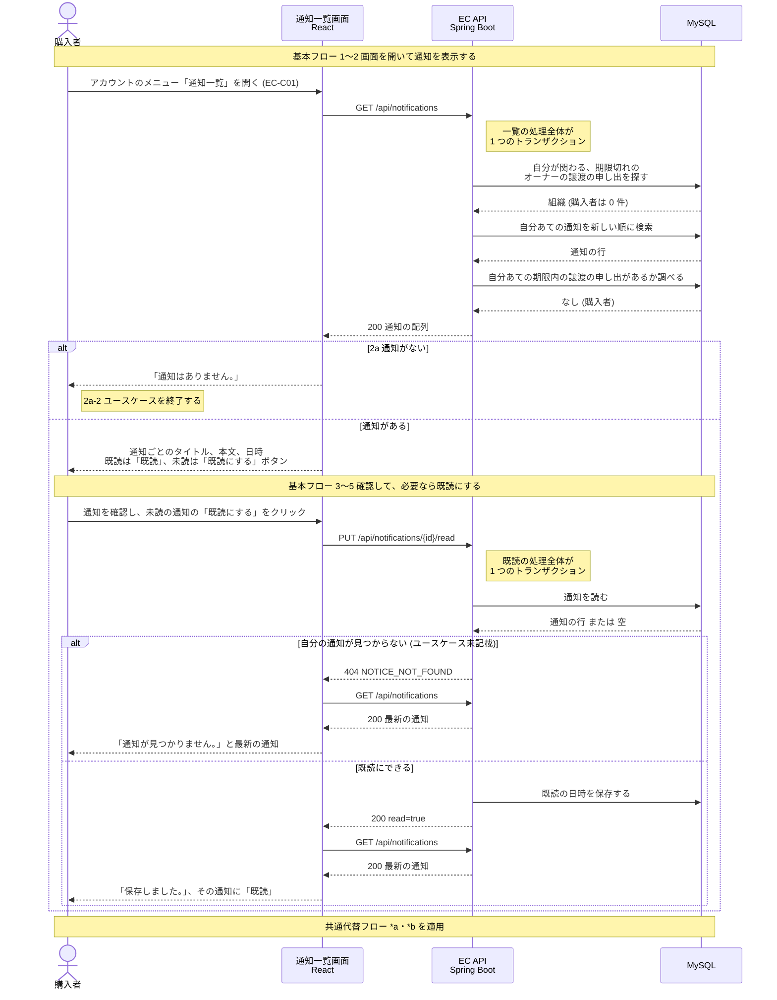
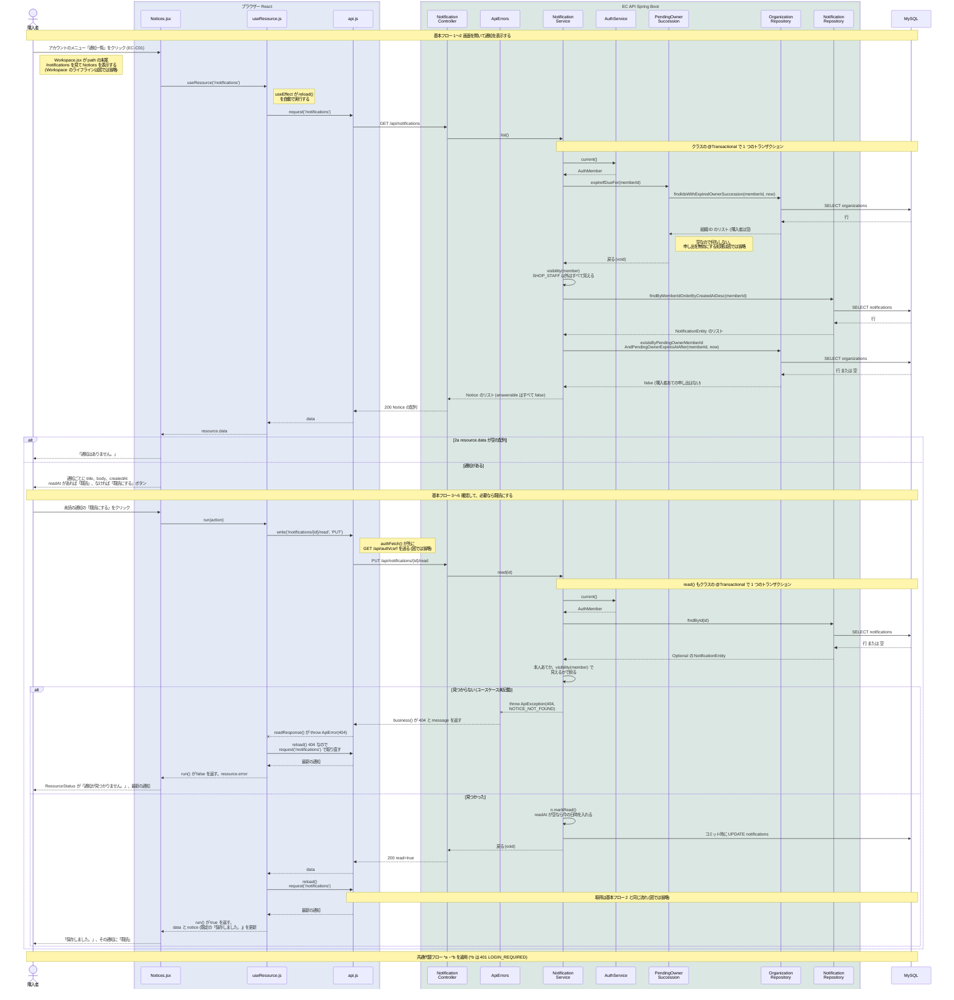

# EC-B15 利用者通知を確認する

- ユースケース記述: [EC-B15_利用者通知を確認する](<../../アーカイブ/ユースケース/kusakari-ec/EC-B15_利用者通知を確認する.md>)
- 対象のコード: kusakari-ec の main（19a2be3、2026-11-20 時点）

## 概要図

## 詳細図

## ユースケース記述との差

- 基本フロー 5 で「既読にする」を押すと、その通知に「既読」が出るほか、一覧の上に「保存しました。」も出ます。`Notices.jsx` が `run()` にメッセージを渡しておらず、`useResource.js` の `run()` の既定のメッセージが使われるためです。記述には「保存しました。」がありません。
- 基本フロー 2 の通知の取得では、通知を読む前に、自分がオーナーか譲渡先の組織に期限切れのオーナーの譲渡の申し出がないかを調べ、あれば無効にします（`PendingOwnerSuccession.expireIfDueFor()`）。購入者は組織に属さないので、何も変わりません。
- 「通知一覧」の画面（`Notices`）は出店者通知（`/seller/notifications`）と共用です。オーナーの譲渡の申し出の通知には「重要」の印と「承認する」「断る」ボタンが出ますが、購入者には届かない種類の通知なので、記述にはありません。
- 404 `NOTICE_NOT_FOUND`「通知が見つかりません。」は記述にありません。画面は自分の一覧にある通知の ID を送り、購入者は自分あての通知がすべて見えるので（`visibility()`）、購入者の画面の操作ではふつう起きません。通知を消す処理はコードに見つかりませんでした。

## 参照したコード

- [frontend/src/workspace/Notices.jsx](https://github.com/abeouga/kusakari-ec/blob/19a2be307ee71a2cd87e538236c3c8c42929c5b3/frontend/src/workspace/Notices.jsx): `Notices`、「通知はありません。」、「既読」と「既読にする」の表示
- [frontend/src/workspace/Workspace.jsx](https://github.com/abeouga/kusakari-ec/blob/19a2be307ee71a2cd87e538236c3c8c42929c5b3/frontend/src/workspace/Workspace.jsx): `buyerMenu` の「通知一覧」、`path.endsWith('/notifications')` で `Notices` を表示
- [frontend/src/workspace/useResource.js](https://github.com/abeouga/kusakari-ec/blob/19a2be307ee71a2cd87e538236c3c8c42929c5b3/frontend/src/workspace/useResource.js): `useResource()`、`run()`（既定のメッセージ「保存しました。」）、`reload()`、`write()`
- [frontend/src/workspace/ResourceView.jsx](https://github.com/abeouga/kusakari-ec/blob/19a2be307ee71a2cd87e538236c3c8c42929c5b3/frontend/src/workspace/ResourceView.jsx): `ResourceStatus`
- [frontend/src/api.js](https://github.com/abeouga/kusakari-ec/blob/19a2be307ee71a2cd87e538236c3c8c42929c5b3/frontend/src/api.js): `request()`、`readResponse()`
- [frontend/src/auth.js](https://github.com/abeouga/kusakari-ec/blob/19a2be307ee71a2cd87e538236c3c8c42929c5b3/frontend/src/auth.js): `authFetch()`
- [backend/src/main/java/jp/kusakari/ec/notification/controller/NotificationController.java](https://github.com/abeouga/kusakari-ec/blob/19a2be307ee71a2cd87e538236c3c8c42929c5b3/backend/src/main/java/jp/kusakari/ec/notification/controller/NotificationController.java): `list()`、`read()`
- [backend/src/main/java/jp/kusakari/ec/notification/service/NotificationService.java](https://github.com/abeouga/kusakari-ec/blob/19a2be307ee71a2cd87e538236c3c8c42929c5b3/backend/src/main/java/jp/kusakari/ec/notification/service/NotificationService.java): `list()`、`answerableRequest()`、`read()`、`visibility()`
- [backend/src/main/java/jp/kusakari/ec/notification/persistence/repository/NotificationRepository.java](https://github.com/abeouga/kusakari-ec/blob/19a2be307ee71a2cd87e538236c3c8c42929c5b3/backend/src/main/java/jp/kusakari/ec/notification/persistence/repository/NotificationRepository.java): `findByMemberIdOrderByCreatedAtDesc()`
- [backend/src/main/java/jp/kusakari/ec/notification/persistence/entity/NotificationEntity.java](https://github.com/abeouga/kusakari-ec/blob/19a2be307ee71a2cd87e538236c3c8c42929c5b3/backend/src/main/java/jp/kusakari/ec/notification/persistence/entity/NotificationEntity.java): `markRead()`
- [backend/src/main/java/jp/kusakari/ec/store/service/PendingOwnerSuccession.java](https://github.com/abeouga/kusakari-ec/blob/19a2be307ee71a2cd87e538236c3c8c42929c5b3/backend/src/main/java/jp/kusakari/ec/store/service/PendingOwnerSuccession.java): `expireIfDueFor()`
- [backend/src/main/java/jp/kusakari/ec/store/persistence/repository/OrganizationRepository.java](https://github.com/abeouga/kusakari-ec/blob/19a2be307ee71a2cd87e538236c3c8c42929c5b3/backend/src/main/java/jp/kusakari/ec/store/persistence/repository/OrganizationRepository.java): `findIdsWithExpiredOwnerSuccession()`、`existsByPendingOwnerMemberIdAndPendingOwnerExpiresAtAfter()`
- [backend/src/main/java/jp/kusakari/ec/auth/AuthService.java](https://github.com/abeouga/kusakari-ec/blob/19a2be307ee71a2cd87e538236c3c8c42929c5b3/backend/src/main/java/jp/kusakari/ec/auth/AuthService.java): `current()`
- [backend/src/main/java/jp/kusakari/ec/common/web/ApiErrors.java](https://github.com/abeouga/kusakari-ec/blob/19a2be307ee71a2cd87e538236c3c8c42929c5b3/backend/src/main/java/jp/kusakari/ec/common/web/ApiErrors.java): `business()`
