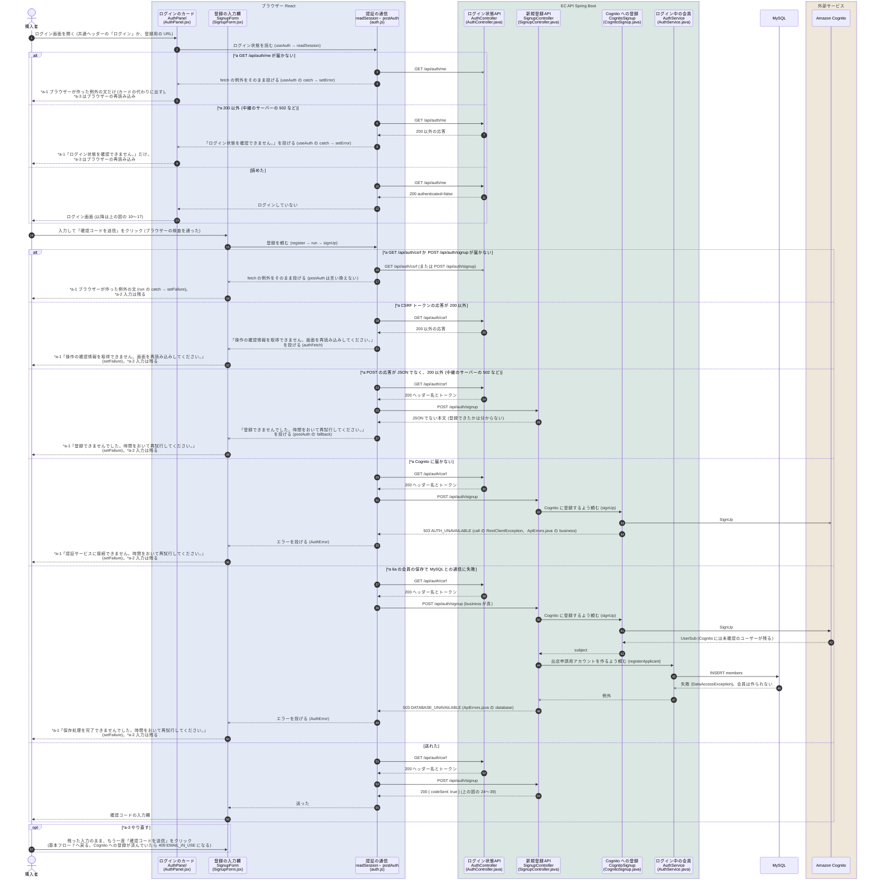

# EC-B16 一般アカウントを登録する

- ユースケース記述: [EC-B16_一般アカウントを登録する](<../../アーカイブ/ユースケース/kusakari-ec/EC-B16_一般アカウントを登録する.md>)
- 共通代替フロー: [00_全ユースケース共通の代替フロー](<00_全ユースケース共通の代替フロー.md>)
- 対象のコード: kusakari-ec の main（6bad7e3、2026-11-24 時点）

## シーケンス図

参加者は、上から「画面や役割の名前」「コンポーネント・クラスの名前」「ファイル名（かっこ付き）」の順に書いています。
新規登録は、ログイン画面（`/account/login`）のカードの中で入力欄を切り替えて行います。EC API が Amazon Cognito の `SignUp`、`ConfirmSignUp`、`ResendConfirmationCode` を呼び、確認コードが通ったら EC-B01 と同じ `POST /api/auth/login` でログインします。会員（`members` の行）を作る時点は、通常の登録では確認のあとのログイン、企業様向け（6a）と招待キー（3a）では確認コードの送信のときです。共通代替フローの中身は、00 の図か、下の「共通代替フローを直接書いた図」を見てください。
代替フローのうち、エラーで終わるもの（8a・8b・11a）は分かれる所だけを描き、結果と画面は Note に文で書いています。6a-2 の出店申請用アカウントの作成と、11a-2 の確認コードの再送は、頼む矢印 1 本と Note に寄せています。3a の招待キーでの登録は、そこでしか起きないやり取り（招待キーのロックと担当者の会員などの保存）を矢印で描いています。確認のあとのログインの Cognito とのやり取りは EC-B01 の図と同じなので、矢印 1 本にまとめています。

```mermaid
sequenceDiagram
    autonumber
    actor User as 購入者
    box rgba(47,111,219,0.10) ブラウザー React
        participant Header as 共通ヘッダー<br/>KusakariHeader<br/>(KusakariHeader.jsx)
        participant App as 画面の切り替え<br/>App<br/>(App.jsx)
        participant Login as ログイン画面<br/>LoginPage<br/>(LoginPage.jsx)
        participant Panel as ログインのカード<br/>AuthPanel<br/>(AuthPanel.jsx)
        participant Form as 登録の入力欄<br/>SignupForm<br/>(SignupForm.jsx)
        participant AuthJs as 認証の通信<br/>readSession・postAuth<br/>(auth.js)
    end
    box rgba(27,127,92,0.12) EC API Spring Boot
        participant AuthCtrl as ログイン状態API<br/>AuthController<br/>(AuthController.java)
        participant SignupCtrl as 新規登録API<br/>SignupController<br/>(SignupController.java)
        participant Errs as エラーの応答<br/>ApiErrors<br/>(ApiErrors.java)
        participant Inv as 招待キーの処理<br/>StoreInvitationService<br/>(StoreInvitationService.java)
        participant CogS as Cognito への登録<br/>CognitoSignup<br/>(CognitoSignup.java)
        participant LoginCtrl as ログインAPI<br/>PasswordLoginController<br/>(PasswordLoginController.java)
        participant CogP as Cognito でのログイン<br/>CognitoPasswordLogin<br/>(CognitoPasswordLogin.java)
        participant Auth as ログイン中の会員<br/>AuthService<br/>(AuthService.java)
        participant Repo as 会員の読み書き<br/>AuthMemberRepository<br/>(AuthMemberRepository.java)
    end
    participant Db as MySQL
    box rgba(180,120,20,0.12) 外部サービス
        participant Cog as Amazon Cognito
    end

    Note over User,Cog: 共通代替フロー<br/>*a 通信に失敗した場合: 8、20、22、46、50、56、71 に適用<br/>*b 未ログインの場合: ログインの前なので適用しない

    alt 基本フロー 1 共通ヘッダーから開く
        User->>Header: 「メイン」画面の共通ヘッダーの「ログイン」をクリック
        Header->>App: ログインを開くよう伝える (onPanel('login') → openHeaderPanel)
        App->>Login: URL を /account/login?returnTo=元の URL に変え、<br/>LoginPage を表示 (login → navigate)
    else 3a-1 登録用の URL を開く
        User->>App: 店舗から受け取った登録用の URL<br/>(/account/login?invite=招待キー) を開く
        App->>Login: path が /account/login なので LoginPage を表示<br/>(invitationInUrl があるので、見出しは「招待キーで登録」)
    end
    Login->>Panel: ログインのカードを表示 (AuthPanel)
    Panel->>AuthJs: ログイン状態を読む (useAuth → readSession)<br/>LoginPage の useAuth も同じ GET を送る
    AuthJs->>AuthCtrl: GET /api/auth/me
    AuthCtrl-->>AuthJs: 200 authenticated=false<br/>(session が current の 401 を受け止める)
    Panel-->>User: 2「ログイン」画面 (メールアドレス、パスワード、「ログイン」、<br/>「新規登録」「招待キーで登録（店舗の担当者）」)。<br/>登録用の URL から開いたときは、すぐに招待キーの登録の入力欄を出す

    alt 3a 招待キーで登録する
        User->>Panel: 3a-1「招待キーで登録（店舗の担当者）」をクリック<br/>(登録用の URL から開いたときは押さない)
        Panel->>Form: 3a-2 登録の入力欄を表示 (switchMode('invite') → onModeChange、SignupForm)。<br/>見出しは「招待キーで登録」。「招待キー」の欄 (URL を開いたときはキーが入っている)
    else 新規登録
        User->>Panel: 3「新規登録」をクリック
        Panel->>Form: 4 登録の入力欄を表示 (switchMode('signup') → onModeChange、SignupForm)。<br/>見出しは「新規登録」。「企業様向け：出店を申請するアカウントとして登録する」
    end
    Form-->>User: 「メールアドレス」「パスワード（8文字以上）」「パスワード（確認）」、<br/>「企業様向け：…」か「招待キー」、「確認コードを送信」

    User->>Form: 5・6 メールアドレス、パスワード、確認用のパスワードを入力<br/>(3a-3 なら招待キーも。6a-1 企業様向けならチェックを付ける)
    User->>Form: 7「確認コードを送信」をクリック
    break 8a 未入力、メールアドレスの形式違い、8 文字未満、招待キーが 43 文字でない
        Form-->>User: ブラウザーが入力を求める (required、type=email、minLength、pattern)。<br/>通信しない。8a-2 基本フロー 5 へ戻る
    end
    Form->>AuthJs: 登録を頼む (register → run → signUp)<br/>ボタンは「登録中…」
    AuthJs->>AuthCtrl: 書き込みの前に CSRF トークンを取る<br/>(postAuth → authFetch、GET /api/auth/csrf)
    AuthCtrl-->>AuthJs: 200 ヘッダー名とトークン (csrf)
    AuthJs->>SignupCtrl: POST /api/auth/signup<br/>(email、password、confirmPassword、business、invitationKey)
    break 8a 入力の形式の違反か、確認用のパスワードと一致しない
        SignupCtrl--xErrs: 400 INVALID_INPUT (SignupRequest の @Valid) か<br/>400 PASSWORD_MISMATCH (ApiException) の例外を投げる
        Note over Errs,Form: 結果: 400 を返し、登録しない。<br/>画面: 8a-1「入力内容・文字数・数値の範囲を確認してください。」か「パスワードと確認用パスワードが一致しません。」。入力は残る (8a-2 基本フロー 5 へ)。
    end
    alt 招待キーなし
        SignupCtrl->>CogS: Cognito に登録するよう頼む (signUp)
        CogS->>Cog: 8 SignUp (Username と email にメールアドレス)
        break 8a Cognito が受け付けない (UsernameExistsException、InvalidPasswordException など)
            CogS--xErrs: 409 EMAIL_IN_USE、400 PASSWORD_REJECTED などの<br/>例外を投げる (call → translate)
            Note over Errs,Form: 結果: 409 か 400 を返し、登録しない。<br/>画面: 8a-1「このメールアドレスは既に登録されています。ログインしてください。」か「パスワードが条件を満たしていません。…」など。入力は残る (8a-2 基本フロー 5 へ)。
        end
        Cog-->>CogS: 未確認のユーザーの UserSub。<br/>9 Cognito が確認コードのメールを送る
        CogS-->>SignupCtrl: subject
        opt 6a-2 企業様向けの登録 (business が真)
            SignupCtrl->>Auth: 出店申請用アカウントを作るよう頼む (registerApplicant)
            Note over SignupCtrl,Db: 結果: 同じ利用者の会員がいなければ (findByIssuerAndSubject、SELECT members)、<br/>出店申請用 (SHOP_OWNER_APPLICANT) の会員を保存してコミットする (saveAndFlush、INSERT members)。
        end
    else 3a-3 招待キーがある
        SignupCtrl->>Inv: 招待キーで登録するよう頼む (register)<br/>register 全体が 1 つのトランザクション
        Inv->>Db: 招待キーの行をロックして読み、使用回数・店舗・組織を読む<br/>(lockByKeyHash、countForInvitation、findById。SELECT ... FOR UPDATE store_invitations ほか)
        break 8b 招待キーが使えない (キーが無い、取り消し済み、期限切れ、使用済み、<br/>店舗の閉鎖・停止、組織の停止)
            Inv--xErrs: 400 INVITATION_INVALID の例外を投げる (invalid)
            Note over Errs,Form: 結果: 400 を返し、Cognito には登録しない。<br/>画面: 8b-1「招待キーが無効です。期限切れ・取り消し済み・使用済みのキーは使えません。…」。入力は残る (8b-2 代替フロー 3a-3 へ)。
        end
        Inv->>CogS: Cognito に登録するよう頼む (signUp.get → signUp)
        CogS->>Cog: 8 SignUp
        break 8a Cognito が受け付けない (UsernameExistsException など)
            CogS--xErrs: 409 EMAIL_IN_USE などの例外を投げる (translate)
            Note over Errs,Form: 結果: トランザクションを取り消してキーのロックを外し、409 などを返す。<br/>画面: 8a-1 応答の文。入力は残る (8a-2 基本フロー 5 へ)。
        end
        Cog-->>CogS: 未確認のユーザーの UserSub。<br/>9 Cognito が確認コードのメールを送る
        CogS-->>Inv: subject
        Inv->>Db: 店舗の担当者 (SHOP_STAFF) の会員、組織への所属、店舗の担当 (ロールなし)、<br/>キーの使用記録を保存してコミットする (saveAndFlush、save、flush。<br/>members、organization_members、store_members、store_invitation_uses)
    end
    SignupCtrl-->>AuthJs: 200 { codeSent: true }
    AuthJs-->>Form: 送った
    Form->>Panel: メールアドレスとパスワードを覚え (setEmail、setPassword)、<br/>確認の段階に切り替える (onStep('confirm') → switchMode)。<br/>LoginPage の見出しは「メールアドレスの確認」(onModeChange)
    Form-->>User: 9「{メールアドレス} に送信した6桁の確認コードを入力してください。」、<br/>「確認コード」「確認して登録を完了」「確認コードを再送する」「ログインに戻る」

    User->>Form: 10・11 メールに届いた確認コードを入力し、<br/>「確認して登録を完了」をクリック
    break 6 桁の数字でない (記述なし)
        Form-->>User: ブラウザーが入力を求める (pattern)。通信しない
    end
    Form->>AuthJs: 確認コードを送るよう頼む (confirm → run → confirmSignUp)<br/>ボタンは「確認中…」
    AuthJs->>SignupCtrl: POST /api/auth/signup/confirm (email、code)<br/>(先に CSRF トークンを取る。GET /api/auth/csrf)
    SignupCtrl->>CogS: 確認コードを照合するよう頼む (confirm)
    CogS->>Cog: 12 ConfirmSignUp
    break 11a 確認コードが無効、または有効期限切れ
        CogS--xErrs: 400 CODE_MISMATCH か CODE_EXPIRED の例外を投げる<br/>(CodeMismatchException か ExpiredCodeException を受けて translate)
        Note over Errs,Form: 結果: 400 を返し、確認しない。<br/>画面: 11a-1「確認コードが正しくありません。」か「確認コードの有効期限が切れています。コードを再送してください。」。確認コードの入力欄のまま (11a-3 基本フロー 10 へ)。
        opt 11a-2 確認コードを再送する
            Form->>SignupCtrl: 「確認コードを再送する」のクリックで、確認コードを送り直すよう頼む<br/>POST /api/auth/signup/resend (run → resendSignUpCode。先に CSRF トークンを取る)
            Note over Form,Cog: 結果: Cognito が確認コードのメールを送り直す (CognitoSignup の resend、ResendConfirmationCode) 。<br/>画面: 200 { codeSent: true } なら「確認コードを再送しました。」(setNotice)。
        end
    end
    Cog-->>CogS: 確認済みにした
    CogS-->>SignupCtrl: 終わった
    SignupCtrl-->>AuthJs: 200 { confirmed: true }
    AuthJs-->>Form: 確認できた
    Form->>AuthJs: 12 覚えていたパスワードでログインするよう頼む (passwordLogin)
    AuthJs->>LoginCtrl: POST /api/auth/login (email、password、returnTo)<br/>(先に CSRF トークンを取る。GET /api/auth/csrf)
    LoginCtrl->>CogP: メールアドレスとパスワードで認証するよう頼む (authenticate)<br/>Cognito の InitiateAuth USER_PASSWORD_AUTH。中身は EC-B01 の図の 19〜20、36〜37 と同じ
    CogP-->>LoginCtrl: ID トークンを検証した利用者と refresh トークン (toUser)
    LoginCtrl->>Auth: 会員を用意するよう頼む (provision)
    Auth->>Repo: 会員を読む (findByIssuerAndSubject、SELECT members)
    Repo-->>Auth: 会員 (なければなし)
    alt 6a・3a で作った会員がいる
        Auth->>Db: メールの確認日時を入れてコミットする<br/>(markEmailVerified。save は呼ばない。UPDATE members)
    else 通常の登録 (会員がまだない)
        Auth->>Repo: 購入者 (USER) の会員を保存する (saveAndFlush、INSERT members)
    end
    LoginCtrl->>Auth: 会員が使えるかを確かめる (current、findByIssuerAndSubject、SELECT members)
    Auth-->>LoginCtrl: 会員
    LoginCtrl->>LoginCtrl: セッション ID を変え、refresh トークン、CSRF トークン、<br/>認証情報をセッションに保存する<br/>(changeSessionId、CognitoRefreshSession.store、saveContext)
    LoginCtrl-->>AuthJs: 200 { returnTo } (safeReturn)
    AuthJs-->>Form: 戻る先 (kusakari-auth-changed を発火)
    Form->>Panel: 戻る先を渡す (onSignedIn → complete)
    Panel->>App: 戻る先の URL を読み込み直す (window.location.replace)<br/>共通ヘッダーから来たなら元の画面、登録用の URL からなら「メイン」画面
    App->>AuthCtrl: ログイン状態を読む (useAuth → readSession)<br/>GET /api/auth/me。session が current で会員を読む
    AuthCtrl-->>App: 200 authenticated=true
    App-->>User: 12 元の画面 (共通ヘッダーに「アカウント」)
```

## 共通代替フローを直接書いた図

上の図の「確認コードを送信」の通信（CSRF トークンの取得と `POST /api/auth/signup`）と、ログイン画面を開いたときの `GET /api/auth/me` に、この画面で起こる共通代替フロー \*a を書き込んだ図です。この画面の通信は `auth.js` の `readSession()` と `postAuth()` が送り、`api.js` を通らないので、00 の \*a-1 の文とは違う文が出ます。「確認して登録を完了」「確認コードを再送する」と、確認のあとのログインの通信も、`postAuth()` を通るので「確認コードを送信」と同じ形です（Cognito や MySQL に届かないときの文は呼ぶ所で違います。「ユースケース記述との差」を見てください）。

共通代替フロー \*b（未ログインの場合）は、この画面には当たりません。ユースケースの事前条件がログアウト状態で、使う API（`/api/auth/me`、`/api/auth/csrf`、`/api/auth/login`、`/api/auth/signup`、`/api/auth/signup/*`）はログインしていなくても使えるためです。

## ユースケース記述との差

- 8・8a: 「8文字以上」の検査は、まずブラウザーが入力欄の `minLength={8}` で止め、通信しません。サーバーの `SignupRequest` の `@Size(min = 8)` を通らない値は、400 `INVALID_INPUT`「入力内容・文字数・数値の範囲を確認してください。」になります。記述の「パスワードが条件を満たしていません。8文字以上で入力してください。」は、Cognito が `InvalidPasswordException` を返したときの文です。
- 8: メールアドレスの重複は EC の DB ではなく、Cognito の `SignUp`（`UsernameExistsException`）で確かめます。
- 8a: 記述にない応答があります。Cognito が新規登録を受け付けないとき 503 `AUTH_UNAVAILABLE`「現在、新規登録を受け付けていません。」、確認コードのメールを送れないとき 503 `CODE_DELIVERY_FAILED`「確認コードを送信できませんでした。メールアドレスを確認してください。」、試行が多いとき 429 `AUTH_RATE_LIMITED` です。招待キーと企業様向けを両方送ると 400 `INVALID_SIGNUP` ですが、画面は招待キーの入力欄とチェックボックスを同時に出さないので届きません。
- 9: 確認コードのメールは、EC のコードではなく Cognito が送ります。
- 12: 購入者の会員（`members` の行）は、登録のときではなく、確認コードのあとのログイン（`POST /api/auth/login` の `provision()`）で作ります。企業様向けと招待キーの会員は、基本フロー 8〜9 の `POST /api/auth/signup` で作り、確認のあとのログインでメールの確認日時を入れます。
- 3a-3: 招待キーで登録すると、`members` のほかに `organization_members`（組織への所属）、`store_members`（店舗の担当、ロールなし）、`store_invitation_uses`（キーの使用記録）を、Cognito への登録と同じトランザクションで作ります。キーの行は `SELECT ... FOR UPDATE` でロックし、使用回数の上限を超えないようにしています。
- 3a-1: 登録用の URL には `returnTo` が無いので、登録のあとは「メイン」画面（`/`）を表示します。共通ヘッダーの「ログイン」から開いたときは、`returnTo` の元の画面に戻ります。
- 11a: 記述にない応答があります。409 `ALREADY_CONFIRMED`「このアカウントは確認済みです。ログインしてください。」と、429 `AUTH_RATE_LIMITED`「試行回数が多すぎます。時間をおいて再試行してください。」です。再送（11a-2）の失敗も、同じく応答の文を出します。
- 12: `SignupForm` の `confirm()` には、覚えたパスワードが無いときにログインの入力欄へ戻す枝があります。登録から来たときも、ログインで `EMAIL_NOT_CONFIRMED` になって確認の段階へ移ったときも、パスワードを覚えているので、画面の操作ではこの枝は起こりません。図には書いていません。
- 12: 確認のあとのログインに失敗すると（Cognito に届かない 503 `AUTH_UNAVAILABLE`「認証を確認できません。時間をおいて再試行してください。」など）、確認コードの入力欄のままエラーを出します。アカウントはもう確認済みなので、もう一度「確認して登録を完了」を押すと 409 `ALREADY_CONFIRMED` になります。「ログインに戻る」からログインし直す必要があります。記述にない枝です。
- 共通代替フロー \*a: この画面の通信は `api.js` を通らないので、00 の \*a-1 の「サーバーに接続できません。…」は出ません。届かないときはブラウザーが作る例外の文が、CSRF トークンを取れないときは「操作の確認情報を取得できません。画面を再読み込みしてください。」が、そのまま出ます。「再取得」のボタンもありません。Cognito に届かないときの文は、`CognitoSignup`（登録・確認・再送）では「認証サービスに接続できません。時間をおいて再試行してください。」、`CognitoPasswordLogin`（確認のあとのログイン）では「認証を確認できません。時間をおいて再試行してください。」です。
- 共通代替フロー \*a: Cognito への登録のあとで DB への保存に失敗すると（6a の `registerApplicant()`、3a の `StoreInvitationService.register()`）、Cognito に未確認のユーザーだけが残ります（`StoreInvitationService.register()` のコメントにも書かれています）。同じメールアドレスで登録し直すと 409 `EMAIL_IN_USE` になります。そのままログインして確認コードを入れると、`provision()` が購入者（`USER`）として会員を作り、企業様向けや招待キーの種類にはなりません。記述にない失敗の扱いです。
- 関連情報「ログイン中に登録用のURLを開くと…と表示する」: ログイン中は、`AuthPanel` がアカウントの情報と「ログアウト」の上に「招待キーは新規登録のときだけ使えます。ログアウトしてから、新しいアカウントとして登録してください。」を出します。事前条件がログアウト状態なので、図には書いていません。

## 確かめられなかったこと

- 確認コードのメールの送信、文面、コードの有効期限、再送の回数の上限は、Cognito の機能と User Pool の設定で決まり、コードでは確かめられません。実際の User Pool は kusakari-terraform で管理しており、その設定とパスワードポリシーは確かめていません。
- 8a・6a の画面でブラウザーが出す入力の文と、\*a でブラウザーが作る例外の文は、ブラウザーと言語の設定で変わります。
- `POST` の応答が JSON でなく、しかも 200 だったときは、`postAuth()` が成功として扱い、確認の段階へ進みます。中継のサーバーがそう返す環境があるかは確かめていません。
- GitHub と Obsidian での図の見た目は確かめていません。

## 参照したコード

- [packages/site-header/KusakariHeader.jsx](https://github.com/abeouga/kusakari-ec/blob/6bad7e37c4135034fbe97e30309772fbe872e675/packages/site-header/KusakariHeader.jsx): `panelAction`、「ログイン」ボタン
- [frontend/src/App.jsx](https://github.com/abeouga/kusakari-ec/blob/6bad7e37c4135034fbe97e30309772fbe872e675/frontend/src/App.jsx): `openHeaderPanel`、`/account/login` で `LoginPage` を返すところ
- [frontend/src/workspace/navigation.js](https://github.com/abeouga/kusakari-ec/blob/6bad7e37c4135034fbe97e30309772fbe872e675/frontend/src/workspace/navigation.js): `navigate`
- [frontend/src/auth.js](https://github.com/abeouga/kusakari-ec/blob/6bad7e37c4135034fbe97e30309772fbe872e675/frontend/src/auth.js): `login`、`readSession`、`authFetch`、`postAuth`、`AuthError`、`signUp`、`confirmSignUp`、`resendSignUpCode`、`passwordLogin`
- [frontend/src/useAuth.js](https://github.com/abeouga/kusakari-ec/blob/6bad7e37c4135034fbe97e30309772fbe872e675/frontend/src/useAuth.js): `useAuth`
- [frontend/src/components/LoginPage.jsx](https://github.com/abeouga/kusakari-ec/blob/6bad7e37c4135034fbe97e30309772fbe872e675/frontend/src/components/LoginPage.jsx): `headings`、`invitationInUrl` での最初の見出し
- [frontend/src/components/AuthPanel.jsx](https://github.com/abeouga/kusakari-ec/blob/6bad7e37c4135034fbe97e30309772fbe872e675/frontend/src/components/AuthPanel.jsx): `invitationInUrl`、`switchMode`、`complete`、`returnTo`、`SignupForm` に渡す値、ログイン中の招待キーの文
- [frontend/src/components/SignupForm.jsx](https://github.com/abeouga/kusakari-ec/blob/6bad7e37c4135034fbe97e30309772fbe872e675/frontend/src/components/SignupForm.jsx): `register`、`confirm`、`run`、`invitationPattern`、入力欄の `required`・`minLength`・`pattern`、「確認コードを再送する」
- [frontend/src/workspace/StoreInvitations.jsx](https://github.com/abeouga/kusakari-ec/blob/6bad7e37c4135034fbe97e30309772fbe872e675/frontend/src/workspace/StoreInvitations.jsx): 登録用の URL（`/account/login?invite=`）
- [backend/src/main/java/jp/kusakari/ec/auth/AuthController.java](https://github.com/abeouga/kusakari-ec/blob/6bad7e37c4135034fbe97e30309772fbe872e675/backend/src/main/java/jp/kusakari/ec/auth/AuthController.java): `me`、`csrf`
- [backend/src/main/java/jp/kusakari/ec/auth/SignupController.java](https://github.com/abeouga/kusakari-ec/blob/6bad7e37c4135034fbe97e30309772fbe872e675/backend/src/main/java/jp/kusakari/ec/auth/SignupController.java): `signUp`、`confirm`、`resend`、`SignupRequest`、`ConfirmRequest`
- [backend/src/main/java/jp/kusakari/ec/auth/CognitoSignup.java](https://github.com/abeouga/kusakari-ec/blob/6bad7e37c4135034fbe97e30309772fbe872e675/backend/src/main/java/jp/kusakari/ec/auth/CognitoSignup.java): `signUp`、`confirm`、`resend`、`call`、`translate`
- [backend/src/main/java/jp/kusakari/ec/store/service/StoreInvitationService.java](https://github.com/abeouga/kusakari-ec/blob/6bad7e37c4135034fbe97e30309772fbe872e675/backend/src/main/java/jp/kusakari/ec/store/service/StoreInvitationService.java): `register`、`invalid`、`hash`
- [backend/src/main/java/jp/kusakari/ec/store/persistence/entity/StoreInvitationEntity.java](https://github.com/abeouga/kusakari-ec/blob/6bad7e37c4135034fbe97e30309772fbe872e675/backend/src/main/java/jp/kusakari/ec/store/persistence/entity/StoreInvitationEntity.java): `usable`
- [backend/src/main/java/jp/kusakari/ec/store/persistence/repository/StoreInvitationRepository.java](https://github.com/abeouga/kusakari-ec/blob/6bad7e37c4135034fbe97e30309772fbe872e675/backend/src/main/java/jp/kusakari/ec/store/persistence/repository/StoreInvitationRepository.java): `lockByKeyHash`
- [backend/src/main/java/jp/kusakari/ec/store/persistence/repository/StoreInvitationUseRepository.java](https://github.com/abeouga/kusakari-ec/blob/6bad7e37c4135034fbe97e30309772fbe872e675/backend/src/main/java/jp/kusakari/ec/store/persistence/repository/StoreInvitationUseRepository.java): `countForInvitation`
- [backend/src/main/java/jp/kusakari/ec/auth/PasswordLoginController.java](https://github.com/abeouga/kusakari-ec/blob/6bad7e37c4135034fbe97e30309772fbe872e675/backend/src/main/java/jp/kusakari/ec/auth/PasswordLoginController.java): `login`
- [backend/src/main/java/jp/kusakari/ec/auth/CognitoPasswordLogin.java](https://github.com/abeouga/kusakari-ec/blob/6bad7e37c4135034fbe97e30309772fbe872e675/backend/src/main/java/jp/kusakari/ec/auth/CognitoPasswordLogin.java): `authenticate`、`initiateAuth`、`toUser`
- [backend/src/main/java/jp/kusakari/ec/auth/CognitoRefreshSession.java](https://github.com/abeouga/kusakari-ec/blob/6bad7e37c4135034fbe97e30309772fbe872e675/backend/src/main/java/jp/kusakari/ec/auth/CognitoRefreshSession.java): `store`
- [backend/src/main/java/jp/kusakari/ec/auth/AuthService.java](https://github.com/abeouga/kusakari-ec/blob/6bad7e37c4135034fbe97e30309772fbe872e675/backend/src/main/java/jp/kusakari/ec/auth/AuthService.java): `registerApplicant`、`provision`、`current`、`session`
- [backend/src/main/java/jp/kusakari/ec/auth/AuthMemberRepository.java](https://github.com/abeouga/kusakari-ec/blob/6bad7e37c4135034fbe97e30309772fbe872e675/backend/src/main/java/jp/kusakari/ec/auth/AuthMemberRepository.java): `findByIssuerAndSubject`
- [backend/src/main/java/jp/kusakari/ec/auth/AuthUrls.java](https://github.com/abeouga/kusakari-ec/blob/6bad7e37c4135034fbe97e30309772fbe872e675/backend/src/main/java/jp/kusakari/ec/auth/AuthUrls.java): `safeReturn`
- [backend/src/main/java/jp/kusakari/ec/auth/AuthConfiguration.java](https://github.com/abeouga/kusakari-ec/blob/6bad7e37c4135034fbe97e30309772fbe872e675/backend/src/main/java/jp/kusakari/ec/auth/AuthConfiguration.java): `authorizeHttpRequests`（ログインしていなくても使える API）
- [backend/src/main/java/jp/kusakari/ec/common/web/ApiErrors.java](https://github.com/abeouga/kusakari-ec/blob/6bad7e37c4135034fbe97e30309772fbe872e675/backend/src/main/java/jp/kusakari/ec/common/web/ApiErrors.java): `business`、`invalid`、`database`
- [docs/decisions/2026-11-09-signup-in-login-card.md](https://github.com/abeouga/kusakari-ec/blob/6bad7e37c4135034fbe97e30309772fbe872e675/docs/decisions/2026-11-09-signup-in-login-card.md): ログインのカードの中で登録する決定
