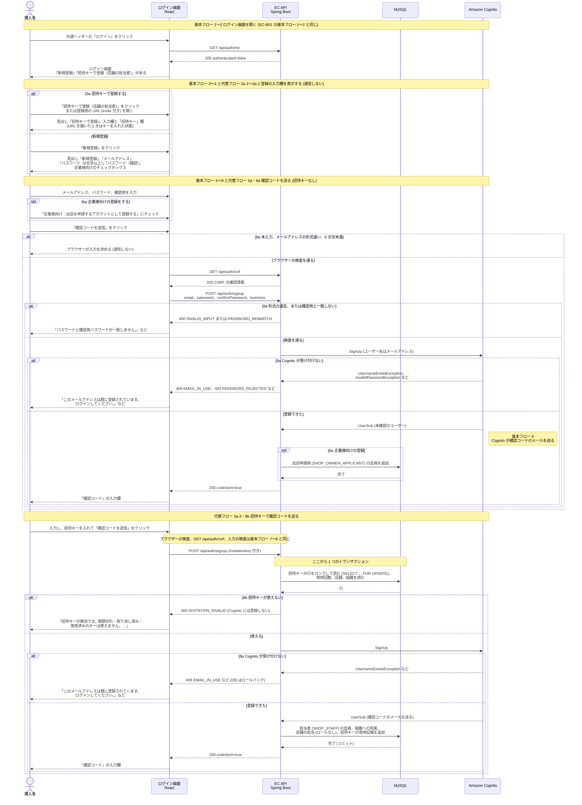
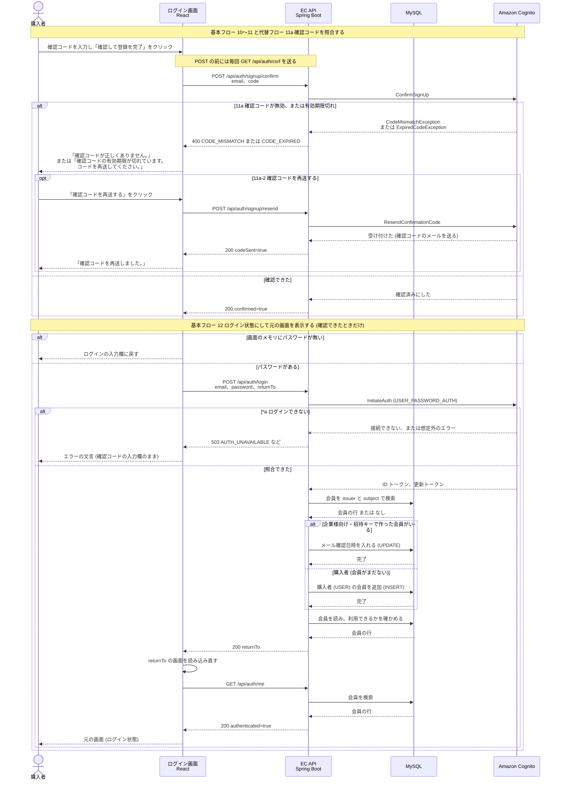
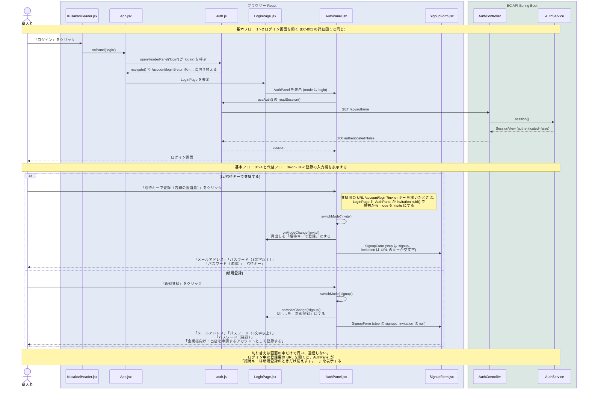
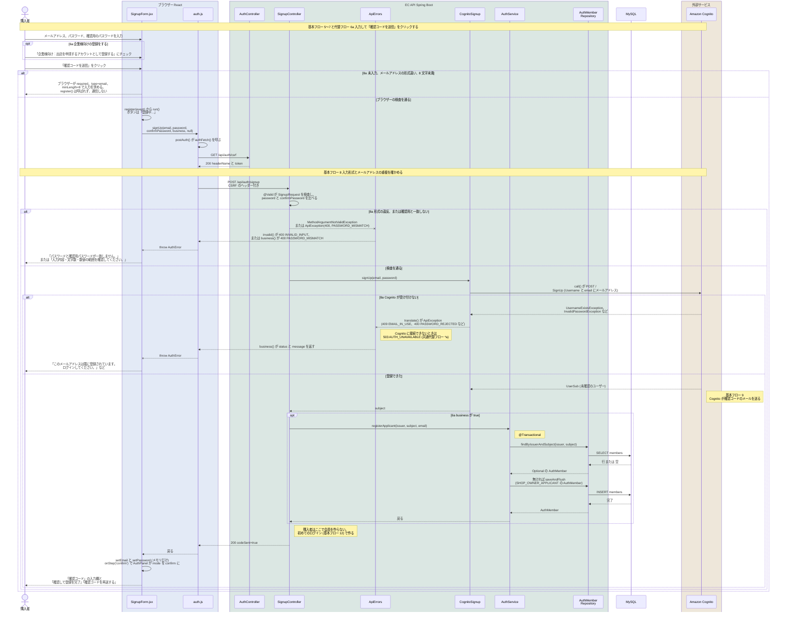
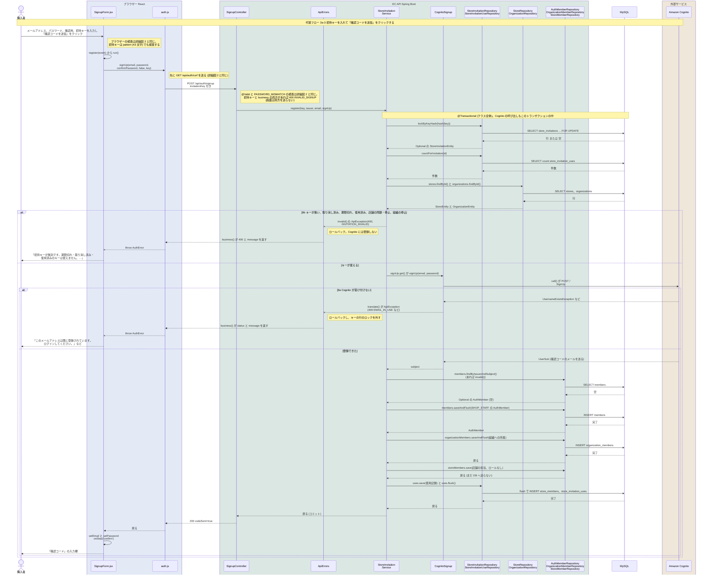
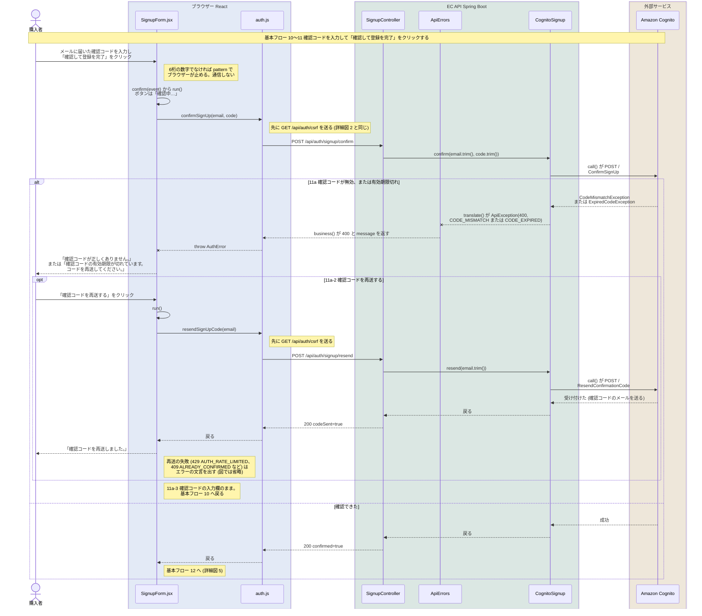
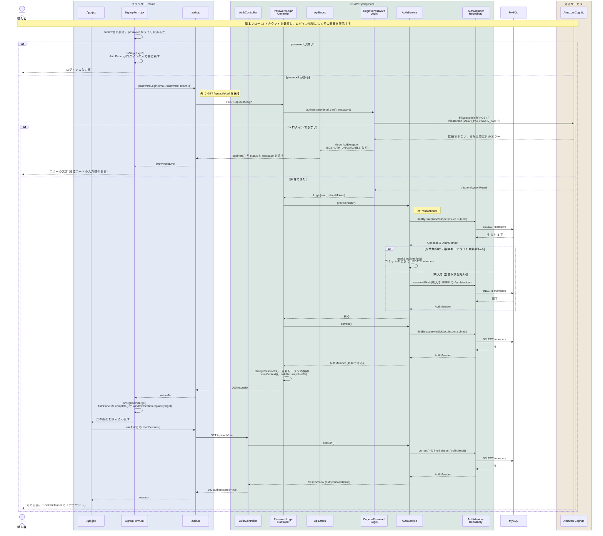

# EC-B16 一般アカウントを登録する

- ユースケース記述: [EC-B16_一般アカウントを登録する](<../../アーカイブ/ユースケース/kusakari-ec/EC-B16_一般アカウントを登録する.md>)
- 対象のコード: kusakari-ec の main（19a2be3、2026-11-20 時点）

新規登録は、ログイン画面（`/account/login`）のカードの中で入力欄を切り替えて行います。EC API が Amazon Cognito の `SignUp`、`ConfirmSignUp`、`ResendConfirmationCode` を呼び、確認コードが通ったら EC-B01 と同じ `POST /api/auth/login` でログインします。会員（`members` の行）を作る時点は、アカウントの種類で違います。

| 登録の方法 | 会員を作る時点 | `account_type` |
| --- | --- | --- |
| 通常の登録 | 確認コードのあとのログイン（`provision()`） | `USER` |
| 企業様向けの登録（6a） | 確認コードの送信（`registerApplicant()`） | `SHOP_OWNER_APPLICANT` |
| 招待キーでの登録（3a） | 確認コードの送信（`StoreInvitationService.register()`） | `SHOP_STAFF` |

## 概要図

### 概要図 1 基本フロー 1〜9、代替フロー 3a・6a・8a・8b

### 概要図 2 基本フロー 10〜12、代替フロー 11a

## 詳細図

### 詳細図 1 基本フロー 1〜4、代替フロー 3a-1〜3a-2 登録の入力欄を表示する

### 詳細図 2 基本フロー 5〜9、代替フロー 6a・8a（招待キーなし）

### 詳細図 3 代替フロー 3a-3・8b 招待キーで確認コードを送る

### 詳細図 4 基本フロー 10〜11、代替フロー 11a 確認コードを照合する

### 詳細図 5 基本フロー 12 ログイン状態にして元の画面を表示する

## ユースケース記述との差

- 8・8a: 「8文字以上」の検査は、まずブラウザーが入力欄の `minLength={8}` で止め、通信しません。サーバーの `SignupRequest` の `@Size(min = 8)` を通らない値は、400 `INVALID_INPUT`「入力内容・文字数・数値の範囲を確認してください。」になります。記述の「パスワードが条件を満たしていません。8文字以上で入力してください。」は、Cognito が `InvalidPasswordException` を返したときの文言です。EC の `infra/cognito/kusakari-ec-terraform/main.tf` のパスワードポリシーは 8 文字以上だけなので、画面から操作する限り、この文言はふつう出ません。
- 8: メールアドレスの重複は EC の DB ではなく、Cognito の `SignUp`（`UsernameExistsException`）で確かめます。
- 8a: 記述にない応答があります。Cognito が新規登録を受け付けないとき 503 `AUTH_UNAVAILABLE`「現在、新規登録を受け付けていません。」、確認コードのメールを送れないとき 503 `CODE_DELIVERY_FAILED`「確認コードを送信できませんでした。メールアドレスを確認してください。」、試行が多いとき 429 `AUTH_RATE_LIMITED` です。
- 9: 確認コードのメールは、EC のコードではなく Cognito が送ります。
- 12: 購入者の会員（`members` の行）は、登録のときではなく、確認コードのあとのログイン（`POST /api/auth/login` の `provision()`）で作ります。企業様向けと招待キーの会員は、基本フロー 8〜9 の `POST /api/auth/signup` で作り、確認のあとのログインでメール確認日時を入れます。
- 3a-3: 招待キーで登録すると、`members` のほかに `organization_members`（組織への所属）、`store_members`（店舗の担当、ロールなし）、`store_invitation_uses`（キーの使用記録）を、Cognito への登録と同じトランザクションで作ります。キーの行は `SELECT ... FOR UPDATE` でロックし、使用回数の上限を超えないようにしています。
- 11a: 記述にない応答があります。409 `ALREADY_CONFIRMED`「このアカウントは確認済みです。ログインしてください。」と、429 `AUTH_RATE_LIMITED`「試行回数が多すぎます。時間をおいて再試行してください。」です。
- 12: 確認のあとのログインに失敗すると（503 `AUTH_UNAVAILABLE` など）、確認コードの入力欄のままエラーを出します。アカウントはもう確認済みなので、もう一度「確認して登録を完了」を押すと 409 `ALREADY_CONFIRMED` になります。「ログインに戻る」からログインし直す必要があります。記述にない枝です。
- Cognito への登録のあとで DB への保存に失敗すると（503 `DATABASE_UNAVAILABLE` など）、Cognito に未確認のユーザーだけが残ります（`StoreInvitationService.register()` のコメントにも書かれています）。同じメールアドレスで登録し直すと 409 `EMAIL_IN_USE` になります。そのままログインして確認コードを入れると、`provision()` が購入者（`USER`）として会員を作り、企業様向けや招待キーの種類にはなりません。記述にない失敗の扱いです。
- 共通代替フロー *a: ブラウザーから EC API に届かないときは、`postAuth()` が例外を言い換えないため、ブラウザーが出す `TypeError` の文言がそのまま表示されます（EC-B01 と同じ）。

## 確かめられなかったこと

- 確認コードのメールの送信、文面、コードの有効期限、再送の回数の上限は、Cognito の機能と User Pool の設定で決まり、コードでは確かめられません。EC の `infra/cognito/kusakari-ec-terraform/main.tf` では `auto_verified_attributes = ["email"]` ですが、実際の User Pool は kusakari-terraform で管理しており、その設定とパスワードポリシーは確かめていません。
- 6a・8a の画面でブラウザーが出す入力の文言は、ブラウザーと言語の設定で変わります。

## 参照したコード

- [packages/site-header/KusakariHeader.jsx](https://github.com/abeouga/kusakari-ec/blob/19a2be307ee71a2cd87e538236c3c8c42929c5b3/packages/site-header/KusakariHeader.jsx): `panelAction()`、「ログイン」ボタン
- [frontend/src/App.jsx](https://github.com/abeouga/kusakari-ec/blob/19a2be307ee71a2cd87e538236c3c8c42929c5b3/frontend/src/App.jsx): `openHeaderPanel()`、`/account/login` で `LoginPage` を返す条件
- [frontend/src/auth.js](https://github.com/abeouga/kusakari-ec/blob/19a2be307ee71a2cd87e538236c3c8c42929c5b3/frontend/src/auth.js): `login()`、`readSession()`、`authFetch()`、`postAuth()`、`signUp()`、`confirmSignUp()`、`resendSignUpCode()`、`passwordLogin()`
- [frontend/src/components/LoginPage.jsx](https://github.com/abeouga/kusakari-ec/blob/19a2be307ee71a2cd87e538236c3c8c42929c5b3/frontend/src/components/LoginPage.jsx): `headings`、`invitationInUrl()` での初期の mode
- [frontend/src/components/AuthPanel.jsx](https://github.com/abeouga/kusakari-ec/blob/19a2be307ee71a2cd87e538236c3c8c42929c5b3/frontend/src/components/AuthPanel.jsx): `invitationInUrl()`、`switchMode()`、`complete()`、`SignupForm` に渡す値、ログイン中の招待キーの文言
- [frontend/src/components/SignupForm.jsx](https://github.com/abeouga/kusakari-ec/blob/19a2be307ee71a2cd87e538236c3c8c42929c5b3/frontend/src/components/SignupForm.jsx): `register()`、`confirm()`、`run()`、`invitationPattern`、入力欄の `required`・`minLength`・`pattern`、「確認コードを再送する」
- [frontend/src/workspace/StoreInvitations.jsx](https://github.com/abeouga/kusakari-ec/blob/19a2be307ee71a2cd87e538236c3c8c42929c5b3/frontend/src/workspace/StoreInvitations.jsx): 登録用 URL（`/account/login?invite=`）
- [backend/src/main/java/jp/kusakari/ec/auth/AuthController.java](https://github.com/abeouga/kusakari-ec/blob/19a2be307ee71a2cd87e538236c3c8c42929c5b3/backend/src/main/java/jp/kusakari/ec/auth/AuthController.java): `me()`、`csrf()`
- [backend/src/main/java/jp/kusakari/ec/auth/SignupController.java](https://github.com/abeouga/kusakari-ec/blob/19a2be307ee71a2cd87e538236c3c8c42929c5b3/backend/src/main/java/jp/kusakari/ec/auth/SignupController.java): `signUp()`、`confirm()`、`resend()`、`SignupRequest`、`ConfirmRequest`
- [backend/src/main/java/jp/kusakari/ec/auth/CognitoSignup.java](https://github.com/abeouga/kusakari-ec/blob/19a2be307ee71a2cd87e538236c3c8c42929c5b3/backend/src/main/java/jp/kusakari/ec/auth/CognitoSignup.java): `signUp()`、`confirm()`、`resend()`、`call()`、`translate()`
- [backend/src/main/java/jp/kusakari/ec/store/service/StoreInvitationService.java](https://github.com/abeouga/kusakari-ec/blob/19a2be307ee71a2cd87e538236c3c8c42929c5b3/backend/src/main/java/jp/kusakari/ec/store/service/StoreInvitationService.java): `register()`、`invalid()`、`hash()`
- [backend/src/main/java/jp/kusakari/ec/store/persistence/entity/StoreInvitationEntity.java](https://github.com/abeouga/kusakari-ec/blob/19a2be307ee71a2cd87e538236c3c8c42929c5b3/backend/src/main/java/jp/kusakari/ec/store/persistence/entity/StoreInvitationEntity.java): `usable()`
- [backend/src/main/java/jp/kusakari/ec/store/persistence/repository/StoreInvitationRepository.java](https://github.com/abeouga/kusakari-ec/blob/19a2be307ee71a2cd87e538236c3c8c42929c5b3/backend/src/main/java/jp/kusakari/ec/store/persistence/repository/StoreInvitationRepository.java): `lockByKeyHash()`
- [backend/src/main/java/jp/kusakari/ec/store/persistence/repository/StoreInvitationUseRepository.java](https://github.com/abeouga/kusakari-ec/blob/19a2be307ee71a2cd87e538236c3c8c42929c5b3/backend/src/main/java/jp/kusakari/ec/store/persistence/repository/StoreInvitationUseRepository.java): `countForInvitation()`
- [backend/src/main/java/jp/kusakari/ec/catalog/persistence/repository/StoreRepository.java](https://github.com/abeouga/kusakari-ec/blob/19a2be307ee71a2cd87e538236c3c8c42929c5b3/backend/src/main/java/jp/kusakari/ec/catalog/persistence/repository/StoreRepository.java): `findById()`
- [backend/src/main/java/jp/kusakari/ec/store/persistence/repository/OrganizationRepository.java](https://github.com/abeouga/kusakari-ec/blob/19a2be307ee71a2cd87e538236c3c8c42929c5b3/backend/src/main/java/jp/kusakari/ec/store/persistence/repository/OrganizationRepository.java): `findById()`
- [backend/src/main/java/jp/kusakari/ec/store/persistence/repository/OrganizationMemberRepository.java](https://github.com/abeouga/kusakari-ec/blob/19a2be307ee71a2cd87e538236c3c8c42929c5b3/backend/src/main/java/jp/kusakari/ec/store/persistence/repository/OrganizationMemberRepository.java): `saveAndFlush()`
- [backend/src/main/java/jp/kusakari/ec/store/persistence/repository/StoreMemberRepository.java](https://github.com/abeouga/kusakari-ec/blob/19a2be307ee71a2cd87e538236c3c8c42929c5b3/backend/src/main/java/jp/kusakari/ec/store/persistence/repository/StoreMemberRepository.java): `save()`
- [backend/src/main/java/jp/kusakari/ec/auth/AuthService.java](https://github.com/abeouga/kusakari-ec/blob/19a2be307ee71a2cd87e538236c3c8c42929c5b3/backend/src/main/java/jp/kusakari/ec/auth/AuthService.java): `registerApplicant()`、`provision()`、`current()`、`session()`
- [backend/src/main/java/jp/kusakari/ec/auth/AuthMemberRepository.java](https://github.com/abeouga/kusakari-ec/blob/19a2be307ee71a2cd87e538236c3c8c42929c5b3/backend/src/main/java/jp/kusakari/ec/auth/AuthMemberRepository.java): `findByIssuerAndSubject()`
- [backend/src/main/java/jp/kusakari/ec/auth/PasswordLoginController.java](https://github.com/abeouga/kusakari-ec/blob/19a2be307ee71a2cd87e538236c3c8c42929c5b3/backend/src/main/java/jp/kusakari/ec/auth/PasswordLoginController.java): `login()`
- [backend/src/main/java/jp/kusakari/ec/auth/CognitoPasswordLogin.java](https://github.com/abeouga/kusakari-ec/blob/19a2be307ee71a2cd87e538236c3c8c42929c5b3/backend/src/main/java/jp/kusakari/ec/auth/CognitoPasswordLogin.java): `authenticate()`、`initiateAuth()`
- [backend/src/main/java/jp/kusakari/ec/common/web/ApiErrors.java](https://github.com/abeouga/kusakari-ec/blob/19a2be307ee71a2cd87e538236c3c8c42929c5b3/backend/src/main/java/jp/kusakari/ec/common/web/ApiErrors.java): `business()`、`invalid()`、`database()`
- [infra/cognito/kusakari-ec-terraform/main.tf](https://github.com/abeouga/kusakari-ec/blob/19a2be307ee71a2cd87e538236c3c8c42929c5b3/infra/cognito/kusakari-ec-terraform/main.tf): `password_policy`、`auto_verified_attributes`
- [docs/decisions/2026-11-09-signup-in-login-card.md](https://github.com/abeouga/kusakari-ec/blob/19a2be307ee71a2cd87e538236c3c8c42929c5b3/docs/decisions/2026-11-09-signup-in-login-card.md): ログインのカードの中で登録する決定
