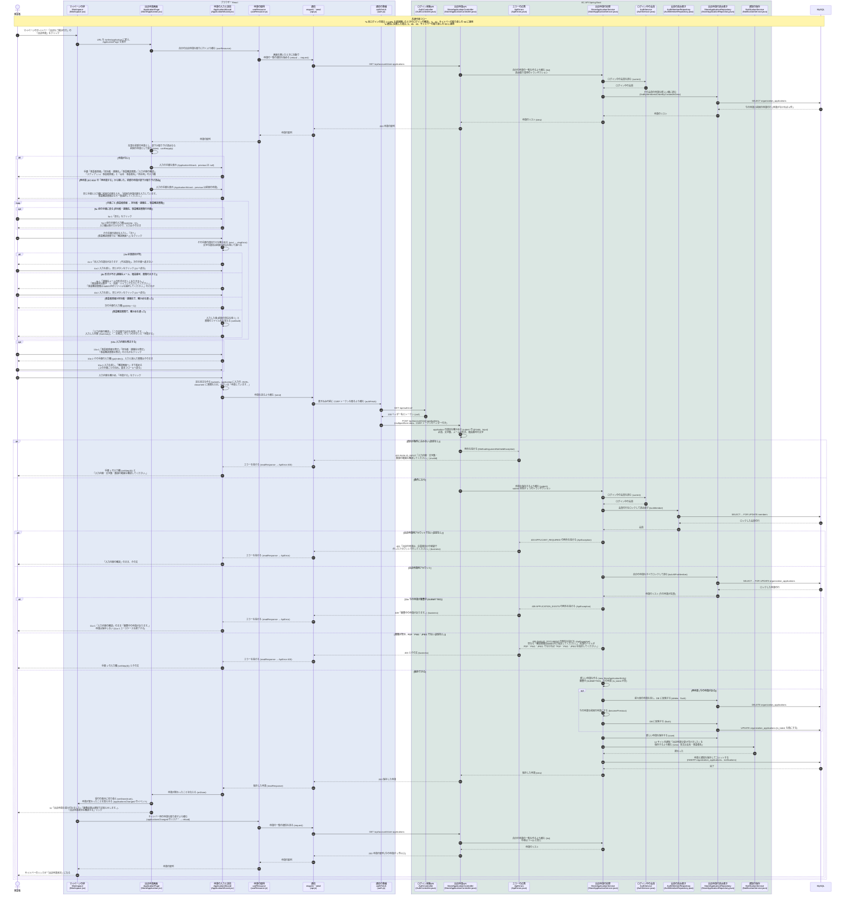
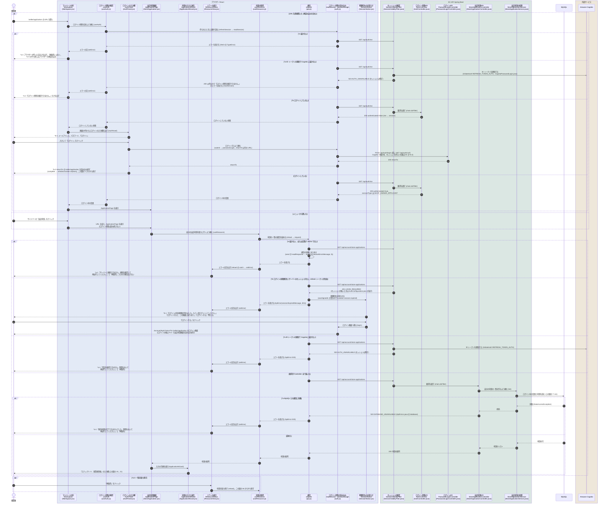
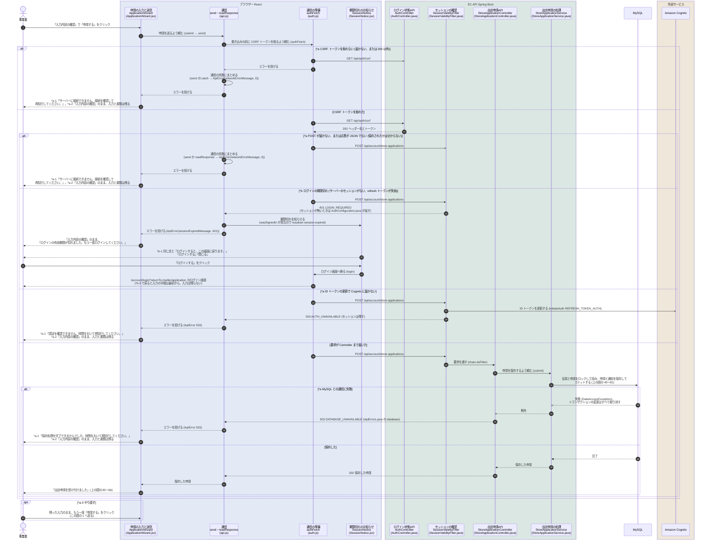

# EC-B17 出店の申請をする

- ユースケース記述: [EC-B17_出店の申請をする](<../../アーカイブ/ユースケース/kusakari-ec/EC-B17_出店の申請をする.md>)
- 共通代替フロー: [00_全ユースケース共通の代替フロー](<00_全ユースケース共通の代替フロー.md>)
- 対象のコード: kusakari-ec の main（6bad7e3、2026-11-24 時点）

## シーケンス図

参加者は、上から「画面や役割の名前」「コンポーネント・クラスの名前」「ファイル名（かっこ付き）」の順に書いています。
図は、EC-C01 でマイページを開いた後から始まります。マイページを開いたときに `Workspace` がサイドバー用に `GET /api/account/store-applications` で申請を読み、申請がまだないので、リンクは「出店申請」になっています。再申請（前回の申請が却下か取り下げ済み）のときはリンクが「出店申請状況」のままなので、EC-B18 の「再申請する」から同じ出店申請画面を開きます（図の 2 から同じ流れ）。
入力の手順と確認（基本フロー 3〜9）は画面の中だけで、通信しません。共通代替フローの中身は、00 の図か、下の「共通代替フローを直接書いた図」を見てください。

## 共通代替フローを直接書いた図

上の図の通信に、この画面で起こる共通代替フロー（\*a、\*b）を書き込んだ図です。画面を開いて申請を取る通信（上の図の 5）と、申請を送る通信（上の図の 40、42）に分けています。入力の手順と確認は通信しないので、共通代替フローは起こりません。申請を送った後にサイドバー用に取り直す通信（上の図の 90）は、\*a では画面にエラーを出さず、サイドバーのリンクが「出店申請」のまま残るだけです。\*b では「画面を開いて申請を取るとき」の \*b と同じ期限切れのお知らせが出ます。どちらも申請の受付の表示は変わらないので、図から省いています。

### 画面を開いて申請を取るとき

### 申請を送るとき

## ユースケース記述との差

- 関連情報は共通代替フロー \*b だけを挙げていますが、画面を開くときと申請を送るときの通信には \*a も起こります。申請を送る通信が失敗したときは、エラーの文を入力の手順の上（`ApplicationWizard` の `error`）に出し、「入力内容の確認」と入力・選んだ書類を残します。「再取得」のボタンはなく、やり直すには同じ「申請する」をもう一度押します。
- \*b で「ログインする」を選ぶと、`returnTo` の出店申請画面を読み込み直すので、入力の手順は最初（再申請なら前回の申請の内容）からになります。入力の途中だった内容は戻りません。
- 4b: 画面は書類の種類を調べません。ファイルの選択欄の `accept` で PDF・PNG・JPEG に絞るだけです。サーバーがファイルの先頭のバイトで調べ、合わなければ 400 `INVALID_DOCUMENT`「PDF・PNG・JPEGを指定してください。」を返します。記述の 4b にこの文はありません。
- 0 バイトのファイルは画面の確かめを通り、サーバーで 400 `INVALID_DOCUMENT`「確認書類は5MB以内で指定してください。」になります。空のファイルに 5MB の文が出ます。
- サーバーが 400 を返したときは、どの項目の誤りでも手順 1（事業者情報）に戻ります（`submit()` の `setStep(0)`）。書類の誤りでも、手順 3（事業確認書類）ではなく手順 1 が出ます。
- サーバーも項目を `@Valid` の `Input` で確かめ、合わなければ 400 `INVALID_INPUT` を返します。メールの形式は画面（`@` の前後に空白以外の文字があるか）とサーバー（`@Email`）で決まりが違うので、画面を通ってサーバーで止まることがあります。記述にない分岐です。
- 403 `APPLICANT_REQUIRED` は記述にありません。画面は出店申請用アカウントにだけ入力の手順を出すので、画面を開いた後に会員の種別が変わった場合に限られます。関連情報の「出店申請は、企業様向けに登録したアカウントで行います。…」は、画面（`notApplicant()`）が `accountType` を見て出す文で、このときは申請を読みに行きません。事前条件で外したので図には書いていません。
- 11a-2「ユースケースを終了する」: 画面は「入力内容の確認」のまま、ボタンも押せる状態で残ります。もう一度「申請する」を押しても、同じ 409 になります。
- 基本フロー 12 の通知は、申請と同じトランザクションで、応答を返す前に保存します。画面に「出店申請を受け付けました」が出る（基本フロー 11）より先に、通知は保存されています。
- 申請を送った後、サイドバーのリンクを「出店申請状況」に変えるために、`Workspace` が申請の一覧をもう一度取ります（`applicationsChanged` のイベント）。記述では EC-B18 の関連情報に、リンクの表示だけが書かれています。
- 再申請では、前々回の申請を消し、今の申請を前回の申請にしてから、新しい申請を保存します。記述では EC-B18 の関連情報に書かれています。
- 最新の申請が審査中か承認のときに出店申請画面を開くと、`useApplicationRoute()` が「出店申請状況」画面（`/seller/application/status`）に置き換えます。オーナー・担当者のアカウントなら「商品管理」画面（`/seller/products`）に置き換えます。事前条件で外したので図には書いていません。
- 5a: 手順 1 には「戻る」ボタンがありません（`step > 0` のときだけ出す）。

## 確かめられなかったこと

- 画面の確かめを通らずに 5MB を超えるファイルが届いた場合の応答です。`application.properties` の `spring.servlet.multipart.max-file-size=5MB` で Spring が先に止め、`ApiErrors.imageTooLarge()` が 413 `IMAGE_TOO_LARGE`「画像は1枚5MB以下にしてください。」を返すと読めますが、動かして確かめていません。

## 参照したコード

- [frontend/src/workspace/Workspace.jsx](https://github.com/abeouga/kusakari-ec/blob/6bad7e37c4135034fbe97e30309772fbe872e675/frontend/src/workspace/Workspace.jsx): `Workspace`（サイドバーの `applicationLink`、`applicationsChanged` のリスナー、未ログインの `AuthPanel`、`ApplicationPage` の表示）
- [frontend/src/workspace/WorkspaceSidebar.jsx](https://github.com/abeouga/kusakari-ec/blob/6bad7e37c4135034fbe97e30309772fbe872e675/frontend/src/workspace/WorkspaceSidebar.jsx): `MenuLink`
- [frontend/src/workspace/Common.jsx](https://github.com/abeouga/kusakari-ec/blob/6bad7e37c4135034fbe97e30309772fbe872e675/frontend/src/workspace/Common.jsx): `PageLink`
- [frontend/src/workspace/StoreApplication.jsx](https://github.com/abeouga/kusakari-ec/blob/6bad7e37c4135034fbe97e30309772fbe872e675/frontend/src/workspace/StoreApplication.jsx): `ApplicationPage`、`useApplicationRoute`、`notApplicant`、`canReapply`、`applicationsChanged`
- [frontend/src/workspace/ApplicationWizard.jsx](https://github.com/abeouga/kusakari-ec/blob/6bad7e37c4135034fbe97e30309772fbe872e675/frontend/src/workspace/ApplicationWizard.jsx): `ApplicationWizard`（`next`、`go`、`submit`、`setDraft`）、`stepError`、`Summary`
- [frontend/src/workspace/useResource.js](https://github.com/abeouga/kusakari-ec/blob/6bad7e37c4135034fbe97e30309772fbe872e675/frontend/src/workspace/useResource.js): `useResource`、`reload`
- [frontend/src/workspace/ResourceView.jsx](https://github.com/abeouga/kusakari-ec/blob/6bad7e37c4135034fbe97e30309772fbe872e675/frontend/src/workspace/ResourceView.jsx): `ResourceStatus`（エラーの文と「再取得」）
- [frontend/src/api.js](https://github.com/abeouga/kusakari-ec/blob/6bad7e37c4135034fbe97e30309772fbe872e675/frontend/src/api.js): `request`、`send`、`readResponse`、`ApiError`、`networkErrorMessage`、`sessionExpiredMessage`
- [frontend/src/auth.js](https://github.com/abeouga/kusakari-ec/blob/6bad7e37c4135034fbe97e30309772fbe872e675/frontend/src/auth.js): `authFetch`（`GET /api/auth/csrf`）、`readSession`、`passwordLogin`、`wasSignedIn`、`login`
- [frontend/src/useAuth.js](https://github.com/abeouga/kusakari-ec/blob/6bad7e37c4135034fbe97e30309772fbe872e675/frontend/src/useAuth.js): `useAuth`（`refreshSession`）
- [frontend/src/components/AuthPanel.jsx](https://github.com/abeouga/kusakari-ec/blob/6bad7e37c4135034fbe97e30309772fbe872e675/frontend/src/components/AuthPanel.jsx): `AuthPanel`（`submit`、`complete`）
- [frontend/src/components/SessionNotice.jsx](https://github.com/abeouga/kusakari-ec/blob/6bad7e37c4135034fbe97e30309772fbe872e675/frontend/src/components/SessionNotice.jsx): 期限切れのお知らせ
- [backend/src/main/java/jp/kusakari/ec/store/controller/StoreApplicationController.java](https://github.com/abeouga/kusakari-ec/blob/6bad7e37c4135034fbe97e30309772fbe872e675/backend/src/main/java/jp/kusakari/ec/store/controller/StoreApplicationController.java): `mine`、`submit`
- [backend/src/main/java/jp/kusakari/ec/store/service/StoreApplicationService.java](https://github.com/abeouga/kusakari-ec/blob/6bad7e37c4135034fbe97e30309772fbe872e675/backend/src/main/java/jp/kusakari/ec/store/service/StoreApplicationService.java): `Input`、`submit`、`list`、`view`
- [backend/src/main/java/jp/kusakari/ec/store/persistence/repository/StoreApplicationRepository.java](https://github.com/abeouga/kusakari-ec/blob/6bad7e37c4135034fbe97e30309772fbe872e675/backend/src/main/java/jp/kusakari/ec/store/persistence/repository/StoreApplicationRepository.java): `findByMemberIdOrderByCreatedAtDesc`、`lockAllForMember`（`@Lock(PESSIMISTIC_WRITE)`）
- [backend/src/main/java/jp/kusakari/ec/store/persistence/entity/StoreApplicationEntity.java](https://github.com/abeouga/kusakari-ec/blob/6bad7e37c4135034fbe97e30309772fbe872e675/backend/src/main/java/jp/kusakari/ec/store/persistence/entity/StoreApplicationEntity.java): `becomePrevious`、`status` と `latest` の初期値
- [backend/src/main/java/jp/kusakari/ec/auth/AuthMemberRepository.java](https://github.com/abeouga/kusakari-ec/blob/6bad7e37c4135034fbe97e30309772fbe872e675/backend/src/main/java/jp/kusakari/ec/auth/AuthMemberRepository.java): `lockMember`（`@Lock(PESSIMISTIC_WRITE)`）
- [backend/src/main/java/jp/kusakari/ec/notification/service/NotificationService.java](https://github.com/abeouga/kusakari-ec/blob/6bad7e37c4135034fbe97e30309772fbe872e675/backend/src/main/java/jp/kusakari/ec/notification/service/NotificationService.java): `send`
- [backend/src/main/java/jp/kusakari/ec/auth/AuthService.java](https://github.com/abeouga/kusakari-ec/blob/6bad7e37c4135034fbe97e30309772fbe872e675/backend/src/main/java/jp/kusakari/ec/auth/AuthService.java): `current`、`session`
- [backend/src/main/java/jp/kusakari/ec/auth/AuthController.java](https://github.com/abeouga/kusakari-ec/blob/6bad7e37c4135034fbe97e30309772fbe872e675/backend/src/main/java/jp/kusakari/ec/auth/AuthController.java): `me`、`csrf`
- [backend/src/main/java/jp/kusakari/ec/auth/PasswordLoginController.java](https://github.com/abeouga/kusakari-ec/blob/6bad7e37c4135034fbe97e30309772fbe872e675/backend/src/main/java/jp/kusakari/ec/auth/PasswordLoginController.java): `POST /api/auth/login`
- [backend/src/main/java/jp/kusakari/ec/auth/SessionValidityFilter.java](https://github.com/abeouga/kusakari-ec/blob/6bad7e37c4135034fbe97e30309772fbe872e675/backend/src/main/java/jp/kusakari/ec/auth/SessionValidityFilter.java): `doFilterInternal`（ID トークンの更新、401、503 のときはセッションを残す、`/api/auth/me` は 401 でも通す）
- [backend/src/main/java/jp/kusakari/ec/auth/CognitoPasswordLogin.java](https://github.com/abeouga/kusakari-ec/blob/6bad7e37c4135034fbe97e30309772fbe872e675/backend/src/main/java/jp/kusakari/ec/auth/CognitoPasswordLogin.java): ID トークンの更新、503 `AUTH_UNAVAILABLE`
- [backend/src/main/java/jp/kusakari/ec/auth/AuthConfiguration.java](https://github.com/abeouga/kusakari-ec/blob/6bad7e37c4135034fbe97e30309772fbe872e675/backend/src/main/java/jp/kusakari/ec/auth/AuthConfiguration.java): `authenticationEntryPoint`（401 `LOGIN_REQUIRED`）
- [backend/src/main/java/jp/kusakari/ec/common/web/ApiErrors.java](https://github.com/abeouga/kusakari-ec/blob/6bad7e37c4135034fbe97e30309772fbe872e675/backend/src/main/java/jp/kusakari/ec/common/web/ApiErrors.java): `business`、`invalid`、`database`、`imageTooLarge`
- [backend/src/main/resources/application.properties](https://github.com/abeouga/kusakari-ec/blob/6bad7e37c4135034fbe97e30309772fbe872e675/backend/src/main/resources/application.properties): `spring.servlet.multipart.max-file-size`
