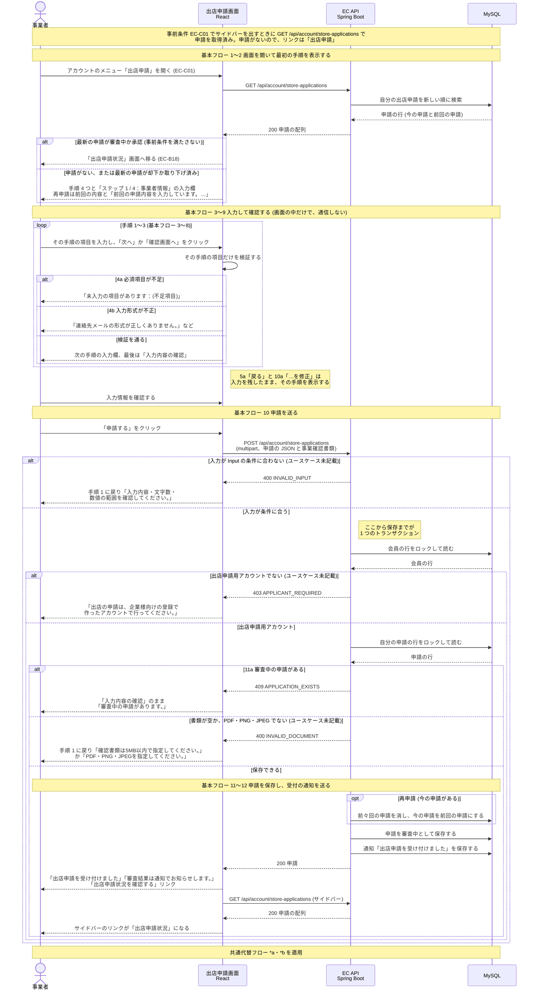
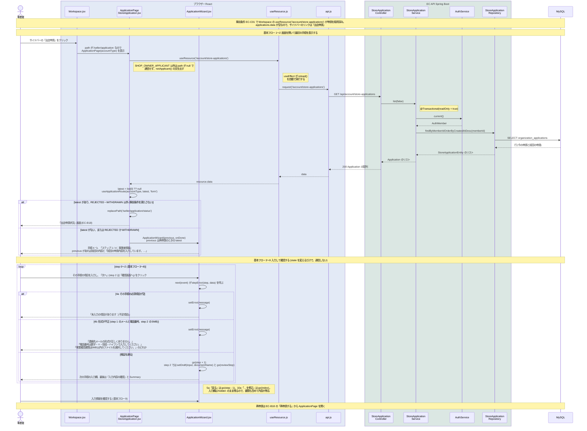
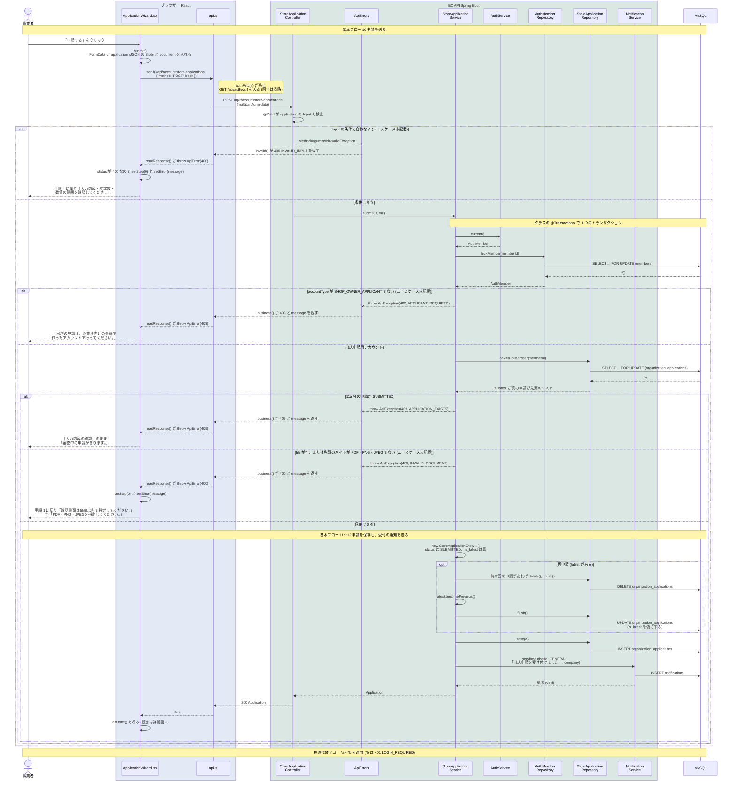
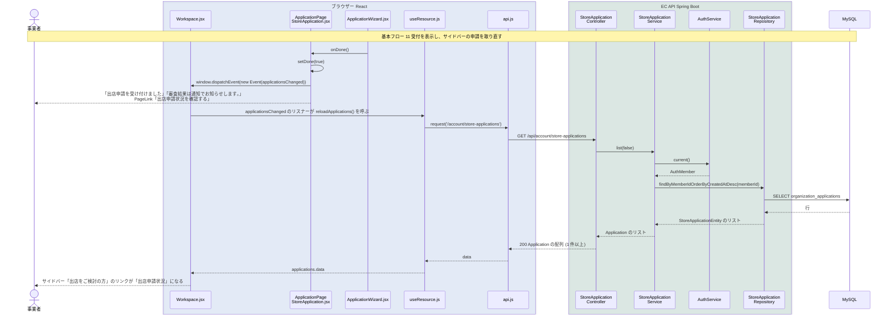

# EC-B17 出店の申請をする

- ユースケース記述: [EC-B17_出店の申請をする](<../../アーカイブ/ユースケース/kusakari-ec/EC-B17_出店の申請をする.md>)
- 対象のコード: kusakari-ec の main（19a2be3、2026-11-20 時点）

## 概要図

## 詳細図 1 基本フロー 1〜9

## 詳細図 2 基本フロー 10〜12

## 詳細図 3 基本フロー 11 の画面の表示

## ユースケース記述との差

- 4b の入力形式の検査に、書類の種類の検査がありません。画面はファイル選択の `accept` で PDF・PNG・JPEG を絞るだけで、`stepError()` では種類を調べません。サーバーがファイルの先頭のバイトで調べ、合わなければ 400「PDF・PNG・JPEGを指定してください。」を返します。記述の 4b にこの文はありません。
- 0 バイトのファイルは画面の検査を通り、サーバーで 400「確認書類は5MB以内で指定してください。」になります。空のファイルに 5MB の文が出ます。
- サーバーが 400 を返したときは、どの項目の誤りでも手順 1（事業者情報）に戻ります（`ApplicationWizard` の `submit()` の `setStep(0)`）。書類の誤りでも、手順 3（事業確認書類）ではなく手順 1 が出ます。
- 基本フロー 12 の通知は、申請の保存と同じトランザクションの中で、応答を返す前に保存します。画面に「出店申請を受け付けました」が出る（基本フロー 11）より先に、通知が保存されています。
- 403 `APPLICANT_REQUIRED` は記述にありません。画面は出店申請用アカウントにだけ入力欄を出すので、画面を開いたあとに会員の種別が変わった場合に限られます。ほかのアカウントで画面を開いたときの文（関連情報）は画面の `notApplicant()` の文で、サーバーの 403 の文とは違います。
- 申請を送ったあと、サイドバーのリンクを「出店申請状況」に変えるために、申請の一覧をもう一度取得します（`applicationsChanged` のイベント）。記述では EC-B18 の関連情報に、リンクの表示だけが書かれています。
- 画面を開いたとき、最新の申請が審査中か承認なら「出店申請状況」画面へ移り、店舗側のアカウント（オーナー・担当者）なら「商品管理」画面へ移ります（`useApplicationRoute()`）。EC-B18 の関連情報には「出店申請状況」画面の URL の場合だけが書かれています。

## 確かめられなかったこと

- 画面の検査を通らずに 5MB を超えるファイルが届いた場合の応答です。`application.properties` の `spring.servlet.multipart.max-file-size=5MB` で Spring が先に止め、`ApiErrors.imageTooLarge()` が 413 `IMAGE_TOO_LARGE`「画像は1枚5MB以下にしてください。」を返すと読めますが、動かして確かめていません。`StoreApplicationService.submit()` の `file.getSize() > 5 * 1024 * 1024` の検査まで届くことがあるかも確かめていません。

## 参照したコード

- [frontend/src/workspace/StoreApplication.jsx](https://github.com/abeouga/kusakari-ec/blob/19a2be307ee71a2cd87e538236c3c8c42929c5b3/frontend/src/workspace/StoreApplication.jsx): `ApplicationPage`、`useApplicationRoute()`、`notApplicant()`、`canReapply()`、`applicationsChanged`
- [frontend/src/workspace/ApplicationWizard.jsx](https://github.com/abeouga/kusakari-ec/blob/19a2be307ee71a2cd87e538236c3c8c42929c5b3/frontend/src/workspace/ApplicationWizard.jsx): `ApplicationWizard`、`next()`、`stepError()`、`go()`、`submit()`、`Summary`
- [frontend/src/workspace/Workspace.jsx](https://github.com/abeouga/kusakari-ec/blob/19a2be307ee71a2cd87e538236c3c8c42929c5b3/frontend/src/workspace/Workspace.jsx): サイドバーの `applicationLink`、`applicationsChanged` のリスナー、`ApplicationPage` の表示
- [frontend/src/workspace/useResource.js](https://github.com/abeouga/kusakari-ec/blob/19a2be307ee71a2cd87e538236c3c8c42929c5b3/frontend/src/workspace/useResource.js): `useResource()`、`reload()`
- [frontend/src/api.js](https://github.com/abeouga/kusakari-ec/blob/19a2be307ee71a2cd87e538236c3c8c42929c5b3/frontend/src/api.js): `request()`、`send()`、`readResponse()`
- [frontend/src/auth.js](https://github.com/abeouga/kusakari-ec/blob/19a2be307ee71a2cd87e538236c3c8c42929c5b3/frontend/src/auth.js): `authFetch()`
- [backend/src/main/java/jp/kusakari/ec/store/controller/StoreApplicationController.java](https://github.com/abeouga/kusakari-ec/blob/19a2be307ee71a2cd87e538236c3c8c42929c5b3/backend/src/main/java/jp/kusakari/ec/store/controller/StoreApplicationController.java): `mine()`、`submit()`
- [backend/src/main/java/jp/kusakari/ec/store/service/StoreApplicationService.java](https://github.com/abeouga/kusakari-ec/blob/19a2be307ee71a2cd87e538236c3c8c42929c5b3/backend/src/main/java/jp/kusakari/ec/store/service/StoreApplicationService.java): `Input`、`submit()`、`list()`
- [backend/src/main/java/jp/kusakari/ec/store/persistence/repository/StoreApplicationRepository.java](https://github.com/abeouga/kusakari-ec/blob/19a2be307ee71a2cd87e538236c3c8c42929c5b3/backend/src/main/java/jp/kusakari/ec/store/persistence/repository/StoreApplicationRepository.java): `findByMemberIdOrderByCreatedAtDesc()`、`lockAllForMember()`（`@Lock(PESSIMISTIC_WRITE)`）
- [backend/src/main/java/jp/kusakari/ec/store/persistence/entity/StoreApplicationEntity.java](https://github.com/abeouga/kusakari-ec/blob/19a2be307ee71a2cd87e538236c3c8c42929c5b3/backend/src/main/java/jp/kusakari/ec/store/persistence/entity/StoreApplicationEntity.java): `becomePrevious()`、`status` と `latest` の初期値
- [backend/src/main/java/jp/kusakari/ec/auth/AuthMemberRepository.java](https://github.com/abeouga/kusakari-ec/blob/19a2be307ee71a2cd87e538236c3c8c42929c5b3/backend/src/main/java/jp/kusakari/ec/auth/AuthMemberRepository.java): `lockMember()`（`@Lock(PESSIMISTIC_WRITE)`）
- [backend/src/main/java/jp/kusakari/ec/notification/service/NotificationService.java](https://github.com/abeouga/kusakari-ec/blob/19a2be307ee71a2cd87e538236c3c8c42929c5b3/backend/src/main/java/jp/kusakari/ec/notification/service/NotificationService.java): `send()`
- [backend/src/main/java/jp/kusakari/ec/auth/AuthService.java](https://github.com/abeouga/kusakari-ec/blob/19a2be307ee71a2cd87e538236c3c8c42929c5b3/backend/src/main/java/jp/kusakari/ec/auth/AuthService.java): `current()`
- [backend/src/main/java/jp/kusakari/ec/common/web/ApiErrors.java](https://github.com/abeouga/kusakari-ec/blob/19a2be307ee71a2cd87e538236c3c8c42929c5b3/backend/src/main/java/jp/kusakari/ec/common/web/ApiErrors.java): `business()`、`invalid()`、`imageTooLarge()`
- [backend/src/main/resources/application.properties](https://github.com/abeouga/kusakari-ec/blob/19a2be307ee71a2cd87e538236c3c8c42929c5b3/backend/src/main/resources/application.properties): `spring.servlet.multipart.max-file-size`
